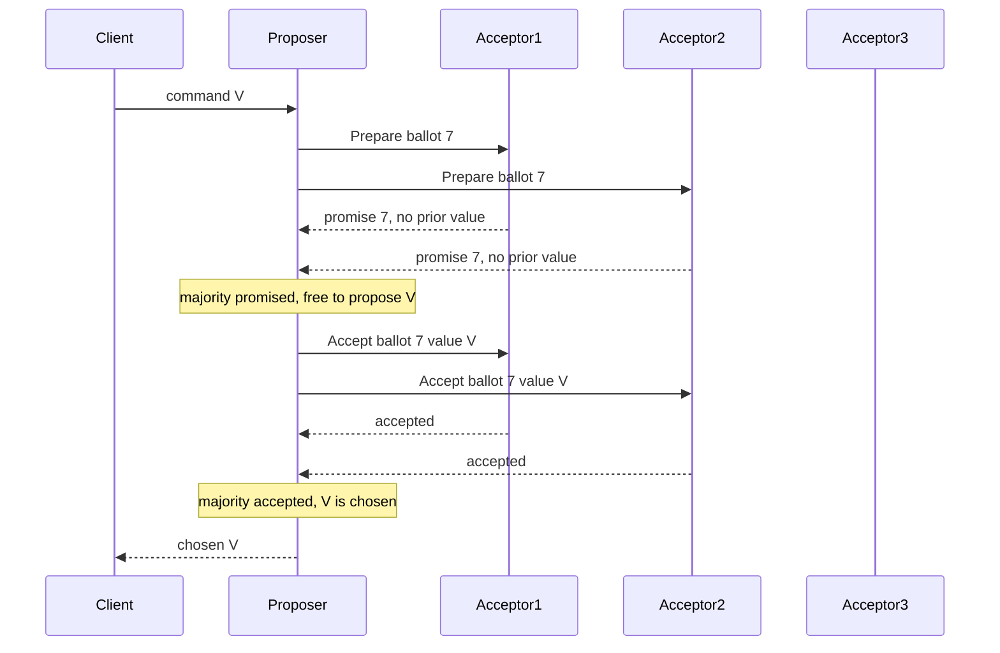

## Concept

### One decision, defined by a majority

Paxos gets a set of replicas to agree on a single value when processes crash, packets vanish, and delays have no bound. It does not make clocks honest, and it does not survive a replica that tells two peers different stories. The safety claim is small and absolute: once a value is chosen for an instance, no other value is ever chosen for that instance.

A value is chosen when a majority of acceptors have accepted it. Majority is the proof, not a tuning knob. Any two majorities of the same set share at least one acceptor. If two different values were both chosen, that shared acceptor would have accepted both, and the ballot rules forbid that. Drop the quorum below a majority and two partitions can choose different values. Demand every acceptor and a single crash freezes the instance.

The description uses three roles that production code usually collapses into one process. A proposer drives an instance by picking a ballot and talking to acceptors. An acceptor stores two facts: the highest ballot it has promised, and the highest-ballot proposal it has accepted. A learner is anyone who must act on the outcome, a state machine, a lock client, a config consumer. Learners do not vote. They act only after they have evidence of a majority, not after a single accept message.

### Phase 1: prepare, promise, and the forced value

The proposer chooses a ballot number strictly larger than any it has used. Ballots are totally ordered and unique across proposers. The usual construction is a pair of counter and proposer id, compared lexicographically so two proposers never share a number. The proposer sends Prepare for that ballot to a majority of acceptors.

An acceptor that has not already promised a higher ballot replies with a promise: it will refuse every proposal numbered below this ballot. The reply also carries the highest-numbered proposal the acceptor has already accepted, if any. That payload is the safety hinge. A proposer that recovers, or that starts late, must learn a value that might already be chosen and is then obligated to carry it forward. A promise with an empty history means this acceptor has not accepted anything yet.

If a majority promise, the proposer may enter phase 2, but it does not get to pick freely. Among the promises, if any acceptor reported a previously accepted proposal, the proposer must use the value attached to the highest ballot among those reports. Only when every promise in the majority reports no accepted value may the proposer supply its own client value. Substituting a fresher client write over a previously accepted value can unchoose a chosen value. That is the bug Paxos exists to prevent.

Phase 1 can fail without breaking safety. Too few promises, or a higher ballot appearing, means the proposer aborts and retries with a larger ballot. Uncoordinated retries are also why naive Paxos livelocks: two proposers leapfrog each other forever, each invalidating the other's accept phase. Safety is indifferent. Liveness needs a rule that lets one proposer run for a while.

### Phase 2: accept, chosen, and learned

The proposer sends Accept with the ballot and the forced value to a majority, usually the same acceptors that promised. An acceptor accepts if it has not promised a higher ballot in the meantime. On accept it stores the ballot and value, then acknowledges. When a majority have accepted the same ballot and value, that value is chosen. Chosen is a fact about acceptor state. There is no separate magic commit bit required for the definition, though learners still need a way to observe it.

Learners hear the outcome from the proposer, from acceptors, or from a distinguished learner that waits for a majority of accepts and then tells everyone else. Until a learner has majority evidence, the value is a rumor. A single accept, a leader's RAM, or a client's timeout is not a decision. Applying a rumor to a state machine is how replicas diverge while every log line looks locally fine.

The classic protocol decides one value. A replicated state machine needs a sequence of values, one per log slot. That is Multi-Paxos: an independent instance per slot, with ballots and a stable proposer shared across slots so you do not pay two round trips on every command. The single-decree protocol is the proof. The log is the product.

### Multi-Paxos, holes, and a long-lived ballot

Once a proposer has finished phase 1 for a ballot, it can reuse that ballot for many slots. Acceptors treat later Accept messages on the current ballot as appends. Phase 1 runs again when leadership is in doubt or a higher ballot appears. The "leader" is a proposer whose ballot is promised by a majority. It is not a lease unless you add a lease on top for reads or for client sessions.

Slots are not filled in order. A leader can get slot 12 chosen and crash before slot 11 has any accepted value. A new proposer's phase 1 replies reveal which slots already hold accepted proposals. It must finish those instances, proposing a no-op where nothing was accepted, before any replica executes slot 12. Execution is a contiguous prefix. The chosen set may be sparse. Applying max(slot seen) skips a hole and forks the state machine.

Membership is itself a log command. The set of acceptors that votes on slot n is the set chosen in an earlier slot. You cannot rewrite the majority that already chose a value. You can change who votes on later slots. If operators add a node and start counting it before the membership entry is chosen, two overlapping majorities can form and disagree. Treat membership as state-machine output.

### What the implementation has to persist

Acceptors write the promise and the accepted proposal to stable storage before they acknowledge. A reboot that forgets a promise can accept a conflicting lower ballot and join a different majority. That is silent disagreement, not a crash you can see in metrics. The disk flush sits on the commit path. Batching flushes across slots makes Multi-Paxos usable. Skipping the flush makes it wrong. Measure the flush. Do not delete it to hit a latency slide.

Learners need a durable identity for the chosen value of slot n, or enough accepted messages to reconstruct a majority. On restart, replay that record. Do not ask a peer for "current state" without a ballot and a slot, or you will adopt a rumor from a replica that is behind or partitioned.

Clients retry. Paxos chooses values. It does not know that two values are the same business operation. Every command that is not naturally idempotent needs a client id and a request id so a duplicated accept does not apply twice. The leader may commit and die before the client sees the reply. The retry must find the same log entry, not append a second one.

## Trade-offs

| Approach | When it wins | Cost / risk |
| -------- | ------------ | ----------- |
| Single-decree Paxos | One-shot choices: a lock owner, a config blob, a name | Two round trips per decision; livelock if proposers duel |
| Multi-Paxos with a stable leader | Replicated logs and lock services at production rate | Leader bottleneck; phase 1 paid again on failover |
| Fast path that skips phase 1 when uncontended | Low latency when collisions are rare | Collision recovery is a second protocol and easy to get wrong |
| Smaller witness set that still intersects | Tiny cells that want majority with less full-state disk | Witnesses must not silently become full acceptors |
| A Raft-shaped log on the same majority | Teams that must implement, test, and operate the log | Same disk and quorum costs; different vocabulary, same physics |

Single-decree Paxos is the right mental model and a poor default for a command log. Shared ballots, hole filling, and a stable proposer are not optional once you have more than one slot. Teams that "start simple" and add those later usually add them after the first divergence.

A stable leader is a latency and operations trade. Clients send to one place and followers append in order. The leader's disk, CPU, and network cap throughput. Across regions, every commit includes a majority round trip from that leader. Moving the leader toward the writers is an operational choice. The protocol does not do it for you. A minority partition that still contains the old leader cannot choose new values, which is the availability you accepted when you required a majority.

## Diagram

## Failure modes

### Dueling proposers

Two proposers keep issuing higher Prepare messages. Each majority promise invalidates the other proposer's Accept, so slots stop being chosen while disks and networks look idle. Detection is a ballot counter that climbs, leader-change metrics that never settle, and client timeouts with no commit progress.

Mitigation is a distinguished proposer: the previous leader if it is still in the majority, a stable preference such as lowest id after a backoff, or a randomized delay before a new Prepare. The protocol stays safe without this. It does not stay live. Production Multi-Paxos cells elect a leader and then hold the ballot.

### Forgotten promises after restart

An acceptor acknowledges Prepare or Accept, then loses that record. After restart it can accept a lower ballot and help choose a different value. Detection is ugly and late: a slot whose chosen value appears to change, checksum mismatches on catch-up, or two replicas that applied different commands at the same index.

Mitigation is a write-ahead record of the promised ballot even when no value has been accepted, flushed before the RPC returns. Crash-inject that path in tests. A memory replica of a disk another process can format is not an acceptor.

### Executing through a hole

A new leader sees slot 20 chosen and starts the state machine there while slot 19 is still unknown. Detection is an applied-index jump, or state checksums that diverge after failover. Mitigation is to finish every gap with the previously accepted value or a no-op, then apply only a contiguous prefix. Learners track a commit watermark, not the maximum slot they have heard about.

### Membership that splits the majority

Operators add a voter and start counting it before the old majority has chosen the membership change, or they remove two voters at once. Detection is two leaders, or a cell that cannot elect after a planned edit. Mitigation is one membership change per chosen entry. The new set votes only on slots after that entry. Never form a majority from a mix of old and new sets that was never itself chosen.

## Real-world example

Google Chubby is a Multi-Paxos lock service, not a general database. A cell is a small set of replicas, typically five, holding a tiny replicated database of files and advisory locks. One replica is master. Clients talk to the master. Lock acquire, file write, and session keep-alive are sequenced through Paxos so the cell has one history.

Clients cache file contents and lock state and drop that cache when the session ends. The cache is why Chubby can sit under higher-level masters without serving every data-plane read. If the master is partitioned from a client, the session expires and cached locks are lost. That lease is fencing on top of Paxos. It does not replace the majority.

The operational lesson is the useful one. A correct protocol is still disks, session timeouts, and operators who will try to replace two replicas in one window. Cell size stays small because majority latency and membership care grow with the replica count. Chubby decides which few bytes name the owner of a coarse lock. The systems that need scale sit above that decision.

## What to remember

- A value is chosen only when a majority of acceptors have accepted it; intersecting majorities are the safety argument.
- After phase 1, the proposer must carry forward the highest-ballot accepted value it was told about, not a fresher client value.
- Multi-Paxos reuses a ballot across slots; apply a contiguous prefix and fill holes, never a sparse maximum slot.
- Flush promises before acknowledging, and treat membership as a chosen log entry or you will create two majorities.
