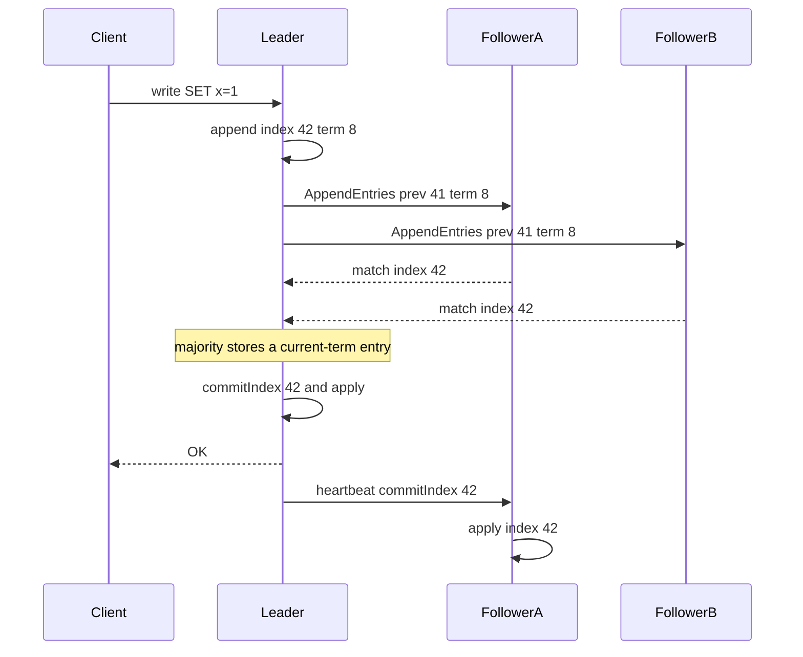

## Concept

### Terms, roles, and the one-leader rule

Raft is a replicated log with a strong leader. Time is split into terms. A term has at most one leader. Every RPC carries a term. A replica that sees a higher term steps down immediately. That rule kills a large family of split-brain bugs in which an old leader keeps appending after the cluster has moved on.

Three roles: follower, candidate, leader. Followers answer RPCs. If a follower hears nothing valid before its election timeout, it becomes a candidate, increments its term, votes for itself, and sends RequestVote. A candidate that wins votes from a majority of the current voting membership becomes leader and starts AppendEntries heartbeats. A candidate that sees a higher term, or that loses, returns to follower.

Only the leader accepts client writes. It assigns the next index, appends locally, and replicates. Followers do not invent entries. That restriction is why Raft is easier to explain than a free-for-all of Paxos proposers. The cost is availability shape: a minority partition that still holds the old leader cannot commit, and the majority side must elect someone else before writes resume.

### Election safety and the log check

A follower grants its vote only if it has not voted in this term and the candidate's log is at least as up to date as its own. Up to date means comparing the pair of last-log term and last-log index. A shorter log from a newer term beats a longer log from an older term. The check exists so a replica that missed recent commits cannot win an election and then overwrite them.

Randomized election timeouts are a liveness trick that works in practice. If every follower times out together, they split the vote and nobody wins. Jitter makes it likely that one candidate asks while the others are still followers and will vote for it. Coordinated pauses still cause split votes. Timeouts must sit above your pause and disk tails, not above the median.

Pre-vote is the production extra round. A replica asks whether a majority would vote for it without incrementing the term. If the leader is still alive, pre-vote fails and the term stays put. Without pre-vote, a partitioned replica increments terms forever and, on rejoin, forces a healthy leader to step down. That is a self-inflicted outage. Serious Raft libraries turn pre-vote on.

### Log matching and the commit rule

If two logs contain an entry at the same index with the same term, the prefixes through that index are identical. The leader enforces this on every append. AppendEntries carries the previous index and previous term. The follower rejects the RPC if its log does not match there. The leader then walks the probe index backward for that follower until it finds a match, and the follower deletes the conflicting suffix.

That repair is how a former leader's uncommitted tail disappears. Those entries were never committed, so replacing them is legal. Committed entries are ones that reached a majority. The subtle rule: the leader advances commitIndex only for an entry from its current term once a majority stores it. It must not mark an older-term entry committed merely because a new majority happens to store a copy. Once a current-term entry commits, every preceding entry is committed too, because of log matching. Skip the current-term restriction and a later election can legally overwrite something you already told a client succeeded.

Followers apply entries in order up to commitIndex. That applied prefix is the state clients may treat as done. Reading the leader's uncommitted tail is reading a guess. Linearizable reads need a round trip that confirms the leader still holds the term, or a lease shorter than the clock drift you are willing to bet. The read-index path records commitIndex, heartbeats a majority, then waits until the state machine has applied through that index. A no-op append also works and costs a log entry.

### Snapshots, flow control, and membership

The log cannot grow without bound. Once a prefix is applied, the leader can snapshot the state machine and truncate the log. A lagging follower then installs the snapshot and replays the tail. Snapshot install is its own failure domain: truncating the log before the snapshot is durable leaves a replica that cannot catch up and cannot vote honestly. Persist snapshot metadata and the truncation together.

The leader commits on a majority, so a single slow follower must not stall the commit index. Pipeline AppendEntries, batch entries, and bound in-flight bytes per follower. You still cannot ignore a majority of slow disks. If two of three voters fsync slowly, commit latency is that slowness. Flow control that waits for every follower, including a learner across a bad link, turns Raft into the speed of the worst peer.

Membership is the remaining sharp edge. Adding or removing one voter at a time keeps old and new majorities overlapping. Joint consensus, the original membership change, replicates a transitional configuration that needs a majority of the old set and a majority of the new set, then a second entry that installs the new set alone. Either design works if a node that is not in the current configuration does not vote. Bootstrap from an explicit initial membership written on every member. Three processes that each believe they are a singleton will elect three leaders.

### What clients owe the log

Clients find the leader. Followers redirect. Retries carry a client id and a request sequence so the same operation occupies at most one log index. The leader can commit and crash before the response. The client retries, the new leader finds the entry, and the state machine must not apply it twice.

A timeout is not a result. The write may be committed, uncommitted, or never appended. Idempotent retries are the API. Read-your-writes on the leader still needs the leadership check above if you promised linearizability. Sticky sessions to a follower are a stale read with better manners.

## Trade-offs

| Approach | When it wins | Cost / risk |
| -------- | ------------ | ----------- |
| Raft with a strong leader | Metadata stores, coordination, replicated state machines | Leader is the throughput cap; every write pays majority latency |
| Multi-Paxos with a freer proposer set | You already operate a Paxos cell and its tooling | Harder to implement and to explain during an incident |
| Leader leases for reads | Read-heavy workloads that can bound clock drift | A stale leader that does not step down before lease expiry serves illegal reads |
| Follower reads with no quorum check | Watches and dashboards that tolerate staleness | Not linearizable; easy to document as if it were |
| Pre-vote and jittered timeouts | Clusters with GC pauses and partial partitions | Elections are slightly slower; asynchrony can still prevent progress |

Raft is not a weaker Paxos. It is the log problem with one proposer per term and an explicit matching rule. You still flush before you acknowledge, you still need a majority, and a minority partition still cannot commit. The implementation budget moves from "did we invent a ballot incorrectly" to "did we violate commitIndex, truncation, or membership."

Five voters is the usual availability point: survive two failures, commit on three. Seven voters rarely pay for themselves inside one region. Cross-region voters buy a disaster story and add a wide-area round trip to every commit. Non-voting learners can serve stale reads or warm a replacement without joining the quorum. Do not let an operator panel call a learner a voter.

## Diagram

## Failure modes

### Split votes and term storms

A blip, a coordinated pause, or a disk stall that looks like leader death starts several candidates at once. They deny each other a majority. Detection is terms climbing, RequestVote rate spiking, and a commit index that sits still.

Mitigation is pre-vote, election timeouts above pause and fsync tails, and jitter. Cap how fast terms may increase. An unbounded term is a denial of service against your own cluster. Confirm the leader has actually failed to reach a majority before you step it down for a single missed heartbeat on one link.

### Acknowledging a write that never committed

The old leader, stuck in a minority, appends a client write, replicates it nowhere useful, and returns success because a bug skipped the commit rule. Detection is a success that vanishes after failover, or metrics that show two leaders. Mitigation is the spec: do not reply OK until commitIndex covers the entry in the current term. Fence any side effect outside the log with the term. Clients retry with an idempotency key and never treat a timeout as success.

### Truncating a committed prefix

A follower deletes a matching prefix, or a snapshot install returns before the snapshot hits disk, then the process crashes. Detection is AppendEntries rejected forever, or a snapshot checksum failure on load. Mitigation is never truncating at or below the committed index, persisting snapshot and truncation as one record, and honoring the previous-index check on every append. A replica that cannot install a snapshot should leave the voter set before it blocks a majority.

### Membership arithmetic

Adding two voters in one step, auto-promoting a learner, or counting a replaced disk as a second member changes what "majority" means without a chosen configuration. Detection is a cluster that cannot elect after a planned change, or two leaders from two configs. Mitigation is one voter change per committed configuration, an on-disk initial membership, and a startup refusal when flags and the stored config disagree.

## Real-world example

etcd stores Kubernetes control-plane state in a Raft log. A typical cluster is three or five voters. A pod object, a lease, or an election key becomes a log entry. The state machine is a multi-version key space with revisions. Linearizable reads go to the leader and use a read index so the leader cannot answer from a term it has already lost.

Kubernetes treats that commit as a fence. A node heartbeat lease is only a token if etcd committed it and the next writer observes the new revision. Controllers that get, modify, and put rely on a compare on mod-revision inside a transaction. That compare sits on the Raft-ordered store. If etcd loses quorum, the API server stops confirming writes. Waiting is the correct failure. Inventing a second cluster state is the outage.

fsync latency on the write-ahead log is commit latency. A slow disk on the leader stalls the cell even when followers are fine. A slow disk on one of five voters often does not, because the majority is three. Defragmentation and learners exist because both the log and the key backend grow. Raft names the failure domain: lose quorum, or corrupt the log. It does not remove either one.

## What to remember

- A term has at most one leader; a higher term means step down, and a vote requires an up-to-date log.
- Matching on previous index and term, plus committing only a current-term entry replicated to a majority, is what makes failover safe.
- Linearizable reads need a majority check or a lease; the leader's memory is not proof of leadership.
- Pre-vote, flush-before-ack, idempotent clients, and one membership change at a time are the production protocol.
