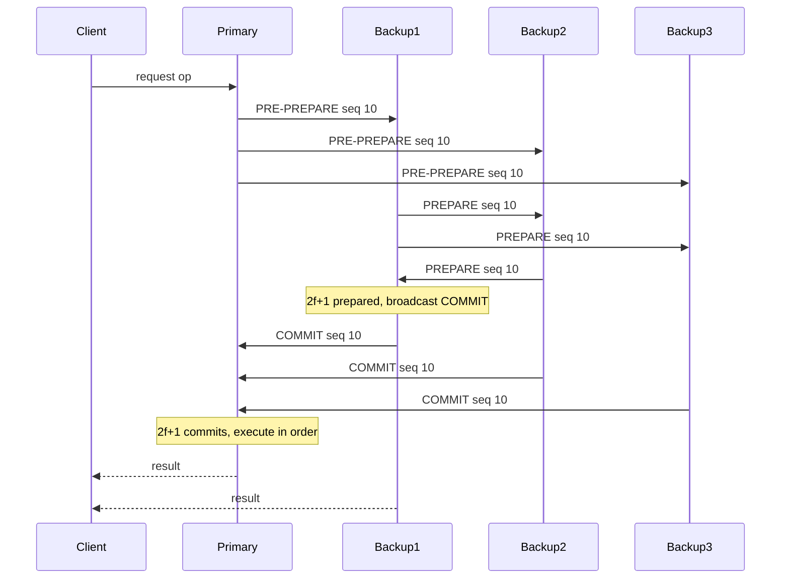

## Concept

### Crash faults are the wrong threat model

Paxos and Raft assume a replica fails by stopping or by going silent. It does not send one history to peer A and a different history to peer B, forge another replica's identity, or sign two values for the same slot. That model fits processes you deploy, disks you own, and networks that drop packets. It does not fit a compromised host, a structured corruption bug, or a participant in a consortium who benefits from lying.

Byzantine faults cover the liar who still holds a valid key and still answers RPCs. Majority intersection no longer saves you, because the liar can sit in both majorities and tell each a different story. Honest replicas need a quorum large enough that the liars cannot outvote them and cannot erase a decision by refusing to speak.

Practical Byzantine Fault Tolerance is the classic protocol for a small, known set of replicas. It is a replicated state machine, not an open blockchain. With n = 3f + 1 replicas, at most f may be Byzantine. Honest replicas are assumed to be able to communicate eventually. Signatures, or authenticators built from message authentication codes, bind each message to its sender so a liar cannot impersonate an honest node.

### Why the quorum is 2f + 1

Crash-fault replication uses 2f + 1 replicas so that f crashes still leave a majority of the original set. Byzantine replication must outvote f liars and also tolerate f liars who simply do not answer. The smallest set that works is 3f + 1. A quorum of 2f + 1 then contains at least f + 1 honest replicas. Two such quorums intersect in at least f + 1 replicas, so the intersection contains at least one honest replica. That honest replica is what carries the real assignment of request to sequence number from one view into the next.

Five replicas give you f = 1. One compromised member is tolerated. Two are not. Adding machines without raising the advertised f does nothing if you still wait for a quorum sized for a smaller f, and it hurts if you wait for a larger quorum than the formula allows. A Raft-style witness that does not hold full state is not a PBFT replica. Every voting replica verifies and stores the protocol messages.

### Pre-prepare, prepare, and commit

A view has a primary, selected from the replica set by a deterministic rule, often view number modulo n. The client sends a request to the primary. The primary assigns a sequence number and broadcasts PRE-PREPARE with the view, the sequence, and a digest of the request. Honest backups accept that pre-prepare when they are in the view, the sequence is free, and the digest matches a request they have seen. They then broadcast PREPARE.

A replica that holds the pre-prepare plus 2f matching prepares from other replicas has a prepared certificate: 2f + 1 agreeing messages in total, counting itself. Prepared means honest replicas have seen the same request assigned to the same sequence in this view. The replica then broadcasts COMMIT. When it collects 2f + 1 matching commits, the request is committed locally and may be executed in sequence order.

The third phase exists because prepared is local to a view. A view change can still replace a request that was only prepared. Commit is what forces the next primary to keep it. A design that stops at a signed majority vote and then lets the new primary start from an empty log will drop a request some honest replica already executed. Clients wait for f + 1 matching replies. One reply can be the liar. f + 1 identical results include at least one honest replica.

### View change

Backups start a timer on the request. If the primary is slow, silent, or equivocating, they broadcast VIEW-CHANGE carrying the prepared certificates they know. The new primary waits for 2f + 1 view-change messages, builds the set of requests that any previous view had prepared, and broadcasts NEW-VIEW with the proof. Honest replicas check that proof. They do not trust the new primary's bare word.

The invariant is the whole protocol: if any honest replica committed a request, that commit had 2f + 1 commits behind it, so enough honest replicas hold a prepared certificate that the next primary is forced to include the request. If the request never committed, the new view may order something else. Clients retransmit. View change is where implementations historically go wrong, because the proof object is large and the corner cases are partitions mid-commit.

### Checkpoints, clients, and what you still do not get

Replicas periodically agree on a stable sequence watermark and a digest of the state there, then discard older protocol messages. Without checkpoints, view-change messages grow without bound and a rejoining replica cannot be caught up. The checkpoint itself needs a quorum. Garbage-collecting early resurrects the same class of bug as dropping a prepared certificate.

PBFT does not create an open membership. Who may vote is a configuration, usually operator-signed. A Byzantine client can submit garbage, but the garbage is still totally ordered; execution must reject it deterministically so honest replicas stay together. The protocol also assumes timeouts do not mark honest-but-slow replicas as faulty forever. If your bound is a fantasy, you will view-change in a loop and call the result an attack.

Cryptography sits on the hot path. Every prepare and commit is checked. Classic PBFT is all-to-all, so message count grows with the square of n. For f = 1 that is tolerable. For f = 2 you already have seven replicas shouting. Later protocols change the message pattern. They do not change the 3f + 1 bound if the threat model stays the same.

## Trade-offs

| Approach | When it wins | Cost / risk |
| -------- | ------------ | ----------- |
| Crash-fault Raft or Paxos | Replicas inside one administrative domain | A compromised host or a lying bug can equivocate and split history |
| Classic three-phase PBFT | Small, permissioned, named replica sets | Quadratic messages; view-change complexity; f is only (n - 1) / 3 |
| BFT with a collector or threshold signatures | Larger n where all-to-all chatter dominates CPU | New cryptography and pipelining bugs; the quorum bound remains |
| Open membership with economic penalties | Unknown or rotating participants | A different security budget; not a drop-in state machine for five hosts |
| Crash-fault consensus plus attestation and checksums | The realistic risk is a bug or a stolen disk, not a conspiring peer | A stolen signing key still equivocates |

Use crash-fault consensus inside a trust boundary you control. Use Byzantine consensus when replicas are run by different organizations, or when one compromised voter must not be able to rewrite a prefix. Running PBFT on five processes you already root is a quadratic protocol bought for a threat you handle with Raft, disk checksums, and least privilege.

Message cost is the practical limit. Prepare and commit in the classic protocol are broadcasts. At modest request rates and n of seven or more, CPU spent on verification shows up before the state machine does. Pipelined designs and aggregated signatures change topology. If you need hundreds of voters, you have left the original PBFT deployment envelope and you need a different dissemination design, still sized around one-third faulty.

## Diagram

## Failure modes

### An equivocating primary

The primary sends two different pre-prepares for one sequence, or assigns one request two sequences, split across backups. Detection is conflicting digests for the same view and sequence once prepares are exchanged, and client replies that do not match. Mitigation is the prepare quorum: honest backups will not prepare both values, so at most one value gathers 2f + 1 prepares. The view-change proof must carry that certificate so a later primary cannot discard a value that already committed. Timeouts set tighter than your real network will manufacture view changes that look like this bug.

### A view change that drops a commit

The new-view builder omits a request an honest replica has already executed. Detection is two honest replicas with different state at the same sequence, or a client that collected f + 1 replies and then watches the effect disappear. Mitigation is a deterministic function from the set of view-change messages to the requests that must be redone, with prepared certificates as mandatory input. Test a replica that commits, partitions, and rejoins after several views. A blank log because "we timed out" is a safety bug.

### Spending the fault budget

Two of seven replicas are compromised while you advertised f = 2, or one of five while you advertised f = 1. They collude and the quorum math no longer holds. Detection may be absent until an external audit disagrees with the log. Mitigation is operational: diverse placements, key rotation, independent implementations if you can afford them, and alerts on conflicting signed messages. Nervousness does not increase f. If you cannot keep faulty replicas at or below f, you do not have a Byzantine-tolerant system, you have a hope.

### A primary that drops clients

The primary never assigns sequences. Backups look healthy. Clients time out. Mitigation is retransmission to all replicas, and a view-change trigger when backups see a request the primary will not pre-prepare. Backups also need hysteresis. A view change on every slow request produces a storm that stops execution just as effectively as a dead primary.

## Real-world example

Tendermint, the consensus engine behind Cosmos chains, is a PBFT descendant for a known validator set. A height has a proposer. Validators exchange prevotes and precommits, the operational cousins of prepare and commit. A block is committed when more than two-thirds of voting power precommits the same hash. That two-thirds is the 2f + 1 quorum expressed in stake: fewer than one-third Byzantine voting power, and honest validators agree on one chain.

Public deployments make the cost visible. Validator sets are tens to low hundreds, so gossip and signature checks matter more than they do at n = 4. A validator that double-signs is not a crash. It is the Byzantine behavior crash-fault Raft never had a detector for, and the protocol's evidence is two conflicting votes from one key. Clients trust a commit carrying a two-thirds proof, not a single node's HTTP response. The application executes only committed blocks.

A multi-organization settlement log has this shape: named voters, a one-third fault budget, three phases, and a round change when the proposer fails. An internal metadata store does not. There you want Raft, a short list of who may vote, and the complexity budget spent on backups and access control.

## What to remember

- Liars equivocate, so a crash-fault majority is not enough; you need n = 3f + 1 and quorums of 2f + 1.
- Pre-prepare, prepare, and commit exist so a decision survives a view change, not merely a vote inside the current view.
- Clients wait for f + 1 matching replies, because one plausible answer can be the faulty replica.
- Use Byzantine consensus across trust boundaries; inside one domain, Raft plus least privilege is the default.
