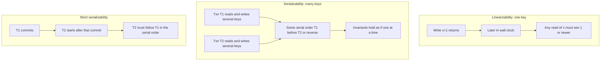

## Concept

### Linearizability is a single-object real-time contract

Linearizability is a correctness condition on a *single object* (a register, a key, a lock, a queue) that is accessed by concurrent operations. Each operation occupies a real-time interval from invocation to response. Linearizability says there exists a total order of those operations, consistent with their sequential specification, such that if operation A finishes before operation B starts, then A precedes B in that order.

The practical reading: once a write has returned, every subsequent read, on any client, must see it or a later write. There is a single point in real time, the linearization point, where the operation "happens." You may not return a stale value after a newer value has been acknowledged. You may not show a write to one client and hide it from another who started later.

Example. Register `x` starts at 0. Client A writes `1` and gets OK at time t1. Client B starts a read after t1. B must return 1 (or a value written after A's write). Returning 0 is a linearizability violation even if B's replica has not heard the write. This is why a load balancer that hits a random replica of an asynchronously replicated store is not a linearizable register.

Linearizability composes: if every object is linearizable, the system of objects is linearizable. That is unusual and useful. It is why you can reason about a linearizable key-value API one key at a time.

### Serializability is a multi-object transaction contract

Serializability is a correctness condition on *transactions* that each touch multiple objects. A history is serializable if it is equivalent to some serial (one-at-a-time) execution of those transactions. There is no built-in real-time constraint. A serial order may legally put transaction T2 before T1 even if T1 committed first in wall-clock time, as long as their reads and writes match that serial order.

Example. Accounts `A` and `B` each hold 100. T1 reads both and transfers 20 from A to B. T2 reads both and transfers 20 from B to A. Serializability allows T1 then T2, or T2 then T1. Both end at 100/100 or 80/120 depending on order, but neither sees a torn pair such as A=80 and B=100 with both transfers "done." The invariant "sum is 200" holds.

Serializability does not, by itself, prevent this: T1 commits, a client starts T3 after seeing T1's commit, and T3 is placed *before* T1 in the serial order. That client observed a commit that later appears not to have happened yet. That is allowed under plain serializability. It is not allowed under *strict* serializability (sometimes called serializability plus linearizability of the commit order, or "external consistency").

### Strict serializability sits on top of both

Strict serializability requires a serial order that also respects real-time commit order: if T1 commits before T2 starts, T1 precedes T2 in the serial order. Spanner calls this external consistency. A linearizable key-value store that only offers single-key operations is strictly serializable for those operations because each operation is a transaction on one object. A serializable database that uses local timestamps without a global clock may not be strict: a transaction in region B can miss a transaction that already committed in region A.

When people say "I need transactions," they often mean strict serializability. When they say "I need a consistent read after write," they often mean linearizability of a register. Mixing the words is how a team buys a serializable isolation level and still ships a stale-read bug on a single row.

### How systems actually provide them

Linearizable registers are typically a consensus log per key or per shard: Raft or Multi-Paxos, with reads that confirm leadership. ZooKeeper's `sync` plus read, etcd's linearizable read index, and Chubby file reads after a write are this family. Asynchronous replication with "read from any replica" is sequential or eventual, not linearizable.

Serializable transactions are typically concurrency control: two-phase locking, optimistic validation (SSI), or deterministic ordering (Calvin). Distributed serializability additionally needs a way to agree on a global order: two-phase commit over Paxos groups, synchronized clocks with commit wait, or a sequencer. Serializability without a global clock is easier inside one database process than across continents.

You can have linearizable single-key ops without serializable multi-key transactions (Dynamo-style with per-key quorums, no cross-key transactions). You can have serializable transactions that are not linearizable at the commit boundary (some snapshot systems, some async commit paths). You can have both: Spanner, FoundationDB, a correctly configured serializable Postgres on one primary.

### Examples that separate the two

Lost update on one key is a linearizability (or at least serializability-of-that-key) failure. Two read-modify-writes on `x` both see 7 and both write 8. The sequential spec of a register does not allow that.

Write skew on two keys can be serializable-isolation failure while each key remains linearizable. Two doctors, one on call each, both read "count of on-call = 1" and both go off duty. Each row write is a perfectly linearizable update. The pair of transactions is not equivalent to any serial execution that preserves "at least one on call." Snapshot isolation allows it; serializability does not.

Session "read your writes" is weaker than linearizability. Sticky sessions to one replica give you your writes and still allow another client to miss them. Linearizability is a global real-time constraint, not a session one.

## Trade-offs

| Approach | When it wins | Cost / risk |
| -------- | ------------ | ----------- |
| Linearizable single-key consensus | Locks, config, leader election, counters | Cross-key invariants are the application's problem |
| Serializable local transactions | Invariants over many rows on one primary | Failover and scale-out need extra machinery |
| Strict serializability, globally | Multi-row, multi-region business truth | WAN latency, clocks or 2PC, expensive reads |
| Snapshot isolation | Read-mostly OLTP with rare write-write | Write skew; not serializable |
| Eventual / causal per key | High availability, AP stores | No real-time read-after-write across clients |

Do not pay for strict global serializability to protect a single feature flag. Do not run a linearizable lock service and then store the actual money in an eventually consistent table and claim the system is "consistent." The contract is per API.

Read latency is the hidden bill. Linearizable reads need a majority or a lease. Serializable snapshot reads can be cheap until they are not (conflict, retry). Strict serializability in a WAN either waits on clocks (TrueTime commit wait) or on a coordinator. If the product can tolerate bounded staleness, offer a stale-read API explicitly rather than quietly weakening the default.

## Diagram

## Failure modes

### Stale read advertised as linearizable

A replica serves a read from its local applied index without confirming the leader still holds the term. Detection is a test: write, then immediately read from another client or another replica, and observe the old value. Jepsen-style histories catch this; unit tests against one node do not.

Mitigation is a read index or lease, or routing all linearizable reads to a leader that heartbeats a majority first. Name the weaker API `bounded_staleness` so callers cannot confuse it.

### Serializable isolation that is not strict

A geographically distributed SQL database commits T1 in region A. A client in region B starts T2, does not see T1, and makes a decision. Detection is causal violations in application logs: "we showed the user a paid invoice, then a later transaction priced as unpaid."

Mitigation is strict serializability (commit wait, or reading at a timestamp guaranteed after the commit) or an application-level barrier: pass a commit timestamp to the next request. Do not assume `SERIALIZABLE` in the SQL sense includes real-time across regions unless the vendor says external consistency.

### Composing linearizable shards and losing serializability

Each shard is a Raft group. A transaction writes shard 1 then shard 2 without a commit protocol. Detection is partial outcomes: shard 1 has the write, shard 2 does not, after a crash. Each shard was linearizable. The transaction was not atomic, hence not serializable.

Mitigation is 2PC over the groups, a deterministic sequencer, or making the multi-shard operation idempotent and recoverable. Linearizable parts do not add up to a serializable whole unless you add a transaction protocol.

### Session stickiness mistaken for a global contract

A sticky load balancer hides replica lag from one user and not from another. Detection is support tickets: "my teammate does not see my edit." Mitigation is either linearizable reads for that path or an explicit "eventual, refresh" UX. Stickiness is a performance trick, not a consistency level.

## Real-world example

Spanner's advertised contract is external consistency: a global strict serializability for transactions. Reads and writes across rows and regions behave as if there is a single serial log that respects real-time commit order. The implementation is Paxos per shard (directory/group), two-phase commit across groups, and TrueTime so commit timestamps do not invert causality. A linearizable read of a single row is the degenerate transaction. A multi-row payment is the general one.

That is a different product from ZooKeeper. ZooKeeper gives you linearizable watches and updates on znodes, not multi-object serializable transactions. You can build a lock with it. You cannot run a bank transfer as one ZooKeeper transaction across two accounts unless you encode both in one znode or you add your own atomic protocol. Teams that moved "coordination" to etcd or ZooKeeper and "data" to an eventually consistent store sometimes rediscover this split in production: the lock is linearizable, the data is not, and the combination is neither a linearizable register nor a serializable transaction.

When you evaluate a database, ask two questions separately. Is a single-key read after a single-key write linearizable? Are multi-row transactions strictly serializable, merely serializable, snapshot isolated, or something weaker? The marketing word "consistent" will not distinguish them.

## What to remember

- Linearizability: one object, real-time order; a completed write is visible to every later read.
- Serializability: many objects, some serial order of transactions; no torn multi-row state.
- Strict serializability (external consistency) is both: serial order respects real-time commit order.
- Linearizable shards plus no transaction protocol do not give you serializable multi-shard updates.
