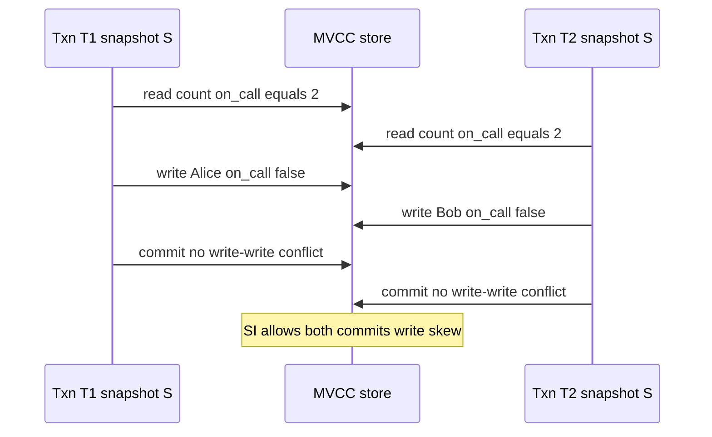

## Concept

### What a snapshot actually freezes

Snapshot isolation (SI) gives each transaction a consistent view of the database as of some snapshot timestamp, and it prevents lost updates on the same item. Reads do not take shared locks in the usual implementation. They read the latest committed version that is visible to the snapshot. Writes create new versions. When two concurrent transactions write the same row, one fails: first-committer-wins, or a write-write conflict at commit.

MVCC is the usual engine. Every row version carries a creation transaction id (or timestamp) and, once overwritten, a deletion or next-version id. A reader with snapshot `T` ignores versions created after `T` and versions whose deleting transaction committed before `T` in a way that makes them invisible. Vacuum and compaction exist because those versions accumulate.

The snapshot is a set of committed transactions, not a moment on a wall clock, unless your system assigns timestamps that way. In PostgreSQL the snapshot is a set of in-progress xids plus `xmin`/`xmax`. In a timestamp-ordered store it is "all commits with timestamp ≤ t." Either way, the reader is insulated from concurrent writers. That is why SI reads scale, and why SI is the default people actually want when they say "I do not want dirty reads."

### What SI prevents, and what it does not

SI prevents dirty reads: you never see uncommitted data. It prevents non-repeatable reads of the same row in the same transaction, because the snapshot does not move. It prevents lost updates on a single item: two concurrent `UPDATE account SET balance = balance - 10` against the same row collide on the version, and one retries.

It does not prevent write skew. Write skew is a serializability violation under SI: two transactions read overlapping state, each writes a *different* item, and both commit, even though no serial order of the two transactions would produce both writes. There is no write-write conflict on a common row, so SI is satisfied. The multi-row invariant is not.

### Write skew, with the on-call example

Two doctors are on call. The invariant is that at least one doctor remains on call. Transaction T1 reads the count of on-call doctors, sees two, and sets Alice to off-call. Transaction T2 concurrently reads the same count, sees two, and sets Bob to off-call. Each transaction wrote a different row. First-committer-wins does not fire. Both commit. Zero doctors are on call.

The serial executions are: T1 then T2, in which T2 would see one on-call doctor and should abort; or T2 then T1, symmetrically. SI allowed a history that is not equivalent to either. Each single-row write could even be linearizable. The *transaction pair* is the bug.

The same shape appears in: "only one of these two flags may be true," "inventory of size-class X plus Y must stay ≥ 0 when we decrement different SKUs," "a user may not hold two conflicting roles if we update role rows separately," and "materialize a unique business constraint by reading a count and inserting another row." If the constraint is not enforced by a unique index or an explicit lock on a common row, SI will not save you.

### Predicate conflicts versus item conflicts

Write-write detection is item-based: the same primary key. Write skew is often predicate-based: both transactions evaluated `SELECT count(*) FROM doctors WHERE on_call` and then updated a row in that set. Serializable isolation must treat the predicate as something that cannot change underfoot in a way that invalidates the decision.

PostgreSQL's serializable snapshot isolation (SSI) tracks SIREAD locks: a read of a range or index records a predicate dependency. If a concurrent write lands in that predicate and commit order would create a dangerous structure (a cycle in the serialization graph, in practice a pivot with two rw-antidependencies), one transaction aborts with a serialization failure. That is not the same as `SELECT FOR UPDATE` on every row you read. It is an extra dependency tracker on top of SI.

You can also prevent specific skews without full serializability: lock a sentinel row for the invariant (`on_call_guard`), use a unique constraint that physically cannot hold two zeros, or `SELECT ... FOR UPDATE` the rows you might update. Those are local cuffs. They do not make the rest of the schema serializable.

### Commit-time checks and retries

SI and SSI assume the application retries serialization failures and unique-constraint failures. A transaction that "must succeed" on the first try is specifying a different product. Under SSI, abort rates climb with contention on hot predicates. That is the cost of the invariant. Under SI, abort rates stay low and the invariant quietly dies.

Read-only transactions on a snapshot are cheap and, in SI, always serializable with respect to each other if they do not write. The danger is a read-only transaction that *informs a later write in another transaction* (application-level write skew). The database cannot see that unless the write happens in the same transaction as the read.

## Trade-offs

| Approach | When it wins | Cost / risk |
| -------- | ------------ | ----------- |
| Snapshot isolation | Read-heavy OLTP, rare colliding row writes | Write skew on multi-row invariants |
| Serializable SI (SSI) | Postgres-style OLTP that needs invariants | Serialization aborts; predicate tracking cost |
| Strict 2PL serializable | Simple mental model, no skew | Blocking, deadlocks, read locks on every access |
| Application locks / sentinels | A few known invariants | Easy to miss a path; does not compose |
| Unique indexes and exclusion constraints | Invariants expressible as uniqueness | Not every invariant is a unique key |

SI is the right default when the schema's true invariants are unique keys and single-row updates. Banking-style "all of these rows together" wants serializable or an explicit protocol. Promoting every service to SSI because it sounds safer can be correct and still fail SLO: abort/retry storms on a hot range.

Do not mix isolation levels inside one invariant. A transaction at SI that maintains "at least one on call" cannot be rescued by another transaction at serializable that sometimes runs. The weak participant wins. Set the level on the connection for the whole unit of work, and test concurrent histories, not single-threaded fixtures.

## Diagram

## Failure modes

### Silent invariant breakage under SI

The on-call count hits zero, or two overlapping coupons apply, with no error in application logs. Detection is an invariant monitor: a periodic query that the constraint still holds, plus audit of committed row versions. You will not see it in a unit test that runs transactions sequentially.

Mitigation is SSI for that workload, a unique or exclusion constraint that makes the bad state unrepresentable, or a sentinel row locked in every writer. Add a regression test that starts two concurrent transactions in the skew pattern and asserts that one aborts or the invariant holds.

### Serialization abort storms under SSI

A hot predicate (a popular account, a single inventory row class, a global counter table) causes `40001` retries to dominate latency. Detection is a rise in serialization failure errors correlated with QPS on one index range, not with disk saturation.

Mitigation is shrinking transactions, avoiding full-table predicate reads, partitioning the hot invariant, or moving that hotspot to a single-row compare-and-set with retries. SSI is not a reason to scan large ranges inside a writer.

### Application-level skew across requests

Request 1 reads a snapshot and returns "you may book." Request 2, a new transaction, writes the booking. Two users pass the check. Detection is overbooking metrics. Mitigation is doing the check and the write in one serializable transaction, or using a reservation row with a unique slot. The database cannot serialize two HTTP requests it never saw as one transaction.

### Vacuum and snapshot too old

Long-running snapshots pin versions. Writers bloat. Eventually reads fail or performance collapses. Detection is wraparound warnings, `snapshot too old`, or table bloat dashboards. Mitigation is bounded transaction time, moving long analytics off the OLTP snapshot, and aggressive but safe vacuum. SI's beauty (readers do not block writers) becomes a storage leak if snapshots live for hours.

## Real-world example

PostgreSQL's default isolation is read committed, not SI. Repeatable read in PostgreSQL is snapshot isolation: a stable snapshot, write-write conflicts on the same row, and write skew allowed. Serializable enables SSI. That distinction is not academic. A large fraction of production "repeatable read" services are running SI and do not know they can skew.

The classic demonstration still works on Postgres: two sessions, `BEGIN ISOLATION LEVEL REPEATABLE READ`, each reads `SELECT count(*) FROM doctors WHERE on_call`, each updates a different doctor, both commit. With `SERIALIZABLE`, one session receives a serialization failure and must retry. With a unique partial index or a constraint table, you can sometimes make the bad state impossible even under SI.

Teams that moved from a single-node Postgres primary to a distributed SQL database inherit this question again. Some vendors implement SI per region and serializability only within a partition. Some implement SSI-like detection with extra WAN cost. Read the isolation chapter, then write a skew test against the production isolation level, not against a local Docker default. The engine will not infer your on-call invariant from a comment in the schema.

## What to remember

- Snapshot isolation gives a consistent MVCC view and blocks lost updates on the same row, not all serializability anomalies.
- Write skew is two transactions writing different items after reading a shared predicate; SI will commit both.
- SSI, sentinel locks, or uniqueness constraints close skew; retry is part of the API.
- A check in one request and a write in another is not one transaction; the database will not invent that boundary.
