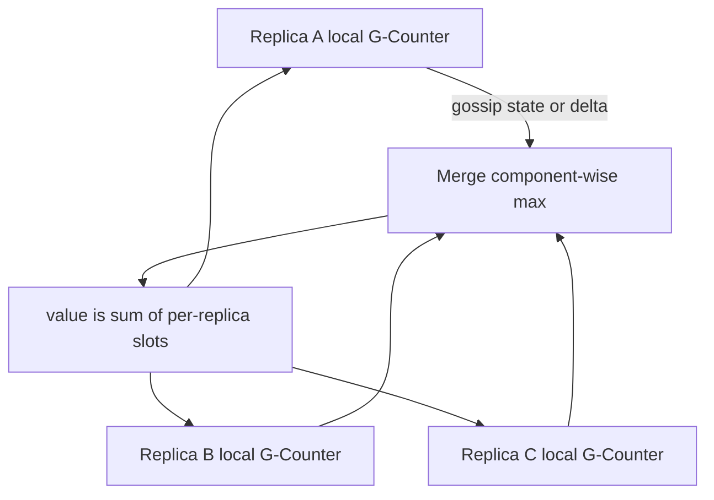

## Concept

### Convergence without a leader

A conflict-free replicated data type (CRDT) is a replicated object whose concurrent updates commute, or whose states merge through a join that is commutative, associative, and idempotent. Replicas may accept writes while partitioned. When they exchange state or operations later, they reach the same value without a central arbiter and without aborting a client. That is the point: availability of writes under partition, with a defined merge, instead of a consensus round trip.

This is not "last writer wins on the whole document" unless you chose a register that is exactly that. LWW is one CRDT. So is a G-Counter. So is an observed-remove set. The type is the contract. If the merge is "we concatenate JSON and hope," you do not have a CRDT. You have a conflict.

Two presentation styles appear in implementations. *State-based* (CvRDT) replicas gossip their full local state; the merge function is a least-upper-bound on a join-semilattice. Sending state twice is harmless. *Operation-based* (CmRDT) replicas broadcast operations that must be delivered at-least-once and, for some types, in causal order; applying an op twice must not double-count, so ops are idempotent or tagged with unique ids. Most production stores look state-based at the wire (send a blob, merge) even when the blob is a compressed op log.

### Counters and registers

A G-Counter (grow-only) is a vector of per-replica integers. Replica `i` may increment only its own slot. Merge is component-wise max, or component-wise sum if you ship deltas carefully; the common form is max of each slot, and the value is the sum of slots. Two replicas incrementing concurrently cannot clobber each other because they write different components.

A PN-Counter is two G-Counters, one for increments and one for decrements. The value is their difference. You cannot prevent a negative total unless you add a side protocol. The type allows it.

A LWW-Register stores a `(timestamp, value)` and merge takes the greater timestamp, with a replica id tie-break. Concurrent writes: one of them disappears. That is specified, not a bug. If disappearing is unacceptable, do not use a register; use a multi-value register (MV-Register) that keeps all concurrent values until an application picks, which is what Dynamo-style sibling values are.

A MV-Register is a set of `(dot, value)` pairs, where a dot is `(replica, counter)`. Merge unions concurrent dots and strips dots dominated by a causal history. The application must still resolve siblings. CRDTs do not invent business meaning.

### Sets and maps

A G-Set is a grow-only set: add-only, merge is union. A 2P-Set keeps an add set and a remove set; once removed, an element cannot return. That is the tombstone forever.

An OR-Set (observed-remove) tags each add with a unique id. Remove deletes only the ids the remover has observed. Concurrent add and remove of the same element: the add that was not observed survives, so "add-wins." That is a choice. Remove-wins is a different type. Pick it in the schema, not in an incident.

Maps are not "a hashmap of CRDTs" for free. Removing a key is a set-remove. Nested values need their own merge. A map of LWW registers is a common JSON CRDT and still loses concurrent field writes per field, which is usually what you want for a profile document and not for a counter field. If a field is a counter, store a counter, not a register holding a number.

### Sequences: text and lists

Lists are the hard CRDT. Each element needs a position identifier that can be generated concurrently without colliding and that totally orders. Early designs used dense fractional indexes (a position between two neighbors). Interleaving and identifier growth are the failure modes: two users inserting at the same cursor produce either a well-defined order by replica id, or an identifier that gets longer with every insert in a hot region.

RGA, Causal Trees, and related designs give each character a `(id, parent)` or a sequence number per replica plus a tombstone for deletes. Tombstones must be retained until every replica has seen the delete, or a delayed op will resurrect a character. Compaction of tombstones is a membership and causal-stability problem, the same family as GC in operation-based systems.

If you need collaborative text, you are in this family or in OT. A naive array splice with LWW on the whole string last-writes the entire document. That is not collaboration.

### Deltas, garbage, and the metadata tax

Full-state gossip is simple and large. Delta-CRDTs ship only recently mutated parts, with care that a delta is not applied twice incorrectly and that a replica that was down still converges. The delta buffer is operational state. Losing it without a fallback full state breaks convergence.

Every useful CRDT carries metadata: vectors, dots, tombstones, tags. That metadata grows with replica count and with delete churn. A cluster of thousands of clients each acting as a replica will drown in dots unless you compress, retire replica ids, or centralize replica identity into a smaller set of servers. "We will CRDT the user session in the browser" is a replica-count decision.

CRDTs commute. They do not validate. "Stock remaining" as a PN-Counter will go negative. Invariants that are not preserved by the merge function need a different protocol: reservations, a consensus-backed allocator, or an accept-on-one-leader path.

## Trade-offs

| Approach | When it wins | Cost / risk |
| -------- | ------------ | ----------- |
| State-based CRDT | Simple merge, at-least-once gossip | Large payloads; metadata growth |
| Op-based CRDT | Small messages, chatty clients | Delivery order and exactly-once apply of unique ops |
| LWW register | Single-value fields, clocks tolerable | Silent loss of concurrent writes |
| OR-Set / add-wins | Collaborative membership of ids | Tombstones; surprising reappearance rules |
| Sequence CRDT | Concurrent editors on one list | Identifier growth, tombstone GC, complexity |
| Consensus per object | Strong invariants, unique allocation | Unavailability under partition |

Use a CRDT when concurrent writes must succeed and the merge semantics match the product. Use consensus when "exactly one of these" is the product. Mixing them is normal: Riak used CRDTs inside a Dynamo-style store; the cluster membership and ring still needed their own protocol.

Do not store a CRDT in a linearizable database "for safety" and then merge in the client on every read. You have paid consensus and still need the merge to be correct. Either the server merges (the type lives in the store) or the clients are the replicas (the store is a blob). Two merge functions will diverge.

## Diagram

## Failure modes

### Sibling explosion and unread conflicts

MV-Registers or naive sibling values accumulate concurrent versions that no client resolves. Detection is a growing sibling count, API responses with conflict arrays, and disk amplification on those keys.

Mitigation is a type that matches the field (counter vs register), client-side resolution that writes a new merged value, and a cap with an explicit error when siblings exceed a budget. Silent last-write-wins on the whole object reintroduces lost updates.

### Tombstone resurrection

A replica that was offline for a week applies an old add after a remove was garbage-collected. Detection is elements that reappear, or characters that return in a document.

Mitigation is conservative tombstone retention until causal stability across the replica set, or compacting only when a membership epoch guarantees the delayed replica will resync from a snapshot rather than from ops. Do not TTL tombstones "because disk" without a snapshot path.

### Replica-id leak and unbounded metadata

Each browser tab minted a replica id. Vectors and dots never shrink. Detection is document size growing with collaboration time even when visible text is small.

Mitigation is a smaller replica namespace (server-side replica ids, session ids that retire), periodic compaction, and refusing to treat every client as a permanent replica. This is an architecture choice, not a library flag you forgot.

### False invariant: negative stock, double spend

A PN-Counter of inventory goes negative because two replicas both decremented the last unit. Detection is a business invariant query, not a CRDT error.

Mitigation is not a "better merge." Use a single allocator (consensus or a single owner) for scarce quantities, or a reservation CRDT that cannot go below zero *if and only if* you accept that some decrements must fail or become pending. Document which fields are CRDTs and which are linearizable.

## Real-world example

Riak, in its Dynamo-inspired clustered form, made CRDTs a first-class bucket type. Counters, sets, maps, and registers lived in the store. Concurrent updates to the same key on different vnodes produced a merge defined by the type, not a sibling blob dumped on the application—unless you used a plain object, in which case you got siblings and a client merge, the old Dynamo behavior.

The operational picture is the ring plus hinted handoff plus read repair, with CRDT merge at read-repair and at write. A counter increment can succeed on a sloppy quorum during a partition. When the partition heals, the G-Counter slots merge and the increment is not lost. That is the win relative to LWW-on-the-whole-value. The cost is that Riak could not, in that mode, tell you that a unique username was globally unique under partition. Uniqueness is not a CRDT property. Teams that stored "email addresses" as a set CRDT got union, not uniqueness. Teams that stored "balance" as a counter got availability and had to police negatives themselves.

Riak's lesson for architects is to put the type in the schema. A map of registers for a user profile, a counter for a view count, and a linearizable or strongly consistent path for billing are three different objects. One cluster can host them. One merge function cannot.

## What to remember

- A CRDT is a specified merge (join or commuting ops), not "we will resolve it in the app later."
- Counters, OR-sets, LWW registers, and sequences have different loss and resurrection behavior; pick per field.
- Metadata and tombstones grow with replicas and deletes; compaction needs a stability story.
- Scarce uniqueness and non-negative stock are not what CRDTs give you; use consensus or an owner for those.
