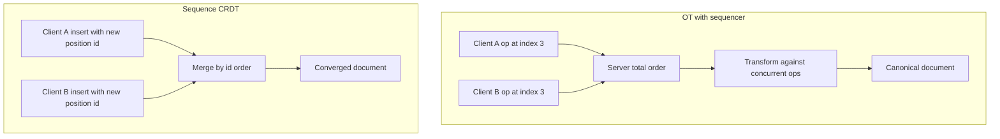

## Concept

### The concurrent edit problem

Two users insert into the same document. User A inserts `X` at index 3. User B concurrently inserts `Y` at index 3. If both apply "insert at 3" naively, one of them hits the wrong place because the other insert shifted indexes. If they last-write-wins the whole string, one user's sentence vanishes. Collaboration needs a defined outcome for concurrent positional edits, plus a way for a late joiner to catch up, plus undo that does not resurrect garbage.

Two families dominate production editors: operational transformation (OT) and sequence CRDTs. Both can work. They fail in different places. Choosing one is a control-plane decision (do we have a single authority that sees all ops?) as much as a CS decision.

### Operational transformation: transform against concurrent ops

OT stores the document as a linear sequence and stores edits as operations against indexes: insert a string at `i`, delete a range at `i`. When an op arrives that was generated against a different document state, the server (or a peer) *transforms* it against the concurrent ops it missed so the index still points at the intended characters.

The server has a canonical history. Clients send ops relative to a known revision. The server transforms the incoming op against the ops that landed since that revision, applies it, bumps the revision, and broadcasts the transformed op. Clients transform incoming server ops against their local unacknowledged ops (the "in-flight" buffer) so the local view stays aligned.

Correctness rests on transformation properties. TP1 (the triangle) says transforming `a` against `b` and `b` against `a` and applying in either order yields the same state. TP2, needed for peer-to-peer OT without a central order, is a more demanding associativity of transforms. In practice, almost every successful OT editor uses a *central server that total-orders operations*. That reduces the problem to TP1 against a linear history. Peer-to-peer OT without that order has a graveyard of incorrect transform functions.

The server is not optional in classic Google-Docs-style OT. It is the sequencer. Clients may be optimistic: they apply locally, then wait for the server's transformed version. If the transform disagrees with local prediction, the client must rebase. That is why OT feels snappy on a good connection and why a partitioned client cannot commit a durable collaborative history without the server.

### Sequence CRDTs: positions that commute

A sequence CRDT gives every character (or chunk) an identifier that is unique and ordered, independent of the current index. Concurrent inserts generate different ids. Merge is set-union of characters minus tombstones, sorted by id. There is no transform function. There is no distinguished server in the algorithm, though you may still use a server as a fan-out and persistence layer.

Identifiers must sit between neighbors. Fractional indexing, list CRDTs (RGA, Fugue, LSEQ, YATA as in Yjs, the Automerge family) differ in how they allocate ids and how they avoid interleaving (the "hello" + "world" concurrent insert at the same spot becoming `hweolrllod`). Interleaving is the characteristic CRDT text bug. OT with a server order does not interleave a single user's typed word if that user generated sequential ops against their own state; CRDTs need an explicit "same-session sequential insert" rule or tree structure to keep a user's run contiguous.

Deletes are tombstones or removed ids that persist until compaction. Undo is inserting the inverse with a new id, or a CRDT-aware undo stack. You do not "delete at index 3" on a stale view.

### Where the implementations actually sit

Google Docs historically used OT with a central service. Many modern multiplayer editors use Yjs or Automerge (CRDTs) with a WebSocket server that is a dumb relay and snapshot store. Some systems hybridize: a CRDT in the client for offline, a server that still total-orders "commits" for permissions and audit.

OT shines when you control a server, want small ops, and already think in indexes (cursors, presence, IME composition). The transform is a tested library, not a weekend project. CRDTs shine when clients must work offline for a long time, merge without a round trip to a sequencer, or replicate through multiple untrusted relays. The metadata is larger. GC of tombstones needs a notion of who is still out there.

Neither replaces access control. A CRDT will happily merge an edit from a user you revoked if that op is still in a peer's buffer. The server that persists snapshots must refuse unauthorized ops even if the type would merge them.

### Cursors, composition, and rich text

Cursors are positions. In OT they transform like inserts. In CRDTs they are ids (or sticky ids to the left character). IME composition and autocorrect generate bursty deletes and inserts that look concurrent if you treat each keystroke as a replica event. Batch a composition session as one op or one id-run.

Rich text (marks, paragraphs) is another type layered on the sequence. Marks that span a range must commute: bold from 3–10 and insert at 5 should keep bold on the intended characters. This is why "we CRDT the markdown string" is usually wrong. You CRDT a tree or a sequence of atoms plus a mark set, not a serialized document.

## Trade-offs

| Approach | When it wins | Cost / risk |
| -------- | ------------ | ----------- |
| Centralized OT | Online editors with a server, small ops, index-based tools | Offline/partitioned clients cannot commit; transform bugs if you write your own |
| Peer OT without a sequencer | Almost never | TP2; historically incorrect |
| Sequence CRDT plus relay | Offline-first, multi-path sync, no transform math | Metadata, interleaving, tombstone GC |
| Whole-document LWW | Not collaboration | Lost edits |
| Hybrid: CRDT clients, ordered persist | Need both offline and audit/ACL | Two truth stories; snapshot vs op-log drift |

If every edit already goes through your backend for authorization, OT's central order is cheap: you already had a server. Adding a CRDT there is still valid if clients cache offline, but you will persist snapshots carefully so the relay does not become a second document.

If the product is "airplane mode for hours, then merge with three peers," a CRDT is the algorithm you wanted. OT clients that queue ops and flush on reconnect still need the server to transform the whole queue; long queues increase conflict surface and user-visible jumps.

Do not write a transform function from a blog post. Use a maintained library, or use a CRDT library. The middle ground ("simple insert/delete transform") is where documents corrupt.

## Diagram

## Failure modes

### Incorrect transforms (OT)

A transform misses a delete-insert pair. Clients diverge: the same revision number, different text. Detection is a checksum of document state per revision, compared across client and server. Users report "my paragraph jumped."

Mitigation is a battle-tested OT implementation, checksums on every apply, and a snapshot reset when they disagree. Do not hot-patch a transform in production without a document fuzzer.

### Interleaving and id explosion (CRDTs)

Concurrent inserts at the same cursor mix two users' words, or fractional ids grow until the document is mostly metadata. Detection is visible mixed typing and payload size metrics.

Mitigation is a CRDT designed to keep causal runs together, chunked inserts (one id per word or per composition), and periodic rewriting of ids from a snapshot when all active replicas have acknowledged a version. That rewrite is a compaction protocol, not a local save.

### Tombstones and late ops

GC drops a tombstone; a delayed insert relative to a deleted character lands wrong, or a deleted character returns. Detection is ghost characters and "I deleted this last week."

Mitigation is snapshot-based catch-up for replicas that lag past the GC horizon, and refusing to compact until a server knows the replica set. Pure P2P CRDT GC without membership is an unsolved operational mess; add a server for stability even if merge is CRDT.

### Dual history: OT server and client CRDT

A team stores Yjs updates in a database and also applies OT for "the official doc." Detection is support tickets that depend on which device you open. Mitigation is one merge function and one canonical snapshot format. Relays store the same type the clients merge.

## Real-world example

Google Docs-style collaboration is the canonical OT deployment. Clients send operations to a server that serializes them, transforms against the accepted history, and fans out. The user sees local keystrokes immediately. The truth of "what is in the doc" after conflicts is the server's. Offline is a buffered queue that rebases on reconnect, not an independent replica mesh. That architecture matches a product with accounts, sharing ACLs, comments as server-side objects, and a need to lock out a revoked user immediately.

The CRDT counterexample is the Yjs/Automerge generation of editors: Figma-like multiplayer (Figma's own CRDT-ish fig-tree), Notion-like blocks, and a pile of open-source web editors. A WebSocket server stores updates and snapshots. Two laptops on a plane can still merge when they share a local channel, then push. The cost showed up as document bloat and the need for server-side compaction. The benefit showed up as less transform code and better offline.

If you are building an internal design-doc editor with always-on VPN and strict ACLs, OT-with-server is still a reasonable default. If you are building a local-first note app that syncs through user-controlled relays, a sequence CRDT is the default. Both need checksums, snapshots, and a story for undo, presence, and rich marks. The algorithm does not replace those products.

## What to remember

- OT transforms indexes against a total order; production OT uses a server as sequencer, not peer TP2.
- Sequence CRDTs merge by position ids and work offline; watch interleaving, metadata, and tombstone GC.
- Whole-document last-write-wins is not collaboration.
- Pick one canonical type; authorization still lives on the persist path, not inside the merge function.
