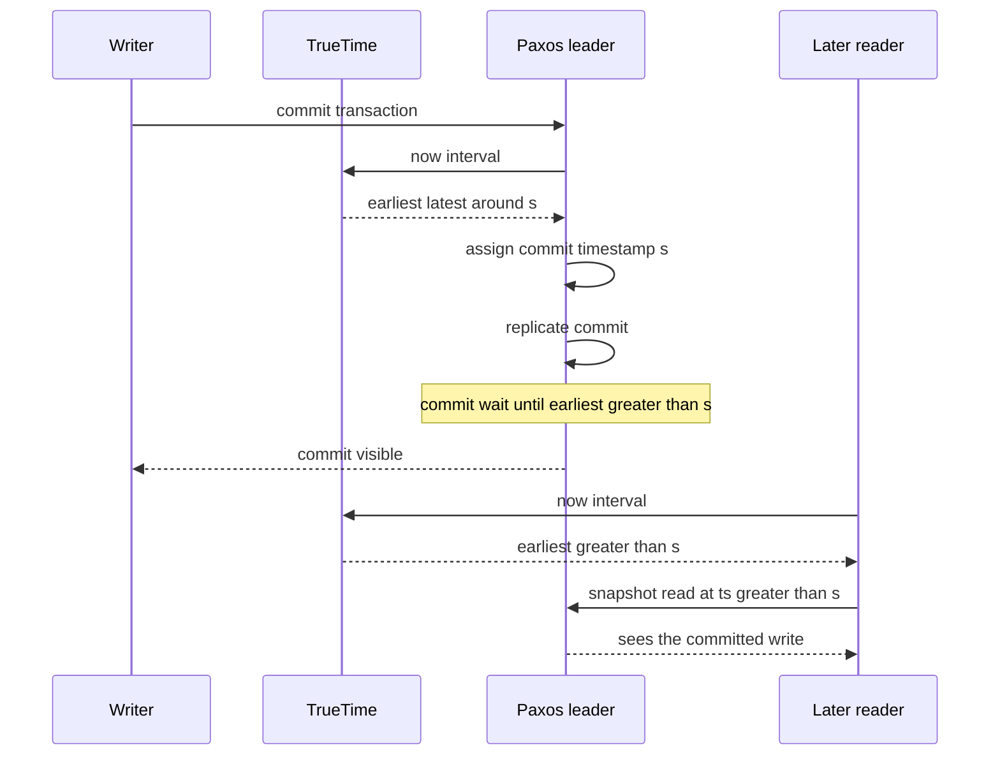

## Concept

### Physical clocks lie, logical clocks ignore physics

A distributed system that stamps events with `gettimeofday` will invert causality. NTP steps, VM pauses, unsynchronized CMOS, and two hosts that both believe they are "now" produce a write in region B with a timestamp *before* the write in region A that happened first. Last-writer-wins then keeps the older fact. Causal histories that depend on "greater timestamp means later" become fiction.

Pure logical clocks (Lamport clocks) fix causality among communicating processes: if A happens-before B, then `L(A) < L(B)`. They do not tell you anything about concurrent events, and they drift away from wall time so operators and SLAs cannot read them. Vector clocks tell concurrency apart and grow with the number of processes. Neither gives you a global commit order that matches a user's wall clock.

You need a stamp that (1) respects happens-before, (2) stays close to physical time so snapshots and TTLs make sense, and (3) has an explicit story for uncertainty. Hybrid logical clocks and TrueTime are two production answers. They are not interchangeable.

### Hybrid logical clocks

An HLC is a pair `(pt, l)`: a physical component and a logical counter. Each node samples a local physical clock `pt_now`. When it sends or receives, it updates:

- If `pt_now` is greater than the known HLC physical part, set physical to `pt_now` and reset the logical part to 0, except when you must stay above a received stamp.
- If physical times are equal, bump the logical counter.
- On receive, take the max of local and remote, using the logical part to break ties when physical parts match, and never go backwards relative to a received happens-before predecessor.

The result: if event A happens-before B, then `HLC(A) < HLC(B)`. Concurrent events get distinct stamps if you include a node id in the comparison. Stamps stay within a bound of physical time if physical clocks are not wildly wrong: the physical component tracks NTP most of the time, and the logical component absorbs clustering of events faster than the clock moves.

HLC does **not** bound the error of `pt_now`. If a node's NTP is off by five seconds, its HLC physical part is off by five seconds. Causality among messages is still preserved because of the max-with-received rule. Global snapshot isolation across nodes still needs you to wait out clock uncertainty or to use a different mechanism. HLC is a causality-preserving timestamp, not a certificate that "this commit is definitely after that one in real time for all observers."

CockroachDB uses HLC for transaction timestamps. When uncertainty is a problem, it adds an uncertainty interval on reads: a reader may need to restart if it sees a write in `(read_ts, read_ts + max_offset)`. That interval is an assumed NTP bound, not a proof.

### TrueTime is an interval

TrueTime, as used in Spanner, does not return a scalar. It returns an interval `[earliest, latest]` that is guaranteed to contain the true absolute time, given GPS/atomic clock infrastructure and a measured uncertainty `ε`. `TT.now()` is not a lie with high probability. It is an interval whose width is the product of clock technology and path delay. Typical `ε` is low milliseconds in Google's deployment; it is not zero.

Comparisons of TrueTime intervals:

- If `latest(A) < earliest(B)`, then A is definitely before B in real time.
- If the intervals overlap, you cannot order A and B by time yet.

That overlap is the whole design space. Spanner does not guess. It waits.

### Commit wait

A writer in Spanner is assigned a commit timestamp `s` inside TrueTime. Before the commit is visible to others, the leader waits until `TT.now().earliest > s`. After that wait, no future `TT.now()` on any well-behaved replica can return an interval that starts at or before `s`. Therefore a transaction that starts after this commit has a timestamp greater than `s`, and external consistency holds.

Commit wait is real latency. You pay `ε` (plus remaining time until `s` is in the past of TrueTime). Reducing `ε` is a hardware and operations problem: GPS receivers, atomic clocks in the datacenter, denial of "just use NTP." If `ε` spikes because GPS is jammed or the time master is unhealthy, commit latency spikes or the system must stop assigning timestamps. Spanner's correctness is tied to the interval being honest. If TrueTime's guarantee is violated, external consistency is violated.

Reads pick a timestamp. A snapshot read at `t` must see all commits with timestamp ≤ `t` that have become visible. The Paxos groups involved must have applied through that time, or the read waits (or chooses a safer timestamp). This is why TrueTime is not "we put GPS on the box and sort keys." It is timestamps plus wait plus replica catch-up.

### What you can implement without GPS

If you do not have TrueTime, you can still:

- Use HLC for causal ordering and compact timestamps in a KV store.
- Use a closed-world max-offset (NTP error bound you *assume*) and uncertainty restarts, like CockroachDB.
- Use a centralized timestamp oracle (a Raft group that hands out timestamps), and pay a round trip to the oracle.
- Avoid global time: Calvin sequences without clocks; per-shard linearizability without cross-shard time.

Do not implement "TrueTime" as `time.Now() ± 10ms` in process. That is an undocumented hope. An interval API whose `ε` is a config constant is a footgun unless something actually measures and widens `ε` when sync is unhealthy.

## Trade-offs

| Approach | When it wins | Cost / risk |
| -------- | ------------ | ----------- |
| NTP + scalar timestamps | Logs, metrics, human-facing times | Causal inversion; LWW loss |
| Lamport / vector clocks | Happens-before, concurrency detection | No wall-clock meaning; vector size |
| HLC | Causal stamps near wall time, compact | Uncertainty not proved; NTP still lies |
| HLC + assumed max_offset | Distributed SQL without GPS | Wrong offset ⇒ wrong SI; retries under skew |
| TrueTime + commit wait | External consistency at global scale | Specialized time infra; wait latency tracks `ε` |
| Timestamp oracle | Simple global order in one region | Oracle availability and WAN hop |

HLC is the right default timestamp for a replicated log when you already have NTP and you need causal compaction, not when you promised "if T1 committed before T2 started, every reader agrees." That promise is TrueTime-plus-wait or a sequencer.

TrueTime's cost is organizational. You run a time service with a threat model (GPS spoofing, operator error, leap seconds). You page on `ε`. You accept that a time outage is a commit outage. That is a fair trade for a global strictly serializable database. It is a ridiculous trade for a regional cache.

## Diagram

## Failure modes

### Clock jump and HLC physical stalls

NTP steps a node backward. HLC must not decrease. The logical component or a hold of the physical part absorbs it, and timestamps cluster. Detection is a growing gap between HLC physical and wall time, or a burst of equal physical stamps.

Mitigation is stepping NTP slowly (slew, not step) on database nodes, tracking HLC minus wall offset as a metric, and refusing to start if offset exceeds a bound. After a large jump forward, uncertainty intervals must widen or you will linearize incorrectly.

### Underestimated max_offset

Cockroach-style uncertainty is 100ms while real skew is 500ms. Detection is rare stale reads or "causal reverse" in multi-region tests, not a crashed process.

Mitigation is measuring actual offset against a reference, alerting when NTP is unhealthy, and bumping max_offset at the cost of more read restarts. If you cannot measure, you do not have a bound.

### TrueTime ε spike or guarantee break

GPS loss widens `ε`, or a bug returns a scalar. Detection is commit wait latency, TrueTime error channels, and (if the guarantee broke) external-consistency violations that look like SI anomalies across regions.

Mitigation is failing closed: do not assign commit timestamps when `ε` exceeds a budget. Diverse time sources. Independent monitoring that is not the same binary as the database. Never shorten wait to hit a latency SLO.

### Comparing HLC across trust domains

Two clusters, two HLCs, merged in a pipeline with `>` on the stamp. Detection is misordered events after a federated ingest.

Mitigation is treating HLC as local to a causal domain. When crossing domains, use explicit happens-before edges (message ids) or a shared oracle. Do not sort a global event bus by HLC from different NTP islands.

## Real-world example

Spanner is the TrueTime production proof. Commit timestamps are TrueTime-derived. Commit wait makes those timestamps safe for external consistency. The database's SQL layer can say: if you saw a commit, every later transaction in any region sees it. The time infrastructure is part of the database's TCB. Papers and talks are explicit that the unusual piece is not Paxos, it is time.

CockroachDB is the HLC production counterpart. It targets similar SQL semantics without Google's GPS fabric. HLC stamps transactions; an uncertainty interval and read restarts stand in for commit wait. When clocks misbehave, CockroachDB's correctness degrades in the way HLC systems degrade: you still have a causal clock, you may not have true external consistency. Operators are told to run NTP well. That sentence is load-bearing.

If you are on AWS without atomic clocks, you are in the HLC-plus-offset world, or the oracle world, or you do not promise global strict serializability. Amazon's later time services and database products moved toward better time; the architectural lesson remains: name whether your timestamp is a causal HLC, an assumed bound, or a TrueTime interval you actually wait on.

## What to remember

- Scalar NTP timestamps invert causality; LWW on them loses writes.
- HLC preserves happens-before while tracking wall time; it does not by itself prove real-time commit order.
- TrueTime returns an interval; commit wait until `earliest > s` is what makes Spanner's order external.
- An assumed `max_offset` is part of the spec; if clocks exceed it, isolation is wrong, not "a bit stale."
