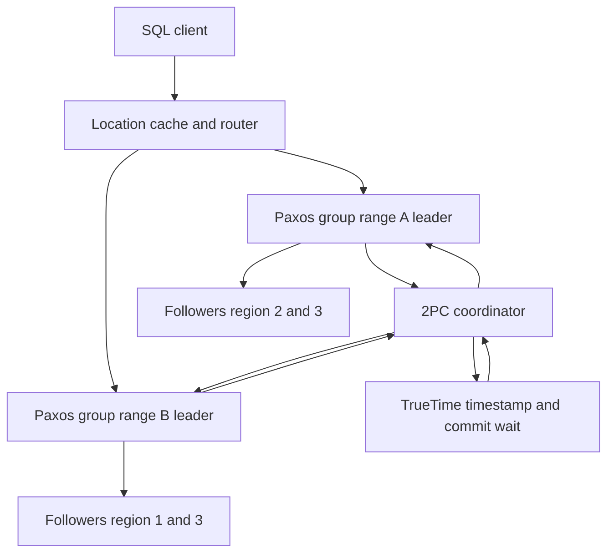

## Concept

### What "Spanner-style" means as an architecture

A Spanner-style system is a relational (or SQL) database that (1) shards data into Paxos or Raft groups, (2) runs distributed transactions with two-phase commit across those groups, and (3) assigns timestamps so the global history is strictly serializable, usually with a time source that can bound uncertainty. Clients see one logical database. Failover of a shard is a consensus leader change, not a human-promoted replica. Multi-region is a placement of those groups, not a separate async replica product with a different API.

The architecture is a stack. At the bottom: directories or ranges, each a replicated log and a state machine of table data. In the middle: a transaction coordinator that locks or validates, picks a commit timestamp, and runs 2PC. At the top: SQL, schemas, and secondary indexes that are themselves ranges. If you only replicate a single-node Postgres with async replicas, you do not have this stack. If you have per-shard Raft but no 2PC and no global timestamps, you have a partitioned KV, not Spanner-style SQL.

### Directories, spanservers, and Paxos groups

Data is split into ranges (Spanner: directories / spanserver tablets). Each range has a replica group, typically three or five, placed by a configuration: which regions, which vote, which are read-only learners. The leader of the group serves writes. Followers exist for durability and for failover. A range split is a metadata transaction: two new groups, a split key, and a period where you must not lose the prefix of the log.

Placement is the product. A table whose primary key starts with `customer_id` can pin a customer's rows to a region. A table keyed by a random UUID will scatter globally and every multi-row transaction will 2PC across oceans. Schema design *is* latency design. Secondary indexes are extra ranges; an index on a non-prefixed column is a global scatter unless you make it local (interleaved, colocated, or region-tagged).

The metadata for "which range owns this key" is itself stored in a group, often a special one. Stale location caches send transactions to the wrong leader; the wrong leader returns a retry with a new location. That retry path is on the user latency budget.

### Two-phase commit over consensus groups

A transaction that touches one group is a one-group commit: the leader logs the commit, wait if you are using TrueTime, done. A transaction that touches two or more groups needs atomicity across logs. 2PC: a coordinator (often one of the participant leaders, or a dedicated coordinator group) sends prepare. Each participant logs a prepared record in its Paxos group (durable, majority) and answers yes. The coordinator logs a commit (or abort) and notifies. Participants apply.

The prepared record is a lock on the future of those rows until commit or abort. If the coordinator dies, a new coordinator must recover from the participant states or from a coordinator log. Blocking 2PC is the classic availability complaint: a participant that prepared cannot serve conflicting writes until resolution. Spanner-style systems mitigate with a Paxos-backed coordinator so the coordinator itself is not a single VM, and with lock tables that expire only after recovery, not after a timeout that would violate atomicity.

Read-write conflicts use locks or optimistic validation. Spanner uses lock-based 2PC with wound-wait-ish deadlock policies in spirit. Some descendants use optimistic protocols and abort more. Either way, the commit timestamp must sit in the global order.

### TrueTime, commit wait, and read types

Commit timestamps come from TrueTime (Spanner) or HLC-plus-uncertainty (CockroachDB). After a commit timestamp `s` is chosen, commit wait (or an uncertainty restart on readers) makes sure that a transaction that starts later in real time cannot get a timestamp ≤ `s`. That is external consistency.

Reads are not all equal:

- Strong / read-write: participate in the transaction, take locks or validate, see the latest committed data at a timestamp.
- Snapshot read at a past timestamp: no locks, may be served by a follower that has caught up to that time.
- Bounded-staleness / exact-staleness: pick a timestamp in the past by a bound, lower latency, weaker than external.

A "global strong read" of a row in a far region still needs a replica that is up to date, or a round trip to the leader. Followers can serve snapshot reads only after they have applied through the read timestamp. Lagging followers force the read to the leader or to wait.

### What the application must still get right

Hot ranges: a monotonically increasing key (timestamp PK) dumps all writes on one leader. Use hash prefixes or ULIDs with care. Interleaved tables (child rows colocated with parent) keep a 2PC from leaving the group. If you cannot colocate, budget WAN 2PC.

Schema changes are versioned metadata transactions. Online DDL in these systems is expand/contract plus backfill on ranges. A unique index backfill is a distributed job that must not violate uniqueness with concurrent writes. That job is harder than in single-node Postgres.

Sessions and retry: 2PC aborts, range moves, and clock uncertainty restarts are normal. Clients need idempotent transactions (a client-generated mutation id) or the SQL must be safe to retry. "I sent COMMIT and the network died" is the same as in any DB, amplified by WAN.

## Trade-offs

| Approach | When it wins | Cost / risk |
| -------- | ------------ | ----------- |
| Spanner-style strict serializability | Global invariants, multi-row, multi-region | WAN 2PC, time infra, operational weight |
| Single-region Raft SQL | Regional products, simpler clocks | Disaster recovery is a different mode |
| Async replica of a primary | Read scale, cheap DR | Not the same API; failover is a promotion |
| Per-shard linearizable, no 2PC | Sharded KV, app-level transactions | Partial commits |
| Calvin-style deterministic | High contention, known read/write sets | Different programming model |

Spanner-style is the right hammer when the business already promised one ledger worldwide. It is the wrong hammer when each tenant is regional and you never join across tenants. Running a global 2PC database and then keying everything on `uuid` throws away the placement model and buys the worst latency of both worlds.

Read-your-writes from a mobile user in Australia to a leader in `us-central` is a physics bill. Pin leaders near writers. Use stale reads for dashboards. Do not make the homepage a strong global snapshot of a scatter table.

## Diagram

## Failure modes

### Coordinator or participant blocked in 2PC

A participant prepared, the coordinator vanished, locks sit. Detection is lock-wait histograms, transactions stuck in `prepared`, and a rise in abort-on-conflict.

Mitigation is a highly available coordinator log, aggressive recovery of in-doubt transactions, and avoiding 2PC via colocation. Never "unlock on timeout" without a commit/abort decision; that splits the transaction.

### Wrong placement and cross-world 2PC

Every order insert touches three continents. Detection is p99 commit latency tracking inter-region RTT times the number of groups, and CPU idle while waiting.

Mitigation is key design, regional tables, interleaved children, and locality-aware indexes. Measure 2PC participant count per transaction in traces. If the median participant count is large, the schema is wrong.

### Clock or TrueTime failure

ε explodes or NTP on an HLC system exceeds max_offset. Detection is commit wait latency, uncertainty restart storms, or (worse) silent order inversion if you keep committing.

Mitigation is fail closed on time service health, page the time pipeline, and shed load to snapshot reads if the product allows. Time is in the TCB.

### Stale location map

Splits and moves leave clients hammering an old leader. Detection is `not leader` / `range moved` retries dominating, and hotspot on a retired range.

Mitigation is short-lived location cache with epoch, batching metadata lookups, and not treating a retry storm as an app bug until you inspect range movement.

## Real-world example

Google Spanner is the namesake: directories, spanservers, Paxos, 2PC, TrueTime, SQL on top (F1 and then Spanner SQL). Google advertising and other core systems moved onto it because they needed cross-datacenter transactions without an ad-hoc sharded MySQL fabric. The operational reality is a fleet that treats time masters and Paxos groups as first-class production services.

CockroachDB and YugabyteDB are the widely available descendants: Raft ranges, 2PC, HLC or similar timestamps, PostgreSQL-facing SQL. They make the same schema-is-placement demand. A company that "just moved to Cockroach for HA" without rewriting primary keys still has a single-node contention pattern, now with distributed lock tables. A company that colocated per-tenant data and used stale reads for global search got the architecture.

The evaluation checklist is not "does it SQL." It is: what is a range, how many replica groups does a typical transaction touch, what is the time story, what do strong versus stale reads cost, and how does DDL backfill work. Spanner-style systems are honest about those knobs. If a vendor hides them, you will meet them in p99.

## What to remember

- Spanner-style = sharded consensus groups + 2PC + timestamps that buy strict serializability.
- Primary keys and indexes are placement; scatter keys turn every commit into a WAN 2PC.
- Commit wait or uncertainty restarts are part of the API latency, not optional polish.
- Strong reads, snapshot reads, and stale reads are different products; defaulting everything to strong will not scale geographically.
