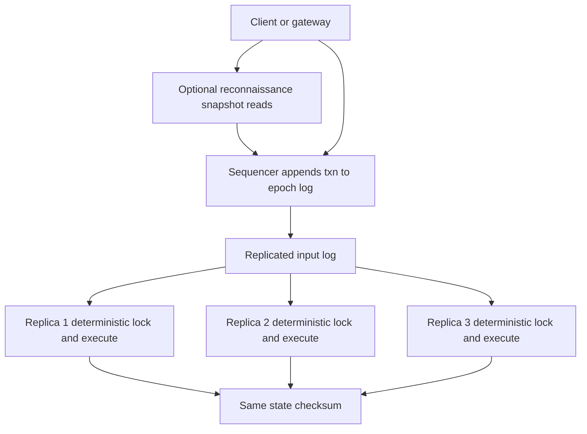

## Concept

### Why lock-based distributed transactions stall

In a conventional distributed database, a transaction arrives at a node, takes locks (or optimistic versions) as it reads and writes, may visit several shards, then runs two-phase commit. Under contention, lock waits serialize the hot keys. Under geography, 2PC adds round trips *after* the transaction has already done its reads. Replication is often another round: you replicate lock state or you replicate effects after commit. The leader of a hot shard becomes both a locking bottleneck and a replication bottleneck.

Calvin's bet: if every replica runs the *same* transactions in the *same* order, they never need to agree on lock outcomes after the fact. Agreement happens *before* execution, on a sequenced input log. Execution is a deterministic replay. 2PC's "do you still promise?" disappears because the sequence already said what will run. Conflicts are resolved by the order, not by a distributed lock manager chatting at commit time.

That bet has a price: you must know what the transaction will read and write before it is sequenced, or you must add a reconnaissance round that discovers the read/write set and then sequences a concrete transaction. Determinism also forbids hidden non-determinism: `now()`, random, and "read whatever is latest mid-flight" must be replaced with values supplied in the sequenced batch.

### The sequencer

Clients (or a gateway) submit transaction requests to a sequencer. The sequencer is a partitioned, replicated log of batches. An epoch or batch contains an ordered list of transaction ids and their payloads. All replicas that will execute those transactions subscribe to the same log. Consensus (Paxos/Raft) or a primary sequencer with a backup is how the log is durable and unique. Calvin's original design uses a sequencing layer that can be sharded by a deterministic rule so the global order is the merge of per-sequencer streams with epoch numbers.

Once a transaction is in a committed batch at position `k`, its identity in history is `k`. Every replica will execute position `k` after `k-1`. There is no second vote at commit. If the transaction cannot complete (constraint violation that is still deterministic), every replica aborts it the same way because they all see the same state preceding `k`.

The sequencer is the availability and latency core. If sequencing is a single Raft group in one region, global writers pay that RTT to get a slot. Sharded sequencers need a deterministic merge (epochs with all partitions present). Missing an epoch partition stalls the world, which is why sequencer health is a cluster-wide incident.

### Read/write sets and reconnaissance

Deterministic execution needs the read set and write set, or a conservative over-approximation, so the scheduler can lock in a deadlock-free order locally (Calvin uses a deterministic lock manager: lock in a global key order, only after the transaction is sequenced). If the application can declare keys up front ("debit account 12, credit account 19"), the request is complete.

If the transaction is "read index, then update whatever rows match," the keys are data-dependent. Calvin-style systems issue a *reconnaissance* query: run the reads against a snapshot, collect the keys, then submit a transaction that includes those keys (and often the read results or a version check). If the data changed, the transaction aborts and reconnaissance repeats. This is optimistic in a different place than SSI: you pay an extra round to make the sequenced transaction fully specified.

Secondary indexes, foreign keys, and triggers expand the write set. If the engine cannot name those keys, determinism is a leak. The SQL surface of a deterministic database is therefore not "any Postgres transaction." It is SQL that can be analyzed or reconnoitered into a key set.

### Deterministic execution and replication

Each replica maintains a lock manager that grants locks to sequenced transactions in id order, avoiding deadlock because the order is total. Execution reads from local storage, applies writes, and produces the same next state. Replicas do not exchange lock messages. They exchange the input log (and bulk state for catch-up).

Replication of the *input* rather than the *output* is the bandwidth argument: a small transaction request versus a large write set. For tiny key-value mutations it may not matter. For transactions that compute large writes from small inputs, it does. The replica must be able to recompute. If execution is not deterministic (floating-point variance, hash-map iteration order, calling out to a microservice), replicas diverge. Divergence is silent corruption. You need checksums of state at epoch boundaries.

Reads that must see a consistent snapshot can be served locally at a replica that has executed through a given sequence number. Strong reads wait until the replica has applied the latest sequenced batch (or a client-specified token). This is closer to "read at log index" than to TrueTime.

### Epochs, batching, and throughput

Calvin batches: many transactions per epoch, one consensus decision per batch. Throughput is sequenced TPS, not 2PC round-trips per transaction. Contention still serializes execution of conflicting keys, but non-conflicting transactions in the same batch run in parallel after locks are granted in order. The scheduler is a local problem.

Latency is "wait for the next epoch" plus execution. Tiny epochs reduce latency and reduce batching gain. Huge epochs add delay and recovery cost. This is the same knob as a log-shipping batch size, with the extra property that clients cannot skip the sequencer.

## Trade-offs

| Approach | When it wins | Cost / risk |
| -------- | ------------ | ----------- |
| Calvin-style deterministic | High contention, multi-shard, replicas that replay input | Read/write set must be known; sequencer is global bottleneck |
| Spanner-style 2PC + time | Ad hoc SQL, data-dependent hops, external consistency via clocks | 2PC and lock chatter under contention; time infra |
| Single-shard Raft | Independent keys, no cross-shard txn | App-level compensation for multi-shard |
| Optimistic SSI distributed | Read-mostly, low conflict | Abort storms when hot |
| Non-deterministic replica + 2PC | Familiar engines | Extra coordination; replication of effects |

Pick Calvin when the workload is OLTP with known keys (payments between accounts, inventory by SKU, booking a seat id) and you want active-active replicas without 2PC. Do not pick it for exploratory SQL that wanders the schema, or for stored procedures that call HTTP.

The programming model is the adoption cost. Teams coming from Postgres expect triggers, `random()`, and "read then decide" in one round. You will add reconnaissance, ban non-determinism, and educate on retries. That is cheaper than 2PC only if contention or replica fan-out was actually the problem.

## Diagram

## Failure modes

### Sequencer stall

An epoch partition is late; all execution waits. Detection is epoch lag metrics, client latency stepping in batch-size increments, and idle executors.

Mitigation is sequencer replication, timeouts that skip an empty partition only when the protocol allows a hole-free merge, and not colocating all sequencer load on one disk. Do not let application QPS bypass the sequencer "for speed."

### Non-deterministic execution

Two replicas disagree on a checksum after the same log prefix. Detection is periodic state hashes, not user reports.

Mitigation is a closed runtime: ordered maps, injected timestamps from the batch, no external calls during execute. Rebuild a replica from log + snapshot. If you cannot checksum, you cannot run this architecture.

### Inadequate read/write sets

A transaction writes a key it did not lock because an index maintenance path was missed. Detection is replica divergence or constraint failures on some replicas only.

Mitigation is engine-enforced analysis of all index and constraint keys, plus reconnaissance version checks. Application-declared key sets are not trustworthy without validation.

### Reconnaissance abort loops

Hot keys change between recon and execute; transactions never land. Detection is a high recon-retry rate on a small key set.

Mitigation is combining hot-path transactions into single-key sequenced ops, or falling back to a conservative lock of a coarser key (a partition) for those records. Determinism does not remove contention; it moves it to the executor's lock manager.

## Real-world example

FaunaDB (Fauna) commercialized Calvin-style deterministic execution: a global log of transactions, deterministic apply, and a document/relational API that required transactions to be expressible without hidden non-determinism. The pitch against Spanner-style 2PC was throughput under contention and the ability to replicate by shipping the log rather than coordinating locks worldwide. Developers wrote transactions in FQL (and later other interfaces) that the engine could analyze.

The public lesson from Fauna and from the Calvin literature is consistent. When the transaction's keys are known, sequencing plus deterministic apply is a powerful alternative to 2PC. When the product needs arbitrary interactive SQL, the reconnaissance layer starts to look like "we built a second query engine in front of the sequencer," and latency plus abort behavior reappear in a new costume.

If you are designing a ledger that already has a natural total order (payments, matching engine, booking), a Calvin-like pipeline is worth stealing: batch, sequence, execute identically everywhere, checksum. If you are wrapping a general OLTP app with unpredictable access paths, Spanner-style or a single-region serializable primary will fight you less. Determinism is a contract with the application, not an invisible storage engine flag.

## What to remember

- Calvin agrees on an input sequence first; replicas execute the same transactions in that order and skip 2PC.
- Read/write sets must be known or discovered by reconnaissance; hidden keys and non-determinism diverge replicas.
- The sequencer and epoch merge are the availability core; checksums catch execution bugs.
- High contention with known keys is the win; ad hoc interactive SQL is the mismatch.
