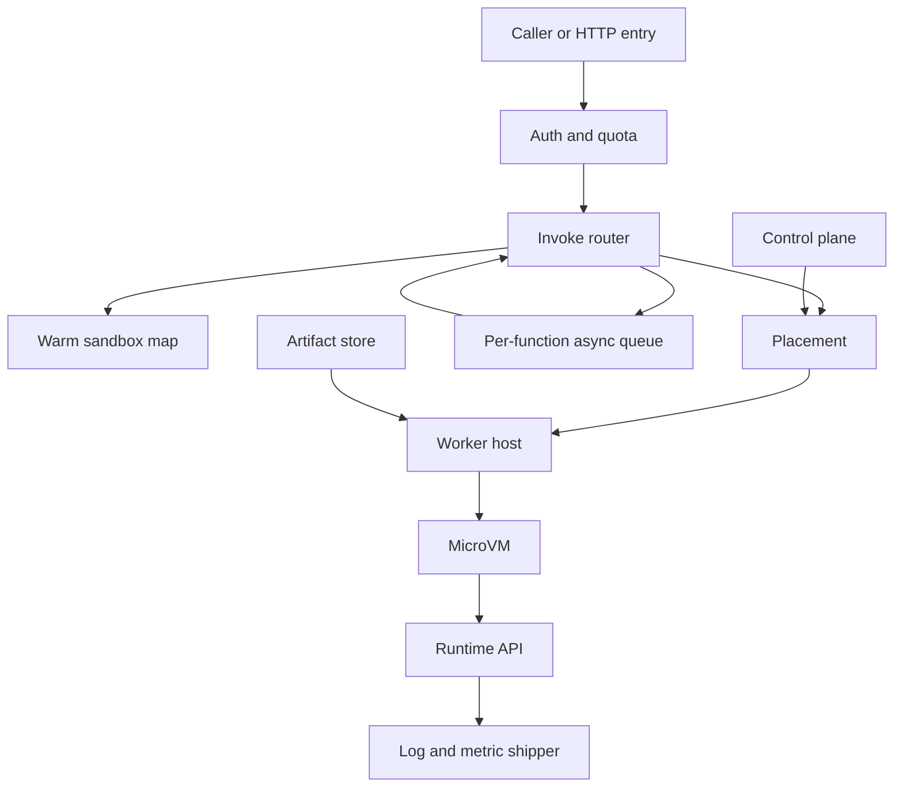

## Concept

A multi-tenant serverless platform runs code we do not trust, on machines we do, with concurrency that arrives in bursts, and a bill based on duration and memory. The isolation bar is that one tenant cannot read another tenant’s memory and cannot see the host’s credentials. The product shape is the one AWS Lambda made familiar: upload an artifact, publish a version, attach a trigger, invoke, read logs, and pay for the invoke. The engineering tension is cold start versus isolation. A microVM per instance is the boundary I would trust for hostile tenants. A process on a shared kernel starts faster and is the wrong boundary when the neighbor is untrusted.

I would split a control plane — functions, versions, aliases, concurrency, identity — from a data plane of invoke routers, worker hosts, microVMs, and a network proxy. They share as little fate as possible. Artifacts live in object storage and are immutable. An invoke authenticates, checks a concurrency quota, and either enters a warm sandbox or places a new microVM. The guest pulls the event through a local runtime API and posts the response. Idle sandboxes freeze or exit after a time-to-live. Logs leave on a side path that cannot block the response. Packing many microVMs on one host is how utilization works. The noisy neighbor is CPU, disk, and network contention, because there is no shared heap and no shared kernel page cache the tenant can write.

### Requirements

Users create a function, publish an immutable version, and point an alias at a version or at a weighted pair for a gradual shift. Invoke is synchronous or asynchronous. HTTP, a queue, and a schedule are triggers. Environment and secrets are configuration injected at placement. Rotating a secret does not require a new binary, and the version still records the digest of the configuration it ran with. Optional attachment to a private network is explicit, because it dominates cold start. Logs and traces exist per invoke. Concurrency limits exist per function: a reserved floor other functions cannot steal, and a provisioned warm set for paths that cannot pay a cold start. Operators quota a tenant, block a function, and drain a host.

Isolation for untrusted code is a virtual-machine boundary. Cold start is the sum of the microVM, the runtime, user initialization, and any network attachment, from hundreds of milliseconds into seconds depending on artifact and network. That is a budget, not a vendor number. A warm invoke is the router plus user code. An asynchronous event is durable before we acknowledge it. Losing a worker fails in-flight synchronous calls. Asynchronous invokes retry with a bound. The guest receives the function role, never the host role.

Out of scope: long-running services that should be an ordinary deployment, accelerators in the first version, and a shared language runtime described as multi-tenant isolation. Tenant code does not run on control-plane nodes.

### Capacity sketch

Assumptions for one regional data plane. On the order of five thousand tenants, on the order of fifty thousand published versions, and a peak around ten thousand invokes per second, most of them hitting a warm sandbox. A typical instance is a few hundred megabytes of configured memory. Many invokes last tens to a few hundred milliseconds, with a tail of seconds up to the function’s timeout. The fraction of invokes that pay a cold start is a result of the idle time-to-live, of how concentrated traffic is, and of how much provisioned concurrency we sold. It is not a constant. These are sizing assumptions. Measure them on your runtime before you publish a latency objective.

A worker keeps a slice of memory for the hypervisor and the agent. Sandbox count follows memory and CPU caps. Invoke traffic is the product. The router streams payloads. It does not buffer them in the control store. Asynchronous work is queued per function. Provisioned concurrency is how a few functions leave placement and boot off the critical path. A small interpreter and a heavy artifact will not share a cold-start number.

### API or control-plane shape

Create function names a runtime, a role, a handler, memory, a timeout, and environment. Publish version freezes the artifact digest and the configuration digest. An alias names one version or a pair of versions with weights. Concurrency configuration sets reserved and provisioned counts. A trigger is HTTP, queue, or schedule, and it targets an alias, not a raw version, unless an operator is pinning a test.

The data-plane invoke takes a function, a qualifier, a synchronous or asynchronous mode, and a payload, and returns a status and a bounded log tail. Inside the sandbox the runtime API is the contract workers already expect: get the next invocation, post a response, post an error. Workers expose place, freeze or snapshot if we support it, kill, and drain. The control plane writes desired config to a strongly consistent store. Workers learn assignments by watch. Routers are stateless aside from a cache of the routing table and a short-lived view of in-flight concurrency. A warm hit does not write the control store. Authentication of the caller fails closed. A cached concurrency decision fails closed once the cache is older than a bound, with a margin under the hard quota so a lagging count cannot overshoot by the full limit.

### Core data model

A tenant has a maximum concurrency, a maximum artifact size, a maximum timeout, and the runtimes it may use. A function has a tenant, a name, a role, and optional network configuration. A version has an artifact key, a digest, a runtime, a handler, memory, timeout, and a digest of the environment it captured. An alias points at a version with optional weights. Concurrency state is reserved, provisioned, and the current in-flight count, reconciled from the workers rather than trusted from a single router. A sandbox has a host, a function version, a state of starting, warm, frozen, or dead, a last-used time, and a memory size.

An invoke record, written by the host agent, has the version, the billed duration, the memory, the status, and a request id. It is durable before the sandbox is reused for a different invoke that would overwrite the evidence. An async event has a payload reference in object storage, an attempt count, a next time, and a dead-letter destination. A host has capacity, a drain bit, and the sandboxes it holds. Artifacts are immutable. A deploy is a new version. Recycling sandboxes when the alias moves is simpler than mutating a disk under a running guest. Snapshot restore, if we invest in it, restores a frozen guest of that exact version and that exact configuration digest. It is not a way to edit the guest in place.

## Trade-offs

| Approach | When it wins | Cost / risk |
| -------- | ------------ | ----------- |
| A microVM per instance | Hostile multi-tenant isolation | Cold start and packing overhead |
| A user-space kernel sandbox | Stronger than a raw process, lighter than a VM | A different threat model from a VM; a larger interface |
| A process and a control group on a shared kernel | Code written by people you already trust | A kernel bug is a cross-tenant bug |
| Containers on a shared cluster orchestrator | An internal platform with known tenancy | Weaker isolation and a poor fit to per-invoke billing |
| A warm pool that can freeze | The next invoke avoids a full boot | Memory cost, stale configuration, and the safety of restore |
| Provisioned concurrency | A latency objective on a path that cannot go cold | You are running capacity and should price it that way |
| One VM per tenant, shared by that tenant’s functions | A simple isolation story | Utilization collapses, and one function still hurts its owner |
| Language isolates | Very fast start inside one runtime | One language family, and a weak story for native code |
| Synchronous invoke only | A small API | Spikes have nowhere to wait |
| A per-function queue in front of async invoke | Bursts and retries | Extra latency, and poison events you must quarantine |

I would use microVMs for untrusted tenants, freeze instances only after restore has a security review, and cap reserved concurrency so one tenant cannot consume the region. First-party code on an existing cluster can scale to zero without claiming a multi-tenant isolation boundary.

## Diagram

## Failure modes

### A neighbor that consumes the host

One function spins on CPU or saturates disk and every sandbox on the machine slows. Cap CPU and IO per sandbox, place reserved work away from burst work, and detect steal by host. A concurrency reserve packed past the CPU you can schedule is not a reserve.

### A stampede of cold starts

An alias move or an idle queue that starts to drain can boot thousands of sandboxes at once. Throttle scale-out per function and per host, reuse a frozen instance of the same version, return asynchronous invokes to the queue, and fail synchronous invokes with a bounded overload error. Each boot can be correct and the storm can still be an outage. Admission is the control.

### Isolation that stops one step short

A shared directory, a metadata answer that carries the host role, or a path from one guest to another breaks the boundary. Each sandbox gets its own network and disk and sees only the function role. Snapshot restore has to resume a guest that still cannot see the host. A snapshot that holds a secret is a secret-handling problem.

### A poison event that occupies concurrency

A payload that crashes on every attempt fills concurrency with retries. Bound the attempts, dead-letter the payload, kill the sandbox, and do not reuse it. Release the in-flight count when the error returns. A dead VM that still counts as concurrency looks like a full platform.

### Private networking on the cold path

A dedicated interface on every cold start turns runtime initialization into network setup. Keep private networking off unless the function needs it, and use provisioned concurrency when that function also has a latency objective. A shared attachment in front of many microVMs is how that sum comes down. Publish the cold start of the path you run.

### The control plane on the warm path

Routers cache routing and concurrency for a bounded time. Authentication fails closed. The warm path does not write the control store. In-flight counts may lag inside a margin under the hard quota. Fail-open with no margin over-admits. Fail-closed on every warm hit turns a control-plane blip into an outage of healthy workers.

### Billing a clock the guest can influence

The host agent times the window from delivery to response or kill, and the record is durable before reuse. Memory billing uses the configured size. A duration produced inside the guest can be stalled and can be lost.

## Real-world example

AWS Lambda is the system this design maps to: a control plane apart from invoke, Firecracker microVMs, a runtime API, versions and aliases, reserved and provisioned concurrency, and a queue for asynchronous invokes. Cold starts there were long dominated by private-network attachment, which is why a shared attachment showed up later. Cloudflare Workers is the isolate model, a fit when you ship that runtime and a poor substitute for an arbitrary binary. A function API on a shared cluster orchestrator copies the verbs and does not copy the boundary.

Copy microVMs for untrusted code, the runtime API, immutable versions, aliases, concurrency quotas, per-function async queues, and host-side metering. Leave a full private-network product and a vendor cold-start number out of the first objective until you have measured runtime, artifact, and network attachment separately. If every function is first-party, call the result scale-to-zero.

## What to remember

- Untrusted tenants get a virtual-machine boundary. Control groups are for code you already trust.
- The warm invoke path serves without a write to the control-plane store, and identity still fails closed.
- Cold start is the VM, the runtime, the user code, and the network. Provisioned concurrency is how a latency promise stays honest.
- Concurrency limits, dead-letter queues, and host-side billing are the product around the handler.
