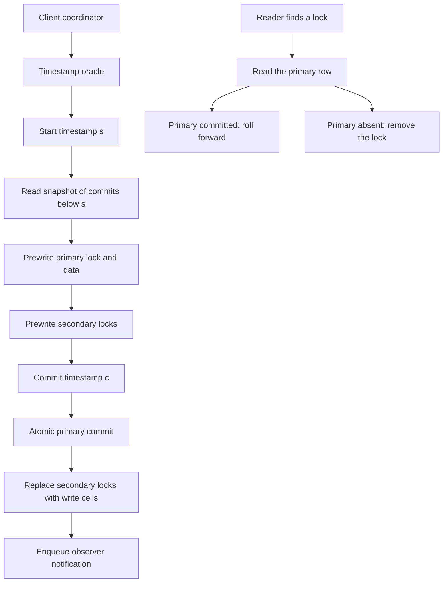

## Concept

### A row mutation is not a multi-row fact

A Bigtable-class store gives you a sparse sorted map, a timestamp on every cell, and an atomic mutation of a single row. That primitive is enough to replace a document. It is not enough to publish the document and the inverted-index postings that point at it. Those rows live on different tablets. If a worker writes the document and dies before the postings, search has a body the index cannot find. If it writes the postings first, the index points at a document that is not there. A retry without a transaction appends the postings a second time. A central lock manager, or one consensus log that total-orders every mutation in the corpus, restores atomicity and also pins crawl throughput to a single coordinator.

Percolator leaves the map as the system of record. It adds a small set of columns and runs two-phase commit in the client. Transactions whose keys do not overlap never meet. Throughput then follows tablet count. The workload that fits is a huge keyspace with rare collisions: web documents, ads graphs, derived tables that fan out from one source write. A counter that every transaction updates turns the lock column of that row into a mutex. The protocol still runs. The scale story does not. Copying the column layout onto a hot status row builds a distributed lock with extra steps.

### Data, lock, and write

Each logical column is stored as three physical columns: data, lock, and write. A committed cell at commit timestamp c is a data cell written at the transaction start timestamp s, plus a write cell at c that points at s. Readers honor write records and ignore bare data. An in-flight transaction writes data at s and a lock at s. The lock names the transaction's primary row. Locks on the other rows are pointers back to that primary. They are not a second commit record.

The store is never asked for a multi-row mutate. The commit point of the whole transaction is one atomic change on the primary row: remove the primary lock and insert the write cell at c. After that change lands, the transaction is committed even if the client process is gone. Secondary rows are cleaned up later, by the same client or by the next reader that finds a lock and inspects the primary. A write record on the primary means roll the secondary forward. No primary lock and no write record means the transaction aborted; delete the secondary lock and the uncommitted data. The protocol is the transaction engine. The store is a durable map with compare-and-swap on one row.

### Client as coordinator

A client asks a timestamp oracle for a start timestamp s and reads a snapshot of commits whose commit timestamps are below s. A cell that still carries a lock is not a free cell. The client follows the lock to the primary before it decides to wait, to clean, or to abort. Prewrite then walks the write set. For each cell it checks that no lock is held and that no write has committed after s. When the checks pass, it writes data and lock at s. The primary is prewritten first. If that prewrite fails, nothing has a commit point and the transaction aborts. If every prewrite succeeds, the client asks the oracle for a commit timestamp c greater than s and commits the primary. Secondary commits replace the remaining locks with write cells at c.

There is no separate transaction-manager process. Coordinator state lives in the primary lock and in the client's memory. After a crash the memory is gone. Recovery is cooperative. A later reader or writer that trips over a secondary lock reads the primary and applies the rule above. A primary lock that is still present means the writer may be alive. Back off, and abort only after a liveness check you trust. Age of the lock by itself confuses a slow client with a dead one. Cleanup is itself a row mutation and must be conditional: delete the lock only when the timestamp and the primary pointer still match, because two cleaners and a live committer can race.

### Snapshot isolation, then the next worker

Reads at s see commits below s. Writers of the same cell conflict at prewrite. The second writer sees a lock or a newer write and aborts. That is snapshot isolation with first-committer-wins on each cell. Write skew is allowed. Two transactions can each read a predicate, each update a different row, and both commit, breaking an integrity rule that no single cell encoded. Percolator will not stop them. If the constraint matters, make it a row that both transactions write, or pick an engine whose isolation statement covers that predicate. Treating this protocol as serializable SQL ships the skew and then blames the store.

After the primary commit, the same system can enqueue a notification so another worker runs a follow-on transaction. That is how an incremental indexer chains a document write into posting updates without a global rebuild. The notification table is another table in the same store. Delivery is at least once. The follow-on work takes a new start timestamp. The application has to be safe to run again, or it has to lock the same cells the protocol already knows how to conflict on.

### The oracle that mints time

The oracle hands out strictly increasing timestamps. It is one logical service, usually a consensus group that allocates a range to the current leader so most clients do not pay a round trip per timestamp. Commit timestamps must be unique, and c must be greater than s. Duplicate commit timestamps collapse two transactions into one snapshot slot. A backward jump lets a new transaction commit at a time a reader has already passed. A stall is downtime for every new transaction. An overlap is corruption of the snapshot. The oracle moves almost no data and sits on every start and every commit. Replicate it, fence a deposed leader with an epoch so it cannot keep minting, and prefer a stall to a clock that moves backward.

## Trade-offs

| Approach | When it wins | Cost / risk |
| -------- | ------------ | ----------- |
| Percolator 2PC on a wide-column store | Huge, mostly disjoint read-modify-write over a map you already run | Snapshot isolation, cooperative cleanup, write skew |
| One consensus log for every write | Small write sets that need a total order | Throughput capped by one log |
| Per-range consensus plus a distributed commit | SQL with a stated serializable mode and range failover | Extra rounds on multi-range writes, more moving parts |
| Application sagas, no lock column | Services where compensation is a product feature | Intermediate states stay visible |
| Classic XA across a few databases | A handful of resource managers in one failure domain | Blocking coordinators, no tablet-scale parallelism |

Percolator wins when the conflict rate is low and the keyspace is enormous. Document indexing fits. A popular URL, a global counter, or a status row that every job touches does not. You also accept client complexity in exchange for a simple storage primitive. Every writer implements prewrite, primary commit, secondary commit, and lock cleanup. A bug in cleanup is a stuck lock or a committed transaction that a cleaner erases. A SQL engine hides that. Percolator puts it in your binary. One team that owns the workers can carry it. A library sprinkled across twelve languages, each with its own reading of "the primary is gone," cannot.

The oracle remains the shared point, and it is a control plane rather than a data log. Disjoint transactions still scale with tablets because the oracle does not sequence their mutations. It only sequences time. Give it its own consensus group, its own disk, and an alert on mint latency. A tablet failure removes a slice of keys. An oracle failure removes commits.

## Diagram

## Failure modes

### Coordinator dies after prewrite and before primary commit

Locks sit on many rows. Those cells reject new prewrites, and readers that respect locks cannot see through them until someone cleans up. Detection is a rise in lock-wait retries and in cleanups of old locks, correlated with worker crashes or deploys.

Mitigation is the primary-row rule. If the primary lock still exists, the transaction is pending; abort only after a liveness check. If the primary has a write record, roll secondaries forward. If the primary has neither, delete secondary locks. Never abort a transaction whose primary already committed. That mistake drops a successful write with no error at the original client, because that client is already gone.

### Oracle stall or overlapping timestamps

If the oracle is down, no transaction can start or commit, even when every tablet is healthy. Detection is oracle latency and error rate, plus a cliff in commit throughput with no matching storage error.

Mitigation is a consensus-backed oracle that hands out ranges, so a leader loss only discards an unused tail. Fence old leaders. Two replicas must never dispense overlapping timestamps. A stall pages a human. A backward jump corrupts snapshots that you will debug as application bugs for weeks.

### Hot primary and retry livelock

Choosing a popular cell as the primary, or retrying forever on the same start timestamp, pins workers to one row. Detection is per-key lock-wait histograms and a small set of rows that dominate prewrite failures.

Mitigation is to pick a primary that is not the hottest cell when the write set allows it, to back off with jitter, and to retry with a fresh start timestamp. If a key is inherently hot, use a single-row atomic mutate or shard the key. Percolator is the wrong protocol for a global counter.

### Cleanup races on the same lock

Two readers see one stale lock. One rolls forward while the other rolls back, or both fight the committer who is turning the lock into a write record. Detection is conflicting mutations on the lock and write columns, and rare snapshot anomalies after an incident where a value the client was told had committed is gone.

Mitigation is compare-and-swap on cleanup: delete or replace the lock only if it still carries the expected timestamp and primary pointer. The primary commit is already atomic. Secondary cleanup must be the same kind of mutation. Test the races with concurrent clients and a recorded history. A single-threaded happy path will not show them.

## Real-world example

Google built Percolator so the web index could move continuously instead of waiting for a full rebuild of the corpus. Crawlers wrote documents into Bigtable. Transactions updated inverted-index postings together with the document row. Observers fired further transactions for derived data. The timestamp oracle was a consensus service. The index lagged the crawl by minutes rather than by the length of a batch pass, and incremental changes no longer required a globally consistent scan of every document. Conflicts stayed rare because distinct URLs land on distinct rows.

The same shape shows up in TiDB's default transactions on TiKV: lock columns, a timestamp oracle in the placement driver, prewrite, then commit of the primary. That is evidence the idea operates outside Google, and it is a reminder of the isolation contract. That mode is snapshot isolation. If the product needs to forbid write skew, pick a mode or an engine that states a stronger guarantee, and test the predicate you actually rely on. Percolator scaled for the web index because conflicts were rare relative to the keyspace and because the indexer could live with snapshot isolation. The columns, copied alone, do not bring those two facts with them.

## What to remember

- Percolator is client-side two-phase commit; the only storage atomicity is one row, and the primary lock-to-write swap is the commit point.
- The isolation you get is snapshot isolation with first-committer-wins, so a cross-row constraint has to be encoded as a row both transactions write.
- Recovery is cooperative cleanup of locks; rolling back a primary that already committed deletes a successful transaction.
- The timestamp oracle is a single logical choke point: replicate it, fence old leaders, and treat overlapping timestamps as corruption.
