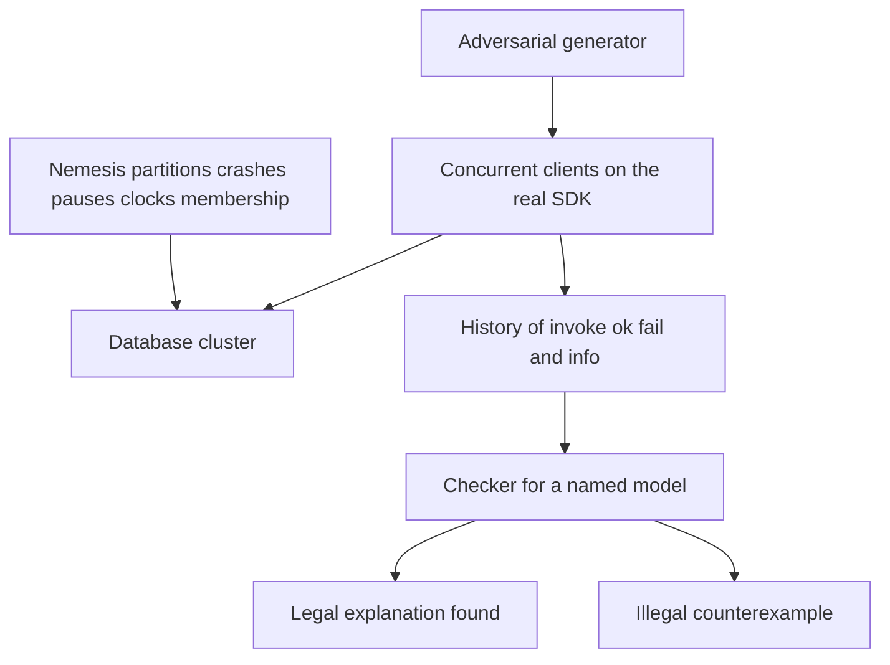

## Concept

### A history, a model, and a checker

Jepsen-style testing asks whether the operations a database actually performed are legal under a consistency model you claim. A harness starts a cluster, runs concurrent clients, records every invocation and every completion, injects faults while calls are in flight, and hands the history to a checker. The checker searches for an explanation that satisfies the model. If it cannot find one, you have a counterexample: a concrete pattern of reads and writes that no legal execution produces. The useful output is that explanation, or a shrunk illegal fragment: a stale read, a lost update, a dirty read of an aborted transaction, a write-skew cycle. A green CI job that never printed a history is a fuzzer run. Verification is the model plus the checker.

This is not a load test, and it is not "we killed pods." Killing pods tells you whether paging works. It does not produce a partial order a checker can reject. A Jepsen-style test is small on purpose: a handful of nodes, a hostile generator, faults you can name. It falsifies claims. It does not prove that next year's version is correct, and a pass on a quiet cluster does not retire the claim.

### Histories, not log lines

A history is a set of operations, each with an invocation and a completion, partially ordered by real time. An ok result completed with a value. A fail result definitely did not take effect. An info result, including a timeout, is indeterminate: the operation may have committed on the server. Checkers must consider both worlds. If you collapse timeouts into failures, you miss the bug users hit. The client retries, the first attempt had committed, and you now have a duplicate or a lost update depending on whether the write was idempotent. If you collapse timeouts into successes, you invent values the server never stored.

Each operation carries a process id, a function such as read, write, compare-and-swap, or a transaction, and its arguments. For SQL, the value is often a micro-transaction of several reads and writes that must appear atomic. Elle, the checker used for isolation anomalies, treats transactions as nodes in a dependency graph: write-read, write-write, and read-write edges. Cycles forbidden by the model are the bugs. You do not hand-build a serial order. You compute the graph from the values that were written and read.

Linearizability is a real-time claim on a single object: once a write completes, every later read must observe it or something newer. Serializability ignores wall-clock order and only requires some serial order of transactions. Snapshot isolation forbids dirty reads and write-write conflicts and still allows write skew. Test the model in the product contract. A linearizability checker will fail a correct snapshot-isolation system. A serializability checker will pass a register that returns stale reads, because a stale read can still sit in some serial order that ignores real time. The name on the brochure has to be the name in the checker.

### Generators, the real client, and the nemesis

The generator chooses operations and keys. It should be adversarial in shape, not only in timing. A small key set forces conflicts. Mix reads, writes, and compare-and-swap. If you sell multi-key atomicity, the generator must issue multi-key transactions. Unique random keys with no overlap will pass a system that never replicates, because nothing ever conflicts and nothing is read twice. Coverage of the model is conflict rate, indeterminate-operation rate, and whether faults overlapped in-flight calls. Line coverage of the binary is a different number.

The client should be the client you ship: same library, same timeouts, same retries. A test that calls an admin API, or that treats every timeout as a clean failure, is testing a different product. If the client retries a non-idempotent write, the history must show two invocations. Record the retry policy. It is part of the system under test. An idempotency key, if the product has one, has to be visible to the checker so a retry is one logical operation rather than two writes.

The nemesis injects faults: majority and minority partitions, process kills, pauses that freeze a process without closing sockets, clock steps, membership changes, disk stalls. Partitions separate "available" from "consistent." Clock steps catch last-write-wins systems that trust timestamps. Membership changes catch writes dropped during rebalance. A pause is a different fault from a crash. Heartbeats fail while TCP buffers and in-memory state sit still, which is how "we detected death" becomes a split brain. Run the nemesis during steady state, while clients are issuing calls, not only at startup before the history has any operations.

### What a pass and a fail actually mean

A pass says that this workload, this fault schedule, this version, and this checker found no illegal history. It is not a theorem. Clusters are small and runs are minutes to hours. Use the pass as a regression gate and as a way to retire a marketing sentence you can no longer defend. A fail is evidence that the implementation plus the client does not meet the model, unless the checker itself is wrong. Checker bugs happen. The response is to read the history, reproduce, and decide whether the model was too strong, the client was wrong, or the database was wrong. Weakening the model after a failure so the pipeline goes green is how stale reads ship with a badge. If you change the documented guarantee, say so in the same change that changes the checker.

Knossos-style linearizability search is expensive and wants a small value domain. Elle scales better on transactional histories when writes carry enough identity to build edges. For a key-value register, linearizability is usually the claim users need. For SQL, start from the documented isolation level, and add a separate test for uniqueness if you sell unique constraints.

Record enough to reproduce. The history should include process ids, invocation and completion times, the nemesis log, and the version of every binary and client library. A checker that says illegal is useful only if a second person can see which key, which return value, and which partition produced the cycle. Keep the generator seed. Keep the cluster config, including consistency level, replication factor, and whether repair or read-repair was enabled. Those settings are part of the system. Changing them between the failing run and the "fixed" run, without saying so, is how a real bug gets filed as flaky. When you do fix a bug, leave the test in the regression suite at the same fault schedule. A one-off analysis that is never re-run will not catch the next refactor of the same path.

## Trade-offs

| Approach | When it wins | Cost / risk |
| -------- | ------------ | ----------- |
| History checking under faults | Falsifying isolation and durability claims on a database you cannot drop into a simulator | Long runs, expert reading, false comfort if the generator is kind |
| Single-process tests of a consensus module | Protocol bugs with a simulated network | Misses client retries, membership, and disk behavior |
| Deterministic simulation of the whole binary | Exhaustive schedules when the system was built for a virtual clock | Unavailable for most databases you buy |
| Production invariant metrics | Rare anomalies on real skew and real hardware | Slow, and data may already be wrong when the metric fires |
| A formal spec with no implementation test | Clarifying the protocol you meant | The binary can still diverge from the spec |

History checking is the default when the database is a large system you cannot drop into a simulator, or when you are evaluating a vendor. Pair it with a written model of the property you sell. The test finds the gap between that claim and the binary. Chaos in production does not replace it, and a fault-free history is only a concurrency test. The bugs that matter show up when a leader is paused, a minority is partitioned, or a clock steps during an in-flight write. Put conflict rate, the fraction of info results, and nemesis overlap next to the pass. A pass with those numbers near zero is a different test from the one you think you ran.

## Diagram

## Failure modes

### A pass from a generator that never conflicts

Every transaction uses a fresh key. Write-write conflicts cannot occur, so lost updates cannot appear. The checker reports legal. Production uses one hot account and loses updates. Detection is a coverage summary on the history: conflict rate, retry rate, and the fraction of indeterminate operations. Near-zero conflicts means the test is not about isolation.

Mitigation is a small key domain, explicit compare-and-swap, multi-key transactions when that is the claim, and a nemesis that runs while clients are busy. Read a passing history before you trust it. A pass with no indeterminate operations during partitions often means timeouts were relabeled as clean failures.

### Timeouts folded into success or failure

Marking info as fail hides writes that committed. Marking info as ok invents rows the server never stored. Detection is a mismatch between client errors and server commit logs, and a checker that only fails when you force timeouts to look successful in a replay.

Mitigation is to keep the three-way outcome. If the client uses idempotency keys, teach the checker that a retry is the same logical operation. If the product cannot tell a committed timeout from an aborted one, that is a product defect. Document it, or read back before retrying, and put that read in the history.

### The wrong model for the claim

The brochure says "strongly consistent." The engine is snapshot isolated. A linearizability checker fails, someone disables the test, and the argument ends. The opposite mistake is a serializability checker on a register, which misses stale reads that are still serializable in some order that ignores real time. Detection is a written map from the docs to the checker, reviewed by someone who can separate snapshot isolation from serializability and both from linearizability.

Mitigation is one name for the model, used in the test, the docs, and the SLA. If marketing disagrees with the checker, change the docs. If the docs disagree with the binary, change the binary. Quietly swapping the checker for a weaker one is a product change and belongs in the release notes.

### An illegal history you cannot replay

The checker says illegal, shrinking fails, and the nemesis was "whatever the wall clock did." Detection is a huge history with no minimal example, or a failure that vanishes on the next run with a new seed and a new binary.

Mitigation is to log nemesis events into the history, pin versions of server and client, and prefer explicit partition and pause schedules over a bag of random faults you cannot name. Capture the failing seed. If you cannot replay, you cannot fix, and a debate about the checker is a delay. Keep the minimal illegal fragment next to the bug, not only the full multi-hour log.

## Real-world example

The public Jepsen analyses of Apache Cassandra are the reports most architects have actually read. Cassandra documents tunable consistency. With replication factor three, quorum reads and writes are often described as strong enough for application truth. Histories under partitions and process pressure showed stale reads, including cases where a quorum write was not visible to a later quorum read, and cases where hinted handoff interacted badly with what the client believed had succeeded. The reports did not say to abandon the database. They named the version, the client, the consistency level, the faults, and the illegal pattern.

That is how to use a public report and how to run your own. Cassandra's behavior changed across versions: per-partition consensus for lightweight transactions, stricter documentation of what a quorum read does not guarantee once hints and clocks enter, and different repair defaults. A result from an old version is not a result for the cluster you operate. Run the same shape of test against your timeouts, your retry wrapper, and your consistency level. Quoting a failure from a decade-old report in a design review is not verification. A counterexample on your build, with your client library, is.

## What to remember

- Verification is a history plus a checker for a named model; a green run with no conflicts and no faults does not count.
- Timeouts are indeterminate; folding them into success or failure hides the bugs retries create.
- Linearizability, serializability, and snapshot isolation are different claims; test the one you document.
- A counterexample is the point of the test: shrink it, pin the version, and treat a quieter model as a product change.
