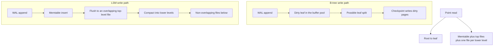

## Concept

### Two places a write can land

A B-tree updates a page in place. The engine finds the leaf that owns the key, dirties that page in the buffer pool, and writes it back later, after the change has been recorded in a write-ahead log. A point read walks from root to leaf, a handful of pages, and stops. A short range scan follows sibling leaves. The write costs a log append plus, eventually, a random page write. The read costs a few random page reads when the cache misses. This is the shape of InnoDB and of classic B-tree indexes. A working set that fits in the buffer pool feels instant because the hot leaves stay resident.

A log-structured merge-tree never updates a sorted run in place. The write hits an in-memory memtable and is appended to a log so a crash can rebuild that memtable. When the memtable fills, it is frozen and flushed as an immutable sorted file. Later flushes add more files. A read must consider the memtable and every file that might hold the key. Compaction merges files so the number of places to look stays bounded, and so old versions and deletes eventually disappear. Disks and flash prefer the sequential flush. The loan is paid in compaction CPU, extra space, and read tail latency.

Neither structure is a moral upgrade. High ingest with a tolerant read SLA is an LSM problem. Point reads and short ranges with modest write rates are a B-tree problem. Embedding an LSM because it is fashionable, without a compaction budget, buys write throughput you will repossess as stalls when the background merge falls behind.

### The B-tree write path

The B-tree write is a log record plus a random page update. A full leaf splits. The parent is updated. The split can climb toward the root. Random keys dirty pages all over the buffer pool, and a checkpoint becomes a storm of random writes. Sequential keys, such as an increasing primary key, hit the right edge of the tree and look almost sequential on disk. That is a physical property of the tree, which is why key order shows up in capacity plans and not only in schema reviews.

MVCC does not remove the page machinery. PostgreSQL inserts a new heap tuple and updates indexes. InnoDB keeps old versions in undo. The index is still a B-tree with splits, and the log is still required before a dirty page can be written. Vacuum or purge is the background work that reclaims versions, the way compaction reclaims versions in an LSM. Choosing a B-tree does not cancel background I/O. It changes the shape of that I/O from sequential merges to random page writes and undo cleanup.

Point reads stay cheap while the hot pages fit in cache. When they do not, you pay random reads. Flash hides a lot of that until the working set and the write rate outrun the device. Each secondary index is another tree and another random write per insert. The write tax is visible in the buffer pool: every index page the insert touches becomes dirty and must be checkpointed.

### The LSM write path

Durability of an LSM write is the log append and its sync policy. Visibility to local readers is the memtable insert. Group commit waits for one sync across many writes. Skipping the sync entirely is a fast acknowledgement and a last few milliseconds that a crash will forget. Call that asynchronous durability if you must name it. Do not describe it as a committed write.

When the active memtable hits a size limit, it becomes immutable and a flush writes a sorted file, usually with a block index, a bloom filter, and compression. Files at the top of the tree may overlap in key range. A point read may have to consult every one of them, plus the memtables. Compaction merges overlapping files into lower levels. In the leveled design, below the top level a key lives in at most one file per level. Write amplification is how many times a byte is rewritten as it sinks. A delete is a tombstone that must meet every older version before space returns. A missing-key read still pays bloom probes and, on a false positive, a block read. Bloom filters make negatives cheap. They do not skip old versions of a key that exists.

Read amplification is why production LSMs grow extra machinery: a block cache, prefix blooms, sometimes a row cache or a persistent cache on local flash. A get is not a leaf walk. It is a probe of a stack of runs. A tall stack looks fine at the median and ugly at the tail, especially right after a flush burst and before compaction catches up.

### Who pays for yesterday's writes

A B-tree range scan walks ordered leaves. An LSM range scan is a merge of every memtable and every file that overlaps the range. If the top level has many overlapping files, scan CPU and I/O climb even when the logical range is small. Compaction exists to keep that fan-in sane. Point reads invert the story. A cache miss on a B-tree is a few page reads. An LSM point read is several bloom checks and possibly several file reads, unless compaction and the cache are healthy. Update-heavy keys stack versions until compaction, so a get may skip tombstones before it finds the newest value.

Space amplification is the third bill, and it shows up at the worst time. A B-tree wastes bytes inside pages that are not full, and it fragments after deletes until vacuum reclaims them. An LSM keeps several generations of a key until compaction sinks them, so a data set can sit at two or three times its live size while merges catch up. Tombstones make this worse. The delete is on disk, the old value is still on disk, and both remain until they meet in a merge. If you size the volume for live data plus a small margin, the first large update or range delete fills the disk during compaction, which is exactly when the engine needs free space to write new files. Budget the multiple, not the logical table size.

Choose by the dominant operation and the update rate. A session store with random point reads and moderate writes wants a B-tree, or an LSM tuned so hard toward leveling that the read path is trying to look like one. Metrics ingest and append-only event logs want an LSM. A B-tree for the primary row and an LSM for history is a legitimate product split. One engine for every table is a staffing choice. It is not a law of storage.

## Trade-offs

| Approach | When it wins | Cost / risk |
| -------- | ------------ | ----------- |
| B-tree, in-place leaves | Point reads, short ranges, modest ingest | Random write amplification, split storms, checkpoint stalls |
| LSM with leveled compaction | High ingest on flash, when extra read I/O is acceptable | Compaction debt, write amplification, tombstone lag, top-level read stalls |
| LSM with tiered or universal compaction | Bulk load and overwrite-light sinks | Higher read amplification, large files, slow range deletes |
| B-tree plus a small set of covering indexes | OLTP with a known query set | Each index is a write tax, and index DDL is a migration |
| Row B-tree plus an LSM for history | Mixed transactional rows and append-only telemetry | Two tunings, two backup stories, two failure modes |

The knob is which amplification you can afford. An LSM held at one level and compacted constantly can read like a tired B-tree and write like a busy disk. A B-tree whose dirty set exceeds what the device can drain writes like an LSM in a bad week, except the writes are random. Space follows the same split. B-trees waste fill factor and fragment until vacuum runs. LSMs keep extra copies of a key across levels until compaction. A delete with a deadline is easier to reason about when vacuum has a visibility horizon you can query than when you are waiting for a tombstone to sink to the bottom of the tree. Measure bytes written by background work versus bytes ingested, block reads per get, and on-disk size versus live size.

## Diagram

## Failure modes

### Compaction debt and write stalls

Flushes create overlapping files faster than compaction drains them. The engine stops writes when file count or memtable count hits a hard limit. Detection is top-level file count, pending compaction bytes, stall counters, and a write tail latency that jumps in steps rather than with request rate.

Mitigation is more compaction throughput, a lower ingest rate, or a layout that moves more bytes per job when that matches the read SLA. Disabling the stall keeps accepting writes until the process is killed by I/O. That is a loan. The files still have to be merged, and the merge will be larger when you finally allow it.

### Checkpoint storms on a dirty B-tree

A large fraction of the buffer pool is dirty. Checkpoint must write it. Foreground transactions wait on those writes or on the log flush that protects them. Detection is checkpoint duration, dirty-page ratio, and sync latency climbing together.

Mitigation is smoother checkpointing, a dirty-page limit, and a buffer pool no larger than the disk can drain in the checkpoint window you can afford. On cloud volumes, watch burst credits. The tree structure can be healthy while the I/O budget is exhausted. A larger buffer pool makes the storm larger if the device cannot absorb it.

### Tombstones that never meet their data

A delete writes a marker. Older values in lower levels remain until compaction reaches them. Reads skip the markers and return the right answer. Disk usage does not fall. Detection is tombstone counts by level, scans that touch many keys to return few rows, and space that stays high after a purge the application believes is finished.

Mitigation is a compaction of the affected range, dropping files that are entirely covered by a range tombstone once snapshots allow it, and refusing to store unbounded history in one key. Deleting a tenant "now" wants a partition or a file boundary you can drop, not a billion markers that must sink through every level.

### Cold cache after restart

A restart empties the block cache. LSM reads suddenly touch every bloom filter and index block. B-tree reads walk cold leaves. Detection is a latency spike aligned with process starts, a collapsed cache hit rate, and deep I/O queues on a cluster whose request rate did not change.

Mitigation is cache warming from a sample of hot keys, a persistent cache on local flash where the engine supports it, and staggered restarts so the whole fleet does not go cold together. For an LSM, drain overlapping top-level files before a rolling restart so the cold path has fewer files to open.

## Real-world example

RocksDB is the LSM most systems actually embed: MyRocks, TiKV, stream-processor state, and a long list of custom stores. A write appends to the log and the memtable, flushes to an overlapping top level, then leveled compaction produces non-overlapping files below, with a bloom filter on each file. Operators live in compaction pending bytes and write-stall counters. They do not live in the asymptotic cost of a memtable insert, which was never the bottleneck once the tree had more than one level.

The comparison inside the same companies is often InnoDB or PostgreSQL. MyRocks was built as a response to InnoDB's space and write amplification on flash for an ingest-heavy workload. The claim was not that every point read got faster. The claim was fewer bytes written to flash and better compression, because immutable files pack well and updates do not split pages in place. That is the quality of decision you want: the device, the mix of gets and puts, and which amplification you can pay. Adopting RocksDB without a compaction budget produces top-level stalls in the second week, on a tree that is working as designed. The stall is the engine protecting the read path from an unbounded stack of files.

## What to remember

- B-trees update pages in place and keep point reads short; LSMs append, flush, and compact, and they keep ingest sequential.
- Amplification moves: random writes and splits on a B-tree, compaction and multi-file reads on an LSM, extra space on both until background work catches up.
- Overlapping top-level files and tombstones are the LSM failures that look like a slow disk; a dirty buffer pool is the B-tree version of the same story.
- Pick from the dominant operation and the device's sustained write rate, then budget the amplification you chose.
