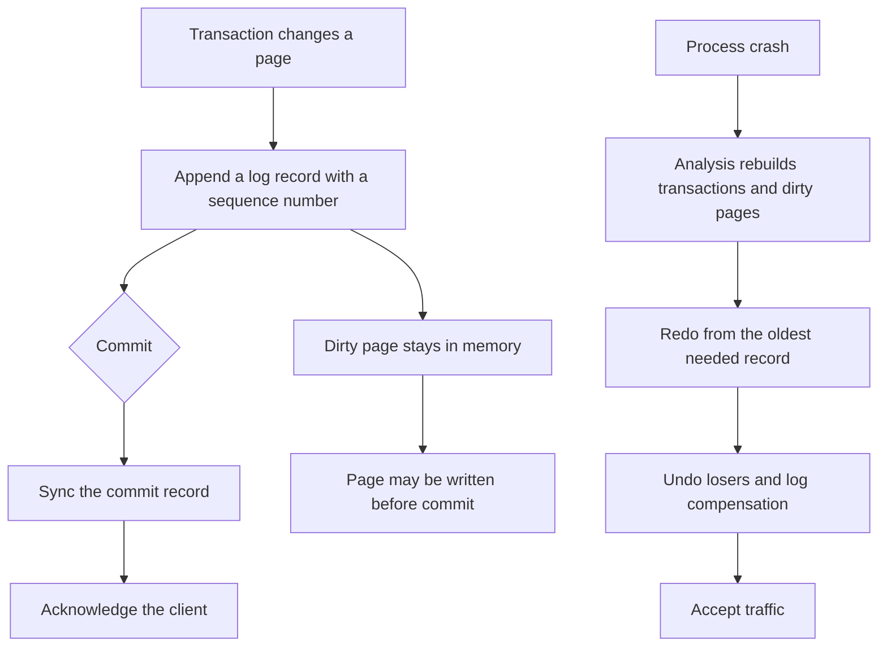

## Concept

### Commit is a log record

A process can die after a transaction looks committed in memory and before every data page is on disk. If you write data pages first and then crash, you have bytes with no description of the transaction that produced them. If you make a log record durable first, you can replay. Write-ahead logging is that rule: a dirty data page must not reach stable storage until the log records that explain it are durable. The commit point the client hears about is the durable commit record, not a clean leaf and not an in-memory lock release.

The same rule holds on an LSM. The memtable is memory. The log is the backup of that memtable. After restart, replay the log into a new memtable and continue. If you skip the sync on the log, you have a fast acknowledgement and a tail of writes that a kill -9 or a power loss will erase. Name that asynchronous durability. Do not call the acknowledgement a durable commit.

### Steal, no-force, and two directions of recovery

Two buffer policies decide how hard recovery is. Steal means the buffer pool may write a dirty page of a transaction that has not committed, because it needs the frame for something else. No-force means commit does not flush every page the transaction touched. It flushes the log. Production OLTP wants both. Steal avoids pinning memory for the life of a long transaction. No-force makes commit one sequential sync instead of a random write of every touched page.

Those policies imply redo and undo. After a crash the disk holds pages that are too new, because uncommitted work was stolen out, and pages that are too old, because committed work was not forced. Recovery must redo committed work that never reached data pages, and undo uncommitted work that did. ARIES is the practical family of algorithms that does this with a log sequence number on every page, a dirty-page table, and a transaction table. You can operate the invariants without implementing the paper. Every page stores the sequence number of the last log record applied to it. Redo applies log records newer than the page. Undo walks a loser's log backward and writes compensation records so a crash during undo does not undo twice. A checkpoint records the dirty-page table and the transaction table so analysis does not start at the beginning of the log.

### Analysis, redo, and undo as an operator sees them

Restart has three phases you should be able to name. Analysis reads the last checkpoint and the log tail. It rebuilds which transactions were in flight and which pages might be dirty. Redo begins at the oldest page that might be behind the log and applies every log record that the page has not yet seen, including records from transactions that will later abort. Repeating history is simpler than trying to redo only winners, because the page on disk may already contain a mix. After redo, the database matches the moment of the crash, losers included.

Undo then rolls losers backward, skipping compensation that already completed. Each undo step is itself logged. A crash during undo is recovered by the next restart: redo replays the compensation records, and undo continues from where it left off. A database that is "up" as a process and still refusing connections is often in redo I/O. The log must be readable, data files must accept writes, and page sequence numbers must be trustworthy. A wrong sequence number makes redo skip a record or apply it twice. That is corruption, and checksums are how you notice before you serve the page.

LSM recovery is a narrower version of the same idea. Immutable files are not updated in place, so there is no page-level undo of a sorted run. A flush that crashes before the manifest names the new file leaves an orphan the engine ignores. Recovery reads the manifest to learn which files are live, then replays log segments newer than the last successful flush. You still must not delete a log segment until the data it covers is in a file the manifest has made durable. The log and the manifest are the checkpoint. Dropping either one loses keys or resurrects files you thought were gone.

### Checkpoints, group commit, and where commit actually lives

A checkpoint bounds recovery time. Too rare, and restart replays hours of log. Too frequent, and checkpoint I/O stalls the foreground. Fuzzy checkpoints do not flush every dirty page. They record how far back redo must start, and the pages drain in the background under the write-ahead rule. A backup that is a file copy without the log tail after the checkpoint is a snapshot of a world that includes stolen uncommitted pages and misses committed ones. The backup procedure is a checkpoint plus the log, or a storage-engine snapshot that already applied that rule.

Group commit packs many commit records into one sync. You add a small amount of latency and gain a large jump in commits per second on the same device. On cloud block storage, that sync latency is the database's commit latency. Measure it on the volume class you will run in production.

Operators should see which phase restart is in. A long analysis means the checkpoint is old or the log is huge. A long redo means log apply is I/O bound. A long undo means a loser touched a great deal of data. Expose the phase, the oldest sequence number still being applied, and the number of loser transactions. Recovery that has never been rehearsed on a full-sized log is a design you have not finished.

Replication moves the commit point off the local disk. If commit means the local log is durable, failover can lose acknowledged writes when that disk's tail never reached a replica. If commit means a quorum has the log, recovery includes replicas catching up, and truncating a log suffix creates new losers that undo must roll back. The local story remains. A replica that received a record must be able to redo it. A replica that applied stolen pages must be able to undo if that suffix is discarded. Write the acknowledgement policy in the same sentence as the loss you will admit in an incident review.

## Trade-offs

| Approach | When it wins | Cost / risk |
| -------- | ------------ | ----------- |
| Log plus steal and no-force, ARIES-style | OLTP B-trees that cannot flush every page at commit | Complex recovery, checkpoint tuning, long undo of huge transactions |
| Log plus memtable flush and a manifest | High ingest and immutable files | Log pile-up if flush stalls, a bad manifest loses or resurrects files |
| Force every dirty page at commit | Tiny stores where restart must be trivial | Commit cost tracks random I/O, a poor fit for OLTP |
| Log without sync | Caches and telemetry that may lose the tail | Clients believe a commit that a crash erases |
| Quorum commit of the log | Failover without silent loss of acknowledged writes | Commit latency includes the network |

Recovery time is a service objective. It depends on how much log sits after the last checkpoint, how dirty the data files are, and how much undo a loser left behind. One multi-hour transaction that touched millions of rows can make recovery longer than the outage you were recovering from. Cap transaction size. A batch job that must be atomic belongs in smaller transactions with an application-level cursor, or in a design that can abort without rolling back a day's writes one row at a time.

Checksums on log records and on pages belong in the first design. Replaying a torn record writes garbage and then serves it. Detect tears with checksums and with log blocks that match the device's atomic write size. If the disk reports a sync and then loses the sectors, you need a quorum that does not trust one device.

## Diagram

## Failure modes

### A disk that acknowledges a sync and then loses the tail

The kernel or the cloud volume reports the sync, then drops the last log sectors on power loss. Restart replays an older tail. Clients already received success. Detection is checksum failures, gaps in sequence numbers, a replica whose log is longer than the restarted primary, and rows that vanish after a power event while the application log says the write succeeded.

Mitigation is checksums, a second log device when the engine supports it, and a documented flush behavior for the volume class you actually use. For replicated systems, withhold the acknowledgement until a quorum has the record. A single-node sync on a volume that lies about durability is a story the incident review will not accept.

### Recovery that does not finish

Redo walks a huge uncheckpointed log, or undo walks a giant loser. The process is alive and refuses connections. Detection is phase timers, log bytes replayed per second, and a growing gap between process start and the moment the engine accepts a query.

Mitigation is frequent fuzzy checkpoints, a hard limit on transaction size, and keeping maintenance jobs out of one enormous transaction. On an LSM, flush and cut the log before the disk fills with segments you will have to replay. If recovery is I/O bound, give it the bandwidth. Starting a heavy compaction at the same moment as redo fights the replay you are waiting on.

### The log volume fills

The log cannot extend. Commits hang, because the next commit record has nowhere to go. If the data volume is also full, you cannot checkpoint or flush in a way that releases log space. Detection is disk usage on the log volume, log directory size, and commit stalls with an out-of-space error while the data files look only moderately full.

Mitigation is separate volumes, alerts well below full, and a rate limit on ingest when flush or checkpoint falls behind. Truncate a log prefix only with the engine's documented tool, and only when that prefix is known to be covered by a checkpoint or a manifest. Deleting log files by hand produces pages you can never redo and a restart that stops on a checksum.

### Torn pages and dishonest sequence numbers

A page larger than the device's atomic write is interrupted. The page mixes old and new bytes. The sequence number may look new while half the page is old, or the checksum fails and restart refuses the page. Detection is checksum errors during redo and assertions that a page's sequence number does not match the log.

Mitigation is a torn-page strategy matched to the engine: write a full page image the first time a page is dirtied after a checkpoint, a doublewrite buffer that lands the page twice, or a copy-on-write layout that never updates a page in place. Checksums without that strategy detect the tear and then refuse to open, which is better than silent corruption and worse than preventing the tear. Immutable sorted files sidestep in-place tears; they still need checksums on the blocks they write, because a partial flush of a new file is an orphan or a corrupt block.

## Real-world example

RocksDB is the durability story many teams actually ship, because they embedded it and then treated the defaults as a policy. A put appends to a log file and updates the memtable. A flush writes an immutable sorted file and then a manifest edit that makes the file live. Only after that manifest is durable may the engine delete the log covering those keys. On crash, recovery reads the manifest, opens the live files, and replays the remaining log into memtables. There is no undo of sorted-file pages, because those files are immutable. A crash in the middle of a flush leaves a file the manifest does not name, and recovery ignores it.

Operators still break the contract in deployment. Disabling the log on a column family they later treat as a system of record is a silent change of the durability promise. Syncing nothing on every write buys throughput and loses the tail on a hard kill. Filling the log disk while flush is stalled is a hard outage: you cannot acknowledge, you cannot cut the log, and the next restart has a long replay if it can start at all. The engine is following write-ahead rules. The deployment is not. Treat that log like any other database log. Give it a volume, a bounded size, a flush that actually runs, and a backup that includes the manifest, the live files, and the log tail. A copy of the data directory taken while writes continued, without a checkpoint the engine understands, is not a backup you can open.

## What to remember

- Durability is a log record made durable before the data page; the commit the client hears is that record.
- Steal plus no-force needs redo and undo; practical recovery repeats history, then rolls losers back with logged compensation.
- Checkpoints bound restart time; huge transactions and disks that lie about sync turn recovery into the outage.
- Immutable-file engines still have a log and a manifest; they remove page undo, and they still replay whatever the manifest has not yet covered.
