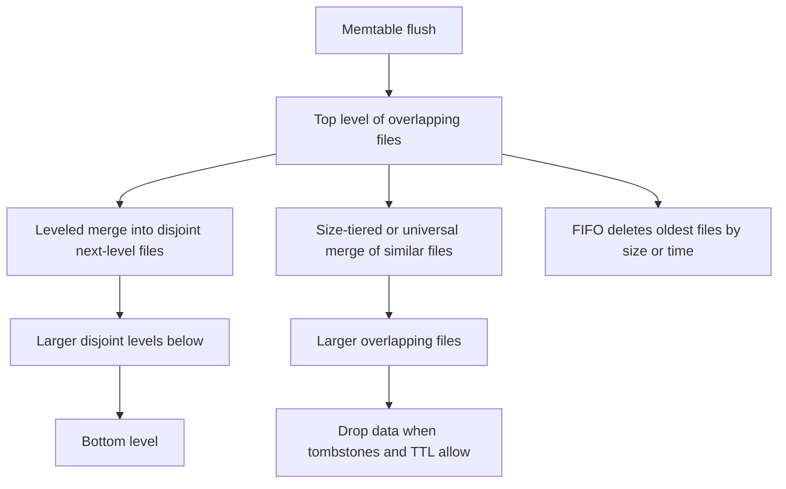

## Concept

### Compaction is the merge that keeps reads finite

An LSM write path only appends. Memtables become immutable files, and those files may overlap in key range. Without a background merge, a point read would open every file ever flushed. Compaction reads some of those files, merges keys in order, drops versions and tombstones that no snapshot still needs, writes new files, and installs them with an atomic manifest edit. Old files become garbage once no iterator holds them. The strategy is which files you pick, how you group them into levels or size tiers, and how you admit you are behind. That choice sets write amplification, read amplification, and space amplification. No strategy minimizes all three at once. You are choosing which bill to pay, and you are choosing it under a disk that also serves flushes, the log, and user reads.

Bandwidth is shared. A strategy that looks tidy on a whiteboard and then runs on a volume whose burst credits are empty will stall foreground writes. Provision I/O for ingest plus compaction plus reads. On leveled layouts, compaction often rewrites several times the ingest rate. Size the disk for that multiple, not for the application's write rate alone. A capacity plan that quotes user megabytes per second and forgets the merge is how a cluster fills its write budget in week two.

### Leveled compaction

Leveled compaction, the default many RocksDB deployments inherit, organizes files into levels. The top level holds freshly flushed files that may overlap. Lower levels partition the keyspace so that files inside one level do not overlap. A compaction job takes a file from one level and every file in the next level that overlaps its key range, merges them, and writes replacements into the next level. Each level's target size grows by a multiplier, often around ten. A byte is rewritten about once per level as it sinks toward the bottom, which is why random updates show write amplification in the teens or higher.

The read path is why you pay that. Below the overlapping top level, a point read looks in at most one file per level, helped by a bloom filter that skips files which cannot contain the key. Space in the lower levels stays closer to the live data set, because each level is a partition rather than a stack of full copies of the table. If flushes outrun the merge that drains the top level, overlapping files pile up, point reads slow down, and the engine eventually stalls writes to protect itself. Leveled compaction is a promise to spend disk bandwidth on tidiness. Starve that bandwidth and the name in the configuration no longer describes the tree you are running. You are running a pile of overlapping files with a stall waiting at the end.

### Universal and size-tiered compaction

Universal compaction, and Cassandra's size-tiered strategy, group files of similar size and merge them into one larger file. They do not partition a level into non-overlapping ranges as the primary organizing idea. A point read may consult many files of different generations. Space amplification is often around two or worse, because several nearly complete copies of the data sit on disk until a large merge finishes and the inputs can be deleted. Write amplification can be lower than leveled compaction for ingest-heavy, overwrite-light data, because a given byte is merged fewer times on its way to a large file.

This fits bulk load, append-mostly sinks, and clusters where disk capacity is cheaper than leveling's write tax. It fits poorly when you have a point-read latency target across a wide keyspace, and it fits poorly when a merge of multi-gigabyte inputs runs for hours and then has to be streamed to other replicas. Size-tiered compaction on tables with heavy updates is a known trap. Many similarly sized files overlap the same keys, and the merge writes an output about as large as the sum of the inputs. You need free space on the order of the inputs, and you need the job to finish before the next tier fills.

Time-window compaction is the specialized cousin. Files are bucketed by a time column, compacted inside a window, and whole windows are dropped when a TTL expires. The delete of old data is a file drop rather than a tombstone that must sink through every level. That is the right tool when the data model is time-bounded and old windows are not updated in place. It is the wrong tool when yesterday's window still receives corrections, because those corrections fight the assumption that a window becomes immutable.

### Hybrids, FIFO, and what a merge is allowed to drop

Some layouts keep overlapping runs at the top, where ingest is cheap, and level only the colder bottom, where reads want one file per level. The top absorbs a burst. Reads during the burst pay the tiered cost of many overlapping files. After the burst, leveling catches up and the read path settles. If the burst never ends, the hybrid is tiered for the life of the cluster. Treat the hybrid as a capacity plan: how many bytes per second of leveling you have after the spike, and how tall the overlapping top is allowed to grow before you stall. It is not a way to avoid choosing an amplification.

FIFO compaction does not merge to improve reads. It deletes whole files when a size or time cap is hit. That is a cache with a calm configuration name. Using it on a column family that users query for old keys is a data-loss setting. If the product promise is "we keep ninety days," FIFO that drops by size will drop the ninety days whenever ingest exceeds the cap. Say that in the design review.

Obsolete versions drop when no snapshot needs them. Tombstones drop when they have been compacted past every older value they cover and the oldest snapshot is newer than the tombstone. A long-lived snapshot, a forgotten backup iterator, or a lagging replica holds that horizon open. Tombstones live, space does not fall, and reads pay to skip markers. Range tombstones are stricter. They must be carried until they cover every overlapping file that might still hold a key in the range. If the triggers that start a job are looser than your ingest, the tree silently changes shape. Alert on file counts and pending bytes, not only on disk percent full. A hot key with millions of versions turns one key range into a permanent job while other ranges starve. The strategy cannot repair a partition that is a single key. Shard the key, or put unbounded history in a structure you can drop by time.

## Trade-offs

| Approach | When it wins | Cost / risk |
| -------- | ------------ | ----------- |
| Leveled compaction | Point reads, tighter space, a write budget you can spend on merges | High write amplification, stalls when the top level is not drained |
| Universal or size-tiered | Bulk ingest and overwrite-light data | Read amplification, huge files, space amplification, long jobs |
| Time-window compaction | TTL series where a whole window dies together | A poor fit for updates inside old windows |
| Tiered top, leveled bottom | Bursty ingest with a read-stable tail after the burst | Two tunings, and a permanent burst stays tiered |
| FIFO | Caches and data you are allowed to forget | Deletes history; a source of truth will lose keys |

File size sits beside the strategy as a second knob. Tiny files mean too many opens and too much metadata in the manifest. Huge files mean one job is an outage, a restart reopens monsters, and a single bad range blocks a large merge. Cap file size. Cap the number of overlapping top-level files with a stall you alert on, rather than an infinite queue you discover when clients time out. Free space is part of the strategy. A merge writes new files before it deletes old ones, so peak usage is live data plus the inputs and outputs of in-flight jobs. A volume at ninety-five percent full cannot compact, which means deletes never become free space. Reserve headroom as a hard operating limit. Rate-limit compaction against user reads on a shared device, and test that limit at peak ingest. An unbounded merge will take the disk, and tail latency will follow the job.

## Diagram

## Failure modes

### Write stalls when the top level runs away

Flushes continue and compaction does not keep up. The engine hits a stop-writes trigger to keep the read path finite. Detection is stall counters, overlapping file count at the top level, pending compaction bytes, and a step change in write tail latency.

Mitigation is more compaction threads and more sustained disk bandwidth, or less ingest. Check for one hot key range that monopolizes the scheduler. Lowering the stall threshold without more I/O keeps writes flowing until the disk falls over and flushes fail too. Scale the device, or accept a lower write rate as the product limit.

### Disk full in the middle of a merge

New files must land before old files are deleted. A size-tiered merge of large inputs can need about as much free space as the data it is rewriting. Detection is the volume filling during compaction, not during the application's insert path, and jobs that fail with an out-of-space error while user write rate is ordinary.

Mitigation is a free-space reserve you alert on early, smaller target file sizes so each job's temporary footprint is bounded, and leveled compaction when you cannot keep a large spare. Compaction is how deletes become bytes you can use again. Treating it as optional background noise is how a purge fails to free the disk it was meant to save.

### Tombstones pinned by snapshots, and deletes that return

A long-lived snapshot or a paused iterator holds versions. Compaction refuses to drop tombstones that a snapshot might still observe. Detection is snapshot age, pending compaction that never falls, and on-disk size far above the live row count. In a leaderless store there is a second version of this bug. Dropping a tombstone before repair has copied it to a lagging replica lets the old value stream back and reappear.

Mitigation is a deadline on snapshots, killing stale backup cursors, and a grace period longer than your repair cycle plus the longest outage you will tolerate before you restore from backup. Follow the engine's rules for when a delete may disappear. A row that returns after repair is this horizon bug. The merge did what the horizon allowed.

### One enormous job owns the disk

A universal or size-tiered merge of many multi-gigabyte files runs for hours. Queries that need those files wait on the job or on cache eviction as the merge reads everything. Detection is job duration, one thread or one device saturated, and latency that tracks the job start rather than request rate.

Mitigation is smaller buckets so jobs finish in minutes, a rate limit that leaves I/O for queries, and a time-window layout when the data is shaped by time. Parallelize by key range when the engine allows it, and avoid starting every range on every node in the same minute. Making the single job larger to "get it over with" makes the outage larger and the free-space requirement larger with it.

## Real-world example

RocksDB's leveled compaction is what teams inherit when they embed the library and leave the compaction style at its default. Public write-ups from large MyRocks deployments treat compaction as a write-amplification budget on flash. Ingest at N megabytes per second implies several times N in file rewrites, and background job limits plus the disk are sized for that product. The counters operators watch are overlapping file count at the top, pending compaction bytes, and write stalls. Those sit on the same dashboard as device errors, because a stall with a healthy disk is still a user-facing outage.

Cassandra's history is the cautionary sibling on the same mechanisms. Size-tiered compaction on tables with heavy overwrites produced stacks of overlapping files and merges that ran for hours and demanded large free space. Time-window compaction later became the usual path for time-series tables with a TTL, because dropping a window is cheaper than sinking tombstones. Leveled compaction exists in Cassandra too, and it has the same top-of-tree stall under a different configuration name when memtable flushes outrun the leveled jobs. The portable lesson is to name the strategy, name the amplification you bought, and put the stall metric next to request rate. A cluster with idle CPU that still refuses writes is usually waiting on compaction I/O, or on a single hot range the scheduler cannot finish.

## What to remember

- The strategy picks the bill: leveled spends writes to buy reads and space; tiered and universal spend reads and space to buy cheaper ingest.
- A growing pile of overlapping files means compaction is behind; raising stall limits without more I/O fails later and harder.
- Tombstones and snapshots pin space, and the disk often fills during the merge, when new files exist beside the old ones.
- Match shape to data: time-bounded TTL data to windows, randomly updated keys to leveled compaction, and caches to FIFO.
