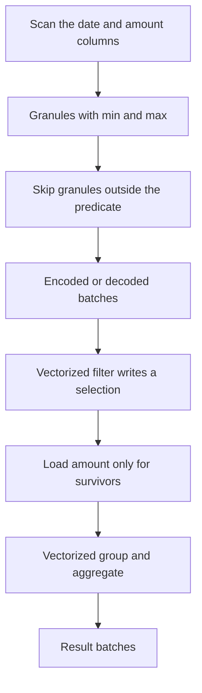

## Concept

### Row pages throw away most of a scan

A row store packs every column of a tuple into the same page. That layout is the right one for fetching one order by primary key: one I/O, or a short index walk, returns the whole row. It is the wrong layout for summing an amount by region over a month. The scan still reads comments, blobs, and every column the predicate never touches, then discards them in the CPU. Cache lines fill with bytes the filter does not use. Compression stays weak because neighboring bytes are different types with different distributions, so a general-purpose compressor sees noise.

Columnar storage keeps each column in its own contiguous run, in chunks of thousands to tens of thousands of values, aligned by position inside a granule or row group. A query on date and amount reads those two streams and leaves the rest on disk. Compression starts to pay. Low-cardinality strings become dictionaries. Sorted integers become deltas or run lengths. Nulls become a bitmap. The unit of I/O is the columns this query needs, inside the row ranges that might match, rather than the whole table. Warehouses and many analytical engines look like this for that reason.

A point lookup of one wide row can get worse, because reconstructing the tuple opens many column files. Hybrid systems keep a row-shaped path for recent or hot rows and convert to columns in the background. That conversion is a product decision with a freshness budget. Lag between the row buffer and the columnar parts is a user-visible staleness bug, and it needs the same paging as replication lag.

### Encodings, granules, and skip indexes

A column chunk is rarely a raw array of uncompressed values. It carries an encoding: dictionary, run-length, delta, bit-packed integers, or plain. Dictionary encoding fits strings with modest cardinality. Run-length encoding fits sorted or repetitive values, which is why insert order and a clustering key still matter after you have left the row store. The executor should operate on encoded data when the operator allows it. An aggregate over a long run-length is a multiply of the run's value by its length, not a loop over every row. Decoding every column to wide integers before the first filter spends the CPU and the memory bandwidth you hoped the layout would save.

Each granule carries summary statistics: minimum and maximum, sometimes a bloom filter or a zone map, and a null count. A predicate that falls entirely outside a granule's range skips that granule without decoding it. This is not a B-tree. It works when the filter column is correlated with on-disk order. If every granule contains a random sample of dates, min and max span the whole domain and nothing is skipped. You sort or partition on the columns you filter. In ClickHouse the table's sorting key is this idea made explicit: the order is the skip index, and a query that does not align with it reads the parts.

Late materialization keeps surviving rows as positions rather than as stitched tuples. Filter the date column, produce a selection vector of positions that passed, then load amount only for those positions. Early materialization builds full rows and then filters, which throws the columnar layout away at the first operator. Scans in a vectorized engine are almost always late. The exception is a query that truly needs every column, in which case the layout's I/O win was never available and you should ask why the scan exists.

### Vectorized execution versus one row at a time

The volcano model is an iterator per operator. Next returns one row. The model is simple to reason about, and it spends analytical queries in interpretation: a virtual call, a null check, and a branch, once per row, with the next operator's code nowhere near the current one in the instruction cache. On hundreds of millions of rows the CPU is in the interpreter, not in the arithmetic the SQL described.

Vectorized execution changes the contract. Next returns a batch, often on the order of a thousand to a few thousand rows, as columnar arrays plus a validity bitmap for nulls. Operators loop over arrays. The compiler can vectorize the loop, or the engine emits SIMD directly. Predicates write a selection vector of surviving positions instead of building a new row for each survivor. Hash probes take a batch of keys. The inner loop starts to look like numerical code, which is what a sum over a column actually is.

Compiling a query to native machine code is a related and separate bet. Compilation removes interpretation of an operator tree. Vectorization removes per-row call overhead and makes SIMD practical. You can vectorize an interpreter that still runs bytecode, or you can compile loops that are already batch-oriented. The architectural commitment is the batch as the currency between operators, and columnar memory inside the executor, not only on disk.

### Joins, updates, and where the batch falls apart

Scan, filter, project, and aggregate is the best case: sequential column I/O and tight loops, with the hash table for a group-by as the main risk. Joins are harder. A hash join built one row at a time loses the batch. A hash join built from vectors still has a hash table that may not fit in cache, and a probe that scatters. Partitioned joins exist to keep each partition's table in cache and to bound memory. Looking up a row-store dimension from a columnar fact scan reintroduces random I/O and row stitching at the boundary. That boundary should be a deliberate design, with the dimension small enough to broadcast or cache, rather than an accident of two engines sharing a query.

Updates and deletes fight the immutability that makes compression and granules work. Many engines store compressed chunks that are not edited in place. An update is a delete mark plus a new row in a delta, merged at read time or during a background compaction of parts. High-frequency point updates turn the column store into an LSM wearing a different costume. You pay the merge on every read until background work catches up, and you pay it in part count, which is its own metadata problem. If the workload is those updates, keep them in a row store and ship aggregates or change batches on purpose.

Batch size is a cache decision. A few thousand values of a narrow integer column fit in L2. The same count of wide strings does not, and a dictionary-encoded column should stay encoded through a low-cardinality filter, decoding only the survivors. A pipeline that materializes every column into a row struct before the aggregate has already lost the layout. If the hash table dominates CPU, more SIMD in the scan will not move the query.

## Trade-offs

| Approach | When it wins | Cost / risk |
| -------- | ------------ | ----------- |
| Columnar files plus a vectorized executor | Aggregations over few columns of large fact tables | Weak point lookups, painful point updates, skips that depend on order |
| Row store and one-row iterators | OLTP, point reads, fetches of a whole wide row | Analytical scans waste I/O and CPU on unused columns |
| Row buffer for hot data, columns for cold | Mixed access: today by id, history in bulk | Two formats, conversion lag, two failure modes |
| Compile the query to native code | Long, stable queries where compile time amortizes | Slow first run, harder debugging of generated code |
| Operators on encoded batches | Low-cardinality filters and group-bys that never fully decode | Encoding-specific operator code, a silent fallback to full decode |

Wide tables still scan well when queries name a few columns. A reporting tool that selects every column reads every stream, and the columnar advantage collapses. Stay encoded through the filter, or decode only the survivors into tight arrays. Memory bandwidth is often the ceiling: a vectorized scan can saturate a socket and look CPU-bound while it waits on memory.

## Diagram

## Failure modes

### Skip indexes that never skip

Data arrives unordered on the filter column, or the sorting key is a random identifier while queries filter on time. Every granule's minimum and maximum cover the domain. The engine reads every granule and the skip machinery is dead weight. Detection is bytes read nearly equal to the relevant columns of the whole table on a query you believe is selective, and a skip or mark counter stuck near zero.

Mitigation is to order or partition by the columns you filter, or to sort in the load path before parts are written. In ClickHouse the sorting key is load-bearing for this reason. In a columnar lake format, partition directories and the sort inside a row group are the same idea. If you cannot order the data, do not promise scan acceleration from zone maps. You will pay for the statistics and still read the table.

### Batches that miss the cache

Batches that are tiny bring interpreter overhead back, one virtual call per handful of rows. Batches that are huge blow the CPU cache and turn the hash table into a memory-bandwidth test. Detection is profiles stuck in hash probes, memcpy, or allocation, and a regression when you raise parallelism or batch size without measuring bytes moved.

Mitigation is a profiler and a measured batch size per operator, not a constant copied from a blog. Partitioned joins and dictionary-sized keys beat a larger block when the hash table is the cost. Watch memory bandwidth and last-level cache misses. A vectorized engine can pin one socket and look busy while it waits on memory. More cores on that socket will not help until the working set shrinks.

### Point updates against immutable parts

The analytical table is used as a mutable system of record. Each update creates a delete mark and a tiny new part or a delta row. Queries merge those marks on read. Detection is part count climbing, merge time dominating query time, disk usage far above the live row count, and mutations that queue faster than background merges drain them.

Mitigation is a primary store for point mutations, periodic rebuilds of parts from a sorted staging table, and partition replacement instead of row-level deletes. If change data must land in the analytical engine, collapse it before insert so each part is large and ordered. Millions of single-row mutations are how merge debt starts, and the debt looks like "the cluster got slower" rather than like a write-path design.

### Wildcard queries and early materialization

A dashboard layer expands every column, or an application fetches full rows and filters in process. Columnar I/O becomes a wide read. A pipeline that stitches rows before the filter pays to decode columns it will drop. Detection is query logs with dozens of columns on a screen that shows five, shuffles of wide batches, and scans whose bytes do not match the fields in the report.

Mitigation is views or a semantic layer that project the columns the report needs, and a refusal of unbounded selects on fact tables. Keep late materialization in the engine: filter on the ordered column, then read the measure. That control is architecture. It is not a tuner setting you discover after the BI tool has been in production for a quarter.

## Real-world example

ClickHouse made columnar storage and vectorized execution an operations problem for teams that are not running a warehouse vendor's managed product. Data sits in parts. Each part is a set of compressed column files ordered by the table's sorting key. A query reads the columns it names, skips granules whose min and max fall outside the predicate, and runs on blocks through a pipeline of operators that favor tight loops over per-row virtual calls. Inserts write a new part. Background merges compact parts the way an LSM compacts sorted files. Asynchronous mutations are merge-bound: they land as marks and become real when a merge rewrites the part.

Teams that sort by tenant and time, and that query by tenant and a time range, see granules skipped and compression that looks disproportionate to the raw row size. Teams that order by a random identifier and filter on time read nearly every granule of the filtered columns. Using the table as an OLTP system of record, with a stream of single-row updates, is how a cluster enters merge debt: part counts rise, merges fall behind, and queries spend their time combining deltas. The engine is explicit about parts, sorting keys, and merges. The mistake is treating a columnar vectorized store as a faster row database that happens to compress. Use it for scans, rollups, and append-mostly facts. Keep point-mutable state in a row store, and move aggregates or sorted batches across that boundary on a schedule you can explain.

## What to remember

- Columnar layout wins when a query touches few columns across many rows, and granule skips work only when on-disk order matches the filters.
- Vectorized execution makes batches the currency between operators so cache and SIMD can matter; a one-row iterator spends the query in calls.
- Late materialization and encoded execution are where the speed is; decoding every column into row objects cancels the layout.
- Immutable parts plus frequent point mutations are a merge problem, and they are a poor system of record for row-level updates.
