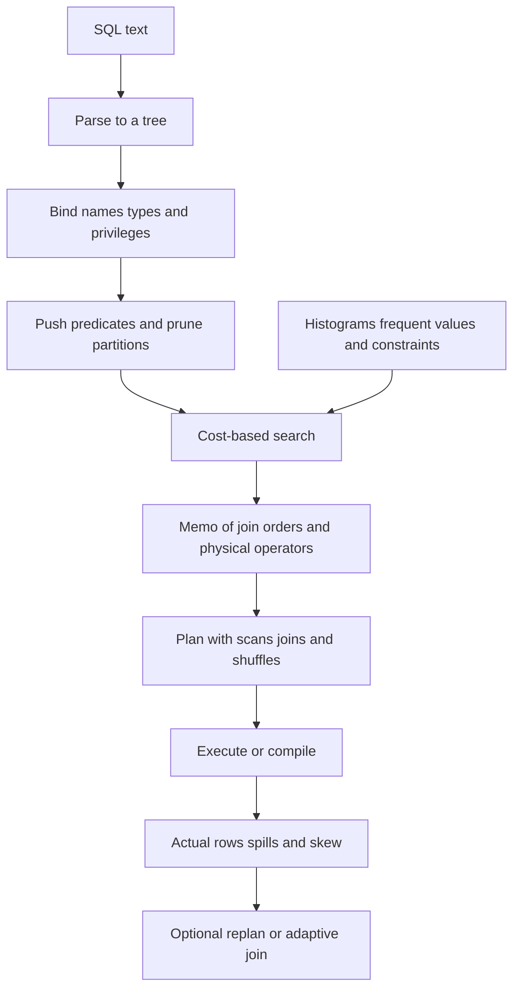

## Concept

### SQL text becomes a program

A query does not run as the string the application sent. It passes through stages, and each stage can fail or can lie in a different way. The parser builds a tree. The binder resolves names, types, catalogs, and privileges, expands views, and inserts casts. The rewriter applies transforms that are supposed to preserve meaning: predicate pushdown, subquery flattening, view inlining, constant folding, and partition pruning when the predicate matches a partition key. The optimizer then chooses join order, join algorithm, access path, and, in a distributed engine, how rows move between nodes. The executor runs that plan, or a compiled form of it, against storage.

Most incidents that present as "the database got slower" are a different plan, not a slower disk. A plan is a program. The optimizer is a compiler whose cost model is fed by statistics. If the statistics lie, the compiler emits a bad program and the executor runs it faithfully, often to completion, on the wrong shape. Adding hardware does not repair a nested loop that scans a large table once per outer row. You find that by comparing estimated rows to actual rows, not by watching CPU percent in isolation.

### Cost-based choice of physical operators

A cost-based optimizer enumerates physical plans, estimates a cost for each, and picks the minimum it has seen. Cost mixes I/O, CPU, memory, and, when data is spread across nodes, network bytes and the risk of skew. The inputs that dominate the estimate are cardinalities: how many rows leave each operator. Join order is exponential in the number of tables. Engines use dynamic programming up to a cutoff, then heuristics, or a cascade of transformation rules with a memo of equivalent expressions and the best physical plan found for each.

Physical operators are the other axis, and they are not ranked in the abstract. A nested-loop join is cheap when the outer side is small and the inner side is an index lookup that returns a row or two. It is a disaster when both sides are large and the inner side is a scan. A hash join builds a table on one side and probes with the other. It needs memory proportional to the build input, and it spills when that estimate is wrong. A merge join needs both inputs ordered on the join key, which is free when an index already provides the order and expensive when it means a sort. The same SQL text can prefer an index nested loop or a hash join depending on selectivity. The optimizer picks with estimates. It does not have a preferred operator.

Some rewrites stay rules because they are valid whenever the predicate has no side effects: push a filter toward the scan, prune a partition that cannot match, fold a constant. Mixing those rules with costed choices is normal. Pruning before the search keeps impossible scans out of the memo. A hint that freezes join order is a loan against future data. Fix statistics, histograms, and constraints first. If you hint, own it as a versioned exception with an owner and an expiry.

### Cardinality is the actual problem

Cost follows cardinality, and cardinality follows assumptions the catalog encodes. Predicates are treated as independent. Values are treated as uniform inside a histogram bucket. A join selectivity is often rows times rows divided by a domain size. Functional dependencies the catalog does not know are treated as if they do not exist. Real data correlates city with postal code, skews so that one tenant is a large fraction of the table, and filters on expressions the histogram never saw because the predicate was wrapped in a function.

When independence is wrong, two moderately selective filters in conjunction look far more selective than they are. The optimizer estimates a handful of rows, picks a nested loop, and scans the inner side once per outer row. When a join domain is wrong, a hash table estimated at tens of thousands of rows is hundreds of millions at runtime. It spills, or a distributed shuffle drowns one worker. The plan was optimal for a table that does not exist.

The repairs are histograms, lists of the most frequent values, distinct-count sketches, and extended statistics on columns you know are correlated. A unique index tells the optimizer that a lookup on that key returns at most one row. Not-null and foreign keys let it drop redundant joins or tighten estimates. Skipping analysis after a bulk load means yesterday's plan is today's outage, even though the SQL text did not change. Put last-analyze time next to index health.

### Distributed plans add a movement decision

On one node the plan is a tree of operators over local storage. In a distributed SQL system or a warehouse, the optimizer also chooses how rows move. A colocated join needs no shuffle when both sides are already partitioned on the join key. A broadcast sends a small side to every worker that holds the large side. A redistribute hashes both sides on the join key so matching rows meet. The cost model has to include network bytes and skew. One hash bucket receives the celebrity key, one worker does all the work, and the average cost the optimizer printed looked fine because it assumed a uniform hash.

Partition pruning has to happen before you price a scan of every range. If the predicate does not match the partition key, or if it is hidden inside a function, you scan the world. Some engines prune at runtime from a value produced by an outer query. Confirm that on an explain of the query you ship. A filter applied after a full shuffle has already moved data it could have dropped.

An analyze job that samples a partitioned table badly describes an average partition and misses the tenant that dominates. When a plan is wrong, ask which cardinality was wrong, then which assumption produced it. Plan stability matters more for short OLTP requests than for a warehouse job. A few milliseconds of latency cannot absorb a weekly flip from an index lookup to a hash join. Engines pin plans, re-optimize when estimates and actuals diverge, or switch join strategy once they see the true cardinality. Adaptive execution can oscillate if the feedback is noisy. If the optimizer hashes a ten-row primary-key lookup, the statistics or the SQL are wrong.

## Trade-offs

| Approach | When it wins | Cost / risk |
| -------- | ------------ | ----------- |
| Cost-based search with histograms | Ad hoc SQL and data whose shape changes | Bad stats emit nested loops; planning time grows on very wide joins |
| Rule rewrites only | Simple engines and query shapes that do not change | Misses the physical join choice as data grows |
| Hints and pinned plans | A known-good OLTP query after an incident | Drift, hint rot, and a statistics bug that stays hidden |
| Adaptive execution | Long warehouse jobs where misestimates are common | Oscillation, and a weak fit for millisecond OLTP |
| Joining in the application | The database cannot see both tables | You became the optimizer, usually a worse one, with no statistics |

Planning time is hidden latency on the request path. A join of many tables can spend tens or hundreds of milliseconds searching before a row is read. Warehouses amortize that over a long scan. OLTP should limit join width, reuse prepared statements, and invalidate cached plans when statistics or schema change. A cache that never invalidates serves last quarter's plan. A cache that drops every plan on every analysis is a re-plan storm.

Bind variables interact with estimates. A plan chosen for a selective parameter is then used for an unselective one, or the reverse. Some engines sniff the first value, some use a generic average, and some re-plan when actual cardinality is far from the estimate. A statement that is fast in a console with literals and slow in the application with binds is this interaction. Decide whether that statement should be generic, sniffed, or split into two statements.

## Diagram

## Failure modes

### A nested loop from an absurdly low estimate

A filter is estimated at one row and returns millions. The inner side is scanned or looked up once per outer row. The query runs for minutes on a statement that should have been a hash join or a single index range. Detection is an explain that shows estimated rows and actual rows off by orders of magnitude, and one operator that dominates time while the rest of the plan is idle.

Mitigation is extended statistics on the correlated columns, a fresh analysis after the data shape changed, or a rewrite that materializes the large set once. A hint can stop the bleeding if it has an owner and an expiry. Alert on the estimate-versus-actual ratio for statements on the user path, not only on duration, so you see the bad cardinality before the next data growth makes it an incident.

### Hash spills and shuffle skew

The build side was estimated small and is huge. Memory fills and the join spills to disk, or one worker receives a hot key and the others finish early. Detection is spill counters, temporary-file growth, one worker saturated while the rest are idle, and network bytes that are not spread across hash buckets.

Mitigation is better distinct counts and frequent-value lists, salting a hot key when the product can stand a two-step aggregation, and broadcasting only when the side is truly small enough to copy. Set a memory limit that fails the query instead of melting the node. For an OLTP lookup this plan should not have been chosen at all. You wanted an index on the join key and a cardinality of one.

### Statistics that describe the table from before the load

The table grows by orders of magnitude, or a new partition arrives full. Statistics still describe last week's size and last week's histogram. The optimizer keeps a plan that was reasonable then, or it flips the moment an analyze job finally runs, in the middle of peak traffic. Detection is analysis time versus load time, a sudden plan change right after a maintenance job, or a suspicious lack of plan change after a load that should have moved every estimate.

Mitigation is analysis as a step inside the load, automatic analysis that fires when the row count moves by a threshold you set, and per-partition statistics so one tenant does not get the average of the others. Swapping in a partition that was never analyzed is a production change. Treat it like a schema migration, with an explain of the statements that scan it before you send traffic.

### A plan cache poisoned by the first parameter

The first bind after a restart or a cache flush is a rare identifier, so the cached plan is an index lookup that returns one row. Later binds are a common status code that matches a large fraction of the table, and every one of them uses the lookup plan, or the reverse: the first bind is common, the cached plan scans, and later rare lookups scan too. Detection is a query whose latency depends on who ran it first, and a plan that does not change when you vary the parameter in a prepared statement.

Mitigation is a generic plan for binds whose selectivity varies widely, a re-plan when actual cardinality is far from the estimate, or two explicit statements in the application when the two bind domains are different products. Restarting the database on a schedule to forget the cache is not a control. It is a way to re-roll the dice on whichever request arrives first.

## Real-world example

CockroachDB's optimizer is a cost-based, cascades-style planner over tables that are split into ranges. It rewrites, searches a memo for join order and physical operators, and costs both local index scans and distributed joins with network movement in the model. Statistics are collected on ranges and aggregated so the planner sees more than a single node's sample. When statistics are missing, estimates degrade, and the engine can say so in its diagnostics. Operators who skip statistics collection see distributed hash joins and full scans on lookups an index could have served. They feel it as tail latency and as elevated CPU on SQL gateways, not as a line item labeled "the optimizer."

The same class of incident shows up in other distributed SQL systems and in warehouses. The practice worth copying is to treat explain with actual row counts as the debugging tool, and to treat statistical objects as production dependencies with owners. A migration that adds an index and does not refresh statistics can still choose a scan, because the planner's row counts never learned that the index is selective. A migration that drops a constraint changes cardinality without changing a single query string. Monitor the age of statistics the way you monitor whether an index exists. The catalog is an input to the query plan whether or not anyone on the application team thinks they own it.

## What to remember

- The optimizer is a compiler and statistics are its inputs; a wrong cardinality becomes a wrong program that the executor will run faithfully.
- Cost-based join and access-path choices are the design; a hint is an exception with an owner and an expiry.
- Distributed plans add broadcast and shuffle, and skew makes an average cost lie about the slow worker.
- Debug with estimated versus actual rows, the age of statistics, and the way the plan cache treats the first bind.
