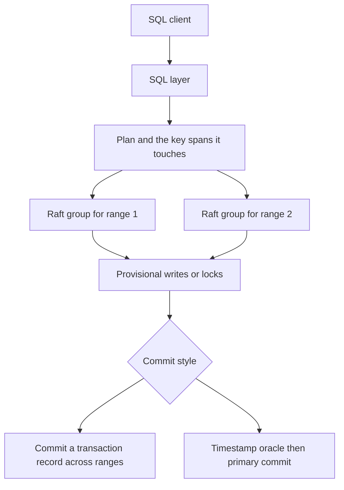

## Concept

### What the SQL API is hiding

A distributed SQL system offers a Postgres or MySQL wire protocol, multi-row transactions, and survival of machine loss without the application holding a shard map. Under that API the keyspace is split into ranges, each range is replicated by consensus, and a second protocol makes a transaction that touches several ranges atomic. The fork that matters to an architect is how that multi-range write commits. One family uses a consensus group per range and a transaction record that spans those groups. The other uses a Percolator-style lock protocol on a consensus-backed map, with a timestamp oracle. CockroachDB and YugabyteDB sit closer to the first. TiDB stores rows in TiKV, which replicates each region with Raft, and its usual transactions are the second: prewrite locks, a primary key that is the commit point, and timestamps from the placement driver.

These are not skins on one engine. Treating all three as "a global serializable database" mis-sets isolation, latency, and the failure playbook. A single-key write inside one range is one consensus round plus the storage engine. A transaction that writes ten ranges in three zones pays a distributed commit on the request path. If the application does that on every HTTP call, the database is behaving as designed and the design is what got slow. Count ranges touched per transaction before you count nodes.

### Raft per range, then a transaction record

Tables and indexes are split into ranges on a sorted keyspace. Each range is a Raft group. The leader serves writes and, while it holds a lease, can serve reads without a full quorum round on every get. A transaction that writes several ranges cannot be one Raft log for the whole cluster. It writes provisional values, often called intents, on the ranges it touches, then commits a transaction record that is the source of truth for whether those intents should become visible, then resolves the intents in the background or on the next reader. CockroachDB's parallel commit is this shape: the transaction record and the intents are coordinated so the client does not wait for a single global log of every key in the cluster. Failover of a range is failover of that Raft group. The SQL layer still has to finish or abort transactions whose intents sat on a leader that disappeared.

Serializable isolation, which is CockroachDB's default, needs a timestamp and a conflict story that goes beyond "the locks did not collide." A read at a timestamp must not miss a write that should have been visible, and a write must not invalidate a read that already committed at a later timestamp. Hybrid logical clocks, closed timestamps on followers, and a refresh of the read set are how that shows up in the implementation. The user-visible symptom is a retryable error. The application must retry the transaction body, and the body must be safe to run again. A client that surfaces the error as a 500, or that retries immediately in a tight loop, is a broken client on top of a cluster that is doing what serializability requires when clocks and conflicts disagree.

YugabyteDB splits the product surface more visibly. DocDB is a log-structured store with Raft per tablet. YSQL speaks a Postgres-compatible protocol. YCQL speaks a Cassandra-like API on the same storage. YSQL transactions use provisional records and a transaction status tablet, with Raft as the durability of each tablet's log. Catalog compatibility is the adoption bet. Capacity is still tablets, Raft leaders, and compaction under each tablet. A familiar wire protocol does not remove the hot tablet or the compaction bill.

### Percolator on a Raft-replicated map

TiKV is an ordered map. Each region is a Raft group, so a single-row mutate is durable once a quorum of that region has it. The placement driver assigns regions and mints timestamps. A TiDB node plans SQL and issues key-value operations. It does not own the rows. A transaction takes a start timestamp, prewrites locks and data, then commits the primary key and the secondary keys at a commit timestamp from the oracle. That is Percolator sitting on Raft rather than on Bigtable. Raft replicates each region. It does not total-order every transaction in the cluster. Disjoint writes share the oracle and collide only when they touch the same keys, which is why this shape can take a high rate of non-overlapping writes, and why a single hot row still serializes on its lock.

The default isolation for that path is snapshot isolation, not CockroachDB's serializable default. Write skew is possible when two transactions read a predicate and write different keys. Pessimistic transactions exist so a select-for-update style statement can hold locks during the transaction instead of failing at commit time under optimistic checks. Compute scales by adding SQL nodes that do not store the data. Storage scales by splitting regions and moving them. The timestamp oracle is on the path of every transaction start and every commit. A multi-region deployment is a placement problem and an oracle problem as much as a SQL problem. You debug lock waits and region leaders, not only query plans.

### Locality is still an index and placement problem

All three systems let you influence where ranges live: zone constraints, partitioning, table locality, and follower reads at a timestamp the replica has closed. A monotonic primary key, or a timestamp as the leftmost index column, makes one range the append point. Every insert hits one Raft leader, and the rest of the cluster watches. A random identifier spreads writes and makes ordered scans a scatter across ranges. The sharding lessons from a hand-built partition map did not disappear. They moved into the leftmost columns of the primary key and of every secondary index that receives the write.

Follower reads trade freshness for a local replica. A dashboard that can tolerate a closed timestamp a few seconds behind is a good use. A uniqueness check, a balance read before a debit, or any decision that must see the latest commit is the wrong use. Know the session's staleness bound before you turn follower reads on to save a cross-zone hop. The hop you saved is the anomaly you will debug as a lost update.

Measure the cluster as a set of ranges. Watch per-range request rate, how many Raft leaders sit on each node, intent or lock age, transaction retry rate, and the latency of the timestamp or metadata service. A node with too many leaders is a hotspot while the cluster-wide average still looks calm. A transaction that crosses regions pays a round trip on each phase of commit, and the tail follows the slowest range. Capacity is leaders per node, compaction, and the fraction of transactions that touch more than one range. Include a monotonic key, a cross-range write, and a leader failure in the load test.

Schema changes are online and still distributed jobs. Adding an index is a backfill while older application versions stay compatible. "Online" means the table stays available. It does not mean the job is free or safe to start at peak without a rate limit.

## Trade-offs

| Approach | When it wins | Cost / risk |
| -------- | ------------ | ----------- |
| Raft per range and a serializable transaction record | Multi-key SQL that must not write-skew, one system to operate | Retryable errors, clock uncertainty, multi-range commit latency |
| Percolator locks on a Raft key-value layer | A split between SQL compute and storage, and high rates of disjoint writes | Snapshot isolation by default, an oracle on the path, lock cleanup |
| Postgres-compatible SQL on Raft tablets | Teams that want a familiar SQL surface on sharded storage | More than one API to govern, tablet and LSM operations at fleet scale |
| Application-sharded single-node databases | Transactions that truly stay inside one shard you control | Cross-shard atomicity becomes a saga, and you run many databases |
| External consistency that waits on a specialized clock | A global commit order as a product requirement, with the clock system to match | Not what a default deployment of these three systems gives you |

Latency budgets have to include the extra round trips of the commit protocol. Match isolation to the invariant, then test with conflicts, retries, and a killed range leader. A move from read-committed Postgres onto serializable distributed SQL grows retryable errors. A move onto snapshot isolation can grow write skew that single-threaded tests never showed. The common transaction should commit inside one region. Cross-region atomicity is available, and you pay for it on the commits that use it.

## Diagram

## Failure modes

### Retry storms under serializable conflict

Clients receive retryable errors when a transaction conflicts or when timestamp uncertainty says the read set may be stale. A client that does not retry loses writes the user believes failed cleanly. A client that retries with no backoff and no limit livelocks the hot keys and burns CPU on the SQL layer. Detection is retry and restart counters, transaction restart errors in the client, and CPU on SQL nodes with little corresponding disk I/O on storage.

Mitigation is an idempotent transaction body, backoff with jitter, a cap on attempts, smaller write sets, and indexes that keep the hot row from being a single range everyone updates. Lowering isolation to silence retries is a new product decision. Write down the invariant you just dropped, and test the write skew or the stale read you are now willing to accept.

### One range takes every insert

A monotonic key, or time as the leftmost column, puts every insert on one Raft leader and one disk. Throughput plateaus at that replica long before the cluster looks full. Detection is per-range request rate, a single hot leader, a range that splits only at one end of the keyspace, and replicas elsewhere sitting idle.

Mitigation is a leftmost column that spreads load, such as a tenant id or a hash, with time or sequence as a later column when you still need local order inside the prefix. Split earlier if the engine allows a split point you choose. A full time-ordered scan then becomes a different query, often a scatter or a time-bucketed index. For a pure time series that must be ordered globally, accept one writer or move that stream to a system built for append-only logs.

### The control plane that mints time or places ranges

TiDB cannot start or commit transactions if the placement driver cannot issue timestamps. Any of these clusters cannot place or split ranges if the metadata ranges are unhealthy or electing. Detection is control-plane latency and election count, not only storage latency, and a global drop in commits while data disks look idle and healthy.

Mitigation is to place that Raft group on deliberate hardware, give it disk that is not shared with the noisiest data ranges, and alert on election, clock skew, and timestamp mint latency as paging signals. The metadata service is the control plane of the database. It is not a spare virtual machine you can pack with other jobs. A loss of quorum there is a cluster outage even when every data range is still readable.

### A partition during a multi-range commit

A range leader that holds intents or locks becomes unreachable in the middle of commit. Transactions wait until a timeout, then abort or roll forward according to the protocol. Readers of those keys block or push the transaction, depending on the engine. Detection is commit latency in the tail, intent or lock counts that do not drain, and leader loss or a partition affecting a subset of ranges rather than the whole cluster.

Mitigation is timeouts that match your real round-trip time, including cross-zone time if you allow it, transaction bodies that stay in one region unless the product requires otherwise, and geo-partitioning so the common case does not take locks in two places. Heartbeats and leases should detect a dead leader faster than your user-facing timeout, or users will wait on a range that has already failed over. Cross-region serializable SQL remains available. Budget it on the calls that need it, and keep the rest local.

## Real-world example

CockroachDB is the public system most people mean when they say Raft-based distributed SQL. Tables split into ranges, each range a Raft group with MVCC values underneath. Transactions write intents, commit a transaction record, and resolve intents afterward. Under serializable isolation, the official drivers retry restart errors when the transaction body is using the documented retry loop. Teams run it as a multi-zone system of record because range-level consensus plus a stated isolation level is a clearer contract than a quorum key-value store plus application-level hope about overlapping reads and writes.

The operating picture is a fleet of range leaders, a log-structured engine on each node, compaction, snapshots when a new replica is far behind, and jobs for schema change and backup. TiDB's public contrast is the same outcome of SQL over a replicated key-value layer, with Percolator locks and a timestamp oracle, a MySQL protocol, and a SQL tier that scales on machines that do not store the rows. YugabyteDB's contrast is a Postgres-compatible SQL layer, and a second Cassandra-like API, on Raft tablets in DocDB. Choose from the isolation default, the wire protocol your drivers already speak, and whether compute is split from storage. Then load-test a transaction that touches multiple ranges and the loss of a range leader. A health check against a quiet single-range table will not show the protocol you bought, and it will not show the retry behavior your clients must implement.

## What to remember

- Distributed SQL is a SQL surface plus sharded consensus; atomicity across ranges is a second protocol on top of per-range Raft.
- A transaction record coordinated across Raft groups and a Percolator primary commit are different isolation defaults and different latency profiles.
- Retryable errors, hot ranges from the leftmost key, and control-plane health are the production failures to drill.
- Index column order and zone placement still decide whether you have a cluster or one hot leader.
