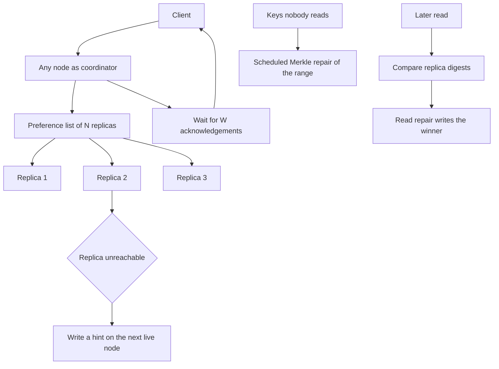

## Concept

### Availability first, reconciliation after

The Dynamo design is a distributed hash table for a workload shaped like a shopping cart: accept a write when enough replicas can take it, stay up through a minority failure, and reconcile copies later. The pieces that landed in Apache Cassandra and in Riak are consistent hashing, a preference list of N replicas, quorum reads and writes, gossip for membership, hinted handoff, and anti-entropy repair. In the sloppy variant, if the coordinator cannot reach the first N nodes responsible for the key, it writes to the next reachable nodes and leaves a hint so the owner can catch up. The system stays writable. It does not stay linearizable. Two concurrent writes of the same key can both succeed. Readers may see different versions until something repairs them.

The application either tolerates sibling values and merges them, or it accepts last-write-wins timestamps and the updates those timestamps discard. Setting a quorum consistency level and then assuming a SQL unique constraint, or a read-your-writes guarantee across every failure, is a misreading of the table in the documentation. Quorum overlap, with R plus W greater than N, is a rule of thumb on a stable replica set whose members are the ones you intended. It weakens once hints, client timestamps, coordinator acknowledgements, and replicas that respond before the data is durable enter the picture. Read the engine's definition of when a write has succeeded, and test that definition under a partition.

### The ring, the coordinator, and what is stored underneath

Keys hash onto a ring. Each node owns one or more token ranges, and virtual nodes spread those tokens so one machine's failure does not dump a single contiguous slice onto its neighbor. For a replication factor N, the coordinator walks the ring and builds a preference list, skipping the same machine and, in a careful deployment, the same rack and the same zone. The coordinator is any node that accepted the client request. It is not a distinguished primary for the key. It sends the mutation to the replicas in parallel and waits until W of them acknowledge.

Cassandra stores each replica's data in an LSM: a memtable, a commit log, sorted files, and compaction. Riak historically used a log-structured or Bitcask-style engine local to each vnode. The Dynamo logic is placement, membership, and quorum. Day-to-day Cassandra operations are also compaction, commit-log disks, and repair. Confusing the two layers leads to a week spent tuning compaction while unrepaired ranges diverge and serve stale reads at quorum. Both layers have to be healthy. Compaction keeps a replica's local reads finite. Repair keeps replicas in agreement with each other.

A write at consistency ONE returns when a single replica has accepted it. A quorum write waits for a majority of the replication factor. A write that waits for ALL replicas is the first setting to fail when any node blips, which makes it a poor default for the availability story that justified the system. Reads use the same ladder. In several data centers, LOCAL_QUORUM waits for a majority inside the local center and does not wait for the remote one. Teams pick it for latency. They are also choosing to learn about the other center later, through repair and read repair, rather than on the write path.

### Sloppy quorums, hints, and the reads that repair

If a preferred replica is down, a sloppy quorum can store the write on a node that is not in the preference list and tag it as a hint. When the owner returns, the hint is replayed. Hints are a short-term cushion. They are not a backup, and they expire. If the node is down longer than the hint window, the write exists only on the replicas that took it during the outage, which may not include the owner. Anti-entropy, usually a Merkle-tree comparison over token ranges, is the remaining path. A long outage is a repair project with a deadline. It is not something the hint queue will quietly finish after the node has been gone for days.

Read repair runs when a read happens. The coordinator compares replica values or digests and writes the winner back to the replicas that disagreed. It repairs keys that somebody read. Cold keys stay wrong until a scheduled comparison of the range. Skipping that job accumulates divergence after partitions, after expired hints, and after a replica that acknowledged a write and then lost its disk. Last-write-wins picks a winner by a timestamp from the client or the coordinator. The same millisecond, or a clock that runs fast, drops the other write and returns success to both clients. There is no error. The row simply has the value from the clock that was ahead.

Riak's earlier default kept siblings when a vector clock said the writes were concurrent, and asked the application to merge. Siblings pile up when the merge never runs or when a client keeps one sibling and drops the rest. A conflict-free type merges by its own rule and avoids silent timestamp loss when the business can express the merge. If losing one of two concurrent updates is unacceptable, that key wants a linearizable update on a single primary, or the narrow consensus path below.

### Gossip, and the linearizable exception on one partition

Membership is gossiped. A failure detector, often an accrual score rather than one hard timeout, decides who looks dead. A detector that is too aggressive marks a slow node down, and coordinators write hints and route around a machine that is still serving. A detector that is too slow delays the moment clients stop waiting on a node that is truly gone. Gossip itself is eventually consistent metadata. A partition can split the cluster's opinion of membership and of schema. Operators wait for schema agreement for a reason: a write coordinated by a node with an old view of the ring goes to the wrong replicas. Treat a membership flap as a data-plane event. It changes where bytes land.

Write the consistency level into the API review for each operation. A session that writes at local quorum and later reads at ONE is a stale read you configured. A counter that uses last-write-wins drops increments under concurrency, because the later timestamp keeps only one of the values. Those structures need a merge that adds, or a different store. A logged batch of many partition keys is a coordinator-local record, not a transaction across the ring. A single partition that grows without a bound becomes one replica's disk, one compaction, and one repair stream.

Cassandra added lightweight transactions: a Paxos round on a single partition for compare-and-set. That protocol sits beside the Dynamo path. It gives a linearizable insert-if-not-exists on one partition key. It is slower, it contends, and it does not make ordinary quorum reads of the rest of the table linearizable. Use it for uniqueness. Riak grew similar per-key options. They are exceptions with a latency budget, not a new default for the ring.

## Trade-offs

| Approach | When it wins | Cost / risk |
| -------- | ------------ | ----------- |
| Sloppy quorum plus later repair | Write availability through node loss at large scale | Stale reads, timestamp loss, repair debt, hints that expire |
| Strict quorum on the preference list, no sloppy placement | Fewer divergent copies when the intended replicas answer | Unavailable when too many of those replicas are down |
| Per-partition consensus for compare-and-set | Linearizable uniqueness on one partition | Latency and contention, and the rest of the table is unchanged |
| A leader-based SQL system | Constraints and multi-row serializability as the product | A different availability story under partition, and a different scale shape |
| Siblings or a mergeable data type | Concurrent writes the application can combine | Merge code in every client, and sibling explosions when merges are skipped |

Overlapping read and write quorums are necessary on a stable replica set if a later read should see a prior write. They weaken under sloppy placement, under clock skew with last-write-wins, and under a coordinator that returns success before the intended replicas hold a durable copy. History-based tests have shown quorum writes that a later quorum read missed once faults and hints were in play. A quorum across every data center is slower and tighter. A local quorum is faster and can hide a remote center until repair runs. Replication factor, consistency level, and the repair schedule are one design. Changing one of them without the others changes what "quorum" means in production.

## Diagram

## Failure modes

### A quorum read that misses a quorum write

The write met W, a later read met R, and the value is missing or older. The replica sets did not overlap in practice: a hint landed off the preference list, a replica acknowledged before the commit log was durable, or an optimization returned success from a coordinator that had not yet reached a real quorum of owners. Detection is digest mismatches on read, history tests under partitions, and users who see a saved value roll back with no error in the write path.

Mitigation is a consistency level whose documented success condition matches the truth you need, healthy scheduled repair, and the per-partition consensus path for keys that must be linearizable. A consistency level of ONE is a cache with replication, not a ledger. If the product cannot tolerate a lost update, do not put that key on the sloppy path.

### Clocks and last-write-wins

Clients or coordinators stamp every mutation. A node or a client whose clock runs ahead wins conflicts it did not issue last. Detection is time-offset metrics on servers and on clients that supply timestamps, and updates that vanish without an error or a sibling.

Mitigation is a real time source on every node that stamps writes, and on clients if the API lets clients choose the timestamp. Do not use timestamp order for a key with concurrent writers unless losing one of the writes is acceptable and written down. A compare-and-set, or a type whose merge is not "maximum timestamp," is the alternative. Letting application code set an arbitrary timestamp is how this failure is invoked on purpose, sometimes by a retry that reuses a future clock from a previous attempt.

### Expired hints and keys nobody reads

A node is down longer than the hint window. Hints are dropped. Nobody reads the affected keys, so read repair never runs. The replicas disagree until a range repair happens to include them, or forever if repair is not scheduled. Detection is hint-drop metrics, repair lag by token range, and ranges that have not completed a comparison within the interval you promised.

Mitigation is scheduled repair with an alert on overdue ranges, and a written plan for outages longer than the hint window. Replacing a node includes streaming and repair. Bootstrap is not finished when the process is listening. If the outage also exceeds the tombstone grace period, repair can resurrect deleted rows; that interaction belongs in the same plan, with a backup you can restore when the live replicas no longer have the truth.

### Gossip marks a live node dead

A long stop-the-world pause, a network blip, or a full disk makes the failure detector flip a node to down. Coordinators write hints and may place copies on stand-ins. The node was alive, or it returns with a state that diverged from the hints. Detection is flapping status in gossip, a storm of hints, schema versions that do not agree, and a sudden rise in digest mismatches.

Mitigation is garbage-collection and pause hygiene so a node does not look dead every hour, failure-detector thresholds you change rarely and on purpose, and disks that do not fill and stall the process. In this design a membership flap writes data to places the steady-state ring did not intend. Page it as a correctness event, not only as a red icon on a cluster map.

## Real-world example

Amazon's Dynamo paper is the template architects still mean by the name: consistent hashing with virtual nodes, N replicas on a preference list, sloppy quorums and hinted handoff so a write can land off the preferred set, gossip for membership, and Merkle trees so replicas can find the ranges where they disagree without shipping every key. A shopping cart could accept writes during a partition and merge carts afterward. The design treated merge as part of the product. It did not pretend the merge was a SQL update with a unique constraint.

Apache Cassandra took that placement and quorum model, stored each replica in a log-structured column-family engine, and became the system teams actually operate for time series, inboxes, and session state. Published practice from large operators centers on virtual nodes, local quorums for latency, repair as a platform job with a schedule and a throttle, and lightweight transactions only on the partitions where uniqueness is required. Riak stayed closer to siblings and vector clocks, which made concurrent writes visible and pushed the merge function into application code. Both lineages inherit the same split: the ring decides where a write may go, and repair decides whether unread keys ever converge.

Adopting Cassandra means staffing repair, compaction, and a consistency level per query class. It does not mean inventing foreign keys or serializable multi-row updates inside ordinary quorum writes. Those belong in another system, or in a per-partition consensus round on a partition whose size you have bounded. Treat gossip, hints, and the repair schedule as part of correctness. They are not weekend hygiene you add after the data model is done.

## What to remember

- A successful quorum write plus later repair is the contract; it is not linearizability, and sloppy hints weaken the overlap you assumed.
- Hints expire, and read repair only sees keys that are read; a scheduled range comparison is the path for everything else.
- Timestamp order with clock skew drops updates silently; siblings or a real merge keep them; per-partition consensus is a narrow, slower exception.
- Gossip flaps and unbounded partitions write the wrong data to the wrong replica; the ring is the placement algorithm, and it is on the correctness path.
