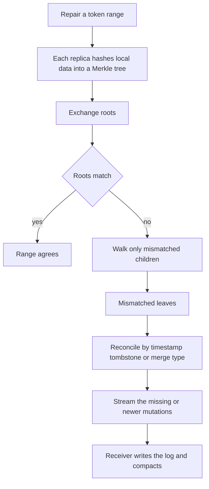

## Concept

### Replicas diverge, and somebody has to compare them

Replicas that are supposed to hold the same keys drift. A node was down past the hint window. A replica acknowledged a write and then lost the disk. A partition left a sloppy copy on a node outside the preference list. Read repair fixes a key when some client reads it and the coordinator notices that digests disagree. It does nothing for the rest of the keyspace. Anti-entropy is the background comparison that copies missing or newer data until the replicas of a range agree, without shipping the entire table on every pass.

A Merkle tree is the usual structure for that comparison. Leaves hash a bucket of keys, or the bytes of a token subrange. Interior nodes hash their children. If two replicas compute the same root, every leaf matched, for a hash that is collision-resistant enough for this job. If the roots differ, the replicas exchange children and recurse only into subtrees that differ. Bandwidth then tracks the size of the disagreement and the branching of the tree, not the size of the replica. That saving is the reason to build the tree instead of streaming every key every night. The tree does not decide which value wins. It only finds the leaves worth sending.

### Building a tree over a token range

A repair session for a range hashes the local data for that range on each replica that should hold it. On a large ring the leaf is rarely one hash per key. It is a hash of a token subrange, sometimes of many partitions that happen to fall inside the bucket. Coarse leaves mean a mismatch sends a large segment even when a single key differs, because the protocol's unit of difference is the leaf. Fine leaves mean a larger tree to build, to store, and to exchange, and more round trips as you walk down. Engines pick a depth. Operators discover the choice when one wrong key causes a stream of tens of gigabytes, because the leaf that contained it was huge, or because one partition inside that leaf was huge. Changing the fanout does not fix an unbounded partition. The data model does. A celebrity partition is a leaf-sized object no matter how you slice the surrounding tokens, until you stop putting the world in one key.

The hash has to cover the same logical bytes on every replica. The same key encoding, the same choice of which timestamp or version is live, the same representation of a tombstone. If one side has dropped a tombstone after a grace period and the other still holds the old value, the leaves disagree. That disagreement is real, and repair will copy according to the reconciliation rule, which can copy the old value back onto the side that had already deleted it. If one side skips expired data differently, or hashes keys in a different order, you get a false mismatch and a wasted stream, or, worse, a false match and silent drift. The tree is only as honest as the function that serializes a leaf. An upgrade that changes that function invalidates every tree you have cached and every incremental marker that says a range was already compared.

A repair session picks the replicas for a token range, builds or loads trees, diffs them, and streams the mutations in the mismatched leaves. The Dynamo design did this per virtual node, and Riak did similar work per vnode. Incremental repair remembers which ranges compared successfully so a nightly job does not rebuild the world. Full repair hashes everything in the range. After a long outage, a restore, a node replacement, or a change in how leaves are hashed, run the full comparison. Incremental state from before the event skips the ranges that most need a look.

### The tree finds the difference; the data type decides the merge

Differing leaves still need a rule for which bytes to write. Last-write-wins compares timestamps. A newer cell wins. A newer tombstone deletes. If clocks were skewed when the writes were accepted, repair "corrects" toward the skewed writer and makes the loss consistent on every replica. The data is now wrong everywhere, which is a kind of convergence. Version vectors, as Riak used, can see that two writes were concurrent and keep both as siblings, leaving a merge to the application or to a stored procedure. A conflict-free type merges by its own rule: a counter takes a maximum of per-replica counts or a sum of increments, a set takes a union. The Merkle tree does not know which rule you wanted. Faster repair with the wrong rule propagates the wrong winner more reliably, and it does so in the background where no client is watching the response.

Streaming is production traffic on a different path from user writes. It fills disks, writes the commit log, and triggers compaction on the receiver. Unlimited parallel repair is an outage you scheduled. Repair that never runs leaves stale cold keys. Throttle the stream, and do not overlap it with a major compaction or a bootstrap on the same disks. Free space has to cover the copy and the merge that follows.

### What this protocol will not give you

Merkle anti-entropy does not make reads linearizable. Two replicas can agree on a stale value and present a matching root. The tree has done its job. The value is still old, because every copy lost the newer write or never received it. Anti-entropy does not replace a quorum at write time. It is eventual, and "eventual" has a deadline you should publish: every range compared within a fixed number of days, with streaming capped so user tail latency stays inside its budget. It does not repair a key that no replica still holds. If every copy lost it, the trees compare absences and find nothing to copy. Snapshots and backups are a different path: a copy of files and logs you can restore when the live set is wrong or empty. A green repair job is not a backup, and a backup that was taken on one divergent replica is a backup of that divergence.

Read repair is the per-key path. Merkle repair is the range path for keys nobody read. Leaderless stores need both if cold data matters. A Raft group catches a follower up from the log, or from a snapshot when the log is gone. That is a bulk copy of an ordered suffix, not a hash-tree diff among peers with no primary. Merkle anti-entropy belongs to systems that do not have a single ordered log per replica set.

Schedule repair as a continuous pass with a deadline. Record the ranges covered, the bytes streamed, and whether the pass was full or incremental. The number that matters is the age of the oldest unrepaired range. After a node is down longer than the hint window, the grace period on tombstones has to still be open when the pass finishes. If it will not be, restore from a backup taken while the tombstones existed.

## Trade-offs

| Approach | When it wins | Cost / risk |
| -------- | ------------ | ----------- |
| Merkle range repair | Leaderless replicas and large keyspaces with partial drift | Hash CPU, coarse leaves that over-stream, disk and compaction during the copy |
| Read repair only | Hot keys that are actually read | Cold keys diverge for as long as you operate |
| Full snapshot or file catch-up | A Raft follower, or a node so far behind that the diff is the whole range | Bandwidth of the range, slower than a tree when only a few keys differ |
| Incremental repair with saved progress | Regular passes on a cluster that has not been restored or rehashed | Skips ranges when that saved progress is stale |
| No anti-entropy, quorum only | A tiny cluster you can prove never partitions and never loses a node | The first real outage leaves permanent divergence on unread keys |

Deeper trees cost memory and CPU and shrink the stream when a single key is wrong. Shallower trees finish the comparison sooner and then pay in network and compaction, because the leaf is large. A skewed partition still streams as a unit if it sits inside one leaf. Parallel repair of many ranges can melt the slowest disk if every node starts at once. Serialize by rack. A rolling upgrade that changes leaf hashing while old incremental markers are still trusted will stream the world or skip ranges. Plan a full repair in that same window.

## Diagram

## Failure modes

### One wrong key becomes a giant stream

The differing key sits in a large leaf, or inside a partition that has grown without a bound. Repair copies gigabytes to fix a single row, fills the receiver, and kicks off a compaction that contends with user reads. Detection is streamed bytes far above the amount of data you believe diverged, a compaction backlog that starts when the repair job starts, and one partition that dominates the stream.

Mitigation is a leaf size matched to the key distribution, partitions that have a size budget, and incremental repair so a healthy cluster is not hashing and sending the world in one session. If one partition is the celebrity, split the data model. Changing only the tree fanout leaves that partition inside some leaf, and the stream for that leaf stays large. Subrange repair, when the engine supports it, limits the damage to a slice you choose after you have seen which tokens differ.

### Deletes that come back

A tombstone is compacted away on one replica after the grace period. Another replica was down, or had not yet been repaired, and still has the old value. The next repair copies the value back onto the replica that deleted it. The row reappears, and clients that observed the delete see it return. Detection is rows that reappear after repair or after a node joins, and a grace period that is shorter than the worst downtime plus the time until every replica of that range has been compared.

Mitigation is a grace period longer than the repair cycle plus the longest outage you will survive without restoring from backup. Run repair, and confirm the range finished, before you allow tombstones to expire. This is a horizon problem. The hash found a real difference. The deletion rule fired before every replica had seen the tombstone. If you cannot keep the grace period that long, stop relying on repair to preserve deletes and restore from a backup that still contains them.

### Incremental state that skips the broken range

The cluster believes a range was repaired at an epoch. A replica was replaced, a snapshot was restored onto a node, or the leaf hash changed, and that belief was not cleared. Later incremental jobs skip the range. Divergence sits there until someone runs a full comparison or a user reads a cold key and happens to trigger read repair. Detection is repair metadata that disagrees with node bootstrap time, with restore events, or with a full comparison you finally run and that streams data the incremental job had marked done.

Mitigation is a full repair after restore, after bootstrap of a replacement, and after any upgrade that changes hashing or reconciliation. Clear incremental markers as part of those operations, in the runbook, not as a follow-up ticket. Incremental repair is an optimization for a stable cluster whose replicas have continuous history. When the history of a node is uncertain, compare the range for real and record that the pass was full.

### Repair as a scheduled overload

Streaming, compaction, and user traffic share a disk and a network with no limit. Every node starts a session at the same time, or a full repair of a large range runs beside a major compaction. Detection is repair throughput and streaming rates on the same graphs as client latency, and a latency cliff whose start lines up with the job rather than with a traffic spike.

Mitigation is a rate limit, a window that avoids peak, one site or one rack at a time, and an explicit ban on overlapping repair with a major compaction or a bootstrap onto the same nodes. Repair is production traffic with a correctness goal. Give it a target: every range finishes inside the cadence you chose, without spending the tail-latency budget. If the only way to meet the cadence is to saturate the disks, you are under-provisioned for the consistency process you claim to run, and the fix is capacity or a smaller replication factor's repair fan-in, decided on purpose.

## Real-world example

Apache Cassandra's repair is the Merkle anti-entropy most operators actually run. A repair session builds trees over token ranges, exchanges them between the replicas that own the range, and streams the differences. Large operators have written up incremental repair, the need to coordinate so that nodes do not all stream at once, subrange repair to keep each session bounded, and the interaction between gc_grace_seconds and deletes that reappear when a replica missed the tombstone. A cluster that has not finished a repair cycle since the last multi-hour outage is a cluster whose unread keys are unverified. The process being "enabled" is not the same as the oldest range being inside its deadline.

Dynamo described the same idea: a tree per virtual node, a background comparison, and a copy of whatever is missing, with the application merging when versions conflict. Cassandra turned that into a scheduled, throttleable job. Full repair on a healthy cluster wastes bandwidth. Incremental repair after a restore skips the broken range. Unbounded streaming melts the disks. If you cannot say when each range last completed a comparison, you have an intention rather than a process. Keep backups beside repair. The tree synchronizes replicas that are online and still hold the key. The backup is the path when none of them do.

## What to remember

- A Merkle tree locates differing subranges without sending the whole replica; it does not choose the merge, and a matching root does not make reads linearizable.
- Leaf size and huge partitions decide whether one wrong key becomes a multi-gigabyte stream and a compaction storm.
- Tombstones need a grace period longer than downtime plus the repair cycle; dropping them early lets repair resurrect deletes.
- Incremental progress is an optimization on a stable cluster; after restore, bootstrap, or a hash change, compare the range in full.
