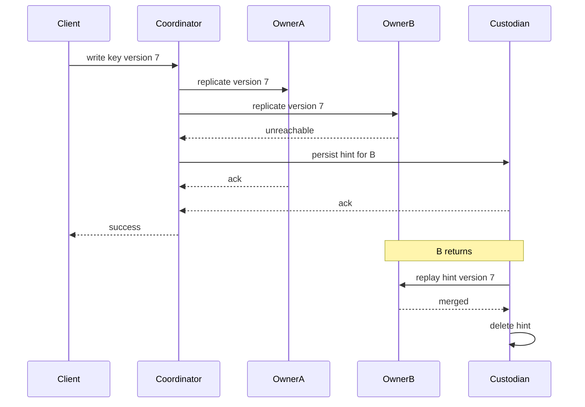

## Concept

### Ownership is a preference list

A Dynamo-style ring assigns each key a preference list before any request arrives. The key's token marks a position. The coordinator walks clockwise and takes the first N nodes that also satisfy rack and zone diversity. Those N nodes own the key. Write quorum W and read quorum R are counts against that list. The inequality R + W > N means a successful write and a later quorum read share at least one owner. Machines elsewhere in the cluster are irrelevant to that proof.

On the healthy path the coordinator replicates the mutation to the owners and returns when W of them have persisted it. Every acknowledgement is from a node a future reader will also contact. The coordinator may itself be the first live owner, or a node that accepted the client call and forwarded it. The set that counts is the preference list.

If an owner stays silent, a strict coordinator spends its timeout and fails the write. The key is then available only to the extent that particular subset is available. That failure is the correct product behavior for balances, inventory holds, and any value whose readers will assume the intersection still holds.

### Sloppy quorum admits a custodian

Sloppy quorum keeps W and relaxes who may supply it. When an owner does not answer, the coordinator continues around the ring and accepts an acknowledgement from the next healthy node. That node stores the mutation together with a hint naming the intended owner. It is a custodian. The token map is unchanged. The client receives success.

A reader that contacts the preference list does not ask the custodian. Until the hint is replayed, or until repair copies the value onto an owner, a quorum read can miss a write the cluster has already acknowledged. The availability gain is exactly the size of that window.

Record the mode per keyspace. A ring that sometimes substitutes and sometimes fails closed, with no record of which tables do which, produces incidents that look like storage bugs. Payments can sit on a strict quorum while a feed uses a sloppy one. They can share disks. They need two written consistency stories.

### A hint must be replayable

A hint that can be applied carries the key, the mutation or a pointer to a durable copy of it, the destination's stable identity, and a version the destination can compare: a timestamp, a version vector, or a ballot. A note that only says an owner missed "something" cannot be merged. A value with no version can overwrite a newer write that landed after the owner returned. A short outage then becomes data loss in the other direction.

The hint log has to outlive the custodian process. An in-memory queue acknowledges durability the process does not have. If the original write returned before fsync, the hint may follow that policy, and the service level should say so. If the original write was durable, the hint log is durable. Cassandra stores hints locally so a restart can still deliver them. Dynamo described the same side log: the live node remembers the intended replica. Neither design adds the custodian to the preference list. Promoting a custodian to owner is a membership change. Streaming, repair, and the ring have to agree, or data is streamed toward the wrong node and repaired away again.

### Replay is a controlled merge

When failure detection marks the destination alive, custodians stream their hints. The destination applies each one with the cluster's ordinary merge rule. Replay is idempotent because the owner may already hold the value from a client retry, an earlier partial delivery, or read repair. A blind overwrite is how clock skew turns recovery into corruption.

The stream needs a rate limit. A node that was down for an hour can owe roughly its write share for that hour. Delivering at line rate fills the commit log and the compaction queue. The failure detector marks the node down again, and the hints requeue. Recovery then oscillates.

A hint window is the other control. Cassandra's traditional window, a few hours and configurable, means the cluster tries to deliver for that long and then drops the hint. Dropping is safe when something else will reconcile. Anti-entropy is that something else. A window with no repair obligation deletes acknowledged writes once the last remaining owner fails. Size hint disk for write rate times the longest outage you intend to cover, and page on disk use before you page on expirations.

### Repair still owns the cold keys

Hinted handoff is an availability overlay. It is an extra copy only for as long as the custodian and the hint both survive. If the custodian dies before delivery, durable copies are whichever owners actually stored the mutation. With N of 3, W of 2, and one owner down, that can be a single disk.

Read repair helps keys that are read, and only when the read contacts enough replicas to see a mismatch. Cold keys stay stale. A Merkle walk of ranges is the path for keys nobody reads. Its period is the recovery-point objective for hinted writes whose hints were lost. Client retries rewrite the mutation when the producer retries and the operation is idempotent. Fire-and-forget publishers do not.

Reads during the window need a policy you can state. Coordinators that accept sloppy writes and then serve strict reads against a narrow owner set will miss data. You can fail the write, accept best-effort read-your-writes until replay finishes, or force a repair read once owners return. A common production compromise is LOCAL_QUORUM with hints kept inside one datacenter: the write does not wait on another region, and after the hints drain, readers in that datacenter intersect. Parking hints in a remote region during a local outage puts the bytes where the next local read will not look.

## Trade-offs

| Approach | When it wins | Cost / risk |
| -------- | ------------ | ----------- |
| Strict quorum, fail the write | Money, inventory, any R+W>N proof you will audit | The key is unavailable for the owner outage |
| Sloppy quorum, durable hints | Write availability across short node failures | Reads can miss until replay; hint disk and recovery load |
| In-memory hints | A demo that never restarts | Process death drops acknowledged writes |
| W=1 plus hints | Latency experiments | Durability collapses to one copy plus a side log |
| Hints disabled, repair only | Fleets that already repair on a tight schedule | Repair interval is the recovery point for every missed replica |

Strict quorum is the setting you can explain with the preference list alone. Sloppy quorum is the setting you choose when a client error during a reboot costs more than a bounded consistency window. Mixing them on one keyspace, and discovering the mix during an incident, is the operational failure. The hint window is a product decision wearing a timeout's clothes. A short window keeps the hint store small and makes repair mandatory. A long window survives a weekend and turns hints into a second database with compaction, expiry, and a capacity owner.

Keep substitutions inside a failure domain you can repair on the same timescale as the window. A hint replayed hours later from another region can resurrect a value a later write replaced, unless every apply path compares versions and every writer uses the same rule.

## Diagram

## Failure modes

### The custodian dies before delivery

The client already holds success. One owner has the value. The custodian is decommissioned without a drain, or its disk is lost. Detection is a rise in expired or undelivered hint counters, followed by Merkle mismatches on the recovered owner for keys written during the outage. There is no write error to page on. The miss appears on a later read.

Mitigation is a drain on every decommission, hint storage that survives a single disk, and a repair objective shorter than the time you will tolerate a single remaining copy. If that objective is unrealistic, turn sloppy writes off for the table.

### Replay saturates the node that just returned

Every neighbor delivers at once. Compaction, commit-log, and CPU spike. Failure detection flaps, and the node looks down again. Detection is hint-delivery bytes, compaction backlog, and a liveness score that oscillates on the joining node.

Mitigation is a per-destination rate limit, a pause when compaction is behind, and a gate that withholds full write membership until the hint backlog is under a threshold. For a planned restart, leave the node marked up and drain clients so coordinators write to it directly.

### Hints name a node that no longer owns the range

A decommission or a rebuilt host leaves hints addressed to an old identity. Replay fails with an ownership error, or a reused address accepts bytes for tokens it does not own. Detection is a burst of delivery failures after a topology change, or a new node holding ranges it was never assigned.

Mitigation is stable node identities in the hint record, dropping or redirecting hints when the token-map epoch moves, and a decommission that either replays remaining hints to the new owners as ordinary writes or deletes them only after the moved ranges have been repaired.

### A quorum read misses an acknowledged write

The sloppy write sits on one owner and a custodian. A reader asks two owners, including one that restarted empty. Detection is digest mismatches and client retry spikes lined up with hint backlog after restarts.

Mitigation is to pair the write consistency level with a read that will observe divergence, keep anti-entropy short for those tables, and refuse sloppy writes where the product requires linearizability. Pinning a client to one coordinator is stickiness. It is a weak substitute for an intersection proof.

## Real-world example

Amazon Dynamo put sloppy quorums and hinted handoff on the write path so a shopping-cart mutation could succeed while a replica was unreachable. The preference list stayed the ownership record. The coordinator walked past the down node, left a hint on a healthy node, and treated delivery as background work. Read repair and periodic Merkle reconciliation sat in the same design, because a hint was a way to ride out a short failure, and a fourth durable replica was a different mechanism.

Apache Cassandra runs that overlay in ordinary clusters. When a replica times out or is marked down, the coordinator appends a hint locally. A configurable window bounds how long the hint is kept. Past the window, incremental or full repair closes the gap. Turning repair off because hints exist is how a multi-hour outage becomes silent loss: hints expire, one replica remains, and keys that are never read never receive read repair.

Clusters that live with the combination size the hint directory as a capacity item, throttle delivery so recovery does not immediately fail the node, and choose consistency per table. LOCAL_QUORUM for state that must intersect inside the datacenter. A weaker level only for data the application can rebuild. Used that way, hinted handoff does one job: a machine can reboot without failing the write, and the ring does not pretend the custodian became an owner.

## What to remember

- Sloppy quorum changes who may acknowledge a write. Ownership stays on the preference list.
- A hint is a versioned mutation on durable storage, merged on replay with the cluster's ordinary rule, and rate-limited when the owner returns.
- If the hint is lost, durability is whatever owners stored the write. Repair cadence is the remaining recovery point.
- Pair the read consistency level with the write mode, or a narrow quorum read will miss a write you already acknowledged.
