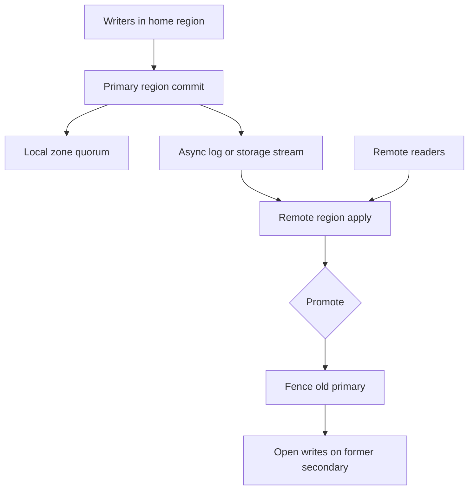

## Concept

### The wide area is a sized component

Inside a region, replication is a failure-domain problem: disks, racks, and zones, with round trips of a millisecond or two. Across regions, replication is a physics problem. Intercontinental round trips sit between roughly 60 and 200 milliseconds. Paths change. Loss is normal. A commit that waits for a remote acknowledgement adds that delay to every write. A commit that returns locally adds a recovery-point objective equal to whatever has not yet arrived.

Throughput is gated by the bandwidth-delay product and by how the engine pipelines log records. A single-threaded applier on the far side will not fill a fat pipe, however fast the primary commits. Treat the link as something you size, monitor, and fail over, the same way you treat a disk.

Every topology answers three questions. Which region may accept writes? What is a reader in another region allowed to see? What is the tested procedure when the writer region is gone? A slide that says multi-region and leaves those three blank is a diagram, and the design is still missing.

### Active-passive keeps one history

One region accepts writes. Other regions receive a stream: a physical write-ahead log, a storage-volume copy, or a logical row stream. Readers may use a secondary when the product can name its staleness. They stay pinned to the primary when they cannot. There is one serial history. Conflict resolution is the primary's order.

Promotion is the painful part. Fence the old writer. Wait until the replica has applied through a point you can name. Then open writes. Skip the fence and the first network partition that looks like a crash becomes split brain. Storage-level replication can keep the secondary close to the primary without replaying SQL, which is why lag well under a second is a realistic steady state on a healthy path. Logical replication can filter tables and reshape rows. It pays with apply lag and with DDL that can fork the stream.

The primary's local durability is still a regional problem. Zones inside the writer region should survive a zone loss without involving the remote region. The remote copy is disaster recovery and read offload. Those are two jobs.

### Synchronous, asynchronous, and the timeout between them

Synchronous cross-region commit gives a recovery point near zero and a latency floor of the farthest voter. Use it for rows you cannot reconstruct and for which a global order is the product. Availability then follows the voters. A partition that hides a required voter stalls commits.

Asynchronous streaming commits locally and ships the log. The recovery point is the lag: seconds on a healthy path, minutes when apply or the network is sick. This is the right default for disaster recovery and for read replicas that advertise staleness.

Semi-synchronous commit waits for at least one remote acknowledgement and proceeds if the rest are slow, often after a timeout. You have reduced loss on primary death, and you have added a hidden mode switch. When the timeout fires, the system is asynchronous. The dashboard may still say sync. That switch belongs in an explicit policy: fail the write, or degrade and tell the caller. A silent degrade is how the recovery point you sold becomes the recovery point you had during the incident.

Session guarantees sit on asynchronous replicas without making every write wait. The client carries a token, a log position or a timestamp. The local replica serves the read once it has applied that token, or the router sends the read to a fresher region. Many user-facing products need read-your-writes more than they need global linearizability. The token is cheaper than a quorum across an ocean.

### Active-active is a merge rule or a partition of keys

Two regions accepting writes to the same keys have concurrent histories. Last-write-wins clocks drop updates under skew. Commutative merge functions and CRDTs keep every write and push the semantic work into the application. Active-active with neither a key partition nor a merge function is two primaries sharing a brand.

The topology that usually wins is write affinity. Region A owns keys for a set of tenants or a key range. Region B owns another set. Each region replicates the other's data for reads and for failover. The fleet is active-active. Each key is active-passive. A user who moves regions is a migration. True multi-master on one row belongs in stores whose data is commutative, and it is a poor fit for a ledger whose secondary indexes assume one winner.

Hub-and-spoke and cascading replicas save wide-area bandwidth. They also add lag. A leaf that receives changes only through a middle region includes that middle region's apply delay in its recovery point, and a failure of the middle isolates the leaf. A mesh is easier to reason about and multiplies duplicate apply unless each change carries an origin identity the receiver can ignore.

### Voters, witnesses, and read replicas occupy different seats

A Paxos or Raft group commits when a majority of voters acknowledge. Where you place those voters is the latency and the failure domain of every commit in the group. Three voters in nearby regions is a modest wide-area wait. Three voters on three continents puts the ocean on the write path. Read-only replicas can sit outside the voting set and serve stale or bounded-staleness reads without joining the commit. A witness that votes and stores a partial copy is a placement tool for majority. It is a poor place to fail reads over to.

Moving a voter changes commit latency for every write in that group until you move it back. Secondary replicas that do not vote can be added for local reads without that tax. A request for Spanner-like ordering and in-region write latency is a request for two topologies. Pick the one the row requires, and write the placement down per group.

## Trade-offs

| Approach | When it wins | Cost / risk |
| -------- | ------------ | ----------- |
| Async active-passive | Disaster recovery, regional read offload, one history | Recovery point equals lag; promotion needs a fence |
| Sync cross-region voters | Global linearizability, near-zero loss | Every commit pays wide-area delay; a voter partition stalls writes |
| Geo-partitioned write ownership | Active-active fleet without same-row conflicts | Cross-region users and global reports need a plan |
| Multi-master with a merge rule | Commutative or collaborative data | Lost updates or application merge cost; unique constraints suffer |
| Cascading replicas | Bandwidth-limited regions | Compound lag; a middle tier isolates the tail |

Choose from the recovery point, the recovery time, and whether two writers can touch one row. A payments ledger wants one writer region, or a commit that waits on voters you placed deliberately. A catalog wants asynchronous replicas and a reader that can say how stale it is. An untested promotion is a single region with extra disks abroad. The test includes the fence, the traffic cut, connection drain, and the log position at which the new writer may accept writes.

Watch lag as a user-facing objective when secondaries serve reads. A replica forty seconds behind a bulk load is a different product from the replica you described as sub-second in the design review. Alert on the watermark you promised, and treat link-up as a necessary condition rather than the objective itself.

## Diagram

## Failure modes

### Apply lag past the recovery point you published

A bulk load, a long transaction, or a single-threaded applier stalls the replica while the primary keeps committing. Detection is a watermark: the primary's flushed position against the replica's applied position, plus replica-lag metrics. Link-up alarms will stay green through the whole event. The user-visible symptom is stale reads and a failover point that has quietly grown.

Mitigation is parallel apply where the engine supports it, breaking up bulk work, and stopping consistency-sensitive reads on a replica that has exceeded its lag objective. Page on that objective. A fixed five-second threshold that nobody tied to the product is how lag becomes the new normal.

### Split brain on promotion

The primary is partitioned, and it is still alive. The secondary is promoted. Clients that can still reach the old primary keep writing. Detection is two nodes advertising a writer endpoint, divergent log positions, or primary-key conflicts after the partition heals.

Mitigation is a fence that does not depend on DNS. A storage lock, a consensus lease, or a power-off of the old writer must make further commits impossible before the new writer opens. Time-to-live on a DNS record is a cache. Rehearse the sequence on a schedule, including the case where the old region returns while the new one is already live.

### Dual writers converge on the wrong value

Clocks pick a loser, or a retry replays an older value over a newer one. Detection is an audit of lost updates, or merge structures that grow without a bound because conflicts are appended and never resolved.

Mitigation is per-key write ownership, or a merge function with tests, plus idempotency keys so a retry is a repeat of one logical write. If the only tool is last-write-wins, keep balances out of the cross-region path.

### A timeout silently drops synchronous commit

The remote region stops acknowledging. If the primary waits, commits stall. If a timeout converts the session to asynchronous replication, the recovery point jumps and the control plane may still report the link as synchronous. Detection is commit latency together with acknowledgement timeouts and path metrics.

Mitigation is a written policy: fail writes, or degrade and surface the weaker durability to the caller. Systems that commit with a majority of voters keep going when a minority region disappears. That behavior is a placement decision you make when you seat the voters.

## Real-world example

Amazon Aurora Global Database is active-passive replication at the storage layer. The primary region's storage volume ships redo to a secondary region. Compute in the secondary applies from that volume rather than replaying every SQL statement as a logical replica would. On a healthy path the lag is typically well under a second, which is a different object from logical replication of a busy transactional database. Writes stay in the primary region. Local durability is still a quorum of storage nodes in that region. The global copy sits off the commit path. Promotion is a controlled failover to a new writer region, and it is a fence-and-promote sequence rather than a merge of two writers. Readers in the secondary can use reader endpoints when the application tolerates the lag.

Google Spanner is the other public shape. A group of voting replicas runs a consensus protocol for a slice of the key space. Commit waits for a majority and for the time bound the system needs to order the write. Place the voters in three nearby regions and you pay a modest wide-area round trip. Place them across oceans and every write pays the ocean. Read-only replicas can live outside the voting set for local reads that accept a staleness bound. The topology is per group: where the voters sit, where the witnesses sit, and where the non-voting replicas sit. Moving a voter changes commit latency for that group. It is visible on the write path the moment the membership changes.

Use a storage-level global database when one writer region plus a fast disaster-recovery copy is the product. Use explicit voter placement when a row must be linearizable across regions and the commit delay is acceptable. Putting both stories on one table is how the latency objective and the consistency claim contradict each other in production.

## What to remember

- A cross-region topology names who may write, what readers may see, and how you fence a failed writer.
- Asynchronous active-passive with a rehearsed fence is the default. Same-row multi-master is a merge-function project.
- Synchronous voters buy a short recovery point and put wide-area delay on every commit.
- Lag, split brain, and a silent fall from sync to async each need their own page, because link-up will not catch them.
