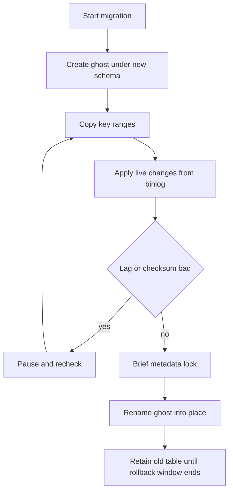

## Concept

### Schema is a contract held by more than the primary

On a small table, many DDL statements take a lock, rewrite rows, and finish before the queue is visible. At hundreds of gigabytes, a rewrite is a second copy of the clustered index and every secondary, a surge in redo and undo, and a metadata lock that lines writers up behind it. Vendor documentation that says online usually means the engine avoids one particular lock or one particular rewrite. It does not mean tail latency is unchanged. Instant column add, a constraint added as not-yet-validated, and a concurrent index build are three protocols with three lock windows. Read the protocol for the server version you run.

The rest of the system holds the same contract. Application servers, ORM metadata caches, replicas, and change-data-capture consumers all assume a shape. Changing the shape under traffic is expand-and-contract, a shadow table with a cutover, or a replicated stream that must stay one stream. A migration runner that sends one ALTER and waits is appropriate for an empty table. On the orders table it is how you discover a writer stall measured in hours.

Replicas apply DDL too. A rolling upgrade leaves mixed server versions that may misunderstand an instant operation, fall back to a copy, or fail the statement. That skew is a schema-change freeze whether the calendar admits it or not. Test the exact version and row format. An empty staging table that added a column instantly does not prove the production table will.

### Expand, backfill, switch, contract

When the change is additive, the application can own the migration.

Expand. Add a nullable column, a new table, or a new index. Old binaries ignore it. New binaries write both representations. An instant add still needs a story for defaults and for replicas that have not applied the statement yet.

Backfill. Copy historical values in primary-key chunks, with a resume cursor and a rate limit. One UPDATE that sets the new column for the whole table is a long transaction and a replica-lag event. The chunk job must be idempotent so a retry does not double-apply a non-idempotent expression.

Switch. Move reads to the new shape after dual-writes have been shown to match. Contract. Drop the old column only after every binary, every delayed replica, and every backup you might restore has moved on. Point-in-time recovery extends that window by days. Forgetting the contract step leaves two writers forever. Forgetting a single job that still writes the old column makes the new read path wrong in a way unit tests will miss.

Expand-and-contract cannot cheaply change a type that requires a rewrite, and it cannot add a constraint existing rows violate until the backfill has made them valid. Those changes need a copy.

### Shadow tables: triggers on the hot path, or the binary log

Percona-style online schema change and GitHub's gh-ost both build a ghost table under the new definition, copy rows in chunks, and catch writes that land during the copy.

The trigger approach installs triggers on the original table so each live write also lands on the ghost. Triggers sit on the hot path. They amplify writes, interact with triggers you already have, and surprise statements the tool did not model. They work where you cannot read the binary log. They are a tax you should be able to name in the design review.

gh-ost installs no triggers. It behaves like a replica: it reads the binary log and applies changes to the ghost while a chunked copy walks the primary key. The original table stays the table until cutover. A failed run drops the ghost and leaves production as it was. That property is the reason to prefer the binlog path when the log is available. Both tools still need disk for a second copy, and both can stall replicas if the copy is greedy. The win is that the long work is interruptible and throttled, in place of a server-side rebuild you cannot pause.

### Cutover is a short critical section

Cutover is the moment the ghost becomes the table. The tool catches up the last log events, takes a brief metadata lock, swaps names, and releases the lock. The lock stays short only if nothing else holds the table. A long transaction, a dump that took a metadata lock, or an abandoned SELECT FOR UPDATE turns brief into an outage queue. The tool needs a timeout that aborts the swap rather than waiting until the business notices.

Before the swap, the ghost and the original must agree. A row count is a weak agreement. Non-deterministic defaults, a missed log event, or a column that calls a function of current time will checksum differently. Checksum is the gate. If the table is too large for a full checksum in the window, checksum ranges and rehearse with a captured workload. Promote only when the gate passes.

After the swap, keep the old table for a defined time. Dropping it inside the cutover removes your rollback. Leaving it forever doubles the disk you thought you had freed.

### Shards need one migration object

A single-node copier stops being a migration once the table is sharded. Vitess runs schema change and table moves through vreplication: a stream from each source shard into a target with the new definition, then a cutover the gateway understands. The topology service records migration state so a lost runner does not leave a silent half-finished job. The gateway can buffer or reject writes for the short switch so clients do not land on a shard that has swapped and a shard that has not.

Vitess can still use gh-ost or a trigger-based tool as the engine on each shard. The architectural piece is the control plane: one migration object, many shards, throttling against aggregate replica lag, and a rule that incompatible migrations do not run together on the same table. The failure unique to this shape is a partial apply. Shard 1 has the new schema. Shard 2 does not. Teaching the application to speak both schemas as a standing design is how the partial apply becomes permanent. Fail the migration as a whole, or finish it as a whole.

Postgres concurrent index builds are their own protocol: two transactions, forbidden inside a surrounding migration transaction, and a failed build that leaves an invalid index which still costs writes until you drop it. The runner has to notice the invalid index. Online schema change is a state machine, and a SQL string is only one input to it.

## Trade-offs

| Approach | When it wins | Cost / risk |
| -------- | ------------ | ----------- |
| Blocking in-place DDL | Tables that copy in seconds inside a window | Writer queue, replica lag, client timeouts |
| Expand-contract dual write | Additive columns the application can own | Dual-write bugs; a contract step nobody finishes |
| Trigger-based ghost copy | No access to the binary log | Write amplification and trigger interactions |
| Binlog ghost copy such as gh-ost | Large MySQL tables under live traffic | Second copy on disk; a cutover lock; a new process to operate |
| Coordinated vreplication | Already-sharded fleets | Control-plane failure; mixed shards if cutover is partial |

If the table copies in a few seconds under a lock, do that. Online tools have more moving parts than a short ALTER. Measure copy rate and lock wait on production-shaped data. Dual-write is cheaper than a ghost table when you are adding a column and you control every writer. It is the wrong tool when the new shape must appear atomic to readers, because the dual-write window lives in application code for as long as the slowest binary.

Copy speed is a budget, and the tool's maximum is an upper bound you should rarely hit. Replica lag is user-facing when reads use replicas. Primary CPU is user-facing when they do not. Tie the copier to replication delay, threads running, and the latency objective, and pause when any of them moves.

## Diagram

## Failure modes

### The cutover lock waits on a session nobody remembers

The swap needs an exclusive metadata lock. A dump, a long report, or an orphaned lock holder sits on the table. The copier waits. Writers queue behind it. Detection is metadata-lock waits, a flat write rate, and a migration that stays at the last percent for minutes.

Mitigation is a lock-wait timeout that aborts the cutover, a policy for killing blockers, and a freeze on long transactions during the window. An infinite wait is an outage you put on the calendar yourself.

### The ghost disagrees with the original

A skipped log event, a trigger that did not fire, or a non-deterministic default makes rows disagree. The swap then promotes the wrong table. Detection is a checksum before rename. A matching row count will miss a swapped column.

Mitigation is to abort on mismatch, to ban non-deterministic defaults in the new schema, and to rehearse against a captured production workload when a full checksum cannot finish in time.

### A writer still targets the old shape after the switch

A job, a second service, or a raw SQL path updates only the retired column. Reads of the new column miss those updates. Detection is per-path write metrics and a continuous compare of old and new values for a window after the switch.

Mitigation is one write API, flags that move binaries together, and a contract step that cannot start until old write paths are at zero. Search the fleet for SQL that names the column. The migration tool will not find that SQL for you.

### Half the shards cut over

One shard swaps. Another hits disk pressure or replication lag and stops. Clients see two schemas for one logical table. Detection is the migration record showing mixed shard states, and errors from statements that match only one shape.

Mitigation is a control plane that treats the migration as one object, gateway buffering across the switch, and a rehearsed rollback that restores the previous name on shards that already swapped. "The app handles both" is a standing design, and it is a poor recovery plan.

## Real-world example

GitHub built gh-ost because trigger-based changes on large MySQL tables had become an availability risk of their own. The tool creates a ghost table, copies in chunks, applies ongoing writes by reading the binary log the way a replica would, and throttles when replication delay or server load rises. Cutover is a short rename that can be aborted. If the process dies, the original table is still the table. Schema change becomes a job with a pause button and a checksum, which is the property operations needs on a table that cannot take a maintenance window.

Vitess is the public control plane for the same problem once MySQL is sharded. Migrations and table moves run through vreplication. Each shard copies under the new definition, and the gateway coordinates the moment clients switch, so a keyspace does not serve half-old and half-new as a normal state. Teams still run gh-ost per shard when that engine fits. The difference at this scale is one migration object, lag measured across the shards, and a rule that a partial cutover is a failed migration. A cleverer row copier is a smaller part of the design than that control plane.

Taken together, online schema change is a distributed protocol. The copier, the log, the replicas, the application dual-write window, and the lock at the end are all in it. A runner that only ships ALTER belongs on empty tables. The orders table wants a ghost or a coordinated stream, a throttle, a checksum, and a cutover you have already failed on purpose in staging.

## What to remember

- Online DDL is a lock and copy protocol. Time it on production-sized data and on the server version you will run.
- Use expand-and-contract for additive changes, and a ghost copy or vreplication when the table must be rewritten.
- Throttle on replica lag, and abort a cutover that cannot get its metadata lock quickly.
- Checksum before the rename, and treat a mixed shard or a mixed binary as a failed migration.
