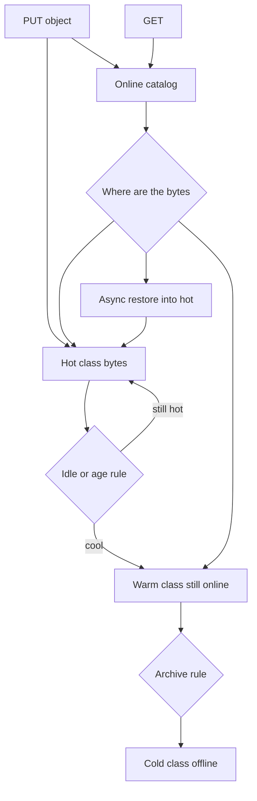

## Concept

### Temperature is a retrieval contract

Hot data is the working set: frequent reads, a tight latency objective, often random access. Warm data stays online with a looser latency and a higher cost to retrieve. Cold data is retained for audit, training, or a future investigation, where the first byte may take minutes and each retrieval is a billed event. The media follows from that contract. Memory and NVMe for hot. Dense SSD or HDD for warm. Deep archive, tape-class object storage, or a densely erasure-coded pool for cold.

Heat is a property of use, and it changes. Assigning the class once, at insert, treats heat as a property of the bytes. A legal hold makes a cold object hot for a week. Yesterday's metrics are warm. Last year's are cold until someone is debugging an incident. A tiering system is a policy, a mover, and a catalog that can still name the object after the bytes have moved. The catalog stays on the hot path even when the payload does not.

A cache in front of the store is a different mechanism. Caches evict. Tiers retain. A design that cools data by dropping it from Redis has deleted the only copy if nothing durable remains. Hot, warm, and cold describe the durable copy's media and its retrieval objective. You may still cache the hot class in front of that durable copy.

### Three policy families

Age-based lifecycle is the easiest to explain. After a number of days, transition to an infrequent class, then to archive. It fits logs and backups whose heat really does decay with time. It buries objects that stay hot by nature: active profile media, the current season's catalog, the index a dashboard hits every minute.

Frequency-based tiering watches access and moves objects between classes. That is the idea behind S3 Intelligent-Tiering. You pay to monitor, and you accept that a sudden scan of a cold prefix is both a bill and a latency cliff unless you fetched it on purpose. The monitor is only as good as the accesses it sees. A CDN that absorbs the reads will make the origin look idle. The object cools while users are still viewing it.

Explicit class at write is right when the producer knows. A raw master video is born cold. A thumbnail derived from it is born hot. Write two objects. Discipline fades, so an explicit class still wants a safety lifecycle for the objects nobody classified. Policies also have to compose with legal holds, replication, and encryption. A transition that copies and deletes can reset metadata, break a checksum the client stored, or duplicate key grants if you treat it as a naive file move.

### The catalog stays online

Listing, authorization, etags, and storage class live in a metadata plane that must answer without touching the cold media. A prefix listing of a million archived objects cannot wait on a tape robot. If you colocate the catalog with the payload, cooling the payload cools discovery, and operators lose the ability to find what they stored.

In a database, the same split shows up as a stub. Moving an entire old row to an archive table drags secondary indexes and foreign keys with it, or it breaks them. Keeping a stub row that points at a cold blob preserves joins and creates a new failure: the row exists, the blob is mid-restore, or the blob is gone. The application has to know which of those is true. A date partition moved to cheaper storage is a cleaner stub. The planner can skip it when the predicate says so. A query that omits the predicate will try to read the cheap media, and the storage layer should reject it.

### Restore is a different API

Hot and warm classes answer GET with bytes. Cold classes often answer with a job. You request a restore, you wait, you read a temporary online copy, and that copy expires. Hiding the job inside a synchronous GET with a ten-minute client timeout blows every idle timeout between the user and the archive. Load balancers return 504. Retries file more restore jobs.

Pick a contract. User-facing reads should miss into a hydrator you control: start the restore, serve from the hot class once the bytes are back, and let policy cool them again later. Batch jobs should restore with a quota so Monday morning does not enqueue a million archive reads. The temporary copy needs a lifetime longer than the job. An expiry in the middle of a training run is a functional bug that looks like object-storage flakiness.

On the write path, ingest-to-hot is simple and expensive for data that is born cold. Direct-to-cold is cheap and makes the first read a restore. Pipelines that need both a serving derivative and a retained original should write both on purpose, with two classes chosen at the producer.

### The mover is a state machine with a budget

Transition order is copy, checksum, publish the new pointer, then delete the source. A crash must leave either the old online object or a verified new object. A catalog entry aimed at missing bytes is the outage. The mover has its own queue and a concurrency cap tied to hot-tier I/O and to the archive service's ingest quota. A lifecycle rule that fires at midnight against a billion objects is a batch incident with a cron expression.

While a move is in flight, GET has one defined behavior: keep serving the online copy until the pointer swings, or return an explicit pending error. A handler that blocks inside the edge timeout turns tiering into user-visible failure. For tables, the same sequence is checksum a closed partition, attach it on the cheaper store, and only then detach the old one. Dashboards that need yesterday and last year should read a hot rollup. The archive is for the investigation.

Leave the system's own state off the tiering policy. Write-ahead logs, catalogs, and leader leases stay on the hottest durable media you have. Tiering is for user data with a restore story you have tested.

## Trade-offs

| Approach | When it wins | Cost / risk |
| -------- | ------------ | ----------- |
| One hot class | Small data, one latency objective | Flash prices on bytes nobody reads |
| Age-based lifecycle | Logs, backups, heat that decays on a clock | Hot-by-nature objects get buried; the next read is slow |
| Access-frequency tiering | Mixed or unknown heat | Monitoring fees; scan-driven promotions; surprise bills |
| Explicit class at write | Producers that already know temperature | Mis-classified objects; two write paths to get right |
| Archive that requires restore | Retention you rarely read | Restore storms, client timeouts, copies that expire mid-job |

For mixed object data, the default that survives contact with finance and with incidents is to ingest into a monitored frequent class, demote from observed access, and keep the catalog online. For relational rows, partition by time and move closed partitions. Row-by-row temperature inside a transactional table fights the buffer pool, the planner, and every secondary index.

Price the retrieval, and price the storage beside it. Some cold classes are cheap to keep and expensive to scan. A transition that saves storage and is read every week is a loss. A round number of days is a guess until you have counted accesses. Count CDN misses as heat if the CDN is why the origin looks idle, and pin prefixes that are the product's serving set.

## Diagram

## Failure modes

### A restore storm

A job, a feature, or an incident review lists a prefix and restores a huge number of archived objects. The archive queue stretches for hours. Temporary copies expire before consumers finish. The bill arrives as a page. Detection is restore request rate, queue depth, and a cliff in GET success when the temporary copies expire.

Mitigation is a rate limit per account and per prefix, a batch restore with reserved capacity, and a hot-class cache whose lifetime is longer than the job. Investigations should name a partition, and a decade-wide prefix is a capacity request, not a query.

### Policy cools an object people are still using

The frequency tracker misses reads that stopped at a CDN, or it ignores a byte range the monitor does not count. Objects move to a slower class while the product still serves them. Detection is a rise in first-byte latency and in restore counts on prefixes that should have stayed hot.

Mitigation is to count edge misses as access, to pin serving prefixes, and to enforce a minimum time in the hot class after ingest. Automatic tiering still needs a denylist for the objects on the user path.

### The pointer and the bytes disagree

A copy-delete moves the payload, the catalog still names the old location, or the hot copy is deleted and the cold copy never becomes durable. Detection is a GET that returns not found while HEAD still describes the object, checksum mismatches, and an inventory that disagrees with the catalog.

Mitigation is the ordered state machine: write the new copy, verify it, swing the pointer, then delete the old copy. Reconcile inventory against the catalog. Deleting first to free space manufactures missing objects.

### A query reads the cold partitions by accident

A report omits the date predicate. The engine pulls archived partitions into the compute layer. Detection is bytes scanned, unexpected restore or HDD wait, and a query that used to finish in seconds.

Mitigation is a required partition filter, rejection of unbounded scans at the storage layer, and a hot aggregate for the questions dashboards actually ask. People will query the archive if it is the only table that answers the question.

## Real-world example

Amazon S3 made temperature an API rather than a directory. Standard is the online, frequent class. Infrequent Access and the instant-retrieval variants keep objects online at a lower storage price and a higher retrieval price. Glacier-class storage keeps the object durable and does not serve it on an ordinary GET. You restore, wait from minutes to hours depending on the class, then read a temporary copy. Intelligent-Tiering monitors access and moves objects among frequent, infrequent, and archive access tiers without a lifecycle rule you have to guess correctly on the first day. Monitoring has a price, and the class of an object is a runtime fact.

The parts worth copying, on AWS or on an internal store, are the splits. Names, listings, and inventory stay available while bytes change class. A transition is a durable sequence of copy, verify, and pointer swing. The coldest classes change the client contract from GET to restore-then-GET, which forces an asynchronous path. Lifecycle rules and object-created events are how a front end hydrates on a miss: restore, serve from the hot class, and allow the policy to cool the object again when it goes idle.

Teams that put a synchronous user GET in front of an archive class learn the contract on the first timeout. Teams that ingest everything as Standard and transition to deep archive after thirty days, without reading access logs, learn it on the invoice. Measure heat, keep the catalog online, and make restore a product path with a quota.

## What to remember

- Hot, warm, and cold are retrieval objectives and media costs, and they change over the life of an object.
- Keep the catalog online, and move bytes by verify-then-swap rather than delete-first.
- Archive classes replace GET with an asynchronous restore that must be rate-limited and must outlive the job.
- Price retrieval and count hidden heat, such as CDN hits, before an age rule demotes data the product still serves.
