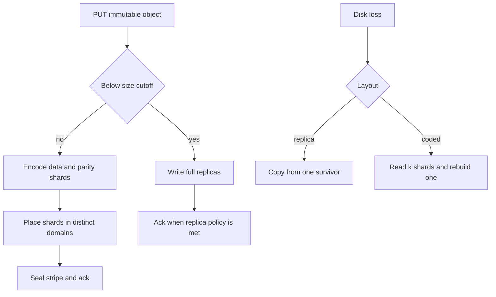

## Concept

### Two durability mechanisms, two bills

Replication stores R full copies. You can lose R minus one of them and still read. Overhead is R, commonly three in cluster storage. Writes multiply by R. Repair is a copy from one healthy replica. CPU cost is noise. Network cost is the size of the object.

Erasure coding splits a blob into k data shards and m parity shards such that any k of the k plus m shards rebuild the original. A Reed-Solomon layout of ten data and four parity shards stores about 1.4 times the bytes and survives four shard losses. The storage bill falls. The bill moves to CPU, because you encode on write and decode on a degraded read, and to repair bandwidth, because rebuilding one lost shard reads k others rather than one replica.

That is the whole trade. Placement, partial writes, and correlated failure decide whether the trade is honest once it leaves the spreadsheet.

### Stripes, and why small objects stay replicated

A stripe is one coding group: k data chunks and m parity chunks, with chunk sizes often in the tens or hundreds of kilobytes up to about a megabyte. A large object is many stripes. An object smaller than a stripe must be padded or stored under another policy. Padding a few kilobytes into a ten-plus-four stripe wastes more capacity than three copies. Production stores therefore split the path. Below a size cutoff, replicate. Above it, encode.

Partial writes fight the stripe. Changing a byte means rereading the rest of the stripe, or logging a delta, to recompute parity. Append-only objects and immutability make coding natural. A POSIX file overwritten in the middle does not, unless you buffer a full stripe and seal it. If the workload is small random overwrites, replication or a log-structured copy-on-write design is the one you can operate. Coding those overwrites and calling the result a capacity win is how CPU and tail latency consume the disk budget you thought you saved.

### Repair bandwidth is the operational constraint

When a replica disk dies, you copy its bytes from a friend. When a coded shard dies, classic Reed-Solomon reconstruction reads k shards to rebuild one. For k of ten, repair traffic is about ten times the lost bytes. At fleet scale, ordinary disk failure times that multiplier is enough to saturate the network that was supposed to serve clients.

Local reconstruction codes, the family Azure described and that others have adopted, add a local parity group so a common single-disk repair reads fewer shards, at a modest extra storage cost. They exist because the reconstruction multiplier, ahead of the 1.4 times overhead, is what hurts operations. Degraded reads have the same shape on the client path. A GET that finds a missing data shard reconstructs from the others, and tail latency becomes decode plus extra cross-rack reads. Hot objects should have a serving copy outside that layout. A rare degraded read of a cold object is acceptable. A landing image that fans out to ten racks on every view is a product bug wearing a storage policy.

### Placement is the durability claim

k plus m shards in one rack survive a disk and die in a power event. The allocator has to spread shards across disks, racks, and zones so the failures you actually have are independent enough for the m you paid for. A durability slogan computed from a code rate is a placement claim. If four shards of a ten-plus-four stripe share a fate, a firmware batch or a single room, the four parities were a diagram. Replication has the same constraint. Three copies in one zone are one copy with extra invoices.

Geographic coding spreads shards across regions and survives a site loss without shipping three full copies over the wide area. A read that must reconstruct may then pull k shards across that wide area, so serving copies are usually still regional: a hot replica or a local subset, with the coded stripe as the durability backstop. You are hybrid again. Encode for the site failure. Replicate or cache for the GET.

### When an object changes layout

New data is often hot and small. Old data is often cold and large. A lifecycle that replicates for a few days and then encodes is the common production policy. Recode is a background job: read the replicas, write shards, verify, drop the extra copies. Too early, and the hot path pays decode. Too late, and you pay triple capacity for bytes nobody reads.

Acknowledge a PUT only when the chosen layout is durable. If you acknowledge after one replica and recode later, the window between acknowledgement and a finished stripe is a durability hole. Either the remaining replicas are enough until coding finishes, or the PUT waits until the shards are durable. Write the choice into the service level. An acknowledgement followed by recode with no surviving replica is how a single disk failure deletes an object the client was told exists.

Scrub is the other background job. A stripe nobody reads can rot. Periodically reconstruct and compare checksums, then repair the bad shard. Without scrub, the durability math assumes disks tell the truth. Priority is client degraded reads first, then stripes that have fallen below the parity you bought, then scrub. Throttle the last two so a wave of disk failures does not starve GET.

Seal a stripe before you treat it as durable. A sealed stripe is immutable, parity matches, and a later writer allocates a new stripe. The placement index should know how many shards of each stripe sit in each failure domain, and the PUT path should refuse a layout that colocates more shards than m can cover.

The metadata that names shards is a poor candidate for the same code. Lose the map and the shards are unaddressable. Keep the index replicated, with a stronger consistency protocol than the blob plane uses for the payload.

## Trade-offs

| Approach | When it wins | Cost / risk |
| -------- | ------------ | ----------- |
| Three-way replication | Hot, small, or mutable objects; simple repair | Triple capacity and write amplification |
| Reed-Solomon k plus m | Large immutable objects, warm or cold | Encode and decode CPU; repair reads k shards; slower degraded GET |
| Local reconstruction codes | Petabyte pools with routine disk death | More parity types to place correctly |
| Hybrid by size and age | A real mixed object store | Two write paths, a recode job, a cutoff to tune |
| Cross-region coding | Site durability without three wide-area copies | Wide-area reconstruct; serving still wants a local copy |

Replication wins when the on-call question is which box still has a full copy. Coding wins when the corpus is large enough that 1.4 times versus 3 times is a building, and when you have measured repair traffic under injected disk loss. The crossover is a spreadsheet plus a network graph. A preference for coding theory is a weak input to that decision.

Choose k and m from failure domains. Ten data shards across ten racks in one room is a different system from ten shards across ten regions. Larger k lowers storage overhead and raises both repair cost and the number of live places a read requires. A rebalance that packs a stripe onto fewer, fuller racks has quietly spent the parity you bought. After a rack loss, the remaining shards still have to include a readable set of k.

## Diagram

## Failure modes

### A repair storm after correlated disk loss

A batch of disks of one age fails within days. Reconstruction reads k shards per lost shard and competes with clients. Detection is rebuild bytes, network saturation, and degraded-read latency.

Mitigation is a code with cheaper local repair, a smaller k on that pool, client traffic ahead of background rebuild, spare disks already in the cluster, and a ban on updating every disk in one stripe in the same window. Mix disk vintages inside a stripe on purpose.

### Loss inside the recode or unsealed window

The PUT was acknowledged on one replica, coding has not finished, and that node dies. Or parity was computed against a stripe that was still being written. Detection is checksum failures, scrubber errors, and objects the inventory lists that will not decode.

Mitigation is to acknowledge only when the chosen layout is durable, to seal stripes, and to keep source replicas until the new layout verifies. Scrub on a schedule so rot is discovered by a background job, and a customer GET is the last line of detection.

### Placement collapses into one failure domain

The allocator ignores racks, or a zone loss removes more shards than m. Detection is a placement auditor that fails PUTs which cannot spread, and an alert when an existing stripe's diversity drops after a rebalance.

Mitigation is hard placement constraints, and rebalancing that is forbidden from packing a stripe for capacity. After a domain loss, confirm that every stripe still has a readable set before you declare the event survivable.

### Decode CPU lands on the hot path

A class you called warm is actually read all day. Healthy reads that gather many shards, and degraded reads that decode, dominate the tail. Detection is decode CPU, GET fanout, and latency that tracks object size rather than cache hits.

Mitigation is a replicated or cached serving copy for hot prefixes. A user click should hit a wide stripe only when an edge cache already holds the reconstructed object.

## Real-world example

Amazon S3 is the public argument for erasure coding at object-store scale. The durability target people quote, eleven nines of objects over a year, is a placement of redundant encoded fragments across availability zones, so that disk loss or the loss of a zone does not lose the object. It is a fleet property, and a drawer of spare disks is a smaller claim. Infrequent and archive classes push density further. You pay for packed, encoded bytes and, in the coldest classes, for a slower retrieval. You do not pay for three hot replicas of a terabyte you will not read.

S3 also behaves like the hybrid an internal store should copy. Fresh and small objects are handled on a path that is fit for their size. The control plane that names objects and records their layout stays available for list and HEAD while payloads sit in a dense layout. Repair and scrubbing are continuous. GET hides reconstruction until you are in a class where retrieval is an explicit slower operation.

If you build a similar store, keep the first day on replication for the hot, small, mutable set. Introduce coding at a size and age cutoff. Inject disk loss and measure repair traffic before you believe the 1.4 times spreadsheet. Keep the index that finds the shards on a replicated, consistent store. The capacity win is real after placement, sealing, and rebuild throttles are real.

## What to remember

- Replication spends capacity so repair is a copy. Erasure coding spends CPU and repair bandwidth to store k plus m shards.
- Hybridize by size and age, and keep tiny or mutable objects off wide stripes.
- Durability is placement across the failure domains you actually have. A code rate in a design doc is an input to that placement.
- Acknowledge a PUT only when its layout is durable, and keep the metadata that locates the shards on a replicated index.
