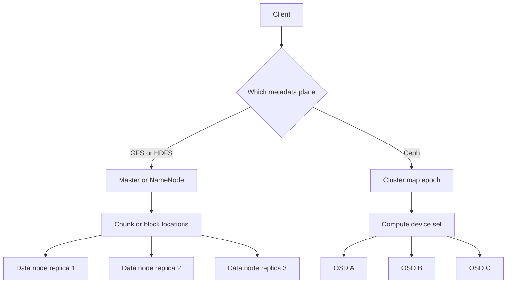

## Concept

### Three systems, three contracts

Google File System, HDFS, and Ceph all spread large data across ordinary machines. They do not offer the same contract. GFS was built for large sequential writes, append-heavy producers, and applications that could tolerate a relaxed concurrent append. HDFS took that shape into the Hadoop ecosystem: huge files, write once, read many times, and a scheduler that wants to run next to the block. Ceph aimed at one cluster that could present objects, block devices, and a POSIX-like filesystem, with placement computed from a cluster map instead of a single metadata server handing out locations.

None of them is a desktop filesystem whose default is fine-grained random writes and strict cross-client coherency. Design reviews that say use HDFS the way we use a local disk fail on small-file rate, on who may write, and on what close and rename actually guarantee. Pick the contract first. The daemon names follow from that contract.

### GFS: one master, large chunks, clients on the data path

GFS splits files into large chunks, 64 MB in the original design. A single master holds the namespace and the map from file and offset to chunk identity and replica locations. Chunkservers hold the bytes, typically three copies. A client asks the master where a chunk lives, caches that answer, and reads and writes the chunkservers directly. After the lookup, the master is off the data path. That split is the reason one master can serve a large cluster.

The master remains the limit for metadata operations: create, open, list, delete, and lookups that miss the client cache. Huge chunks keep the master's record count manageable. A petabyte of large files is a reasonable number of chunk descriptors. A petabyte of tiny files is a metadata crisis. The master leases a primary replica for a chunk so mutations have a single serializer. Record append was a first-class operation with weaker guarantees than a POSIX write, so many producers could dump records without electing a single writer. Applications were expected to tolerate duplicates and padding. That application contract is part of the filesystem.

Failure is the steady state. Chunkservers die. The master re-replicates chunks that fall under the target. Clients retry. The master itself is precious: its operation log is the namespace. Losing it, or failing it over without fencing, is a different outage from losing a chunkserver.

### HDFS: the same split, then HA, federation, and a stricter write

HDFS follows the same outline. The NameNode holds the tree in memory. DataNodes hold blocks, 128 MB in later defaults. Clients talk to DataNodes for bytes. The original secondary NameNode checkpoints the image. It is a checkpoint helper. Teams that treated the name as a hot standby learned otherwise during the first NameNode death.

High availability adds a pair of NameNodes and a shared edits log, often a quorum of journal nodes, so failover can promote a standby. Federation splits the namespace across independent NameNodes, each owning a subtree, because one memory image does not grow to trillions of files. Both features keep the original split: metadata is a service, blocks are a store of bytes, and a block you cannot name is not a file.

The write model is stricter than GFS append culture. One writer creates a file, writes it sequentially, and closes it. After close, the file is immutable in the common case. That matches MapReduce and Spark. It matches a virtual-machine disk badly. Placement is rack-aware: one replica on the writer node when the writer is inside the cluster, another on a different rack, another on a different node in that second rack, with variations by version and policy. The scheduler can place a task on a node that already has the block. On cloud virtual machines with network disks, that locality is often gone, and you are paying HDFS's metadata model without the rack win.

HDFS later added erasure coding for cooler, larger files and kept replication for hot blocks. The NameNode still cannot disappear.

### Ceph: compute the location from a versioned map

Ceph's RADOS layer stores objects. The filesystem, the block device, and the S3-compatible gateway are clients of that layer. Placement is CRUSH. Given an object name and a versioned cluster map of devices, buckets, weights, and failure domains, clients and storage daemons compute the same device set. There is no master RPC on every I/O to ask where the object lives, and no per-object location table on a central node.

CephFS metadata lives in MDS daemons that partition the directory tree dynamically. The inode and directory objects themselves sit in RADOS. Busy directories can move. That is the opposite of one master image in RAM, and it is why CephFS can approach a small-file rate HDFS will not. The cost is operational: MDS failover, client capabilities that grant and revoke cache rights, and a CRUSH map that, if edited carelessly, moves a large fraction of the cluster.

CRUSH is the idea worth stealing even if you never run Ceph. If placement is a function of a versioned map, adding a device moves a predictable fraction of objects, and clients find data after they learn the new epoch. Get the map wrong, through an aggressive reweight or a rule that packs replicas into one domain, and you get a recovery storm or correlated loss. The epoch is a production object. An old map is a retry. A silent write to a device that no longer owns the object is a bug in epoch handling.

### What the metadata lookup actually grants

GFS and HDFS return locations plus a generation or a lease so a stale primary cannot accept writes after the master has moved on. Cache those locations and invalidate them when the epoch changes. An unbounded cache is how clients keep talking to chunkservers that no longer hold the block.

Consistency follows the protocol. GFS record append is at least once and can duplicate or pad. The application deduplicates. HDFS makes a file stable at close, which is why jobs write a temporary name and rename it into place when the output is complete. CephFS capabilities grant cache and write rights and then revoke them. A client that ignores a revoke will corrupt shared state. If the workload needs POSIX close-to-open behavior or byte-range locks across machines, name that requirement and pick the system that implements it. An analytics filesystem is a poor shared home directory. None of these systems is your database write-ahead log. They do not give you transactions.

Choose the GFS and HDFS shape for sequential analytics files and a scheduler that can use locality. Choose Ceph when you need block, object, and a POSIX mount from one disk pool and you will staff the map, the metadata servers, and recovery limits. If the API you want is only PUT and GET, skip the filesystem personality and build or buy an object store.

## Trade-offs

| Approach | When it wins | Cost / risk |
| -------- | ------------ | ----------- |
| Single metadata master, GFS or HDFS | Huge sequential files, a simple model, compute locality | Metadata rate, high availability, small files |
| HDFS HA and federation | An estate already built on HDFS | More operations; each NameNode is still a namespace limit |
| Ceph CRUSH and RADOS | Object, block, and file on one cluster | Map mistakes, capability bugs, recovery storms |
| Replicated blocks | Hot data and straightforward repair | Triple capacity |
| Erasure-coded blocks | Cool, large, immutable files | Repair bandwidth; a poor fit for tiny files |

HDFS locality matters when the compute framework schedules on it and the cluster can satisfy placement. When disks are network-attached, object storage plus separate compute is often the simpler system. Ceph is frequently the right on-premises answer for virtual-machine images and an object gateway on the same spindles. It is a poor drop-in Hadoop replacement if the whole stack assumes block locations in the scheduler, unless you are ready to give that assumption up.

Small files dominate the failure budget of the centralized metadata design long before sequential throughput does. Pack them, refuse them, or put them in an object store whose index was built for that cardinality.

## Diagram

## Failure modes

### The metadata service is down and the disks are fine

The NameNode or GFS master is unavailable. Creates, opens, and lookups stop even though every data node is healthy. Detection is failed metadata RPCs, a high-availability pair with no active node, or a journal quorum that cannot commit.

Mitigation is a real standby with fencing of the old active, a journal quorum you have failed over in a game day, and checkpoints you have restored. Federation limits the blast radius to one subtree. A checkpoint helper with a reassuring name is a checkpoint helper.

### Recovery after a rack loss saturates what remains

A rack dies. The master, or Ceph peering, queues re-replication for every under-replicated block. The surviving network and disks spend their budget on recovery and clients time out. Detection is under-replicated block counts, placement groups stuck degraded or recovering, and client latency that tracks recovery throughput.

Mitigation is rack-aware placement so one rack loss still leaves a readable copy, a cap on recovery rate, and free capacity reserved so restoring the replica count is possible. A cluster at the brim cannot heal. Spare space is part of durability.

### Small files exhaust the metadata heap

Billions of tiny files inflate NameNode memory or MDS load. Detection is garbage-collection pauses on the metadata process, create and list latency, and an edits log that grows with file count rather than with bytes.

Mitigation is packing files into larger containers, a larger chunk size where the workload allows, and an admission policy that refuses the pattern. HDFS is a poor mail store and a poor home-directory server.

### A placement change moves or correlates the wrong data

A CRUSH edit remaps a huge fraction of placement groups. An HDFS policy change after maintenance puts two replicas in one failure domain. Detection is a spike in misplaced objects, unexpected backfill, or a domain outage that loses data because replicas were not actually independent.

Mitigation is to simulate a map change before you apply it, to move weights in small steps, and to run a placement auditor. Setting every device weight to zero and back again is a recovery storm you scheduled.

## Real-world example

GFS is the public design that fixed the template. A cluster filesystem for analytics could run with one master, large chunks, three replicas, a client data path, and applications that accepted an append which was at least once. Google later replaced the single-master ceiling with Colossus. The operational picture operators still live with is the earlier one: metadata is the scarce resource, chunks are large, machines fail continuously, and the compute layer was written to the filesystem's actual guarantees.

HDFS made that template the default data platform for a decade. NameNode, DataNodes, rack-aware placement, and a file that becomes stable when closed so a task can read it locally. Estates then hit the NameNode memory wall, added a real standby, added federation, and added erasure coding, each time keeping metadata and bytes as separate planes.

Ceph took the other fork. CRUSH removes the per-object location lookup. RADOS is the common store. The filesystem, the block device, and the object gateway are personalities on top. You run it when the GFS assumptions are false: files are not all huge, writers are not all sequential, and you still want commodity disks. You staff the cluster map and the recovery limits, because those are the system.

Match the contract to the workload. Large immutable analytics files belong on an HDFS or GFS-like store. Virtual disks and an object API on one pool belong on Ceph. A cloud object API with no POSIX requirement does not need a filesystem wrapped around it.

## What to remember

- GFS and HDFS centralize metadata and fit huge, sequential, write-once files, with clients talking to data nodes after a lookup.
- Ceph computes placement from a versioned cluster map, so that map epoch is an operational object.
- Metadata loss, recovery storms, and small files dominate the risk, ahead of sequential bandwidth.
- Choose the filesystem for the contract you will actually use, and keep database logs and POSIX random I/O off an analytics store.
