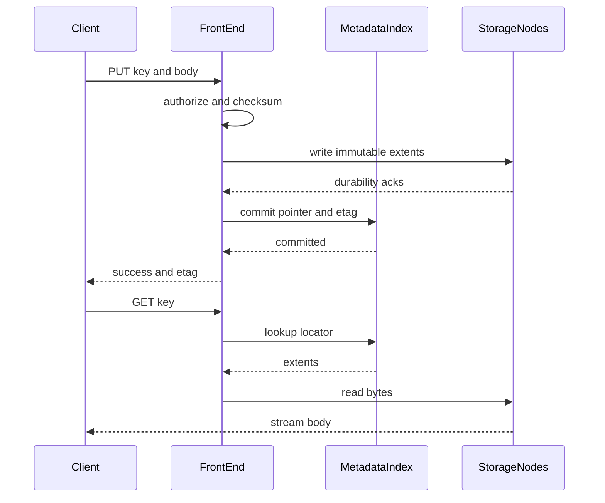

## Concept

### The API is the storage engine

An S3-like store offers a bucket, a flat key, HTTP verbs, and a durability objective stated as objects not lost per year. There is no inode, no directory lock, and no in-place byte write as the primitive. A prefix looks like a path and is a listing convention. Multipart upload assembles an immutable object from parts. It is the way you publish a large object, and it is a poor way to edit the middle of a file.

That API is what makes the internals tractable. A PUT publishes a blob and a metadata record together, from the client's point of view. A GET is a lookup plus a stream. A LIST is a range scan on an index. People treat LIST as free because a folder listing was free on a laptop. At a billion keys it is the expensive call.

If the product needs to rename a million-key prefix, you are issuing a million metadata updates, or you are pretending to be a filesystem. Prefer immutable names, a content hash plus a small metadata record, and make rename rare. Conditional writes on the index replace POSIX locks for the cases that actually need mutual exclusion.

### The front door does not hold bytes

Requests land on a stateless front end: TLS, signature checks, authorization, rate limits, and a request identity you can trace. The front end looks up the index. Bucket, key, and version map to a descriptor with size, etag, storage class, encryption, and locators for the extents. That index is a low-latency metadata database. Split brain in the index is two live etags for one key, or a 404 for an object that is still on disk. Either one is a durability incident even when every disk is healthy.

Shard the index by bucket or by a hash of the key. A single hot bucket, or keys that all hash to one shard because they share a timestamp prefix, is a metadata hotspot. Ordered listing wants a contiguous scan, which fights pure hash sharding. The practical compromise is to partition on a coarse prefix and keep the suffix ordered, or to tell API users that listing order is a scan, and a queue is a different system. Pagination tokens are an API over the index. They are a walk of disks only in a design you should refuse.

### Publish is an ordered commit

The body is one or more immutable extents on storage nodes, replicated or erasure-coded. The PUT path authenticates, allocates an object identity, streams bytes with a checksum, waits until the data plane has met its durability rule, and only then commits the index pointer. Order is the atomicity. Commit the index first and GET returns not found or a short body for a key the client believes exists. Write the bytes and never commit, and you leak capacity until garbage collection notices. The index commit is the moment the key becomes visible.

Overwrite of a key allocates a new object identity and swings the pointer. The old extents stay until no version, legal hold, or in-flight GET needs them. Byte-range GET is arithmetic over a manifest. It is a read of immutable extents, and a seek into a mutable file is a different store. Large objects and flaky networks use multipart. Parts upload independently, and complete-multipart inserts the manifest that makes the key visible. The multipart etag is a digest of part digests, and clients that assume it is a simple digest of the concatenated bytes will fail verification. Store a checksum that survives composition, and document it.

Parts that never complete are capacity you are paying for. Abort and lifecycle expiration of incomplete uploads belong in the data plane. Operators who skip them discover a large fraction of the cluster in abandoned parts.

### Locators, versions, and what consistency means here

Many S3-like designs store explicit locators in the index so an object can move to new media without a global placement function changing under every key. Rebalance is a background copy, a verified pointer swing, and a later delete. A computed placement function, in the CRUSH style, shrinks per-object metadata and makes a bad cluster map everyone's problem at once. Explicit locators cost index space and a careful two-phase move. Pick the one your rebalance story can operate at 3 a.m.

Early public object stores were famous for eventual overwrite and list. A PUT could succeed and a following GET or LIST could miss it. Strong overwrite and list behavior means the index linearizes updates per key. That is a consensus or leader-per-shard problem in the metadata plane. The disks do not provide it.

Versioning turns overwrite into an insert. Delete becomes a marker. Garbage collection has to honor versions, markers, and holds. Without versioning, a reader that opened the old etag needs the old bytes until the stream finishes or a grace period ends. Conditional PUT, if-match and if-none-match, is compare-and-swap on the index. It is how you build an idempotent writer without a lock service. If the store lacks it, applications invent list-then-put races and lose.

### Garbage collection, inventory, and replication

Everything except the index commit is cleanup. Failed PUTs, aborted multiparts, and overwritten generations are invisible to GET and obvious on a capacity graph. Collection joins a disk inventory to the index, waits out the longest in-flight GET, and then deletes. A sweeper that deletes by file modification time will remove a slow client's last part and an extent a legal hold still names.

Inventory reports and object-created events exist so workflows stop using LIST as a work queue. They are also how tiering and replication learn that a key exists. Cross-region replication copies bytes, then the index entry, and exposes lag as a watermark. A reader in the second region is stale until that watermark passes the key's generation. A durable PUT in one region is a local fact. Visibility in another region waits on the replication watermark. Say that next to the durability objective. Conflict rules on the key, usually last writer, are a poor substitute for filesystem disaster recovery. Decide whether version stacks merge or one side wins before the first regional partition.

## Trade-offs

| Approach | When it wins | Cost / risk |
| -------- | ------------ | ----------- |
| Explicit locators in the index | Moves across media, heterogeneous nodes | Larger index; bugs in the two-phase move |
| Computed placement | Small per-object metadata | A bad map relocates or correlates a huge fraction of objects |
| Strong per-key index | Correct overwrite and list | Metadata rate and consensus latency |
| Eventually consistent index | Write availability across a partition | Missed reads, phantom listings, lost overwrites |
| Multipart and immutable extents | Large objects, retries, erasure coding | Orphan parts; etag surprises |
| In-place byte writes | Disks for databases and virtual machines | You have left the object-store design |

Build this shape when the API is PUT, GET, and LIST and the durability target is about immutable blobs. Random write wants a block store with a different consistency story. A POSIX shim over objects is a product for backup and archive tools. A database on that shim will find the missing locks the hard way.

Listing will not scale because a client found it convenient. Offer inventory and notifications, and rate-limit prefix scans. Key design is a capacity plan. Sequential dates that land on one shard will melt one metadata partition while the cluster looks idle.

## Diagram

## Failure modes

### The index says the object exists and the bytes do not

A bug commits the pointer before the storage nodes have made the extents durable, then a node dies. GET returns not found or a short body for a key that returned success. Detection is length and checksum mismatches, scrubber errors, and client verification failures.

Mitigation is durability on the data plane before the index commit, journals on the storage nodes, and crash recovery that drops index entries whose extents are incomplete or rebuilds both from a log that records the pair.

### Capacity disappears into orphans

The index never committed, or a multipart upload was abandoned. The bytes remain. Detection is a gap between bytes on disk and bytes referenced by the index, and a growing age of incomplete uploads.

Mitigation is collection by object identity with a grace period for in-flight writes, lifecycle rules on incomplete multipart uploads, and a periodic reconciliation. Deleting disk files because they look old will delete live objects that are merely unread.

### One metadata shard takes the bucket

Every writer uses keys that hash together, or the company shares one bucket and one hot prefix. Detection is CPU and request rate on a single index shard, PUT latency, and LIST timeouts while other shards are idle.

Mitigation is key design that spreads load when listing order does not matter, shard splits, and rate limits. Where order matters, partition on a hash of a coarse prefix and keep the remainder ordered. Document that compromise, or clients will page through the wrong dimension and call it a bug.

### Bit rot copies itself

An extent flips bits on disk. If you checksum only at PUT time and then replicate the damaged replica, you replicate the rot. Detection is a scrubber mismatch and a GET that disagrees with the stored etag.

Mitigation is checksums in the index and on the extent, periodic scrub, and repair from another replica or from the remaining erasure shards. Coding without scrub is a durability spreadsheet with no feedback loop.

## Real-world example

Amazon S3 is the template the category is named for. Buckets, keys, PUT, GET, HEAD, LIST, multipart, versioning, lifecycle, and signed requests hide a fleet of front ends, a metadata plane that can order updates to a key, and a data plane that places redundant fragments across availability zones. The properties worth copying are atomic publish, a durability objective as a product, immutable parts, and a listing problem treated as a database.

S3's consistency history is the other lesson. For years, applications had to tolerate a successful write that a later read or listing might miss. That leaked into every design that used the bucket as a lock or a queue. Stronger read-after-write and list behavior made the metadata job explicit: per-key ordering lives in the index, and the bytes are a durable blob store that the index addresses.

An internal store should copy the split. Authentication, limits, and request identity stay on the front door. The index is the source of truth for names, versions, and locators. Extents are immutable and redundant. Collection is reconciliation, and a file-age cron is a way to delete the wrong bytes. Checksums and conditional writes are core. LIST is scarce. A multi-terabyte object is a multipart pipeline with a manifest, and one TCP connection you hope survives the afternoon is an accident waiting for a network blip.

## What to remember

- An object store publishes a key by an index commit after immutable extents are durable.
- Garbage collection reconciles disk inventory with the index, including abandoned multipart parts.
- LIST and hot key prefixes are metadata capacity problems. Inventory and events replace bucket scans.
- Versioning, checksums, and conditional PUT are the protocol, and cross-region visibility lags the local commit.
