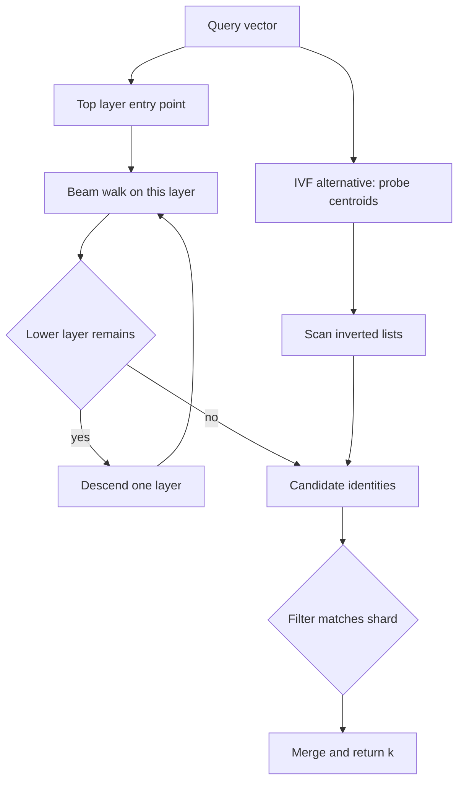

## Concept

### Exact neighbors are a batch job

A vector database stores embeddings, often a few hundred to a couple of thousand floats, and answers nearest neighbors under a metric, usually with filters for tenant, time, or access. Exact search walks the corpus, or uses a structure that collapses in high dimension. At tens of millions of vectors, exact search is how you score an index, not how you serve a query.

The product is approximate nearest neighbor search. You publish a recall target at a given k, for example most of the true top ten present in the result, and you buy latency and memory with the misses. The raw vectors are a table: identity, bytes, metadata. The graph or the inverted lists are the index you size memory for, rebuild, and blame when recall moves. A table of float arrays with no index is a scan. A library file with no log and no filters is a notebook. Production is the space between: durable vectors, a maintained index, filtered search, and a recall objective you measure on real queries.

### HNSW walks a layered graph

Hierarchical Navigable Small World indexes build a stack of graphs. The bottom layer contains every point, with edges to a bounded number of nearby neighbors. Upper layers hold successively smaller samples, in the spirit of a skip list. Search starts at an entry point on the top layer, greedily walks toward the query, then drops a layer and repeats. The walk is not a proof of the global nearest set. A beam, often called efSearch, keeps several candidates alive so the search is not trapped by the first greedy step. A larger beam raises recall and CPU.

Insert searches for neighbors and adds edges, with a cap on degree. The construction-time beam and the degree cap set quality you cannot tune later without a rebuild. Deletes are usually tombstones plus a periodic rebuild, because repairing a graph is harder than repairing a list. An update is a delete and an insert. Changing coordinates in place would invalidate every edge that was chosen against the old point.

Memory dominates the design. For low latency the graph and the vectors want to be resident, or memory-mapped with a working set that stays warm. At large cardinality, float32 vectors alone are hundreds of gigabytes before the neighbor lists. Product quantization compresses vectors and approximates distances. A graph over quantized vectors is the usual compromise when the corpus will not fit as raw floats. You are spending recall for RAM, and you should measure that spend.

A single global graph is also a write bottleneck. Concurrent inserts need a shard boundary or a lock. Shard by tenant or by hash, search the shards the filter selects, and merge. The merge is another recall leak if each shard returns too few candidates, or if a true neighbor lived on a shard you did not ask. Fanout width is part of the recall budget.

### IVF assigns a coarse bucket, then scans

An inverted-file index trains a coarse quantizer, typically k-means, into a set of centroids. Each vector joins the list of its nearest centroid. Search finds a probe count of nearby centroids and scans those lists, often with quantization on the residuals so the scan does not touch raw floats. Training is a batch step. Bad centroids, unbalanced lists, or a codebook trained on last quarter's distribution, wreck both latency and recall. One centroid that owns a fifth of the points makes the tail a function of that list, not of the probe count.

The probe count is the query-time knob. High values approach a scan. Low values are fast and miss. Inverted files use less RAM than a full graph of neighbor lists, which is why they show up at billion-scale, especially once residuals are quantized. Hybrids are normal: a small graph over the centroids to choose which lists to scan, then a list scan. You are choosing where the approximation sits. It can sit in the coarse assignment, in the compressed distance, or in a graph walk. It should not sit in all three by accident with no recall number attached.

### Filters and model versions are index layout

Application search is almost never the ten nearest vectors in the universe. It is the ten nearest vectors this tenant may see, in this time range, with this access tag. Fetching a hundred neighbors and dropping the ones that fail the filter under-returns when the filter is selective. The neighbors you needed were never in the hundred. Pre-filtering requires a structure that can constrain the walk or the lists: a graph per tenant, an intersection with a posting list, or partitions that match the filter key.

A global graph plus a post-filter is a demo. A tenant-sharded index is the design that can keep a recall target after authorization. Very large tenants need a second split inside the tenant or they become the hotspot the shard was meant to avoid.

Recall is not a notebook cosine on random vectors. Freeze a sample of production queries with their exact top-k, and run it after compaction, after deletes, and after a rebuild. Page when recall drops. Embedding-model upgrades are data migrations. A new model is a new space. Old and new vectors do not belong in one index unless you have dual-embedded the corpus and cut over. Version the index with the model. A 1536-dimensional model and a 768-dimensional model are not two settings of the same graph.

### The vector row is the source of truth

Write the vector and its metadata to a log or a table first. Apply to the graph or the lists second. On a crash, replay. Search replicas should be built from that log, not mutated independently until they drift. A flood of embedding writes will not update a giant in-memory graph on the request path. Batch the log, build an immutable segment off to the side, and swap it in. Compaction after many tombstones is a rebuild of a shard, not a clever in-place patch.

Reindex is blue-green. Build the new structure, run the recall sample against it, swing the search pointer, drop the old one. Construction parameters that you wish were higher require that rebuild. The query-time beam does not. Operators will raise the query beam until CPU is gone and call it a recall fix. Cap it, and repair the graph, the centroids, or the shard boundaries.

## Trade-offs

| Approach | When it wins | Cost / risk |
| -------- | ------------ | ----------- |
| Exact scan | Small corpora, audits, recall of one | Latency grows with corpus size |
| HNSW | Online search with a tight latency and high recall | RAM, costly inserts and deletes, graph operations |
| IVF with quantization | Corpora that will not fit as raw graphs | Training quality, probe tuning, distribution drift |
| Quantized HNSW | A memory ceiling with still-interactive queries | Recall loss; degree and beam become capacity planning |
| Per-tenant or per-filter shards | Multi-tenant search with selective filters | Many small indexes; uneven tenants |

HNSW is the default for a search box over millions of embeddings when the tail is tens of milliseconds and recall has to stay high. Inverted files with quantization are the default when you cannot keep float32 neighbor graphs in memory. Exact scan belongs in the evaluation job that tells you whether the approximate index is lying.

Degree and construction beam are build-time. Changing them means a new index. Query beam and probe count are request-time, and they are how you spend CPU after the index exists. Do not mix model versions to avoid a backfill. The backfill is cheaper than a silent recall collapse that support cannot explain.

## Diagram

## Failure modes

### Recall falls after deletes or a selective filter

Tombstones punch holes in the graph. A post-filter throws away most of the candidates you fetched. The API still returns k identifiers, and they are the wrong ones, or fewer than k. Detection is a scheduled recall job on labeled queries, a rise in empty results, and a drop in whatever downstream signal you trust.

Mitigation is a bounded over-fetch, partitions that match the filter, compaction that rebuilds dirty shards, and an alert on result-set size against history. Returning ten identifiers is not a recall measurement.

### The working set no longer fits

The graph plus the vectors exceed RAM. The tail explodes as the operating system pages. Detection is resident set size, major faults, and latency that correlates with cache misses rather than with beam width.

Mitigation is quantization, more shards, pinning hot tenants in memory, and refusing ingest below a free-memory watermark. A graph index is not a disk format unless you designed the layers and the cache around disk. Hoping the kernel will save you is how p99 becomes a disk latency.

### Centroids or embeddings drift

The coarse quantizer is old. New vectors pile onto a few lists. Or the model changed and yesterday's vectors remain in the index. Detection is a histogram of list sizes, a recall drop on the frozen query set, and a shift in distance distributions.

Mitigation is a scheduled retrain, a dual index during a model cutover, and a backfill. Ship the model deploy as a data migration with a recall gate, not as a configuration toggle.

### Concurrent writers corrupt or fork the structure

An insert races, or two search replicas apply updates in different orders and stop agreeing. Detection is crashes, duplicate identities, and recall that falls apart after a write spike.

Mitigation is a single writer per shard for structural edits, a log of upserts as the recovery source, and rebuild-from-log when a replica looks wrong. Do not let every search node mutate its own graph forever and call that replication.

## Real-world example

HNSW became the default online index in production vector systems: libraries such as hnswlib and FAISS, engines such as Milvus and Weaviate, the kNN options in Elasticsearch and OpenSearch, and pgvector's HNSW index. The public system to learn from is that ecosystem operating the graph as a maintained index, not a one-off file.

Elasticsearch's dense-vector search is the architectural picture in one product. You store the vector, choose degree and construction beam, and query with a vector plus the filters the rest of the engine already knows how to apply. The graph finds candidates quickly. The cluster provides durability, sharding, and the filter. Teams that embed a bare graph library in a sidecar rediscover the missing pieces: no write-ahead log, no authorization filter, no rolling rebuild.

FAISS remains the tool for the batch side and for billion-scale layouts: inverted files with quantization when memory is the constraint, HNSW when recall and latency dominate, and GPUs to train and add. A common split is a quantized inverted file for the long tail and a graph for a hot slice or for the centroids themselves. Hosted vector databases productize the split with segments, compaction, and a recall target.

Copy the operations, not a parameter screenshot. Version the embedding model with the index. Shard so filters do not depend on post-processing alone. Rebuild rather than patching a huge graph in place. Measure recall on queries that look like production. Treat RAM, the query beam, and delete compaction as capacity, because they are how the index fails in production: too little exploration, too much memory, and a structure that accumulates tombstones until the neighbors are gone.

## What to remember

- Approximate search trades a measured recall target for latency; HNSW walks a layered graph, and IVF scans the lists of a few coarse centroids.
- Put filters in the shard or partition layout, because post-filtering a short candidate list drops the neighbors you needed.
- Log the vectors as the source of truth, treat the graph as a rebuildable index, and cut over when the embedding model changes.
- Memory, query beam or probe count, and delete compaction are ongoing capacity controls, not defaults you set once.
