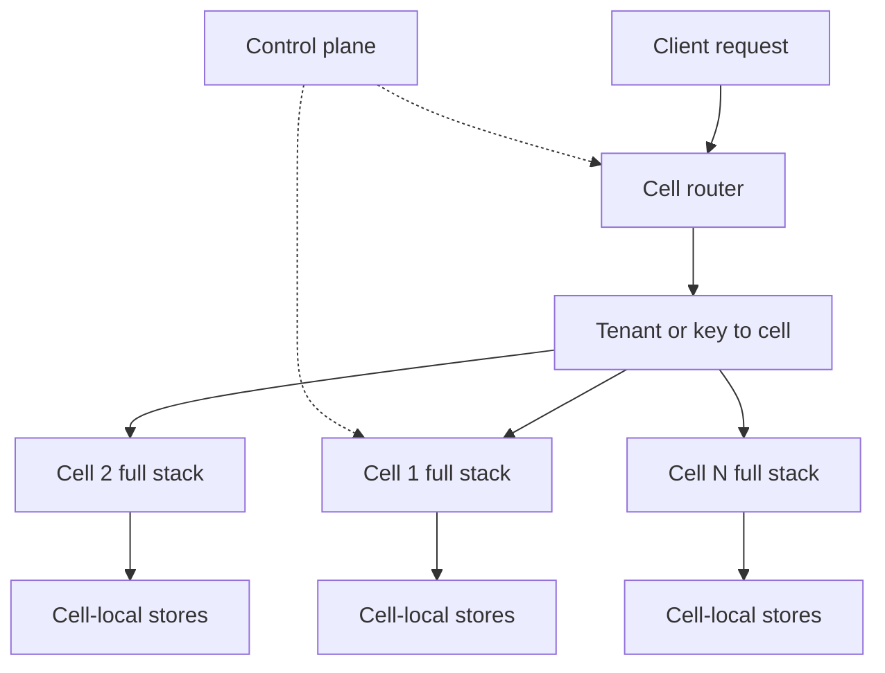

## Concept

### A cell is a whole stack for a slice of work

A cell is not a database shard with a shared application tier in front of it. It is a deployment of the service and the dependencies a request needs after routing: the application, the data stores, the queues, and the caches that would otherwise correlate failures. Customers, key ranges, or regions are assigned to cells. If one cell is on fire from a bad deploy, a full disk, a poison payload, or a retry storm, the other cells keep serving their slices. The blast radius is a fraction of the workload, and that fraction is something you can put next to an error budget.

The property holds only when the cell boundary is honest. A shared cache, a shared log cluster, a global metadata database, or one control-plane call on every request is a single fate wearing several DNS names. Draw the box around a request after the router has chosen a cell. If the box still contains a global bottleneck, you have deployment groups. You do not have cells.

Amazon's public write-ups of the pattern say the same thing in operational language: keep cells from sharing fate, keep them similar enough to operate as copies, and keep each one small enough that losing it is an acceptable slice of the service.

### Routing is part of the data plane

Every request maps to one cell, or to an explicit fanout when a read must. Typical maps are tenant or account to cell, a hash of a key to cell, or geography to cell for latency and residency. Tenant mapping is easy to explain and painful when one tenant is a large fraction of load. Hash mapping spreads load and makes support harder, because a customer's data is not one box you can point at. Geography matches residency law and still leaks at the boundaries, where a user or a workflow crosses cells.

The map lives in a router that has to be more available than any single cell. A replicated table, a consistent hash over a cell ring, or an edge route plus a first hop can work. A single gateway cluster in front of dozens of cells recreates a global blast radius at the door. The router is in the path of all cells, so it is designed like a small highly available system of its own: multiple copies, no shared cache that can stall every lookup, and a map cache that keeps serving when the control plane hiccups.

Moving a tenant is a migration, not a configuration flip, once the cell owns the data. Copy, verify with a dual read, freeze writes, swing the map, drain, delete. In-flight requests need a generation so they do not straddle two databases. If you cannot move a tenant, you cannot rebalance, and the fleet grows one whale cell until the blast-radius percentage you published is fiction. Practice an empty-tenant move on a schedule.

### One template, one size argument

Cells should be instances of one template: same artifact, same topology, same limits, different identity and data. You test and deploy the template. You scale by cloning cells, not by giving cell one a special shard layout and a snowflake chart. Uniformity is what makes an incident a rerun. Runbooks, autoscaling, and the maximum tenants or queries per cell are one document. A cell that still runs last year's architecture next to cells on the rewrite fails together with whichever chart you just shipped to "all the new ones," and the old one fails alone in a way nobody rehearsed.

Size is blast radius versus waste. Too small, and you pay for idle headroom and for N copies of every coordination service. Too large, and one cell outage exceeds the customer fraction you promised. A few percent of the service is a common public target. Derive the percent from the error budget. A cell that holds eight percent of revenue during a sale has already failed a "few percent" test. Cap tenants, request rate, and data volume in the router, and overflow to a new cell before the cap. Idle capacity inside the cap is the cost of the isolation, the same way spare capacity in a second zone is the cost of a zone objective.

### Control plane outages must not be request outages

The control plane assigns tenants, rolls deploys, issues certificates, and collects metrics. Existing cells should keep serving last-known configuration if that plane is down. Routing should keep using a cached map. A design that calls the control plane in band on every request has coupled the planes. You will take a global outage to fix a global outage.

Deploys are cell-shaped. One cell, watch the objectives, then a batch, then the rest. A global feature flag bypasses the isolation as surely as a global binary push. Scope flags to a cell or to the tenant map. Schema changes are the same shape. A blocking DDL against "the database," when each cell has a database that receives the statement in lockstep, takes the fleet down together. Either each cell has its own schema cadence, or the change is an expand that old and new binaries can run, rolled cell by cell.

### What you cannot clone, isolate at the edge

Identity providers, payment networks, and some hardware stay outside the cell. Isolate at the adapter: timeouts, bulkheads, credentials per cell, and a connection pool that one cell's retry storm cannot exhaust for the others. If you cannot bulkhead a dependency, it belongs on the published list of shared fate, with its own error budget.

Data that must be global, a unique name or a cross-customer search index, needs an explicit protocol. A dedicated uniqueness service with its own cells, or a global index you have agreed is eventually consistent. A single SQL table that every cell writes on the signup path is a cell you forgot to draw. It will be the outage.

Prove the boundary. Kill one cell's database. Ship a bad build to one cell. Saturate one tenant. Other cells' error rates should stay inside noise. If they move together, a shared dependency is still on the path. Publish the list: identity, the router, payments, DNS, the artifact registry. Each item is cell-local, bulkheaded, or an accepted global risk.

## Trade-offs

| Approach | When it wins | Cost / risk |
| -------- | ------------ | ----------- |
| One scaled-out fleet | Small services, cheap global incidents | Every failure is global |
| Cells by tenant | SaaS isolation and per-customer limits | Whale tenants and migration work |
| Cells by key hash | Even load, no customer is a natural whale | Hot keys; harder support and residency stories |
| Cells by geography | Latency and data residency | Cross-cell workflows; more than one traffic story |
| Many very small cells | A tiny blast radius | Idle capacity and control-plane overhead |

Cells cost duplicated databases, lower utilization, and more pipelines. Buy them when a global outage costs more than the waste. A consumer service with a tight availability objective and a large user base is in that set. An internal tool with a handful of users is not; cells there are ceremony.

Audit shared fate on a schedule. The list gets worse as people add a convenient global cache. "We have cells" plus one session store every cell must reach is one cell. The data stores are the fate. A cellular application tier in front of one database is a deployment wave, and it will fail as a deployment wave.

## Diagram

## Failure modes

### A shared dependency couples the cells

A cache, a rate-limit store, or a metadata database that every cell uses saturates or dies. All cells degrade together. Detection is error budgets burning in correlation across cell identities that should be independent.

Mitigation is to split the dependency, or, if it must stay shared, to bulkhead client pools per cell and page on cross-cell correlation rather than only on a regional aggregate. The audit is how you find the dependency before the incident does.

### One tenant fills the cell

A single customer saturates the cell's database or worker pool. Everyone else mapped there inherits the pain. Detection is per-tenant rate and storage, and a cell that is saturated while its neighbors are idle.

Mitigation is an admission cap at the router, a dedicated cell for whales, and a migration you have already practiced. A pure hash with no escape hatch fails at the first large contract.

### The map sends work to the wrong place

The router is down, or it returns a stale cell after a move. Users hit an empty cell or another tenant's data path. Detection is miss rates, authorization failures that cross cells, and the router's own error budget.

Mitigation is multiple router replicas, a signed token that carries the cell identity, a map cache that outlasts a control-plane blip, and a freeze on migrations while the router is unhealthy. The router is data plane. Treat its availability as a serving objective.

### One pipeline deploys every cell

Continuous delivery ships the same chart to the fleet in one wave because the cells are identical. A bad build is global, which defeats the reason the cells exist. Detection is the deploy graph: one wave means you do not have cellular blast-radius control, regardless of how many clusters you count.

Mitigation is a mandatory first cell, an automatic halt on objective burn, and compatibility between the new schema and the previous binary for cells that have not moved yet. Bake time is part of the architecture.

## Real-world example

Amazon describes cell-based architecture as a standard way to bound blast radius in large services. A cell is a complete, independently deployable slice of the service. Work is partitioned so that a failure or a bad push takes a fraction of traffic rather than the service as a whole. The edge routes each request to one cell. Cells stay similar so the unit of scale is a copy, not a new design. Services that have discussed the pattern in public, including front-door systems that also use shuffle sharding, treat the cell as the unit in the availability math: with a honest boundary, losing one cell out of twenty is about five percent of the workload, not a total outage.

The checklist for a smaller company is the same. Partition customers or keys. Give each partition its own stores and queues. Deploy in waves. Measure whether failures correlate. Keep the router simple and highly available. Move tenants with a protocol you practice. Keep the control plane off the request path. When someone adds a global cache or a global uniqueness table, either give it cells or write it down as shared fate.

A stateless tier labeled "cell" in front of one database has not implemented the pattern. The blast radius is the database. Until the data moves with the cell, the diagram is a deployment convenience, and the next bad migration will prove it.

## What to remember

- A cell is a full serving stack for a slice of work; a shared store on the request path cancels the isolation.
- Route with a highly available map, and treat tenant moves as a migration with a freeze and a generation.
- Run one template, cap cell size from the blast radius you will accept, and deploy one cell before the fleet.
- Audit shared fate and whale tenants; those two are how the percentage you promised stops being true.
