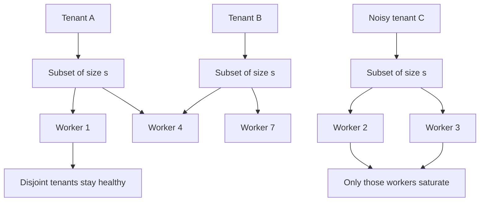

## Concept

### Isolation from combinations, not from dedicated machines

A dedicated shard per tenant isolates perfectly and utilizes poorly. A whale still needs its own machines, and everyone else leaves capacity idle. A fully shared fleet utilizes well and isolates nothing: one tenant, one poison payload, or one retry loop can occupy every worker.

Shuffle sharding gives each tenant a small subset of the fleet. Requests for that tenant are load-balanced only inside the subset. Two tenants interfere only where their subsets overlap. If subsets are chosen uniformly, the chance that a noisy tenant shares its entire subset with a given quiet tenant is small, and the chance it can recruit the whole fleet is zero. It can fill its own workers. Everyone whose subset is disjoint stays up. Everyone who overlaps on one worker still has the rest of their subset, if you retry inside the subset and skip the hot worker.

The mechanism is combinatorial. It is not a cryptographic boundary and it is not a fairness scheduler. AWS described it publicly as a way to keep multi-tenant front doors from sharing fate too broadly, with DNS nameserver assignment as the example people can see from outside.

### How a tenant gets a subset

You need a stable function from tenant identity to a set of worker identities of a chosen size. Hash the tenant with several salts and take workers, or hash to an index in the space of combinations and expand that index to a subset. If the function is pure, you store nothing per tenant. If you need to rebalance without moving everyone when the fleet grows, store the assignment.

Workers and the load balancer must enforce the set. Traffic for the tenant goes only to those workers. If any worker still accepts the tenant through a default round-robin, you have labeled logs with a shard identity and you have not shuffle-sharded anything. The balancer is part of the pattern. A header nobody routes on is not.

Subset size is the knob. Size one is ordinary sharding: a dead worker is a dead tenant, and isolation is strong. Size equal to the fleet is no isolation. Two or three workers out of a large fleet is the usual band. You want enough redundancy that one worker death does not strand the tenant, and a small enough set that a retry storm cannot spread past a few machines. The numbers from a write-up with a fleet of hundreds do not apply to a fleet of eight. At small fleet sizes the combinations overlap so heavily that you have reinvented a shared pool. Measure pairwise overlap on your actual fleet and tenant count.

When the fleet grows, a pure hash remaps some tenants. That is acceptable for stateless workers if you can drain connections. It is expensive if workers hold tenant state. Then keep an assignment table and move as few tenants as you can, the same way you would with consistent hashing. Freeze remaps during an incident so you do not add a stampede to a failure.

### Overlap is the blast radius you can calculate

You do not need a research paper. You need two counts. If a bad tenant saturates its workers, how many other tenants have at least one worker in that set, and how many have all of their workers in that set? Partial overlap is degradation: a fraction of requests hit a hot worker, and a retry to another worker in the subset can succeed. Total overlap is a hard outage for that second tenant. The point of a large combination space is to make total overlap rare.

In-subset retry is part of the pattern, not an application quirk. Without it, sharing even one overloaded worker fails a share of requests even though another assigned worker is healthy. With it, you must still cap retries. The subset is small on purpose. Retrying forever inside it concentrates load on the machines you were trying to protect, which is the correct failure domain and still an outage for that tenant.

Route 53-style assignment makes the idea visible. Each hosted zone receives a combination of nameserver addresses from a large pool. A flood tied to one zone hits that combination. It does not hit every nameserver. Two customers who share one nameserver still have others, so a single host failure does not darken the zone.

### What shuffle sharding does not do

It does not make an unbounded handler safe. Pair it with timeouts, per-tenant concurrency limits, and load shedding that prefers to drop the tenant that is over its budget. Shuffle sharding bounds how far damage spreads. The worker still has to refuse work.

It is not a cell. A cell partitions the whole stack, including data. Shuffle sharding partitions the use of a shared pool. Large systems use both: cells so a deploy and a database failure stay local, shuffle sharding inside a cell or inside a shared front door so tenants do not all land on the same workers. Bulkheads isolate failure types, a thread pool per downstream, not tenants. A bulkhead without a tenant-to-worker map still lets one tenant take every thread in the pool.

Hashing a tenant to one queue partition is sharding. You get isolation and a hotspot, and you lose the spare worker inside the subset. The combination is the part that gives you redundancy and incomplete overlap at the same time.

### Stateful workers and poison payloads

If workers are stateless, the map is a routing table. If they hold connections or caches, the subset is a capacity reservation. Leave headroom on every worker for the worst tenant that maps to it. Packing every worker to a high utilization target means a noisy neighbor still fills its subset, and every other tenant on those workers shares the pain. Shuffle sharding is an isolation tool. It is a weak packing tool.

A payload that crashes the process will crash the subset if the balancer retries the next worker and the client keeps sending. After a small number of crashes, quarantine that payload and stop sending it to healthy workers. A sacrificial set of workers for quarantined tenants is better than a crash loop across the combination. Shuffle sharding a database connection pool is reasonable when every replica holds the data, because you are only steering compute. It is dangerous when the subset is also the only place the tenant's bytes live. That is ordinary sharding again, and losing the subset loses the data.

## Trade-offs

| Approach | When it wins | Cost / risk |
| -------- | ------------ | ----------- |
| Fully shared fleet | Highest utilization, simplest balancer | One tenant can occupy every worker |
| Dedicated shard per tenant | Hard isolation, known whales | Idle capacity and an operational fleet per tenant |
| Shuffle subset on a large fleet | Multi-tenant APIs and DNS-style front doors | Partial overlap, remap on scale, a balancer that must understand the map |
| Cells plus shuffle sharding | Deploys and noisy neighbors both need a bound | Two maps to operate |
| Single-worker hash shard | A simple assignment | No in-subset retry; one worker death is a full tenant outage |

Pick the subset size from the failure you are buying insurance against. At least two workers so a single death is not an outage. Far fewer workers than the fleet so saturation is a few percent of capacity. Simulate overlap. Leave headroom. If the balancer is a round-robin load balancer that ignores tenant identity, you have not deployed the pattern, however clean the design document looks.

Utilization will be lower than a perfect pack, because each worker sees a random mix and must absorb the noisiest tenant in its combinations. That idle fraction is the price of a blast radius you can explain. Teams that fill the idle fraction back up in the name of efficiency have quietly returned to a shared fleet.

## Diagram

## Failure modes

### Scaling the fleet remaps everyone

Adding workers changes the hash. Tenants stampede onto new processes while old connections drain. Detection is a latency spike lined up with autoscaling, and errors concentrated on nodes that just joined.

Mitigation is a stored assignment with explicit moves, hashing that only places new tenants onto new workers, or a drain that freezes remap during an incident. Stateless workers tolerate a remap. Connection-heavy workers do not.

### Overlap is worse than the combination math

The fleet is small, the subset is large, or the hash clumps. Many tenants share the same two machines. Detection is a tenant-to-worker matrix and a count of pairwise overlap, plus saturation that correlates across tenants who should have been independent.

Mitigation is a larger fleet, a smaller subset, a uniform hash, and, when assignments are stored, a reject rule for sets that exceed an overlap cap. Do not quote a binomial coefficient you have not measured.

### Retries fill the subset

The handler is slow or the tenant is genuinely over budget. All of its workers are busy. Clients retry, and the hash correctly sends them to the same workers. Isolation held. The tenant is still down. Detection is concurrency and queue depth on that subset only, with the rest of the fleet inside normal bounds.

Mitigation is per-tenant admission control, backoff, and shedding that drops the over-budget tenant first. Shuffle sharding without a limit is a smaller outage. It is still an outage, and it is the one you told this tenant they would have.

### A poison payload walks the subset

Parsing the body panics the process. The balancer tries the next worker in the subset and takes that one down too. Detection is crash loops whose tenant identity and payload hash match, confined to one combination.

Mitigation is a crash budget, a cache of poisoned payloads refused fleet-wide after a few failures, and quarantine workers if the tenant must be parked somewhere. Do not infinite-retry a failure that is a process crash.

## Real-world example

AWS documents shuffle sharding in the Builders' Library and uses it in services such as Route 53. Each hosted zone is assigned a combination of nameserver addresses drawn from a large fleet. Queries or a failure mode tied to one zone hit that combination. They do not hit every nameserver the service runs. The zone still has several nameservers, so one host in the combination can fail without taking DNS for that zone dark. The space of combinations makes it unlikely that two arbitrary customers share the full set, which is the isolation property customers experience without seeing the hash.

The same assignment shows up in other multi-tenant AWS control planes: a customer or a resource maps to a small subset of hosts, and overload, retries, and some software faults stop at that subset. Cell-based architecture, in Amazon's own writing, is the complementary move. Cells bound a bad deploy and a data-plane failure. Shuffle sharding bounds a noisy neighbor inside a shared layer, or inside a cell that is still multi-tenant.

On a fleet of a few dozen stateless pods you can get a useful weak form with subset load balancing keyed by tenant, a subset of two or three, and a per-tenant concurrency limit. You will not reproduce a global DNS fleet's combination space. You will stop one customer from occupying every pod. Measure overlap, keep the subset small relative to the fleet, and make the balancer enforce the map. That is the architecture. A sentence about isolation on a slide is not.

## What to remember

- Shuffle sharding assigns each tenant a small subset of workers so overload cannot spread to the whole fleet.
- Choose a subset of at least two, far smaller than the fleet, and enforce it in the load balancer.
- Add in-subset retry, per-tenant limits, and a quarantine path for payloads that crash workers.
- Remaps, heavier overlap than you calculated, and retry storms inside the subset are the failures to page on.
