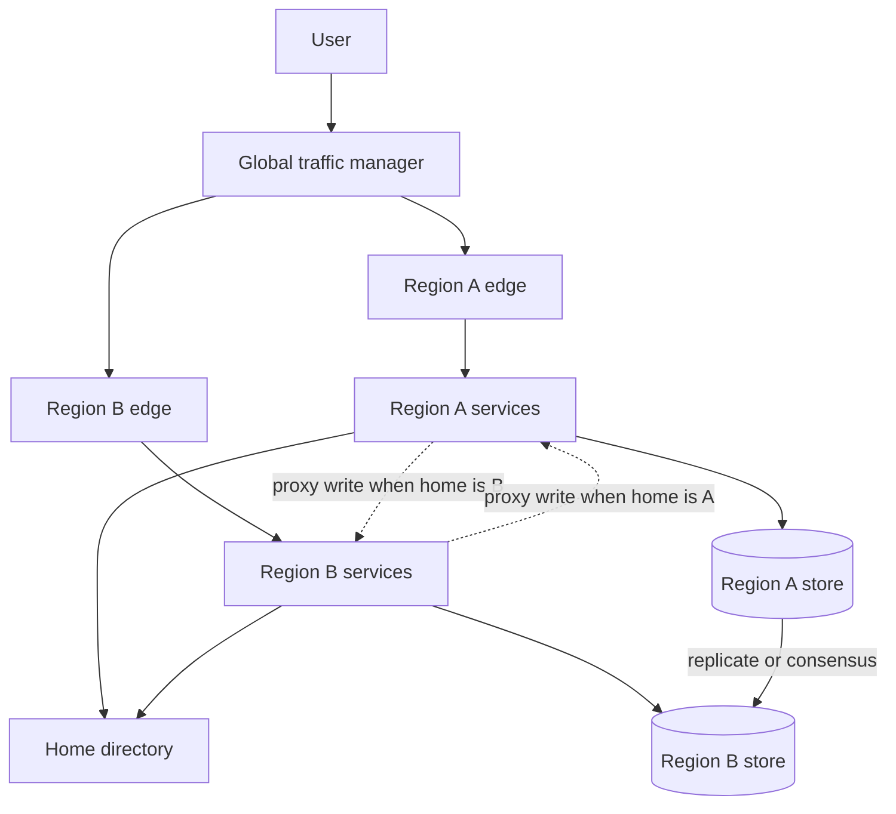

Two regions that both answer requests are not yet an active-active system. They become one when the architecture names, for each class of record, which region may commit and what a reader in the other region is allowed to believe. Terminating TLS near the user, checking a token, and rendering a page are the easy half. The record is the hard half: a balance, a reservation, a session, an uploaded object, a message that must apply once. Frankfurt and Virginia can each be consistent with their own disks and inconsistent with each other. The product needs a written rule for which history the user, the ledger, and the regulator will see. A second cluster plus a DNS failover name is a standby plan. It is active-active when both clusters serve live traffic and the commit rule already exists.

## Concept

### Serving plane and commit plane

Treat the path that accepts a connection as a different system from the path that makes a fact durable. A region can be fully active for reads, page composition, and authentication checks while every durable write for a given key still lands in one home. Local reads with home-region writes are the form of active-active most SaaS products can defend in a design review. Users in both regions get a short path for the bulk of traffic. The write pays a wide-area round trip when the user's home is elsewhere, and a local commit when they are already home.

The other arrangement is multi-master. Both regions may commit the same business key without asking the other first. Collaborative documents, presence, and some carts survive that choice when the merge is something the product will show a person. Inventory counts, account balances, and unique reservations survive it only when the merge is a rule the business has accepted before the first conflict. Health of the serving plane — error rate, drain state, retry budget — is a different signal from health of the commit plane — replication lag, quorum, lease, fencing token. One boolean named region healthy is how a failover both flaps and fails to move the writer.

### Three commit contracts

Home-region pinning removes conflicts by construction. A directory maps a user, a tenant, or a shard to an owner. Other regions proxy the write or return a redirect the client understands. Failover is a control-plane operation: fence the old owner so it cannot commit, move the directory entry, drain in-flight work, then admit traffic. Travelers and objects with no natural home pay latency on the write. The directory sits on the critical path, so it needs its own replication story and a cache that can serve a slightly stale map while the source is impaired. A wrong home pointer is a quiet split brain. Give the pointer a generation, and refuse a commit whose generation is older than the one storage last accepted.

Local commit with asynchronous merge is true multi-master. Last-writer-wins on wall clocks drops a legitimate update that took the slower path and arrived carrying an earlier timestamp. If you choose this contract, persist a version, use a clock whose error you can bound, and define the merge in product language: keep both edits, surface a conflict, or apply a structure that commutes, such as a counter or an observed-remove set. Deletes are writes. A tombstone has to outlive replication delay, or the deleted row returns from the other region and looks like a resurrection. Schema changes are writes too. A new column has to expand and contract across both regions, or one region starts rejecting rows the other stores without complaint.

Global consensus gives every commit a single order. A Paxos or Raft group spread across regions, or a system in the Spanner family, makes the write wait for a quorum that crosses a wide-area round trip and, where external consistency is required, for clock uncertainty to pass. Nearby replicas can serve a read at a timestamp already known to be safe. You pay commit latency and the cost of operating the quorum. You also stop committing when you lose a majority, even while a minority region is full of users who can still read. That stop is the correct behavior when a forked ledger is worse than a pause. It is an outage when the product promised that local writes would continue.

Object bytes, search indexes, and queues do not inherit the database's contract. A page served from one region that points at an object stored only in the other is inconsistent in the way users measure: the link fails. Advertise the global URL after the bytes exist in every region that might serve the page, or pin the page to the region that holds the object.

### Identity, sessions, and residency

A sticky cookie feels like a topology until a phone changes networks, TLS fails to resume, or the region named in the cookie is the one you just drained. Prefer a small global bootstrap that returns regional endpoints and the user-to-region map. Keep session state in a store that is globally ordered, or keep it cheap to rebuild from a durable credential. Sessions that live only in the memory of a regional fleet disappear in the first real drill, and the user is logged out in the middle of a payment.

Identity providers, secret stores, feature flags, certificate authorities, and the container registry are often the real single region. Both application regions look green while login is dead worldwide, or while a replacement instance cannot pull an image. Place those bootstrap dependencies in a failure domain that still works when either compute region is gone. A runbook that says to fail the application over, and then requires a pull from the region you lost, is a document. It is not a design.

Residency is a product constraint that belongs in the directory. A European tenant whose rows may not be stored or processed in the United States is not an active-active participant across that pair. You can still run active-active inside the legal zone, and single-region or active-passive across the legal boundary. A residency key on the record, checked before replication, is what makes the distinction enforceable. A flag on the whole table is how an audit fails months later, when a join or a backup copy lands the row in a warehouse the tenant was never meant to enter.

### Read-your-writes and causality

The request that breaks naive geo-routing is the one the user just submitted. The write commits in Oregon. The next read lands in Frankfurt because a resolver or a load-balancing hint looked closer. The replica is a few hundred milliseconds behind, and the interface shows the previous state. The user experiences a broken save. Pick one platform default and make teams opt out in writing. Pin the client to the writer for a short window. Send a version token the replica must catch up to before it answers. Read from the primary on the first get after a mutation. Or read at a globally consistent timestamp. A different choice in every service is a lottery the support organization cannot explain from a single trace.

When two regions can write the same key, causality has to travel with the data. Version vectors, hybrid logical clocks with a bounded error, or a consensus log each give you a way to say which update follows which. Wall-clock last-writer-wins discards the edit that took the slower path. The ticket says the application lost the user's work. The regional dashboards say both sites are healthy, because they are. Health was never the question. Order was.

### Capacity belongs in the failover design

An active-active pair that cannot absorb the loss of one region is a demonstration. If each of two regions runs at seventy percent of its limit, the survivor falls over as traffic arrives. Caches are cold. Autoscaling is calling a control plane that is impaired at the same moment. Connections show up faster than instances. Size the pair so one region can carry the peak you are willing to promise, or run three regions so any two can. If neither budget exists, decide in advance which traffic you will shed: recommendations, batch exports, even new signups, while checkout and login stay up. Provision that headroom before the incident. Finding the shortfall while the survivor is melting is the incident.

Failover is a continuous behavior. Probe from vantage points outside the region, so a network cut that blinds your own probes does not look like health. Fence writers before you shift traffic. Plan failback with the same fence. Failback is where the second split brain usually appears: the old region returns, still believes it is primary, and accepts writes the new primary has also accepted. Clients that cache an address until the process restarts will ignore a short DNS TTL. The drain has to succeed at a layer you operate — a load balancer, a route withdrawal, or a client that already holds a second endpoint.

## Trade-offs

| Approach | When it wins | Cost / risk |
| -------- | ------------ | ----------- |
| Single region, multiple zones | Zonal loss is the failure you actually expect, writes must stay linear, and users sit in one geography | A regional disaster or a regional control-plane event takes the product down |
| Active-passive standby | You need a regional recovery objective measured in minutes, and a forked write is unacceptable | Idle capacity, lag as the recovery point, and a failover path that rots if you never drill it |
| Active reads, home-pinned writes | Read latency must be local and each key has a natural owner | Traveler latency, a directory on the critical path, and home moves that are control-plane events |
| Multi-master with an explicit merge | Objects commute, or the product can show a conflict and keep both edits | Lost updates when the merge is vague, tombstone windows, and support load when two truths appear |
| Cross-region consensus | A forked record is unacceptable to the user or the regulator | A wide-area round trip on commit, a write stop when quorum is lost, and the weight of operating the quorum |

Zones already remove most of the failures a product will see in a year: a bad rack, a power domain, a zonal control-plane blip. Single-region multi-zone stays the professional default until the business writes down a regional recovery objective and a latency target one geography cannot meet. Crossing a region boundary to survive a rarer event is worth the operational cost when someone has priced that event. It is an expensive hobby when the diagram was adopted because it looked mature.

Active-passive fits money movement, inventory that cannot be double-sold, and identity records, provided game days actually move the writer and the old primary is fenced before the new one accepts commits. You are buying a single writer. You pay for capacity you hope to leave idle, and the lag at the moment of failure is the recovery point. If that lag is unacceptable to the business, the design already belongs in the consensus column, whatever the slide title says. Home-pinned writes are the first shape I reach for when a global product still has a natural owner per user or tenant. Multi-master is a product decision about conflict. Consensus is the honest tool when two histories would be a defect. Mixing the three inside one product is normal: checkout pins, a document editor merges, a ledger waits on a quorum. The defect is one replication arrow that claims to cover all three classes of record.

## Diagram

## Failure modes

### Split brain after a false failover

A probe flap or a partial network cut convinces each region that it is the writer for the same keys. Both commit. The histories diverge, and the divergence stays quiet until a user, a report, or a reconciliation job sees two truths for one business key. Downtime would have been easier to explain.

Detection: two directory entries claiming the same generation, conflicting versions on one key, and tickets that reproduce in only one geography. Mitigation: fence before any traffic shift. The old writer has to lose the ability to commit, through a lease, a consensus lock, or a storage generation. Losing a DNS name is not a fence. Keep automated regional failover conservative for data that does not commute. A human confirmation on the fence is cheaper than a weekend of manual merge.

### The survivor saturates

The failed region is gone. The remaining region is up and melting. Error rates climb, connection pools saturate, caches miss, and autoscaling cannot obtain capacity because the cloud control plane or the image registry is unhappy at the same moment.

Detection: saturation and tail latency in the survivor within minutes of the shift, plus a game-day record that already showed the region above the line where one site can carry the pair. Mitigation: provision the headroom the promise requires, shed a named tier of traffic before user-critical paths, and run failover tests that remove a region. Adding synthetic load to a healthy pair never shows the cold cache or the registry that lived in the region you just lost.

### A successful read of a stale replica

The user does not see the write they just made. A unique constraint on a stale replica rejects a legitimate insert. A newly uploaded object returns not found because the page was rendered in the region that does not have the bytes yet.

Detection: a lag objective on each store, and a synthetic that writes in one region and reads in the other on a timer. A single replication-healthy bit stays green while the product is wrong. Mitigation: version-aware reads, a short pin to the writer after a mutation, and a publication rule that withholds a global URL until the bytes exist in every region that might serve them.

### A shared dependency glues the regions together

The identity provider, the container registry, the flag service, or a third-party fraud API lives in one place. Both application regions fail together. The diagram still shows two clouds.

Detection: a dependency map that includes bootstrap and recovery paths, exercised by a drill in which the registry is in the dead region. Mitigation: replicate those dependencies, or host them where they survive the loss of either compute region. A dependency belongs to the data plane when the product cannot serve, or cannot recover, without it.

## Real-world example

Google's public account of Spanner is the industrial description of a multi-region commit contract that architects can actually study. Replicas sit in multiple regions. Paxos groups order commits. TrueTime bounds clock uncertainty with GPS receivers and atomic clocks, so a transaction can be given a timestamp that is safe to treat as a real-time order. A commit waits out that uncertainty. Write latency therefore includes a wide-area component and a wait for the clock's error bound to elapse. Reads often proceed from a nearby replica at a timestamp already known to be safe, which is how a global system still feels local on the read path.

The F1 advertising database sits on that machinery because an advertiser cannot be told that a spend happened twice, or that it happened in an order the books cannot defend. The serving edge is a separate layer. People reach a nearby front end, and caches absorb reads that do not need the latest global timestamp. Search, mail, and ads do not share one write topology. Putting all three on one quorum would charge Spanner's commit cost to data that never needed a global order. In a design review, the useful question is which keys are pinned to a home, which keys merge under a product rule, and which keys wait on cross-region consensus. A second region, a replication arrow, and no such list is a standby plan with an active-active title.

## What to remember

- Active-active means a commit contract for each class of record, and live serving from more than one region at the same time.
- Pin a home, merge under a product rule, or wait for cross-region consensus. An unlabeled replicate arrow is how histories fork.
- Losing a region is a capacity problem and a fencing problem. A survivor that cannot carry peak, or an old primary that can still commit, has not failed over.
- Identity, registries, flags, and object bytes sit on the data plane. When they live in one region, the product does too.
