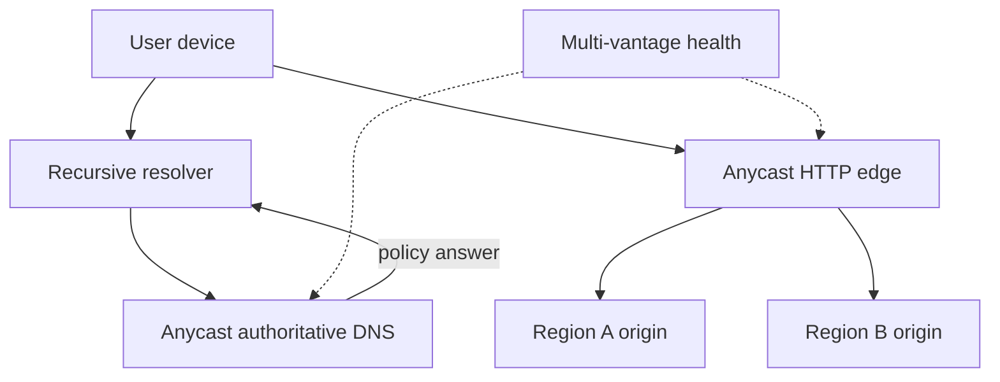

Global traffic management is the machinery that turns one public name into a nearby, healthy place to terminate a connection. People do not attach to a cloud. They resolve a name, receive an address, and send packets along whatever path their network currently prefers. Anycast and GeoDNS are the two mechanisms architects name first. They answer different questions, they move on different clocks, and a production front door usually stacks them. Treating the two as synonyms produces a design whose failover time is whatever a recursive resolver feels like caching, or a design that withdraws a route and then watches the neighboring city absorb a flood it cannot carry. The job is narrower than the vocabulary suggests. Resolve quickly. Land on capacity that is close in network terms. Stop sending work to a site that cannot finish the request. Do all of that while resolvers, browsers, and mobile SDKs keep answers you no longer believe. A recovery plan that assumes every client re-resolves inside the TTL you typed into the zone is a wish.

## Concept

### Proximity is a routing fact

GeoDNS that keys off the recursive resolver's address will treat a person in Mumbai as a Virginian when the phone is configured to use a resolver in Virginia. Anycast keys off BGP. BGP follows local preference, peering economics, and AS-path length. A city that is geographically near can still be far in the routing table when the ISP hauls traffic to a cheap interconnect on another continent. Both systems approximate the user. The measurement that matters is handshake time and time to first byte, grouped by client network. The latency of a health probe that sits next to your own load balancer tells you whether the probe can see the balancer. It does not tell you what the user's ISP is doing.

Health has to be application health. A point of presence that answers ICMP and fails TLS, or that returns a flood of server errors, is a destination you must stop advertising. Traffic management that only knows the virtual machine is running will keep filling a dying site. Probe from several continents and from networks that do not share fate with the origin. A probe fleet that lives in the same failure domain as the site will miss the outage, or it will withdraw a healthy site because the probe itself went blind.

### Anycast

Anycast announces the same prefix from many locations. Routers on the internet pick a path. The client is configured with one address, and no DNS TTL stands between a route withdrawal and a new path. That is the operational attraction. When a site stops announcing, BGP converges toward another announcement of the same prefix. Convergence is seconds to minutes. It is uneven at the edge of the internet. Some flows stay pinned to a site that is trying to leave, because a router along the path has not processed the withdrawal, or because a middlebox has glued the flow to an old next hop. Equal-cost multipath inside a site can also move a flow if the hash changes under load. Long-lived connections need a story. Terminate them at the edge and proxy inward over a session you control, or accept that a reroute resets them and make the client retry safe.

Anycast fits UDP and short connections that can be retried without a person noticing. Authoritative DNS, cache hits on a CDN, and an HTTP front door that terminates TLS are the classic fits. It is a poor fit for a protocol that assumes the address names one machine with durable session state, and a poor fit for an origin that exists in a single building. The address names a service. State either lives in a store the next site can reach, or the connection ends at the anycast edge and the origin stays regional and unicast.

Capacity does not appear because a prefix was announced. Withdrawing a city dumps its traffic onto neighbors. If those neighbors were already near their limit, a local failure becomes a regional overload, and the second withdrawal makes it worse. Drain before you withdraw when the site is merely overloaded: shift BGP preference, finish in-flight work, then stop announcing. Volumetric denial of service is the other reason large operators anycast a front door. Junk is absorbed at many edges instead of concentrating on one origin address the customer would have to sink alone. That property belongs to the front door. It does not replicate a database, and it does not make a single-region origin globally resilient.

### GeoDNS and latency-based answers

GeoDNS, latency-based DNS, and weighted DNS return different answer sets based on the resolver, a geolocation database, latency measured from probe networks, or weights you set for a canary. The client then connects to a unicast address that belongs to one region or one site. Failover is a change to the answer. You remove the sick address and wait for caches to forget it.

You do not operate those caches. Recursive resolvers clamp TTLs upward. Browsers and stub resolvers keep their own copies. A sixty-second TTL is a request you make of the internet. It is not a recovery-time objective you can put in a contract with a customer. GeoDNS still wins when you have a handful of unicast regional origins, when a legal rule says a user must enter a specific jurisdiction, and when an explicit canary needs a sticky answer so one person does not bounce between versions. It loses when you need worldwide failover faster than caches and you do not ship the client. EDNS Client Subnet can reveal a slice of the user prefix to the authoritative server so the answer tracks the user more closely than the resolver. It is not universal, and it has a privacy cost. Design as if many users hide behind a few large resolvers, and treat client subnet as an improvement for the networks that send it.

### The stack you actually operate

A durable global front door combines the tools. Anycast authoritative DNS keeps the nameservers themselves close and hard to drown. The application name returns a policy answer: geography, measured latency, or weights. Anycast HTTP edges terminate TLS, apply request policy, and proxy to a regional origin. Health signals cut a site out of the DNS answer and, on a separate path, withdraw or de-preference a sick point of presence. Those two health domains can disagree. A region can be a fine origin for users who are already on a nearby edge and a terrible DNS answer for users whose resolvers would send them there directly.

The control plane of that stack is itself a global dependency. If the only way to move traffic is an API that is down, packets keep going where the last policy sent them. Keep an emergency path that does not need the portal: a pre-staged zone change, a BGP community the routers already understand, or a client that holds a second endpoint. Inside each site, consistent hashing in the Maglev family keeps a flow on one machine so a drain does not scramble every connection at once. The portal that draws the map is not the data plane. Last-known-good policy has to live on the site.

### Steering policies are product policies

Latency steering, toward the measured-closest healthy origin, is the default for a consumer product with no residency constraint. Residency steering sends a user into a jurisdiction even when another region would answer faster. It has to key off an account home or an explicit pin. The city of the recursive resolver is the wrong input for a legal boundary. Weighted steering is how you run a canary, and the weight has to stick for the life of a session so one user does not compare two versions of a checkout in the same minute. Failover-only steering is simple, and every user pays the primary region's latency until the day you need the secondary. Quorum the health checks. One probe beside the origin will not see a transoceanic path die. One poisoned probe network must not be able to black-hole the product by itself.

## Trade-offs

| Approach | When it wins | Cost / risk |
| -------- | ------------ | ----------- |
| Unicast name, manual change | One region, a small blast radius, and a human who can be in the loop | Recovery time is a person; there is no proximity |
| GeoDNS or latency-based DNS | A handful of unicast regional origins, a residency rule, or an explicit canary weight | Resolver location misleads the answer; caches dominate failover time |
| Anycast at the edge | Many sites, protocols that are stateless or terminated at the edge, DNS, cache, and volumetric defense | BGP convergence, flow resets, and neighbor overload when a site withdraws |
| Anycast edge in front of regional origins | A global front door, with data and writes kept regional | Two health domains to operate; a shared cache key must not hide a personalized response |
| Client-held endpoint list | You ship the client and you will not trust DNS for recovery time | Old binaries keep old policy; you now operate a configuration fleet |

Start with GeoDNS or latency-based DNS when you have two or three regions and unicast load balancers. Do the health-check design and the TTL arithmetic before you buy a more exotic fabric. Anycast becomes the right tool once you operate many sites and the process listening on that address can lose a single site without losing user state. An anycast address aimed at one origin is a complicated alias for a building. It adds route operations and still fails when that building fails.

Client-held endpoint lists beat DNS for recovery time when the application can try the next endpoint on a connection error. They also freeze policy inside old binaries, so a residency change you make on Tuesday reaches a phone that has not updated in a year only if the bootstrap name still works. Pair a highly available bootstrap with a baked-in fallback, and version the policy the client caches. Residency outranks latency. A resolver in the United States must not be allowed to send an EU-pinned tenant to a US origin because the probe network thought Virginia was faster.

## Diagram

## Failure modes

### The resolver sends the user to the wrong continent

The recursive resolver is far from the human. GeoDNS steers on the resolver, and the human pays a transcontinental handshake for a product that looked geo-optimized in the design review. The zone file is doing what you asked. The input was the wrong location.

Detection: handshake-time histograms split by client network and by resolver network, plus a country whose traffic persistently lands in another region's origin logs. Mitigation: client subnet on the networks where you accept the privacy trade, anycast edges that make resolver location irrelevant for the data path, or an application-level region choice after login that overrides the DNS guess. Measure the user. The resolver is an intermediary.

### Caches ignore the failover you just published

You delete a region from the answer. A large fraction of clients keep connecting to it for many minutes, sometimes much longer. The zone is correct. The incident is not over.

Detection: origin request graphs that do not move when the record changes, and request logs on the withdrawn region that stay busy. Mitigation: treat TTL as a hint. Own a drain at a layer you control — route withdrawal, load-balancer health that stops accepting new work, or a client retry onto a second name. A short TTL is one input to that plan. It is not the plan.

### An anycast site swallows packets it cannot serve

BGP looks healthy. The process is dead, saturated, or failing the TLS handshake. Traffic enters the site and does not come back as a successful response. From the internet's point of view you advertised a working service, and routers are correctly delivering packets to it.

Detection: external synthetics that connect to the anycast address and assert an application response, plus per-site error and discard counters. ICMP success is a weak signal. Mitigation: automatic withdrawal, or a path that makes the site more expensive, when application health fails. Keep spare capacity in the neighbors who will inherit the traffic. Drain, then withdraw, when the site is overloaded and still able to finish the work it has. Withdraw immediately when it is black-holing.

### Routes flap and paths hunt

A site announces and withdraws in a tight loop because a health check is oscillating. The internet hunts. Connections reset. Users see a brownout that no single region's dashboard fully explains, because each site looks intermittently fine and the pain is in the path between them.

Detection: BGP update rate, a rise in TCP resets correlated with those updates, and traceroutes from one vantage point that change every few seconds. Mitigation: damping, a bias toward making a site more expensive before making it disappear, and a hold-down so a flapping health check cannot drive the global table. Prefer a partial shift, through AS-path prepending, when neighbors can absorb some of the traffic and the site can still serve a reduced load.

### The steering control plane is a single point of failure

The API that changes weights is down, or a bad policy push lands on every site at once. During the incident you cannot steer, or you have just steered the world into the bug you are trying to escape.

Detection: a change that correlates worldwide within one policy rollout, and a game day in which the steering API is unreachable while traffic still has to move. Mitigation: stage policy the way you stage binaries. Keep last-known-good local to each site. Maintain an out-of-band withdraw that does not depend on the broken API. A portal outage should leave the data plane on the last good map.

## Real-world example

Cloudflare's public network is the anycast traffic system operators can study from the outside with the least mythology. The same service addresses are announced from cities across the world. A DNS query for a customer zone, or an HTTPS request to a proxied hostname, lands on a nearby Cloudflare site because BGP selected a path. A country code on the recursive resolver did not pick the building. Inside the site, TLS terminates, cache and request policy run, and an origin pull, when one is required, goes to the customer's own regional servers over a connection the edge controls.

Volumetric attack traffic is discarded at the edge where it arrived. That absorption is a primary reason to anycast a front door at this scale. The attacker's packets spread across many points of presence instead of converging on one origin address the customer would have to absorb alone. Authoritative DNS is anycast as well, so the question of which nameserver is close is a routing question. When a site is in trouble, the public incident pattern is to take that site off the announcement rather than to wait for every resolver on earth to expire a unicast address. Recovery time is then bounded by BGP convergence and by the drain logic the operator runs. Customer origins stay regional and unicast. Health checks have to be able to stop the proxy from using a dead origin, or the edge will faithfully accelerate a failure. An anycast address aimed at a single database does not reproduce this design. A front door that can withdraw a city, with origins that remain regional, does.

## What to remember

- Anycast moves packets by withdrawing and preferring routes. GeoDNS moves clients by changing answers. They fail on different clocks, and a front door usually needs both.
- Resolver location is a poor stand-in for user location. Residency and latency are different policies and need different inputs.
- A TTL is a hint you publish. It is not a recovery-time objective you control. Own a drain at the edge or in the client.
- A route to a site that cannot finish the request is a black hole. Application health has to be able to de-preference or withdraw the announcement.
