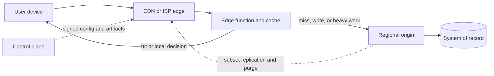

The edge is a place with a worse operational story than your region, which you accept because the physics of the user path demand it. That place might be a CDN point of presence, a cache inside an ISP, a server in a store, a cell on a factory floor, or a device in a pocket. The jobs people collapse into one slide — cut a round trip, save origin bandwidth, keep working when the wide-area link is down, keep data on a premises — want different architectures. A team that says the work will happen at the edge, without naming the job, is usually buying a cache configuration and hoping it becomes a distributed system. The edge has less capacity per site, patchier observability, weaker physical security, and a fleet of versions you will never see fully converged. You win when the bytes or the control loop cannot afford the trip to a region, and when you have already defined what the site does after the origin has been unreachable for fifteen minutes.

## Concept

### Three edges that do different jobs

The CDN edge is a provider fleet, or a fleet you operate, of points of presence in many cities. It is good at TLS termination, caching, request filtering, image and video transforms, and small functions whose input is the request in front of them. It is a bad home for a primary database, a long batch, or any write that must be strongly consistent across users. Density and a short CPU budget are the point of the site. A function that needs a minute of compute and a large working set belongs in a region, with the result cached if the next user can share it.

The network edge — caches inside ISPs, open-cache appliances, some sites attached to a mobile core — exists to avoid hauling popular bytes across the long haul. The win is bandwidth and last-mile latency for objects that are large and popular. The cost is a fleet you often cannot treat like a cloud virtual machine. Someone else racks the hardware. Refresh cycles are slow. The control plane has to push artifacts to thousands of sites that are frequently half-reachable, and it has to decide what "half-reachable" means for a fill that is already in progress.

The premises and device edge exists so a local job continues when the wide-area network does not, and so some data never leaves the building. Retail checkout, a robot's safety loop, and a vehicle's perception path live here. The cost is offline-first data, sparse telemetry, and a threat model in which the box can be stolen, cloned, or left unpatched for a season. A pattern that resizes images at a CDN will not run inventory in a store. Design the data plane and the control plane for the edge you actually have, and refuse to share a runtime story across the three.

### What earns a place outside the region

Put work at the edge when it is latency-bound to the user or bandwidth-bound to the origin, and when it can tolerate stale or purely local state. Cacheable reads. Verification of a token against a cached key set. A feature flag evaluated against a snapshot that syncs on a short interval. Video segments. A bot score computed from the request. A personalization hint the product is allowed to get slightly wrong.

Keep in the region the strongly consistent write, the join across tenants, the heavy training job, and the decision a human has to approve. The edge may enqueue that work. It should become the system of record only when the product is local-first: the store's tender for the last hour, the machine's interlock. A useful test is the fifteen-minute origin outage. If the correct behavior is to fail closed and show an error, you wanted a cache TTL and an origin, and you should say so. If the correct behavior is to keep selling against a local reservation and reconcile when the link returns, you wanted a local ledger and a sync protocol. Budget for both before you budget for a new runtime.

### A small runtime and a versioned contract

Edge runtimes are capped. CPU is short. Disk you can trust is scarce. Cold starts are visible to users. The language allow-list is real. Isolates start quickly and struggle with native dependencies and large heaps. Containers at a point of presence feel familiar to a platform team and cost you density, which is the scarce resource in a city. WebAssembly is the compromise many platforms are betting on: a portable artifact, a tight sandbox, and a debugging experience that is still younger than the one your regional services enjoy.

You will not ship a four-hundred-megabyte service to three hundred cities on every commit. Edge code is a slice. An authentication check. A rewrite. A cache-key policy. A small decision that can be wrong for a few seconds without harming a person. The rest stays regional. That split is an API, and it has a version. During a rollout the edge runs yesterday's code against today's origin, and the origin runs tomorrow's code against yesterday's edge, for as long as the slowest site takes to catch up. Expand and contract applies here the way it applies to a database column. Configuration — flags, routes, certificates, filter rules — should move faster than binaries, because a bad rule needs to leave the fleet in seconds and a bad binary needs a canary. A control plane that pushes config in seconds and code in minutes is what keeps a fleet from becoming a museum of points of presence, each running a private combination.

### Data moves outward as a subset

Replication toward the edge is usually one-way and lossy on purpose. A slice of the catalog. A filter of revoked sessions. A precomputed ranking. Writes that originate at the edge move forward as events with idempotency keys, and the product may accept them tentatively. Conflict is normal. The product has to say, in language a store manager understands, what happens when two sites accept overlapping work. Putting the primary transactional database in two hundred cities produces two hundred split brains and a support model you cannot staff. Put a cache, a narrow read model, or a purpose-built replicated structure for one object type.

Invalidation is the tax you pay for the win. TTLs, versioned cache keys, and origin-driven purge are the tools. A purge that takes half a minute worldwide is acceptable when the product was designed around that delay. It is an incident when someone believed the purge was instant, especially for a price, a takedown, or a revoked credential. Identity at the edge should verify more often than it mints. Checking a signature against a cached public key is cheap and local. Calling the identity provider on every request from every city adds back the round trip you paid to remove, and it risks knocking the provider over at the exact peak you built the edge to survive.

### Many small failure domains

Deploy one city, then a region of cities, then the world. Canary on the real traffic mix of that city, not only on a count of instances. A launch that is quiet in one country and saturated in another is correctly placed and still pages you, because capacity is per city and per event. Decide the shed order before the event: serve a stale object, skip personalization, skip the origin enrichment, then fail the request. Observability has to degrade when a site cannot reach the regional collector. Buffer logs locally. Sample traces. Let the control plane pull a heartbeat. A site that can only be understood through a stream it cannot send is invisible during the outage you most need to see.

Physical reality shows up here in a way a regional virtual machine hides. Firmware is a vendor relationship. Theft and tamper belong in the threat model for premises hardware. Treat the edge host as untrusted infrastructure that is allowed to run signed artifacts and is not allowed to hold long-lived secrets it cannot protect. A stolen store server should reveal a bounded local ledger and a set of keys you can revoke, not a company-wide credential.

## Trade-offs

| Approach | When it wins | Cost / risk |
| -------- | ------------ | ----------- |
| Regional origin only | Writes must be strong, the team is small, and users tolerate a regional round trip | Origin bandwidth and the origin as the attack surface; a wide-area outage is a full product outage |
| CDN cache, no custom code | Bytes are static or safely cacheable, and you want TLS and filtering close to users | Invalidation delay; all business logic still lives on the origin |
| Provider edge functions | Request-scoped auth, rewrites, and experiments, on global bursty traffic | Runtime limits, opaque debugging, cost at high request rates, and a tight coupling to the origin's contract |
| Private caches in access networks | Huge, predictable egress such as video or software distribution | A hardware program, slow refresh, and a thin control plane over sites you do not fully own |
| Premises or device autonomy | The local job must continue through wide-area loss, or data must stay on site | Sync conflicts, physical security, and a long tail of sites that are each slightly unique |

Begin with a CDN and a regional origin. Add custom edge compute when you can name the milliseconds or the origin CPU you are buying, and when the code slice stays small enough to roll back per city. Provider functions are a good rental for request-scoped policy. They are a bad place to grow a domain model. When the function starts importing the pricing engine and a copy of the user table, move that work back to the region and cache the decision if the next request can reuse it.

Private caches inside access networks pay off when the payload is large, popular, and immutable enough to pre-position. They are a distraction for ordinary create-and-update traffic, which will miss and drag the origin into the request anyway. Premises autonomy is a product, not a distribution of Kubernetes. The store has to be able to sell. The sync protocol has to have an owner and a conflict policy. The support model has to assume the wide-area link is a fickle dependency rather than a requirement for every tender.

## Diagram

## Failure modes

### The origin's domain model leaks into every site

The edge function grows a dependency on the user table, the pricing rules, and an artifact large enough to need a regional cluster. Deploys take hours. One bad release is worldwide because the blast radius was coupled to the whole fleet.

Detection: artifact size, cold-start time, and deploy duration trending the wrong way, plus an allow-list of origin calls that keeps growing. Mitigation: a hard budget on the edge package, a review that asks whether the answer could have been precomputed in the region and cached, and a platform check that fails the build when the slice stops being a slice.

### A partial config push creates two products

Half the cities have the new filter rule or the new flag. Users flap as they move across networks. Incident response cannot say which behavior is current, because both are.

Detection: a version histogram by site, rather than a single deploy-succeeded flag for the fleet. Mitigation: versioned configuration, a progressive rollout, and an origin that stays compatible with the previous edge version for the whole rollout window. A worldwide simultaneous cut turns a config change into a global outage.

### A cache key is wrong, or the purge arrives late

A personalized response is stored under a key that omitted the session or the authorization scope. Or a price, a takedown, or a revoked token remains servable after the origin has moved on.

Detection: cache-key reviews in the change, canary fetches that vary cookies and authorization and expect different bodies, and a measured purge latency against an objective you publish. Mitigation: conservative keys, an explicit rule that authenticated HTML is uncacheable unless the key was designed for it, and signed URLs with short lifetimes for sensitive bytes. When the data is a safety or security control, a failed purge is a security incident. It is not a cache-hit metric to glance at on Monday.

### A dark site keeps taking traffic, or dies because it cannot phone home

The site cannot ship logs, so on-call is blind while users still enter. Or the site fails closed because the control plane is unreachable, and a management-network blip becomes a user-facing outage.

Detection: probes that reach the site from outside it, and a last-heard-from heartbeat per location that pages when it goes stale. Mitigation: choose fail-open or fail-closed per function, in writing. Authentication fails closed. A marketing rewrite can fail open to the last good rule. Buffer logs on the site. The data plane has to keep serving from the last signed config without a live call home.

### A premises partition with no reservation protocol

The store sells stock the warehouse no longer has, or it refuses every sale because the link blinked. Both outcomes come from a missing design. The network behaved the way wide-area networks behave.

Detection: sync-lag alerts per site, and a reconciliation report after reconnect that a named owner actually reads. Mitigation: a local reservation with a bounded financial risk, idempotent upload of the tickets when the link returns, and a conflict policy written for the person who has to explain it to a customer. "Eventual consistency" is not an instruction an operator can execute.

## Real-world example

Netflix Open Connect is the public edge architecture that stays concrete enough to copy from. Appliances sit inside ISP networks. Popular video segments are already on those appliances when a member presses play. The device is steered to a nearby appliance based on the member's network and location, using a control-plane decision made with information the cloud still owns. The bytes for a popular title do not cross the long haul from a single cloud region on every play. That is the bandwidth win, and it is large enough to justify a hardware program.

Identity, the catalog, licensing, personalization, and the decision of what to pre-position remain in the cloud control plane. The edge does the expensive physical work: serving large, immutable, highly cacheable objects close to the last mile. Playback objects are immutable for the life of an encode, so they can be filled ahead of demand around popularity forecasts and the relationship with each ISP. An appliance that fails moves playback to another appliance or, at higher cost and higher latency, back toward the cloud. Billing, account recovery, and the models that rank what to cache stay in the control plane, where a strongly consistent write and a global view still make sense.

The split is the design. A team that puts checkout state on the same boxes, because the boxes are "the edge," has copied the map and missed the reason the map works. Copy the division between a central control plane and a pre-positioned payload. The hardware follows the payload. It does not create a new system of record.

## What to remember

- Name the job — latency, bandwidth, offline autonomy, or data that must stay on site — before you place compute outside the region.
- Keep the system of record regional unless the product is local-first. Replicate a subset, and operate a purge path, rather than cloning the transactional database into every city.
- Edge code stays a small versioned slice, rolled out per site, and compatible with the previous origin for the length of the rollout.
- Open Connect works because the bytes are large and immutable and the control plane stays central. Copy that split.
