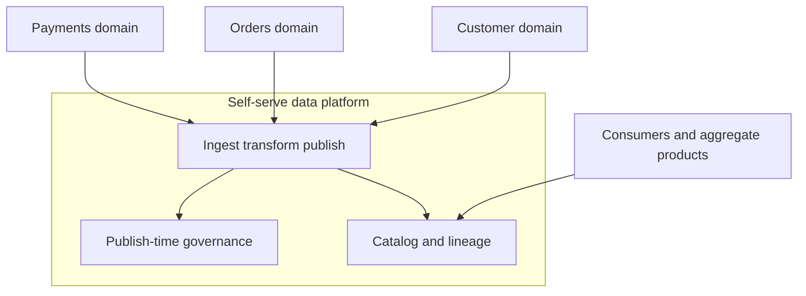

A data mesh is an operating model for analytical data, with architectural consequences you can enforce. The domains that already own the operational systems also own the analytical interfaces those systems justify. They publish those interfaces as products, on a shared platform, under a small set of rules the platform can check at publish time. The pain it responds to is familiar in any company that has outgrown a central data team. That team sits in front of a lake. Every new source waits in a queue. A schema change breaks dashboards nobody can attribute. The table named customer means a different human, or a different grain, in every folder. Mesh fails when a company renames the lake, buys a catalog, and leaves ownership where it was. It works when a domain can publish a product the rest of the company can find, trust, and join without filing a ticket, and when a broken product pages the domain that shipped it.

This is a scaling pattern for organizations, expressed as platform and contract. A handful of sources and a handful of analysts are well served by a warehouse and a few maintained views. Mesh earns its cost when the number of domains and the number of questions have already outgrown a central modeling team, and when leadership will staff data work inside the domains rather than only beside them. A mesh diagram on top of an unchanged central queue is a rename.

## Concept

### Put the first mile back with the domain

Central ingestion does not scale with the number of source systems. Pipelines become coupled to each other and to folklore. The people who understand an order lifecycle are not the people maintaining the job that encodes it, so the job drifts the week the lifecycle changes. The lake accumulates slightly different extracts of the same business event, and every consumer picks a favorite. Reconciliation becomes a permanent team.

Mesh puts the first analytical model with the domain that already runs the operational system. Payments publishes a captured-payment fact and a daily settlement aggregate. The product has an owner, a freshness objective, and a schema others are allowed to depend on. Other teams consume those products. A central group builds the platform that makes publishing and consuming cheap, and the standards that stop the mesh from turning into a thousand private files with a shared logo. Architecture follows the staffing you will actually fund. If domain teams will not carry a data role, keep the model central and be honest about the queue.

### A data product is a maintained interface

A data product has a name a stranger can search, a schema, a freshness objective, a quality objective, an owner with a pager, documentation that says how to join it, and a deprecation policy with a date. It might be a table, a stream, a feature set, or an API over a serving store. The shape matters less than the contract. A folder a pipeline happened to land in is not a product. Nobody can tell you whether it is safe to join, how late it may be, or who will answer when it stops updating on a Friday.

Operational databases are not data products. Shipping a change-data-capture feed of internal tables into the lake reproduces the service's accidental schema at analytical scale. Every migration then becomes a company-wide incident, because consumers bound themselves to column names the service never promised. The domain chooses the analytical grain on purpose: an order placed, a payment captured, a shipment handed to a carrier. Those facts, and the aggregates built from them, are the public surface. Internal tables stay internal. Change data capture can be the mechanism that fills an outbox or a product. It is not the interface other teams should import.

Discoverability is part of the product, not a later catalog project. A catalog that cannot answer who owns a set, how fresh it is, what the join key to the customer product is, and which downstream jobs will break if a field changes is a filesystem with labels. Lineage has to be emitted by the jobs that move the data. A lineage diagram drawn by hand will be missing on the tables that matter the week you need a deletion or a breakage trace. If the runtime does not record the edge, the edge does not exist for an audit.

### The platform is the product domains buy

Ownership does not mean every squad stands up a private processing estate and a private access model. It means the squad is accountable for the analytical contract of its domain. The platform owes them a paved path: take a connector or an outbox from the operational system, transform in a standard runtime, publish in a standard table or stream format, register in the catalog, emit quality checks, and grant access through groups rather than through a list of individual users. Time-to-publish is the platform's own service objective. If that path is slower or more mysterious than emailing a spreadsheet, domains will email the spreadsheet, and the mesh will have federated the swamp.

Polyglot operational stores are a reasonable consequence of bounded contexts. Polyglot chaos on the analytical side is not. Pick a table format, a stream format, a catalog, and an access path, and make deviation expensive enough that a team needs a real reason to leave the path. Mesh is decentralized ownership of meaning, on a centralized substrate for storage, compute, identity, and policy. The platform team's customers are the people inside domains who build data products. Interview them. Watch a new product go from operational change to a catalog entry a stranger can query. Retire platform features that nobody can use without a platform engineer sitting in the room. A self-serve claim that still requires a concierge is a queue with a portal in front of it.

### Federated rules the runtime enforces

A committee that publishes a document will be ignored by the next urgent pipeline. A central gate that reviews every dataset will recreate the bottleneck mesh was meant to remove. Federated computational governance is a short list of global rules implemented as code, plus room for a domain to add stricter local rules on its own products. The global list is boring and load-bearing. Names that do not collide. Classification of personal data. Encryption. Retention. Schema compatibility. Lineage emission. Access through groups that map to real teams. The platform refuses to publish, or refuses to list, a product that has no owner, no freshness check, or no classification. A rule that can be skipped with a comment and no expiry is a suggestion.

Interoperability is the unglamorous core, and it is where meshes quietly fail. Two domains can each publish a customer identifier that is not the same human, and a mesh that cannot be joined is a set of private marts with extra network hops. Someone has to own the connection products — identity, party, calendar, currency, the canonical organization — and the definitions of shared metrics, with a contract as serious as any domain product. Those connection products are few. They are not an invitation for a central team to re-model every domain "for consistency."

### Keep the analytical plane off the request path

Mesh does not replace the operational system, and it does not mean every service exposes its database to the company. The operational system stays encapsulated behind its API. The data product is a separate interface, with different consumers, a different load profile, and different objectives for freshness and availability. A dashboard that queries a production primary, or a checkout service that reads a neighbor's warehouse table to decide whether to take a payment, couples two planes that fail differently and scale differently. Serving a feature or a decision at request time is allowed when it goes through a store and a contract designed for that latency and that freshness. A warehouse scan is not that store. An analytical product may feed the serving store on a schedule the request path can tolerate. The request path does not reach into the warehouse because the table was convenient during a hack day.

Consumption can itself be a product. An aggregate with a named owner, built from several domain products, is healthier than a single table everyone writes into. Cycles in that graph should be rare and reviewed. When aggregate A depends on aggregate B and B depends on A, a definition change has no safe order, and freshness objectives become fiction.

## Trade-offs

| Approach | When it wins | Cost / risk |
| -------- | ------------ | ----------- |
| Central warehouse team | Few sources, one analytical stack, and no appetite to staff data roles inside domains | The queue becomes the product; models encode folklore; the lake silts up as domains multiply |
| Hub and spoke | A strong central model is acceptable, and domains supply extracts that already match a contract | The central model lags product change; ownership of meaning stays outside the domain |
| Data mesh on a real platform | Many domains, many consumers, and product teams that will carry a data role | Platform cost, and uneven quality if the global rules are optional |
| Mesh vocabulary, no platform | It does not win | Every domain invents pipelines, formats, and access paths; the swamp is now federated and harder to see |
| A catalog pasted on the old lake | An audit needs labels and nothing else is funded | Consumers still cannot trust freshness, and there is still no owner who will answer |

A central warehouse remains the professional choice for a company that will not put analytical accountability inside domains. Adopting the vocabulary while the same central rotation owns every table produces a program. It does not produce an architecture. Hub and spoke can be a stable intermediate, and for some companies it is the right end state for years: domains emit extracts to a standard contract, and a smaller central team still builds the enterprise marts. Call that what it is. Full mesh pays off when bounded contexts already exist in software, domain teams can staff the work, and the platform makes publishing as dull as publishing an internal API.

Start with two domains that already have real consumers and a boundary you can point at in the code. Ship products with freshness and quality objectives, and with a pager that rings the domain. Expand when time-to-publish is short and incidents route to the owner of the product rather than to a shared inbox. A big-bang declaration that every table in the company is now a data product is how the term gets a reputation it did not have to earn.

## Diagram

## Failure modes

### A lake with a new name and no owners

The catalog exists. The chat channel is named mesh. Every table is still owned by a central rotation, or by nobody. Consumers learn not to trust freshness, because nobody is paged when a product slips, and they build private copies that drift further.

Detection: an ownership report of products without a team and a pager, and incidents that land in a shared inbox nobody feels accountable for. Mitigation: refuse to list a product that lacks an owner and a freshness check. Move a few sources onto domain teams, and make the paging path real, before you scale the brand or the slide.

### Raw change streams dressed up as products

Consumers bind to operational column names, surrogate keys, and soft-delete flags. A service migration breaks five dashboards and a feature pipeline. The domain is surprised, because they never promised that shape. They promised a table that happened to look like their database on the day someone pointed a capture tool at it.

Detection: schema-change incidents whose blast radius crosses team boundaries, join keys that only make sense inside one service, and contracts that list every internal column. Mitigation: publish modeled facts and aggregates as the public grain, and run compatibility checks on that schema. Keep the capture stream behind the product boundary, visible to the producing domain and hidden from casual consumers.

### Governance that lives in a document

Personal data sits in unmarked columns. Lineage is optional, so the graph is empty on the products with the most downstream jobs. Each domain invents an access path. An audit becomes a research project staffed by people who were not in the room when the table was created.

Detection: findings that start with the question of who has a given table, and a lineage graph that is blank where consumption is highest. Mitigation: publish-time gates. Classification, encryption, group-based access, and lineage emission are prerequisites for appearing in the catalog. A committee can write the rules. The runtime has to reject a publish that breaks them, with an error the producing team can act on without a meeting.

### Four versions of the customer, and a cycle

Every domain builds its own customer and its own definition of revenue. Consumers join them and get four answers, then pick the one that matches the slide they already showed. Aggregate products read each other until a change to one definition cannot be ordered safely.

Detection: duplicate metric names in the catalog, nodes with an extreme number of raw-extract consumers, and cycles in the lineage graph. Mitigation: a small set of enterprise connection products with named owners, metric definitions stored as code with tests, and a review for any new aggregate that reads another aggregate. Self-serve means governed fan-out. It does not mean unrestricted joins across raw extracts from every service.

### The warehouse becomes a production dependency

A request-path service queries an analytical table because the join was already written and the dashboard looked right. Latency, freshness, and warehouse maintenance become checkout incidents. A compaction job or a permission change in the analytical plane takes payments down.

Detection: service dependency maps that include analytical endpoints, and traces whose slow span is a warehouse query on a user-facing route. Mitigation: keep request paths on operational APIs or on a serving store with a serving objective for latency and freshness. An analytical product may feed that store on a schedule. The query behind a dashboard is not an API.

## Real-world example

Zalando is one of the large enterprises that has described a data-mesh shift in public engineering writing with enough operational detail to learn from. They already ran a large microservice estate, so domain boundaries existed in software before they existed in the analytical layer. A central data platform was taking on more sources and more questions than one team could model with a straight face. The move they described places accountability for analytical data products with the domains, and recasts the central group as the provider of infrastructure, tooling, and guardrails rather than as the author of every pipeline.

What had to exist, in that account, was practical and unglamorous. A self-serve way to publish. A catalog that made products findable by people who did not build them. Expectations that a product carries quality and freshness, not merely a schema. Domain data work sits with the teams that understand the operational system, which is the only place the meaning of a captured payment or a returned item is still fresh. The platform group is judged on whether publishing is actually self-serve. That is the correct metric. A platform measured by the number of connectors it offers will grow a catalog of unused options while teams keep emailing extracts.

Their public path also shows the failure the industry keeps repeating under new product names. A lakehouse and a catalog, without domain owners and without a paved publish path, reproduce the old bottleneck with better storage. Sequence matters more than the slogan. Build enough platform that the right thing is the easy thing. Publish a few products that have pagers and objectives. Enforce the global rules at publish time so a domain cannot opt out quietly. Then add the next domain. Decentralized ownership on a centralized substrate only functions when both halves are funded in the same planning cycle. Funding the catalog and hoping ownership appears later is how the program stalls with a pretty search box and the same shared inbox.

## What to remember

- A data mesh is domain ownership of analytical products on a shared platform. A catalog product does not create that ownership.
- A product has an owner, a contract, freshness and quality objectives, and a deprecation policy. A raw capture stream is an ingest mechanism.
- Global rules count when the platform rejects a publish that breaks them. A document does not enforce itself.
- Start with a few domains that already have boundaries and consumers. A company that will not staff the work should keep a central model and say so.
