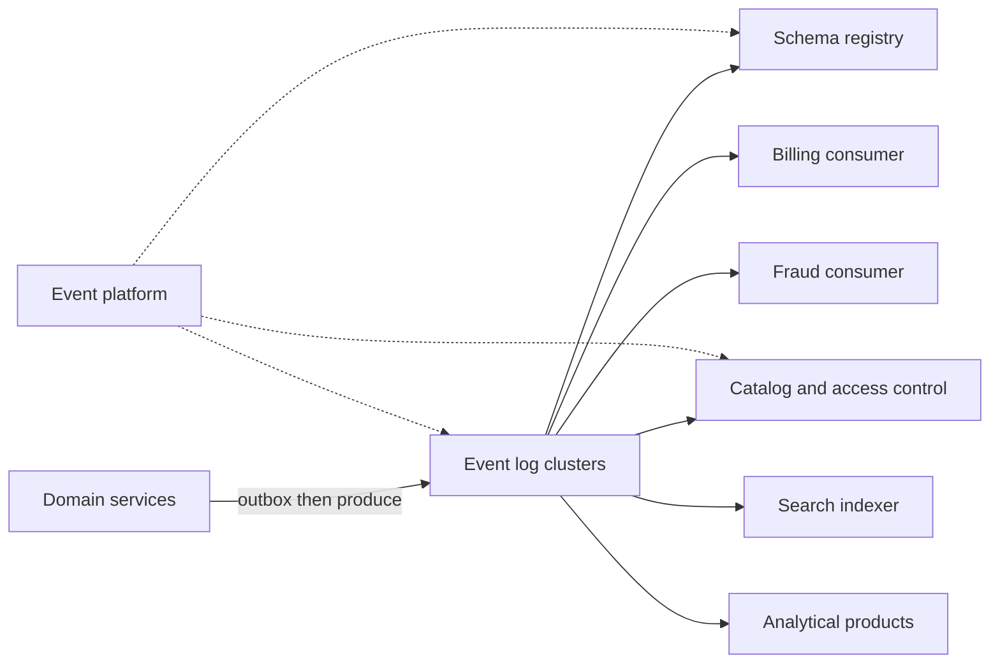

At the scale of a few services, event-driven architecture is a broker and a page in a wiki. At enterprise scale it is a product with an on-call rotation. Clusters, a schema registry, an identity model for producers and consumers, retention and replay, a catalog that names the owner of each public type, and a client library that injects tracing and a standard retry policy. The attraction is real and worth paying for when it is real. A producer can commit a fact without waiting for every downstream system to be healthy. Many teams can react to the same fact without a mesh of synchronous calls that couples their deploy and their latency. The log can serve integration and audit from one history, if you designed retention for both. The bill arrives later. Users observe delay and call it a bug. Contracts become implicit if you let any team publish a JSON object and hope. Failures show up hours afterward in a team that did not know it was on the path. Enterprise eventing is the discipline that keeps that bill from exceeding the attraction. It does not appear because someone stood up a cluster.

## Concept

### Facts, commands, and the public surface

An event, in the sense that belongs on a shared log, is a fact about something that has already happened inside a bounded context. It carries a type, a schema version, a payload, an event time, a producer identity, and correlation and causation identifiers so a trace can cross the log. A command is a request that something should happen, addressed to a specific owner, with an expectation of success or failure. Putting both on one topic invites two consumers to treat the same bytes as news and as an order. One of them will act. The other will record. A third will do both, and you will discover the double action in finance. Split the channels.

A useful taxonomy has three layers, and the middle one is the only layer other teams should see. Domain events are the business facts a context uses internally. Integration events are the anti-corruption shape you are willing to support for other contexts, with a compatibility promise and an owner. Private events are implementation details that must not leave the context, including the row-level chatter of an internal table. If every internal change is broadcast as a public event, the company is coupled to your storage model, and a column rename becomes a cross-team project. Change data capture is a sound way to fill an outbox so the database commit and the publish share a fate. The public event is a modeled fact with a name a product manager could recognize: payment captured, trip started, shipment handed to a carrier.

The log is not the application. A consumer needs its own store, an idempotent handler keyed by an identifier the producer placed in the event, and a poison-message policy with an owner. "We consume the topic" is a subscription. It is not an architecture. The architecture is the handler, the store, the lag objective, and the decision about what the product does when the handler is hours behind.

### The platform around the cluster

One cluster with open access is not an enterprise event platform. You will need separate environments so a replay in test cannot charge a card in production. You will need a multi-region story that states whether a consumer fails over with its offsets or starts from a defined position. You will need quotas so one producer cannot fill the disks and stop everyone else. Authentication and authorization on topics, so an unlisted consumer is impossible rather than merely impolite. A schema registry whose compatibility mode fails the deploy, not the night. A catalog. A consumer library teams actually use, because a private serializer and a private idea of JSON will not converge by encouragement.

Every public topic has a producing team whose pager rings when the contract breaks. A topic without an owner is a liability that happens to have a retention setting. Evolution is additive by default: new optional fields, a new type when the meaning changes, a period of dual publishing when you rename so subscribers can move. Unknown subscribers are a policy failure. Access control should make them impossible. If you cannot list the consumers, you cannot change the schema, and you will either freeze the topic or break someone you have never met.

Multiple clusters are normal once volume and sensitivity diverge. A cluster per region, or per sensitivity class, matches failure domains and data classification. Mirroring between clusters is a lagging copy with different offsets. It is not a backup you can point a consumer at unless you designed the position store and tested the cut. Clickstream volume and payment facts do not belong on the same cluster, the same retention, or the same on-call. A disk-full incident on telemetry should not be how you discover that captures have stopped. Isolate classes of sensitivity and classes of volume even when the client library looks the same. The similarity of the API is not a reason to share a failure domain.

### Delivery, order, and the exactly-once claim

At-least-once delivery is the honest default across an enterprise boundary. Consumers are idempotent. The idempotency key is part of the contract, not a private field the producer might omit. Exactly-once processing inside a closed set of topics and applications that opt into the log's transactions is a real feature of some systems. It does not extend to the email that must leave once, or to the partner bank that must post once, unless those systems participate in the same transaction, which they will not. An enterprise program that advertises exactly-once as a property of "the bus" is telling product managers a story the bus cannot keep once a side effect leaves the cluster. Put the key in the schema. Test the replay. Show the test to the team that owns the charge.

Ordering holds inside a partition, for a key you chose, not across the enterprise and not across topics. Choose keys so that facts which must be applied in order share a key, and so that one hot customer or one hot region does not become a single-threaded bottleneck for everyone else. If a workflow needs a sequence across types — authorize, then capture, then notify, with timers and a human in the middle — that sequence is a saga or a workflow engine with its own store. Topic timestamps will not give it to you. Clock skew and redelivery will produce an order the business does not recognize.

A slow consumer does not stall the producer's commit when the integration is a log. That decoupling is the feature you bought. The slow consumer accumulates lag, and lag is a product incident when the downstream effect is fraud review before a parcel leaves the building, or search reflecting a price the customer can already see on a product page. Define lag objectives per consumer class, owned by the team that owes the user the effect. Retention has to outlive the slowest critical consumer and the replay you still owe auditors and incident response. A one-day topic that finance will ask about next quarter is a compliance defect that was recorded, at the time, as a disk-saving decision.

### Fan-out, personal data, and replay

Fan-out is the feature on the invoice. Ten consumers of a payment-captured fact means the producer does not integrate ten times, does not wait on ten timeouts, and does not redeploy when a new analytics job appears. It also means ten compatibility constraints and ten rotations that will notice a careless payload change. Version types. Do not reuse a field for a new meaning because the name still sort of fits. Provide a projection or a second type for old consumers when you must break, and give them a date after which the old type stops. A break with no date is a permanent dual-write.

Personal data on a widely fanned-out event is a leak architecture with a retention setting attached. Classify topics. Put sensitive payloads on restricted topics with a short, named consumer list, or publish an identifier and let an authorized service read the record under its own access check. A deletion request that cannot find every copy, because the copies are in consumer stores you do not control, will fail the first time someone asks. Replay is a first-class operation: a new consumer, a bug fix, an audit, a backfill after a bad deploy. Compacted topics hold the latest state per key. Retained topics hold history. Write down how far back a replay is allowed to go, who may start one, and how a replay is marked so consumers do not confuse it with live traffic and send the email again.

### Where a request still wins

The person waiting on a screen needs a synchronous answer with a clear success or failure. Eventing the click that must succeed or fail in front of them pushes uncertainty into the interface, and support cannot say whether the order exists. The enterprise default that survives contact with users is a hybrid. A synchronous API owns the user-critical decision and the system of record for that decision. Events fan out the consequences and the work that is allowed to lag: search, notifications, analytics, fraud scoring that can run a few seconds behind, caches. A checkout whose only status is a cloud of consumers is how a support agent cannot answer where an order sits. If the organization will not staff a platform team, and will not enforce schemas in the release path, stay with explicit APIs and a smaller set of queues behind individual services. Eventing amplifies the discipline you already have. A cluster does not create that discipline.

## Trade-offs

| Approach | When it wins | Cost / risk |
| -------- | ------------ | ----------- |
| Synchronous APIs only | The request path is the product, the estate is small, and the call graph is still drawable | Fan-out becomes a mesh of calls, and the write waits on every participant's availability |
| A queue per integration | A few point-to-point workers behind one service | No shared contract, weak replay, and an N-by-N queue farm as teams multiply |
| An event-log platform | Many consumers of the same facts, a need for replay and audit, and producers that must not wait on downstream uptime | Schema and lag discipline become permanent costs; delay becomes a user-visible property |
| Public change-data-capture of internal tables | You need to start quickly from databases you already have | Consumers bind to table shape, and personal data fans out to whoever can subscribe |
| One bus for payments and clickstream | Almost never, once both streams are real | Cost, noisy neighbors, and an on-call that cannot tell a revenue incident from a telemetry spike |

The log platform earns its keep when several teams already need the same facts and you will fund the registry, the catalog, the access controls, and the client libraries as a product with its own error budget. A queue is the right tool for a worker pool behind one API. It is a poor company-wide integration bus, because messages disappear when they are acknowledged, fan-out is awkward, and replay is a feature you will wish you had during the first bad deploy. Change data capture belongs behind an outbox or another product boundary. Publishing a raw database stream as the company API is a decision you will spend years unwinding, one consumer at a time. Keep volume classes and sensitivity classes on separate clusters even when the producer API looks identical. The cost of a second cluster is visible. The cost of a shared disk filling up during a revenue event is larger, and it arrives at a worse time.

## Diagram

## Failure modes

### A poison message stalls the partition

One payload crashes the handler or fails a validation the code cannot skip. Retries never end. Lag grows for every key that shares the partition, including keys whose messages were fine. The producer dashboard stays green. The user-visible effect stops.

Detection: consumer lag rising together with the same exception fingerprint at the same offset, repeated across retries. Mitigation: a retry budget, a dead-letter topic with an owner and a queue, and an operational path to skip or patch a poison offset without a multi-day platform ticket. Idempotent handlers make the skip safe to retry later. Handlers that cannot be replayed turn the skip into a business incident, which is a reason to fix the handler before you need the skip.

### A breaking change meets consumers you did not know about

A field disappears, changes type, or changes meaning while keeping its name. Half the company fails overnight, or worse, half the company silently misreads the value. The producing team believed the topic was internal because nobody had filed a ticket to use it.

Detection: registry compatibility checks that were bypassed by a side deploy path, and a consumer inventory that was already incomplete the day before the change. Mitigation: compatibility enforced in the only produce path, no publisher that can skip the registry, and authorization so an unknown principal cannot subscribe. Treat the catalog as the allow-list. A consumer that is not listed does not exist, and should not be able to attach.

### Lag, while the producer looks healthy

Fraud review, inventory reservation, or search is hours behind the fact. The service that emitted the event is meeting its latency objective and its error budget. Users see stale truth. The paging system is quiet because nobody paged on consumer lag, only on producer errors.

Detection: lag and end-to-end freshness objectives, owned by the consumer team, alarmed separately from broker disk utilization. Mitigation: capacity reserved for the consumers on a critical path, a shed policy that degrades the feature when it is late rather than presenting hour-old data as current, and a product decision, written down, about how stale is still allowed to look live. A badge that says the price is current, on data that is an hour old, is the incident.

### A dual write without an outbox

The database commits and the produce call fails, or the produce succeeds and the database rolls back. Downstream work never happens, or it happens for a fact that is not in the system of record. Reconciliation finds the gap days later, usually from a customer.

Detection: a job that compares committed rows to emitted events, and events to rows, on a cadence shorter than your customer-tolerance for a missing side effect. Mitigation: a transactional outbox, or capture from the database commit log, so the fact and the row share a commit. Two independent writes in application code will diverge the first time a process dies between them. That failure is not rare. It is the ordinary crash.

### A retry storm fans out through the graph

A bug re-emits. Consumers re-emit derived facts. Downstream calls retry without jitter. The log retains the storm cheerfully, because retention is working, and the side effects multiply: duplicate emails, duplicate charges, duplicate shipments. Each hop looks locally reasonable.

Detection: produce-rate anomalies that do not track user traffic, and error budgets burning in proportion to fan-out. Mitigation: idempotency keys checked before the side effect, bounded retries with jitter, and circuit breaking on charges, emails, and partner calls. Mark replays so a backfill cannot trigger the live side effects again. A replay that looks like production traffic will do production things.

## Real-world example

Uber's public engineering record is a picture of event-driven architecture at the scale where a log stops being sufficient by itself. A very large estate of services fans marketplace facts — trip lifecycle, payments, coarse location — out to pricing, safety, incentives, maps, and analytics. A synchronous call graph cannot absorb that fan-out. Every producer would wait on every consumer's timeout, and a slow incentives job would stall a trip. An event platform, with schema discipline, regional clustering, and a producing team per public topic, can carry the fan-out. Uber has written about operating Kafka as production infrastructure: consumer lag as a signal someone owns, a paved client path so teams do not each invent serialization and retry, and the cost of getting retention, replay, and multi-cluster mirroring wrong. Those are platform problems. They do not go away because the broker is a well-known open-source system.

They also published the lesson about control flow, which is the part many event programs skip until support cannot find a trip. A trip, a payout, or a document review runs for minutes or days. It needs timers, a durable place to ask where the work sits, and a compensation when a step fails or a driver cancels. A chain of consumers hoping the graph stays acyclic does not give support or engineering that place. Uber built Cadence for that class of work. The open-source lineage that followed, including Temporal, exists because the problem is general: long-running processes are not topics. Events remain the facts other systems project. The workflow engine is the status authority for processes that are inherently sequences with time in them. Remote calls remain where a person or a partner is waiting on a yes or a no in the current request.

Copy the layering rather than the particular cluster size. Facts on the log, with a registry and an owner. Processes that have a duration in a workflow with a queryable history. Decisions a user is waiting on behind a synchronous API. The bus is a platform-team problem. The schema is a company type system. The workflow engine exists because money-adjacent processes become unsearchable when they are only a chain of consumers.

## What to remember

- Enterprise eventing is a platform: clusters, a registry, a catalog, access control, client libraries, and an owner on every public topic.
- Public events are modeled facts with a compatibility rule. Commands, and raw table captures, are different tools with different audiences.
- At-least-once delivery plus idempotent consumers is the contract you can keep past the edge of the cluster. Lag objectives are product objectives when the effect is on a critical path.
- Decisions a user is waiting on stay synchronous. Long-running journeys need a workflow or another status authority, not an unbounded graph of consumers.
