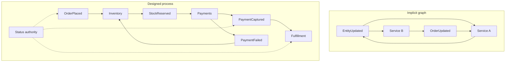

Choreography begins as a reasonable bet on autonomy. Each service commits its own data, emits a fact, and other services react. No central conductor has to know every step, and teams can deploy without waiting on a shared release of a process diagram. It becomes spaghetti when nobody can draw the path of an order, when a new subscriber to a generic update accidentally closes a loop, and when the only timeout in the system is the hope that someone will eventually emit a failure. Spaghetti is an implicit control flow that was never designed as control flow. The remedy is to make the graph explicit, keep the business process acyclic, name an owner for every edge, and put a status authority on any journey a human will ask about. Installing a workflow engine everywhere is optional. Leaving the graph in tribal memory is not.

## Concept

### Choreography is still a program

A choreographed saga is a saga. Each participant commits locally and emits an event. The next participant's subscription is an edge. That graph is the program that moves money, inventory, and customer promises. If the graph lives only in access-control lists and in the memory of two senior engineers, you do not have independent services. You have a distributed jump table.

Healthy choreography is a short directed graph of business stages a support agent could name. An order is placed. Inventory reserves and emits a reservation. Payments emits a capture or a failure. Fulfillment ships only after capture. Compensation is a first-class edge: payment failure releases the reservation. Each node has a team. Each edge has a contract.

### Write the graph down and review subscriptions

Keep a process catalog for each customer-visible journey: the events in order, the owners, the compensations, the timeout, and the store that answers "where is this?" Generate the catalog from annotations if you can. Review a new subscription the way you review a new remote call. A consumer of a public event is a dependency even when the producer never hears about it at runtime. The dependency is real the day the producer wants to remove a field.

Require a correlation identifier and a causation identifier on every integration event. Causation is how you debug a tangle: this message exists because of that one. Without it, an investigation is a join on timestamps and luck. Trace tooling that only knows about synchronous calls will draw a blank across a choreographed path. Propagate the identifiers through the log.

Keep private events private. If an internal invoice-row write is visible company-wide, someone will subscribe, and that subscription will become a requirement you never agreed to. Public events are a versioned, documented subset. The platform should make cross-context reads of private topics an authorization failure.

### Cycles, generic names, and flags that are secret protocols

Cycles appear when a downstream fact is interesting to an upstream service, and the upstream service emits a type the downstream also treats as a stimulus. Sometimes the upstream interest is legitimate: a status projection, a read model. The projection must emit a different type, or emit nothing, so the domain fact is not re-fired. A linter over the process catalog that flags a cycle is cheaper than a weekend of oscillating updates.

Generic names are magnets. User-updated and order-updated collect every meaning anybody needs. Split by intent: email changed, order placed, order cancelled. Consumers then subscribe to a meaning. A payload of forty fields that each team interprets differently is the same smell in one type. Business branching hidden in "if this flag is set" is an unversioned protocol. Prefer a distinct event type per branch so the registry, not a conditional in twelve codebases, is the contract.

### Timeouts do not emerge from a log

A pure subscription graph has no clock. A journey that stalls sits forever with money captured and nothing shipped. The sweeper you will write — a job that finds non-terminal journeys older than a threshold and pages or compensates — is a small orchestrator. Name it, give it a store, and give it an on-call. Skipping a poison offset without a human path is a process failure, not only an infrastructure one.

### Choreography at the rim, a status authority at the core

The pattern that survives is mixed. Facts still fan out for search, analytics, and notification. Those consumers project the process; they do not advance it. The money path, the trip, the license grant, or any journey a person will ask about has an authority that records history, owns timers, and names the next step. Participants stay autonomous in their own data. A new hire should be able to find the next hop for a stuck journey in one system.

Keep domain decisions in domain services, and keep routing, retries, and timers in the engine or the sweeper.

## Trade-offs

| Approach | When it wins | Cost / risk |
| -------- | ------------ | ----------- |
| Pure choreography | Short linear fan-out, low support burden, teams that already maintain the graph | Invisible paths, weak timeouts, cycles, support blindness |
| Choreography plus a status projection | You need a where-is-it view and you do not want that view to command anyone | Projection lag; people start treating the view as the boss without giving it authority to compensate |
| Orchestrated saga or workflow engine | Branching, timers, money, audit, and a human asking where the work is | A central dependency; a god-workflow if domain rules move into the engine |
| Commands for the process, events for the side effects | One owner should decide the next step, and many teams still need the fact | Less accidental fan-out on the process itself; the owner is a dependency you must operate |
| One more consumer as a process step | Almost never, once the journey is customer-visible | Spaghetti, accidental loops, side effects with no owner |

Use choreography for notification and for independent projections. Use an authority when the sequence is the product. A status projection is cheap insurance and does not set timers or release inventory. If the projection is the only place that knows an order is stuck, you still need someone allowed to compensate.

## Diagram

## Failure modes

### An accidental loop

Service A consumes a type that service B emits. B consumes a type that A emits, directly or through a third hop. CPU, cost, and customer-visible fields oscillate, or the topics simply fill.

Detection: causation chains that do not terminate, produce-rate spikes correlated across topics, and a subscription graph that contains a cycle at the process layer. Mitigation: distinct types for projections versus domain facts, private topics that outsiders cannot read, and a catalog linter. Break an existing loop by introducing a new type. A boolean on the old payload becomes another secret protocol.

### One updated-event, many meanings

Consumers disagree about what changed. Side effects fire when an unrelated field was edited. Two teams "fix" the payload in incompatible ways.

Detection: handlers with large conditionals on the payload, and defects that appear only when a field the consumer claims to ignore is populated. Mitigation: intent-specific public events. Keep field-level change detail inside the context. Refuse to add another meaning to a type that already has several. The split is a new type with a compatibility window.

### A stuck journey with nobody watching the clock

Payment is captured. Nothing ships. No page fires, because lag on each consumer looks acceptable and no record represents the journey.

Detection: you will not detect it until a customer does, unless a status store reports non-terminal journeys older than the objective. Mitigation: a mandatory status authority for money and safety journeys, a sweeper with a named on-call, and compensation modeled as an event or a command with an owner. A wiki runbook is not a timeout.

### Hidden coupling and excess payload

A consumer depends on a field the producer considers internal. Or personal data fans out to a marketing subscription that was convenient.

Detection: schema fields used by consumers that are absent from the published contract, and data-loss-prevention hits on wide topics. Mitigation: minimal public payloads, registry contracts, restricted topics for sensitive facts, and an allow-list of consumers. Everyone else fails closed at the access-control layer.

### A crowd of miniature orchestrators

Each team writes a sweeper, a state machine, and a retry policy. Compensations disagree. Two sweepers act on the same journey.

Detection: duplicated timeout logic and incident reviews that discover two systems both tried to refund. Mitigation: one workflow platform for processes that need timers and compensation, and a rule that money paths do not grow new ad-hoc state machines. Leave choreography in place for projections.

## Real-world example

Spotify's public engineering culture is built on autonomous squads and on a large estate of services that integrate asynchronously: playback, playlists, ads, accounts, and the data products around them. That autonomy is exactly the condition that makes choreography attractive and exactly the condition that produces spaghetti. Talks and posts from their platform groups describe the pressure every large event-driven organization hits. Implicit consumers multiply. Ownership of a stream is unclear. A change that looks local has a side effect in a squad that never sat in the design review. Their response, visible in the open through Backstage and in their writing on software cataloging, is to make dependencies findable: an owner, a contract, a place a new hire can look.

They did not respond by banning events. Fan-out for playback and analytics still fits, because those consumers project a fact rather than advancing the business transaction. An event with no owner is spaghetti even when the broker is healthy. Journeys that are sequences — billing, licensing, a half-finished import — still need a status authority. Copy the catalog, the intent-specific contracts, and the acyclic process graph.

## What to remember

- Choreography is a control-flow graph. If it is not written down, acyclic at the process layer, and owned, it is spaghetti.
- Publish intent-specific events. Keep generic updated-types and private topics out of the cross-team process.
- Every money or support journey needs a status authority and a timeout. You will build that sweeper; design it once.
- A new subscription to a process event is a dependency. Catalog it, authorize it, and review it like a remote call.
