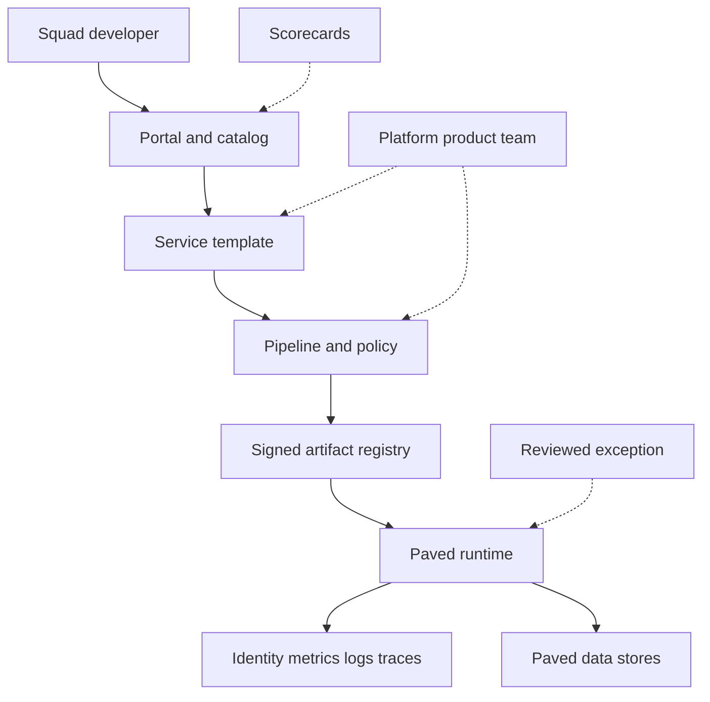

Platform engineering is the practice of building a product whose users are your own engineers. An internal developer platform is that product: a golden path from an idea to a production service, with delivery, identity, observability, and security already in the defaults. The point is cognitive load. A squad should be able to own a service without becoming part-time specialists in cluster administration, identity policy, and the current compliance checklist. A wiki, a chat channel, and a pile of modules that every team must assemble by hand is a queue with extra reading. A paved road that is the fastest way to ship, and that is safe because the safety is in the template, is a platform.

The platform is production software. It has users, a backlog, a support burden, and failure modes that can stop the company from deploying. Treating it as a rename of the infrastructure ticket desk produces the same wait times under a new org chart.

## Concept

### A product, with a user who is an engineer

A shared-services desk takes tickets and builds what each squad asks for this month. A platform team chooses a small set of capabilities, measures whether people use them, and declines snowflake paths it cannot operate. The backlog is visible. Documentation is a feature, not a favor. Someone is on call for the platform itself, and that on-call is distinct from being on call for every product that happens to run on it.

The users are developers. Watch a new hire create a service. Time from a template to a healthy production endpoint is the metric that matters, next to the share of production services that actually sit on the path. A count of modules or plugins is a vanity metric. Platforms rot when they optimize for surface area.

You cannot pave every road. Pick the repeated, expensive, high-risk paths: create a service, build it, deploy it, obtain a secret, call another service with a real identity, emit logs and traces, get a database with backups and a retention default. Leave the long tail alone. A platform that promises to abstract an entire public cloud becomes a slower copy of that cloud, with a two-month lag and a support rota you staff.

### The paved road and the portal in front of it

The paved road is the supported way to build and run software, with a documented shoulder for the cases that truly cannot stay on it. Spotify's Backstage is the portal shape that made this idea easy to point at: a software catalog, templates that scaffold a service, documentation next to the entity, and plugins that surface pipelines and runtime status. The portal is how humans find the road. The road is the templates, the pipelines, the runtime defaults, and the guardrails. Installing the portal on top of an unpaved estate produces a handsome index of chaos.

A golden path is opinionated. A small allow-list of runtimes. One primary deploy mechanism. One way to obtain a relational database. One way to expose an HTTP service with a standard identity. Opinion is the feature you are selling. Promising to support every combination funds several platforms and operates none of them well.

Leaving the road has to remain possible for a real constraint: a special accelerator, a regulated enclave, a latency budget the standard runtime cannot meet. It also has to be more expensive in support and in lead time than staying on the road. If the shoulder is the fastest route in week one, the golden path has already lost, and shadow infrastructure will follow.

### The catalog is an allow-list

You cannot operate what you cannot name. A catalog of services, libraries, and pipelines, each with an owner, an on-call, a repository, and a link to its production surface, is table stakes. Backstage popularized storing that record beside the code and rendering it in one place. The architectural rule is stronger than the UI: production credentials, DNS, and paging routes attach to catalog entities. A workload with no entity does not get a production identity.

Scorecards — production readiness, dependency hygiene, gold-path conformance — work when they are computed from the pipeline and the runtime, and when being red has a consequence short of a 90-question form nobody updates. A human attestation that drifts the week after the review is not a control. Automated checks, with a small set of exceptions that expire, are a control.

### Guardrails instead of gates

A gate is a ticket. A guardrail is a default that is difficult to get wrong: the template runs as a non-root user, the pipeline will not push an unsigned image, service-to-service calls require a workload identity, a new public endpoint gets a standard timeout and a standard set of signals. Prefer guardrails. Keep human gates for the rare decision that is expensive to reverse: a new data residency region, a new trust boundary, an exception to a control the regulator named.

Policy belongs in the path. When a security group wants a new control, the platform implements it once on the road. A PDF emailed to eighty teams recreates the ticket queue.

### The platform is a tenant of itself

The portal, the template service, the pipeline infrastructure, and the cluster control plane need objectives of their own. A portal outage must not block deploys. The command line and the deployment API have to work when the UI does not. Templates are versioned artifacts. A bad template release is a fleet incident, so roll templates the way you roll any other production change: progressively, with a way back.

Self-serve without quotas is a finance incident. A golden database offering needs a default size, a budget alarm, and a cleanup path for abandoned environments.

## Trade-offs

| Approach | When it wins | Cost / risk |
| -------- | ------------ | ----------- |
| Ticket-driven infrastructure | A handful of services and one operations group that can hold the whole estate in its head | Queue latency; every service unique; the model breaks as squads multiply |
| A wiki plus a module library | Strong engineers, moderate scale, willingness to read | Cognitive load; drift; modules that are "required" and widely misunderstood |
| A golden-path platform | Many squads, regulated defaults, hiring that has to become productive quickly | A product team to fund; arguments about opinions; pressure to exempt favorites |
| An internal cloud that wraps every upstream API | Almost never, unless you are in the business of selling that cloud | You lag the real cloud and still leak its concepts |
| A portal with no paved runtime | A demo, or a catalog you are not yet willing to enforce | Rotting entities; templates that scaffold a service into an empty account |

Ticket-driven work is honest at small scale. It does not survive a hundred squads. A module library without an owner becomes a junk drawer, so version it and wrap the common case in a template.

The platform wins when leadership funds it as a product and accepts that some snowflakes will wait or will pay an exception cost. It loses when the same ticket-takers are renamed and given a portal. Bind to the cloud's primitives, and spend your opinions on identity, delivery, data defaults, and observability.

## Diagram

## Failure modes

### A rename without a path

The team still works only from tickets. There is no template with an objective, and production services remain unique in how they build and ship.

Detection: time-to-production unchanged after the reorg, and a ticket queue whose top categories are things a template should already do. Mitigation: build one path, publish an objective for template-to-production, and stop accepting tickets for journeys the path already covers. Earn the name after the path exists.

### An abstraction that hides the failure and blocks the escape

The platform conceals the runtime until something breaks, and the squad cannot see logs without a platform engineer. Or the platform forbids every escape, so a legitimate special workload waits months for an exception.

Detection: tickets whose only purpose is to read telemetry, and an exception queue measured in quarters. Mitigation: progressive disclosure. Defaults first, then a documented escape with a support contract, then raw access for the few who need it. A gold-path service's logs and traces are part of the path, reachable by the owning squad.

### A catalog of former teams

Every entity lists an owner that was reorganized away. Pages bounce. The catalog is a historical novel.

Detection: owner checks against the identity provider, entities that have not changed while their repositories have, and pages that fail to reach a human. Mitigation: production credentials tied to a living owner group, automated stale flags, and archival of entities that miss a heartbeat. No entity, no production identity.

### The golden path is slower than a personal account

Engineers open cloud accounts the platform does not see, because the official path begins with a two-week review. The controls you wanted are absent exactly where the new systems appear.

Detection: spend outside the platform accounts, and endpoints that never appear in the catalog. Mitigation: put the controls in the template so the safe path is the fast path, and give finance a way to close unmanaged accounts. You will not lecture people onto a slower road.

### The platform control plane takes the company with it

The UI, the pipeline, and every product share one fragile dependency. A bad plugin or a portal outage stops deploys, or a template bug rolls out to every new service in an afternoon.

Detection: deployment coupled to the UI, a single failure domain for platform and products, and template changes with no progressive rollout. Mitigation: a command-line and API path that does not need the portal, isolation between experimental plugins and production delivery, and staged template releases. The platform's own error budget is a company-level budget.

## Real-world example

Spotify's Backstage is the public reference for an internal developer portal, open-sourced because the underlying problem is common. Inside Spotify it sits on a software catalog: services, websites, and libraries as entities with owners. Software templates scaffold a new component onto the golden path — repository, pipeline, standard runtime assumptions — instead of a README that says to copy another squad's repository and hope. Plugins then attach the things engineers used to hunt for across consoles: build status, documentation, runtime, on-call.

The architectural content is the rule underneath the interface. Production software is an entity with an owner, and starting a service is a template rather than a series of conversations. Spotify's squad model works when discovering an owner is cheap and creating a well-behaved service is the fast path. A portal without catalog discipline and without a paved runtime is a searchable map of the same disorder.

## What to remember

- An internal developer platform is a product for engineers: a golden path, a catalog of real owners, and time-to-production as the metric.
- Put controls in templates and pipelines. Opinionated defaults beat a private cloud that lags the real one.
- The portal is a window. The platform is delivery, identity, data defaults, and observability.
- Exceptions must exist, and they must be slower than the paved road, or unmanaged accounts will win.
