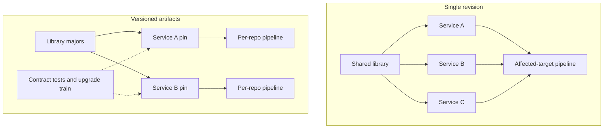

Choosing a monorepo or a set of repositories is a decision about atomic change, dependency versions, continuous integration, and how easily one team can couple to another. It is not a preference about clone time. A monorepo makes a cross-cutting change cheap and makes unbounded coupling cheap as well. A polyrepo makes an independent release cheap and turns a consistent change across twenty libraries into a versioning project. Neither layout is an architecture by itself. Both will encode one. At scale the repository strategy is a production system: source of truth, build graph, access control, and a cultural permission about who may change what. Pick the encoding you can afford to tool, because the failure mode of the wrong choice is a permanently red build or a vulnerability you cannot finish patching.

## Concept

### What is actually different

In a monorepo, many projects share one history and one current revision, and usually one build graph. A change can edit an interface and every in-tree caller together. There is no internal matrix of library 3.4 against library 3.5. There is the revision you are on. Tooling has to compute the affected subgraph, or every commit rebuilds the world. Bazel, Buck, Pants, and carefully structured task graphs exist because of that fact.

In a polyrepo, each project has its own history and its own release cadence. Dependencies are versioned artifacts. A breaking change is a new major version and a migration. Integration scope is naturally the repository. An atomic change across repositories does not exist unless you add an orchestrator: a lockstep train, a bot that opens a fleet of pull requests, or a human with a checklist.

A directory that vendors every dependency and runs all tests on every commit has the coupling of a monorepo and the tools of neither. A set of repositories glued together with submodules has the coordination cost of a monorepo and the history model of a tangle. Name the dependency policy and the integration policy. The count of remote URLs is a side effect.

### Atomic change and how APIs evolve

The architectural win of a single revision is the large refactor. You can rename a contract and update every caller in one review, with the build proving the graph. That is the property Google's public account of its repository emphasizes: internal APIs move without a years-long matrix of supported versions, because the callers live at the same revision and can move with the callee.

The cost is that the current revision is the contract. You cannot leave a dead caller behind as easily as a polyrepo can leave an old major running in production. The tree wants to be green, or you need a precise way to see what is broken and who owns it. Compatibility shims and feature flags still exist. They live in the tree rather than in a published artifact, and they need an expiry or they accumulate forever.

Polyrepo evolution is explicit versioning, which is the correct tool when consumers are external, when release cadences cannot match (a mobile client and a backend), or when you cannot afford to rebuild the world. It fails open when a security fix must land in forty repositories and half of them pin a range that excludes the fix. The architecture of change, in that world, includes a supported version window and a way to know what production is actually running.

### The build, the queue, and who may edit

Monorepo integration is a distributed system once the engineering population is large. Remote caching, remote execution, test selection, and a merge queue that protects a green trunk stop being luxuries. Without them the repository becomes a lesson in queueing: everyone waits on tests that their change could not have affected, people batch enormous commits to amortize the wait, and the trunk stays red because reverting is also slow.

Polyrepo integration is simpler inside each repository and harder across them. You will rebuild the same library in many pipelines. You will discover that two services, each green against its own pin, are not green together. Contract tests and downstream pipelines are how you buy back the integration signal a single revision provided for free. Budget for them, or budget for production.

Access control cuts across the choice. A monorepo needs directory ownership so that not everyone can change billing, plus a documented path for a wide mechanical refactor that many directories must accept. A polyrepo uses repository permissions people already understand, then struggles when one change must land in ten repositories the same person cannot write to. The refactor you wanted is now a political schedule.

### Coupling, visibility, and team shape

A monorepo does not prevent a ball of mud. It makes the mud easy to deepen, because depending on an internal package is a path, not a negotiation. Visibility rules — which packages may import which other packages — are part of the architecture. Without them the graph becomes complete, bounded contexts exist on slides, and a local change touches hundreds of files because the compiler will let it.

A polyrepo does not prevent coupling either. It hides coupling in pins, copied contracts, and diamond dependencies on two JSON libraries. Teams feel independent until production pages on a combination nobody built together.

Team shape still dominates. Squads that own deployable units map onto repositories, or onto packages inside one repository with enforced visibility and separate release artifacts. A single product evolved by a large population that shares primitives maps onto one revision. Many companies are both, and the boundary has to be a real versioned API.

### Third-party code and the blast radius of a fix

One revision is one place to move a shared dependency and see who broke, which matters only if the build graph is real. A polyrepo leaves a tail of unmaintained upgrades. A company repository plus an isolated repository for a regulated slice is a normal hybrid. An unowned boundary is the failure.

## Trade-offs

| Approach | When it wins | Cost / risk |
| -------- | ------------ | ----------- |
| Independently versioned repositories | Separate products, external consumers, or a team that will not staff a build graph | Version matrix; slow security fan-out; cross-repo change is a project |
| Monorepo with a naive pipeline | A small team and a small language set, briefly | Collapses at the first wait-time cliff; coupling without the ability to refactor safely |
| Tool-backed monorepo | Many in-tree callers, shared primitives, frequent wide refactors | Cache, remote execution, merge queue, and directory ownership as permanent costs |
| Core repository plus satellite repositories | Mobile or desktop clients, open source, or a regulated isolate beside a shared core | Two cultures; the boundary API has to be real |
| Submodules or copied trees as a compromise | It does not win | Detached revisions and several copies of the same dependency |

If you cannot staff remote caching and a merge queue, stop growing a monorepo at the point where integration is always red because of someone else's test. Split, or stay with repositories, until the tooling exists. If you cannot staff a version window and a fleet inventory, stop growing a polyrepo at the point where nobody can say which combination is in production.

Hybrid is how most large organizations actually look. Design the versioned edge on purpose. Generated clients, compatibility tests, and a deprecation clock belong on that edge. Copying source across the edge "just this once" is how four copies of a crypto library appear.

## Diagram

## Failure modes

### Every commit builds the world

The pipeline cannot see the affected graph. The merge queue is measured in hours. Engineers batch unrelated edits into giant commits to survive the wait.

Detection: queue depth, time-to-green, and median commit size all rising together. Mitigation: a real target graph, remote caching, test selection, and a fair merge queue. If you cannot build those, split the tree until you can, or stop calling the layout a monorepo strategy and treat it as an accident.

### Unrestricted imports erase the boundaries

Any package can import any other. The bounded contexts in the architecture review are not present in the compiler or the build.

Detection: a dependency graph with a huge strongly connected component, and refactors that touch an absurd file count for a local intent. Mitigation: visibility rules that fail integration, a public surface per module, and code owners as a necessary complement rather than as the only control. Owners without visibility still allow the import.

### Version drift and an unpatchable tail

Production runs several majors of an internal SDK. A vulnerability fix cannot reach the oldest pin. Dependency bots open pull requests that nobody merges.

Detection: an inventory of artifact versions actually running, which is a different report from a list of open upgrade requests. Mitigation: a supported window, automated upgrades inside that window, and retirement of repositories that cannot move. Contract tests on the published API catch the break before the furthest pin does.

### A protocol change that is not atomic

The server repository lands a new contract on Monday. Clients ship on Thursday. The days between are an incident, or a runbook that says to deploy in a sacred order.

Detection: compatibility errors at release, and humans who know the deploy sequence because the sequence is load-bearing. Mitigation: compatibility as a rule on the contract, an expand-and-contract sequence, or moving those projects to one revision so the change is atomic. If deploy order is the design, write it as a design and test it.

### Permissions that forbid the refactor you bought

The wide change is the reason you chose one repository. Directory rules then make the wide change impossible without an administrator merging it by hand.

Detection: abandoned cross-cutting diffs, and a shadow process of asking an admin to land them. Mitigation: owners on directories, plus a sanctioned path for mechanical changes — a robot, a skip-review policy with tests, a designated approver for generated edits. The point of the monorepo is the wide change. An access model that makes that change illegal has removed the benefit and kept the cost.

## Real-world example

Google's single repository is the public existence proof at the largest scale, described in the 2016 account of why they keep billions of lines in one place, and in the tooling around Piper and the internal build system later known outside as Bazel. Most internal software sits at one revision. An engineer sees a consistent snapshot. A library change can land with its callers. There is no internal semantic-version matrix for that tree. Trunk-based development is the mode that fits the tool, not a slogan beside a long-lived branch.

The choice is paid for in platform engineering: a custom source system, virtual workspaces so a client does not materialize the entire tree, a global build, distributed testing of affected targets, and directory permissions. Without that platform, one repository at their scale is unusable. Copy the pairing of atomic in-tree change with a build graph and visibility. If you cannot fund that tooling, use smaller repositories or a modest monorepo with strict modules, and put real versions on the boundaries you cannot rebuild atomically.

## What to remember

- The choice is about atomic change, versions, and integration, not about how many clone URLs feel elegant.
- A monorepo without an affected-target graph, a cache, a merge queue, and visibility rules is a queue with extra coupling.
- A polyrepo without a version window, contract tests, and a fleet inventory is a fix you cannot finish shipping.
- Hybrids are normal. Put a real versioned API on the boundary, and do not imitate a planetary monorepo by concatenating git histories.
