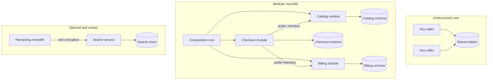

A modular monolith is one deployable process whose internals are modules with hard edges: a public interface, private implementation, and data that other modules cannot casually read. It is not a folder per feature inside a codebase where any class may import any class and any query may join any table. Migration toward that shape, and only later toward a network boundary, is the path that survives contact with a real domain. A decade of extracting services from an unstructured monolith taught the industry to pay distribution costs before anyone could name the seams. The sequence I want in a plan is narrower. Find the seams. Enforce them inside the process. Extract a module only when it has an independent reason to fail, to scale, or to be staffed on a different cadence. Extraction is optional. Modularity is not.

## Concept

### Pay for distribution only when you must

A network boundary adds partial failure, deploy skew, duplicated data, and an operational surface. Buy those costs when a module needs a different reliability objective, a different scale axis, a different compliance boundary, or a team whose release cadence cannot share a binary. Until then, an in-process call across an explicit interface keeps transactions and traces honest.

The migration that matters is from a ball of mud — arbitrary imports, arbitrary joins — to modules. "Monolith versus Kubernetes" is a different axis. You can put a mudball in a cluster, and you can run a well-bounded monolith on a simple runtime. The second system is easier to operate.

### Seams come from the domain

Bounded contexts are the raw material: catalog, checkout, fulfillment, identity, billing. A seam is real when you can name the interface — commands, queries, events — and name the data that does not leak across it. Conway's law will offer the org chart as a substitute. Use the domain first, then align teams to the modules you can actually enforce. The reverse produces services that share a database and call each other in a cycle.

The database tells the truth faster than the package diagram. A table every feature writes is a coupling magnet. Split storage along the same seams while it still lives in one engine: separate schemas, module-owned migrations, no cross-schema foreign keys except through published identifiers, and no casual reads across schemas. Cycles in the import graph mean the seam is still fictional. Break them with an event or with a composition root whose job is composition.

### Enforce the boundary before anyone extracts it

A folder is a suggestion. On a Friday it will be violated. Enforcement, in increasing strength, looks like this.

Import rules in continuous integration: architecture tests that fail the build when billing reaches into catalog's internals, or when a new dependency arrow points the wrong way. A suppressed rule is a decision with an expiry, not a lifestyle.

Schema ownership. A module does not query another module's tables. If it needs data, it calls an interface that returns a purpose-built object. The query plan of the production database is part of the review when someone claims the rule is too slow. Usually the claim means the boundary was drawn through a hot loop and should move, not that the rule should die.

Separate build artifacts composed into one binary. The compiler joins the review. You still deploy once. You have a modular monolith when a new engineer cannot reach across the boundary without the pipeline complaining.

The strangler approach works inside the process: new behavior lands in a clean module, old behavior is wrapped, callers move. An edge proxy in front of an unmodularized core only moves the mud one hop farther from the editor.

### Extract on a trigger, and extract a leaf

Take a module out of process when you can name the trigger. Search traffic is drowning checkout and needs its own scale. A catalog incident must not stop payment. A vendor team or a follow-the-sun team cannot share your release train. A compliance boundary requires a different trust zone. Copy the interface you already enforced. Put an anti-corruption layer on both sides so the extraction does not leak internals across the network. Run both paths, compare, then switch.

Data is the hard part. Replicate, dual-write through an outbox, backfill, cut readers, cut writers, then drop the old schema. Doing those steps in a weekend because the service binary is "already split" is how migrations lock both products at once.

Do not extract the shared kernel first. A first service named common, or a first published library that every module must upgrade in lockstep, recreates a distributed monolith with extra latency. Extract a leaf: read-heavy, clearly bounded, valuable to scale alone. Keep the modular monolith as the default home for new contexts until they earn a process of their own. A monolith plus a few services is a healthy end state.

### Design the saga while the call is still local

Once checkout can no longer join catalog and billing in one transaction, you have a saga whether you planned one or not. Design it while the code is still in-process: domain events, idempotency keys, a status field, a compensation. The extraction then moves a call you already understand. Inventing a distributed transaction on the night of the cut is how orders exist without payments.

A shared database after extraction is one system with two deployables. Finish the data split, or stay in one process. Two connection pools and one migration tool is not isolation.

## Trade-offs

| Approach | When it wins | Cost / risk |
| -------- | ------------ | ----------- |
| Big-bang rewrite into services | The existing product is truly dead and the rules can be re-derived | Lost behavior, a stalled roadmap, a second system that relearns the mud |
| Enforce modules in the current process | Almost always the first move, while the domain is still being learned | Political fights over table ownership; the rules need teeth in the pipeline |
| Modular monolith as the destination | One product, one scale envelope, teams that can own modules inside a single release | One deploy blast radius; one runtime to scale; you accept that on purpose |
| Strangle a leaf into a service | A named scale, failure, staffing, or compliance trigger | Data split, a saga, and a permanent operational cost |
| Extract every context | Most contexts truly need independent failure and you can operate the result | A distributed monolith if the boundaries were only folders |

Rewrites fail because the mud contained the actual business rules. Modularize in place, then extract a boring leaf when a trigger is real. Extracting without modules rebuilds the import graph as HTTP.

## Diagram

## Failure modes

### Folders without a failing build

Everyone still imports internals and joins across schemas. The module map was a slide. New code follows the old paths because the old paths compile.

Detection: architecture tests that do not exist, or that carry a growing list of permanent suppressions. Mitigation: a small rule set that fails integration, a freeze on new cross-module queries, and an owner per schema. Start by outlawing one class of import and expand once the pipeline is believed.

### The shared kernel leaves first

A common library becomes a published artifact every team must upgrade together, or a service every request passes through. Change failure concentrates there, and every extraction depends on it.

Detection: fan-in on the kernel and a change-failure rate that dominates the program. Mitigation: keep the shared kernel thin and in-process. Duplicate a small helper before you turn it into a network hop. Extract leaves.

### Two deployables, one database

Services have separate pipelines and one engine. A migration locks both. A connection storm from one pool takes the other down. You cannot scale or restore them independently, which was the point of the split.

Detection: deploy coupling and incidents whose blast radius crosses the supposed boundary. Mitigation: split schemas while you are still one process, then replicate, then point the new service at its own store. Until the data plane is split, describe the system as one system.

### Distributed failure you discover in production

Billing is now a remote call. Checkout has already committed. The call fails. You have orders without payment, or payments without orders, and the retry is unsafe.

Detection: reconciliation gaps between the two stores. Mitigation: introduce the outbox, the status model, and idempotency keys before extraction, and exercise the saga in-process. The remote call is a transport change, not the moment you invent consistency.

### The strangler never deletes

Old path and new path run indefinitely. Flags accumulate. Dual writes lose an owner. The migration is a permanent tax.

Detection: dead-code measures, flags older than the migration plan, and dual writes with no burndown. Mitigation: a kill date on the old path, a test that fails if the retired import returns, and a visible burndown. A strangler that does not delete is a second implementation.

## Real-world example

Shopify has been public about keeping a large Rails application — the core commerce monolith — while investing in modularity instead of a fashion-driven split into hundreds of services. The tool that makes the story concrete is Packwerk: a static checker that lets teams declare packages, mark a public surface, and fail the build when another package reaches past that surface or takes a dependency the package did not allow. That is boundary enforcement inside one deployable, which is the step most migration plans skip on the way to a service diagram.

The product is one commerce system in the merchant's eyes, sharing a request, a transaction, and a release. Shopify still runs separate systems where a boundary and an operational need are both real. The sequence is the lesson: modularize, enforce with a tool the pipeline believes, extract with a cause. A plan with no module map, no failing check, and no named extraction trigger is a rewrite with extra deployment YAML.

## What to remember

- Modularize inside the process first: public interfaces, schema ownership, and a pipeline that fails on violations. Extraction can wait.
- Extract a leaf for a named scale, failure, staffing, or compliance reason. Do not extract the shared kernel to make the diagram look modern.
- Split data before you split deployables. Two services on one engine are one system with extra latency.
- Design status, idempotency, and compensation while the call is still in-process, then cut over and delete the old path.
