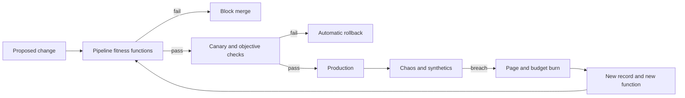

An architecture that cannot change is a bet that the first guess about load, team shape, and product boundary will hold. It will not. An evolutionary architecture is one you can change on purpose: small steps, reversible where they can be, with automated checks that say when a step made an important property worse. Those checks are fitness functions. The name comes from the work of Neal Ford, Rebecca Parsons, and Patrick Kua; the practice is older than the name. Error budgets, canary analysis, chaos experiments, and a build that fails on an illegal import are fitness functions whether or not anyone uses the phrase. What most organizations lack is the explicit list. Which characteristics may drift, which may not, and which pipeline or production signal will notice before customers do.

## Concept

### Design the expensive parts, automate the guardrails

Evolution is not the absence of design. Data gravity, identity, bounded contexts, and the regional story are expensive to reverse, so you still choose them with care and change them slowly. The opposite of an evolutionary architecture is accidental architecture: every decision made inside a pull request, with no record and no check, until only a few people can change the system safely.

A fitness function is an objective, preferably automated, assessment of an architectural characteristic. Ordinary tests ask whether a behavior is correct. Fitness functions ask whether the system still has the shape and the operational properties you claimed: coupling limits, a latency budget, recoverability, cost per request, a residency constraint, time to detect a fault. Some run on each change. Some run continuously in production. Some are scheduled experiments. A paragraph on a wiki is a wish. If deleting the check would not change anyone's week, it is not a fitness function yet.

### Name a short list and attach a threshold

You cannot protect a characteristic you have not named. Pick a short list per system rather than a generic catalog of qualities. A payments API might care about correctness under retry, tail latency, ledger recoverability, the absence of personal data in logs, and change-failure rate. A media edge might care about cache hit ratio, purge latency, origin offload, and whether a failed dependency fails open or closed as designed. Characteristics conflict. That is useful. A change that buys tail latency by weakening durability should fail the durability function even if the latency chart looks better.

Tie each name to a measurement and a threshold. A value statement about resilience does not page anyone. A concrete experiment does: lose a zone, keep checkout errors under an agreed rate, and recover inside an agreed window. Revisit the list when the product changes. A check that still enforces a protocol you retired will block the wrong work and teach people to ignore the suite.

### Where the functions run

Atomic functions in the pipeline are the cheap default. Architecture tests for cycles and illegal imports. Schema compatibility. Image vulnerability gates. License allow-lists. A size budget on a client bundle. A breaking-change check on a public contract. Put these on the golden path so a new service inherits them instead of rediscovering them after an incident.

Holistic functions look at the system as composed. A load test against an objective. Statistical canary analysis that compares a slice of production traffic on the new binary with a baseline. Chaos experiments against a dependency you actually have. Cost anomalies. Burn-rate alerts on a user-facing objective. Synthetics from several regions that perform the journey, not a health URL. These catch what a unit test cannot, because the failure lives in the interaction.

Manual functions still exist: a threat review, a game day with humans in the loop. Keep them rare and scheduled. They are the wrong tool for a property you could have checked on every merge. If someone greps for an unbounded query once a quarter, that grep is a missing pipeline check.

### Guard the change without freezing it

Fitness functions are guards, not a museum. Thresholds need budgets. A short burn of an error budget is a conversation. A sustained burn pauses feature work until the characteristic recovers. Architecture tests should allow an exception with an owner and an expiry. A permanent ignore comment is how the suite goes red and stays red.

The evolutionary habit is to add a function when you learn. After a retry storm, the default client in the template gains jitter and a budget, and a test fails if a new client omits them. After a deletion incident, new topics fail the pipeline when they carry unclassified personal data. Decision records pair with the checks. The record says why the characteristic matters. The function says it still holds. A record with no check will be forgotten. A check with no record will be deleted by someone who cannot see the scar it came from.

### Make them a platform feature

At a large organization, fitness functions that each squad invents will exist in one squad. The pipeline should inject the common checks. The service template should include the architecture tests. The observability stack should compute burn rates. The chaos tool should have an allow-list of experiments and a blast-radius limit. A catalog of functions — owner, severity, and whether a failure blocks a merge, pages, or files a weekly report — keeps the practice from becoming a drawer of dashboards.

Do not attempt to cover the enterprise in one quarter. Instrument the golden path. Add a function when an incident shows a gap. Retire a function when the product no longer has the characteristic. That loop is the architecture practice evolving alongside the system.

## Trade-offs

| Approach | When it wins | Cost / risk |
| -------- | ------------ | ----------- |
| Human review only | A tiny team with high trust and rare irreversible bets | Folklore; the practice does not survive hiring or the next incident's amnesia |
| Pipeline architecture tests | Coupling and contract drift are the main risks you can see in code | Blind to runtime properties: latency, failure, cost, and real traffic |
| Production objectives and error budgets | Reliability is the scarce resource and you ship often enough to need a brake | Slow to catch structural coupling; a weak objective will ratify a weak experience |
| Continuous verification | High deploy rate, and staging is a poor imitation of production | Tooling cost; flaky checks that teach people to click through |
| A heavyweight architecture board | Rare, regulated, hard-to-reverse changes | Latency measured in meetings; evolution moves outside the board |

Keep a light human review for decisions that are expensive to undo: identity, residency, a new consistency model. Automate everything you can describe as a threshold. Pipeline tests are the place to start. They will not tell you that a retry policy melts a dependency, so they are the first layer, not the only one.

Service objectives used as fitness functions work when they proxy a user journey and when exhausting the budget changes behavior. Canaries and chaos earn their cost when you deploy too often for a staging environment to be the truth. They are ceremony if you deploy monthly and already ignore staging. A board is a fitness function with a human and a long cycle time. Use it on the few irreversible bets, not on every service name.

## Diagram

## Failure modes

### A red suite everyone ignores

The architecture tests have been failing for months. Canary analysis is labeled informational. Exceptions have no expiry. The function exists and does not govern anything.

Detection: a rising count of ignores, jobs that continue on error, and incident reviews that never mention the check which should have fired. Mitigation: shrink the suite to the checks you will actually block on, make those green, then add back. A flaky chaos test is fixed or removed. A small enforced set beats a large ceremonial one.

### The metric improves and the characteristic does not

Bundle size drops because the bundle was split, not because users download fewer bytes. An objective is set to whatever the system already achieves, so it cannot be missed. Teams optimize the probe.

Detection: charts that improve while the user journey and the risk outcomes do not, and objectives with no synthetic behind them. Mitigation: place functions close to the outcome — a real journey, a real data-classification failure, a real regional failover — and review thresholds on a schedule. Pair the aggregate number with a synthetic that walks the path.

### The past freezes the future

Every incident adds a rule. Eventually ordinary change cannot pass, and the rules encode one-off history rather than current product needs.

Detection: time-to-merge rising, and a ruleset whose owners cannot explain the characteristic in present-tense product language. Mitigation: expiry on exceptions and on rules, records that explicitly allow retiring a function, and a named acceptance of some risks. Evolution includes deleting a check the product no longer needs.

### Tools with no owner

Five dashboards, three experiment frameworks, and no page. The incident you just had was visible in none of them, or in all of them after the fact.

Detection: a gap between incidents and functions, and licenses for systems nobody queries during an incident. Mitigation: one catalog, each function with an owner and a severity. A new tool has to replace or feed that catalog. Unowned verification is a hobby.

### Every service is green and the journey is red

Each team meets its local objective. The user fails because the chain of eight calls exhausts the latency budget, or because a dependency fails in a way no local test models.

Detection: journey-level synthetics and end-to-end traces disagreeing with a wall of per-service green. Mitigation: holistic functions on the path, and experiments that impair the dependency rather than only the local process. Evolutionary architecture is a property of the system the user meets.

## Real-world example

Netflix's public reliability practice is the fullest industrial example of fitness functions used to keep a large system changeable. They deploy often enough that a quarterly architecture board cannot be the control. They automated the characteristics that hurt them when they drift.

Canary analysis, open-sourced as Kayenta in the Spinnaker ecosystem, is a holistic fitness function on a release. A fraction of production traffic hits the new binary. Metrics are compared statistically with a baseline. A poor canary rolls back. The architecture is allowed to change every day because an automated reject exists for the changes that harm the characteristics they measure. Chaos engineering — Chaos Monkey at first, and later more targeted injection through their experiment platforms — is a fitness function on recoverability. If killing an instance or a slice of traffic violates the member experience, the system is less resilient than the diagram claimed. The failed experiment is a failed test. It is not accepted as a surprise outage to be explained after the fact. Automated rollback and service objectives close the loop between a bad change and the next deploy.

They added functions after bad deploys and dependency failures, which is the evolutionary process applied to the practice itself. Copy the loop: change, measure, block or roll back, then encode the lesson as a check with an owner. Availability error budgets, as Google SRE describes them, are the same pattern aimed at one characteristic: when the budget is gone, feature change slows until reliability recovers. Coupling, cost, and residency deserve a budget of their own.

## What to remember

- Name a short list of architectural characteristics, attach a measurement and a threshold, and automate them. A wiki page will not fail a build.
- Run atomic checks in the pipeline and holistic checks — canary, burn rate, chaos, synthetics — on the composed system.
- Give functions budgets and expiries so they steer change, rather than freezing the past or rotting in a permanent red state.
- After an incident, add or adjust a function, and retire functions the product no longer needs. That loop is the architecture.
