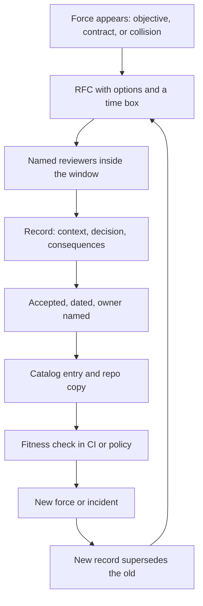

## Concept

### The record closes a choice the RFC only argued

An architecture decision record is the artifact that still answers a question after the design review has ended and the chat thread is gone. It freezes one choice that is expensive to undo, the forces that were real when the choice was made, and the costs the organization accepted. The RFC or design document is the working surface: options, diagrams, open questions, and dissent. The record is the close. I want a principal engineer who joined two years later to read one sentence and know what is in force, who owns it, and which follow-on work it forbids.

Keep the fields stable so the corpus stays searchable. Context names the forces, including the ones that lost: a latency objective, a contract clause, a hiring plan, a vendor quota, a neighboring team that already ships the other half of the flow. The decision is one sentence in the present tense. Consequences name the capabilities you gave up, the operational load you took on, and the decisions this one now forces. Status is a small enum. Links point at the RFC, the ticket that funded the work, and the record this one replaces. Diagrams and sample payloads stay in the RFC. Two pages is already long. An empty consequences section means the author stopped before the hard part, and the file will not survive a repository move.

### The lifecycle is a state machine with a named accept

Status is a transition with an owner and a date. Draft means the author is still changing the text. Proposed means the people who will live with the choice have something they can review. Accepted means the decision is in force. Deprecated means production still matches the record and the organization would choose differently today, so the next project should plan an exit. Superseded means a newer record is in force and the two files link to each other. Rejected is worth keeping when a serious alternative was declined, so the same debate has a memory the next quarter can find.

Accepting is a named act. On a single team the acceptor is the staff engineer who will be paged, plus one reviewer from a team that must consume the result. In a larger organization the acceptor is a small advisory with a written charter and a review window measured in days. The output is a status change, a date, and an owner. The owner is the team that pays the operational cost. A review group that will never carry a pager can index, challenge, and catch collisions. It stays off the on-call rotation for a cache choice.

Supersession is the transition most programs skip. When you leave a store or a protocol, you write the new record, set the old status to superseded, and keep both files. Readers need the sequence: these forces produced this choice; the forces changed; a later choice replaced it. Deleting the old file leaves a slogan with no provenance. Deprecated and superseded do different jobs. Deprecated still describes what production does. Superseded explains how the present choice came to be.

### Governance is a threshold, a catalog, and a clock

Governance is the rule for which choices need a record, who must be consulted, and how anyone finds the current answer. Without a threshold, records become optional essays, and the teams that move fastest skip the choices that will hurt later.

These classes always get a record: a new bounded context, a new system of record, a new public API family, a new region or residency binding, a new tenancy model, a change to authentication or authorization, a change to backup and restore, and any commitment another team must now depend on. These classes stay outside the process: a library bump inside an already chosen stack, a dashboard, a runbook rewrite, a refactor that preserves the public contract. Everything else is the author's judgment, with a bias toward writing when two teams will feel the consequence for more than a quarter.

Open questions live in an RFC with a time box. The record closes the question. After the review window the author accepts, revises, or withdraws. Silence counts as consent only when that rule is written down and the required reviewers were actually notified. A monthly committee that must bless every record teaches teams to route around it. Review that is optional disappears on the decisions you most needed to see. The workable shape is a short list of hard-to-reverse classes, a fast path for the rest, and the right to ship after the window expires, with the timeout written on the record itself.

Index the corpus. Local choices live in a decisions directory next to the service. Cross-cutting choices live in a catalog you can query by title, status, owning team, and tags such as store, API, tenancy, and region. If a staff engineer cannot answer what the organization decided about multi-region writes in a few minutes, you have files. The current answer has to be findable, dated, and owned.

### Fitness checks keep a decision alive after the author leaves

An accepted record that the build cannot violate will drift the week a tutorial adds a second driver on the hot path. Pair the record with a fitness check: a module boundary that forbids the rejected store, a compatibility gate on the public API, a policy test that production identity matches the trust model the record described. When you supersede the record, update or retire the check in the same change. A check that outlives its reason is folklore enforced by a robot.

Tickets track work. Records track choices. The file is the wrong home for a project plan, a pasted backlog, or a taste essay about a technology. When the situation offered a constraint and little real choice, still write the constraint. Personal data for a named contract living in a named region is a decision later staff will otherwise simplify away. The corpus exists so the current answer survives the author changing teams.

## Trade-offs

| Approach | When it wins | Cost / risk |
| -------- | ------------ | ----------- |
| Verbal decisions only | One team, one context, stable people | The choice leaves with the people; the same argument restarts; reversals are silent |
| Records only in the service repo | Stack choices owned by a single team | Cross-cutting decisions stay invisible; search is a grep across repositories |
| RFC, then a record, with a review window | Multi-team platforms, regulated work, rapid hiring | Process tax; authors can fill the template and miss the real constraint |
| Standing board as the acceptor | Rare irreversible bets: tenancy, global identity, a region strategy | Queues and political veto; teams hide work until it is too late to change |
| Records plus automated fitness checks | Long-lived platforms where drift is the default | Checks encode yesterday's decision; changing them needs the same care as the record |

Repo-local records are the default because they age next to the code that obeys them. Promote a decision into the central catalog when a second team must obey it, or when the first question in an incident is who decided this.

A standing board is the right acceptor for a handful of bets that are miserable to undo. It is the wrong acceptor for every queue, cache, and client library. An agenda of dozens of items means ordinary engineering was classified as architecture. Push accept back to the owning team. Keep the board for collisions: two teams proposing incompatible sources of truth for the same fact.

Fitness checks feel like ceremony until a pull request introduces a second database driver on the hot path. The maintenance cost is real. Superseding a record includes the check, or the pipeline keeps enforcing a decision the organization already retired. I would rather pay that maintenance than rediscover the constraint during an outage, with the original author already on another team.

## Diagram

The record is a close in a loop. A new force reopens the RFC, and the previous record stays in the catalog with a superseded status.

## Failure modes

### Decision theater

Teams write the record after the store is already in production, to satisfy a checklist. The text describes what happened. It does not constrain what happens next. Detection: the record timestamp is after the first production deploy of the chosen component; the consequences section is empty or copied from a template; reviewers are listed as a group with no names.

Mitigation: gate only the irreversible classes. A new database engine, a new region, or a new public API family reaches production with an accepted record identifier in the change. Leave routine work ungated. Publish time-to-accept and keep it inside the window. A slow gate teaches people to paste a fake identifier. Repair the clock before you add more gates.

### Two accepted truths

Two accepted records assert incompatible facts about the same concern. One says the order store is the system of record. Another says a side table in a different engine is the source of truth. Detection: a catalog query on context plus concern returns two accepted rows. An incident review cites both, and each team is locally consistent.

Mitigation: give the catalog a unique key for context plus concern. Accepting a new record on that key supersedes the old one in the same change. Reviews of cross-cutting records include the owners of every accepted record they collide with. The newer file is the candidate. The review picks, and the loser changes status with a link.

### Invisible supersession

A migration finishes and the old record stays accepted. New hires implement the retired choice, or they preserve a constraint the platform has already left. Detection: the dependency named in an accepted record has no production traffic, or a decommission ticket closed with no status change.

Mitigation: the last step of a decommission runbook is the status change, linked both ways. A liveness job flags accepted records whose named dependency no longer exists. A human confirms, because the job can be wrong. Leaving a record accepted forever is how folklore starts, and a quarterly reading club will not keep up with hiring.

### Review capture and the silent skip

The same two people accept every record, or the required reviewers never read and authors ship anyway. Detection: the reviewer histogram is a monoculture; time to first comment exceeds the window; a sample of irreversible records has no comments at all.

Mitigation: rotate reviewers and publish the charter, including what the advisory is allowed to block. Page an on-call architect only for the irreversible list. For everything else, one peer from an affected team is enough. Shipping after the window expires is a recorded event on the record, with a note that review timed out. The owner still accepts it. Silence with a clock is a process. Silence with no record is a skip.

## Real-world example

Kubernetes Enhancement Proposals are the public, large-scale version of this lifecycle. A KEP lives in a repository anyone can read. It has an owner, a SIG, a motivation, a design, and graduation criteria. The states are explicit: provisional while the idea is still being shaped, implementable once the design is accepted, implemented as the code lands, and replaced, deferred, rejected, or withdrawn when the story ends. A production-readiness review stands between "the code exists" and "the feature is safe to call stable." The proposal is the RFC. The status and the graduation criteria are the decision record. SIGs are the named acceptors, and the repository is the catalog.

Service teams inside a company still need the short form. A KEP is the right weight for a feature that will ship in a multi-year API. A two-page record is the right weight for "orders live in this store, and the cache is disposable." The transferable practice is the state machine, the owner, and the link from the new decision to the one it replaces. Organizations that struggle have a perfect template and a current answer that lives in one person's head. Organizations that cope have a short list of irreversible classes, a review window measured in days, and a place where search returns the accepted record.

## What to remember

- A record freezes a costly choice, the forces that produced it, and the operational cost; the RFC is the conversation that preceded the close.
- Status is a state machine: accepted and superseded records both stay, because the sequence is part of the current answer.
- Govern a short list of hard-to-reverse classes with a review window, and leave library bumps outside the committee.
- Index the corpus and attach fitness checks, or the files rot into folklore the week the author changes teams.
