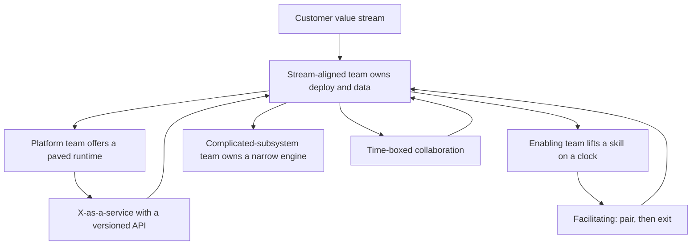

## Concept

### The paths you fund become the interfaces you operate

Conway's observation is a production property. The communication paths an organization funds become the interfaces the software ships. Teams that share a standup and a database ship a shared schema and a joint on-call. Teams that meet only in a quarterly forum ship a network hop, a contract, and a queue. An architecture diagram that ignores reporting lines, backlogs, and who gets paged is a picture of a system you do not have. The org chart is already a coupling map, and production will draw it again in incident timelines.

I use the law as a diagnostic. If two services change in lockstep every quarter, look at who owns the schema and who shares the release train. If a request to a platform sits for six weeks, look at the interaction you actually asked for: a stream team needed a product, and the other team is staffed as a ticket sink. If checkout pages platform, identity, payments, and a vendor SDK on every change, the decomposition lives on a slide. The gap fills with meetings, shared tables, and unofficial APIs that nobody versioned.

### Inverse Conway funds the teams the architecture needs

The inverse Conway maneuver is deliberate organization design in service of a target architecture. If you want independently deployable bounded contexts, you fund teams whose backlog, deploy pipeline, data ownership, and on-call match those contexts. If you want a platform, you fund a team with users, a versioned surface, and an objective. A queue named enablement, with no product and no compatibility policy, will not become a platform because the name says so.

Start from the value streams you actually have: checkout, catalog, identity, seller tools, claims, billing. For each stream, name the software boundary, the data owner, the deploy unit, and the team. A shared table with two owners is a permanent coordination tax. Merge the teams, or split the table and give one side an API. Leave the table shared and the calendar will fill with the meetings the schema requires.

Sequence the change as a pair. Extract a module with a contract, give it a pipeline that can ship alone, then move the people who already understand it and give them a budget. Splitting the team before the code can build and deploy independently creates a distributed monolith with extra channels. Splitting the code while one manager still owns both backlogs recreates the monolith in planning. Inverse Conway is a migration with a target. Kubernetes services without team boundaries are a hosting choice, and the release train stays where the managers are.

Cognitive load is the budget you are actually spending. A team that must hold a language, a datastore, a cloud account, a compliance regime, three clients, and a training pipeline will couple those things, because that is how people survive a week. Treat that load as a design input. Subtract work from a stream-aligned team by moving it to a platform, a time-boxed enabling team, or a complicated-subsystem team with a narrow API. Hiring one more generalist into the same pile increases the meeting surface.

### Team types and interaction modes are the contract between groups

Four team types are enough when you use them as types. Stream-aligned teams own a slice of customer value and ship it. They are the default. Their software looks like a service or a modular-monolith slice with a clear data owner and a pipeline they can run without asking permission.

Platform teams offer an internal product: paved delivery, an identity SDK, a cell runtime, observability defaults, a golden path for a new service. Their customers are other teams. Their surface is an API, a template, and an objective. A backlog that is a list of other teams' names means the platform has not become a product yet.

Enabling teams are coaches with an end date. They pair with a stream-aligned team to lift a skill: test automation, a cloud migration, threat modeling, a data-model review. Then they leave. A coaching group that never leaves is a shadow platform with no roadmap and no objective.

Complicated-subsystem teams own a piece that would swamp a stream team's load: a matching engine, a pricing compiler, a geospatial index, a ledger. They expose a stable interface. They are allowed to be specialists. They are expected to publish a contract, so they do not become the hidden dependency of every feature.

Three interaction modes keep the types honest. Collaboration means two teams work closely for a defined window, usually while an interface is still being discovered. X-as-a-service means one team consumes a versioned product with an objective and a compatibility policy. Facilitating means an enabling team coaches and then exits. Most organizational pain is a mode error. A platform that only collaborates never finishes a product. A stream team forced onto an unfinished platform builds a sidecar and keeps it.

Write the mode next to the boundary. A platform launch should say: six weeks of collaboration to land the first tenants, then X-as-a-service with an objective on the API, and facilitating only for version migrations. If you cannot name the mode, you will pay for all three at once. Incidents will name teams. They will not name interfaces.

### A review that ignores topology approves the wrong split

When I review a proposed service split, I ask who will be paged, who can change the schema without a meeting, and which team a product manager talks to when a feature crosses the new boundary. If the answer is the same people, or a steering group, the split adds a network and keeps the coupling. The running system will describe the steering group.

The durable shape is ordinary. A stream-aligned team owns the deploy unit and the data. A contract suite lets other teams move without a joint release. A platform makes the second service cheap to run. A collaboration window has an end date. A shared core team that every feature waits on is a complicated subsystem with no interface. Name it and narrow it, or fold the work back into the streams that already feel the customer outcome.

## Trade-offs

| Approach | When it wins | Cost / risk |
| -------- | ------------ | ----------- |
| Mirror today's organization and change little | Stable product, one value stream, a small company | The architecture cannot evolve; growth copies the first team's accidents |
| Inverse Conway: move teams with the code | Clear bounded contexts and a need for independent release | Temporary throughput drop; political cost of moving people and budgets |
| Strong platform, thin stream teams | Many teams repeating undifferentiated work: deploy, identity, runtime | The platform becomes the bottleneck if it stays a ticket queue |
| Activity-aligned teams: UI, API, data | Short projects and early prototypes | Every feature becomes a three-backlog protocol; the system grows layers |
| Collaboration as the standing mode | Discovery, and the first tenants of a new platform | Meetings replace interfaces; nobody owns the objective after the workshop |

Activity-aligned groups produce a layered system even when the diagram says services. The user-visible change waits on a frontend backlog, a backend backlog, and a data backlog. At a few dozen people that handoff machine dominates lead time. Buy specialist depth back with a platform and a few complicated-subsystem teams, and keep the stream team as the owner of the outcome.

A platform looks expensive because you staff it before the tenth team needs it. It is cheaper than ten teams each inventing delivery, authentication, and a deploy story. Staffing that platform without product management leaves a specialist group everyone depends on, with no versioning and no forecast. Measure adoption and time to first successful deploy. Inverse Conway around a modular monolith funds teams around modules and package boundaries. Hosting choices come after the ownership is real.

## Diagram

Value streams own outcomes. Platforms, coaches, and specialist engines attach through a named mode, and the mode has an end when the interface is ready.

## Failure modes

### A distributed monolith with extra teams

Services and squads split, and a single database, a single release calendar, or a shared library with daily breaking changes keeps the lockstep. Detection: deploy days coincide; schema migrations require a multi-team war room; the change-failure rate spikes when services that were called independent ship on the same day. The review said bounded context. Production says one change set.

Mitigation: make independent deploy a test before you move the chairs. Contract tests, expand-and-contract schema changes, and separate pipelines come first. If a shared library is the coupling, version it and slow its release, or fold it into the owning service. Move people after the code can ship alone for a couple of weeks without a joint calendar.

### Platform as a ticket queue

The platform team takes work items named after other teams. There is no self-service path, no version, and no objective. Detection: the backlog is a list of tenant names; a new environment is measured in weeks; every adoption is a meeting. Stream teams build sidecars because waiting costs more than duplicating.

Mitigation: give the platform a product owner and a paved path. Refuse bespoke work that will not become a capability with more than one customer. During a defined collaboration window, embed with the first tenants. After that window, the mode is X-as-a-service. Measure time to first deploy and the fraction of teams on the golden path. A sidecar that outlives the window is a signal the product is missing a feature, and the feature belongs on the platform roadmap.

### Interaction-mode thrash

Two teams oscillate between pairing on every story and throwing work over a wall. Detection: recurring alignment meetings with no contract at the end; duplicate implementations of the same capability; incident write-ups that name teams and never name an interface or an objective.

Mitigation: write the mode and the end date in the same place you write the boundary. Collaboration ends when a versioned interface freezes. X-as-a-service starts with an objective, a compatibility policy, and a channel for defects that is a support path. Leaving the mode implicit means you will pay for all three modes and finish none of them.

### Cognitive overload wearing a full-stack badge

A stream-aligned team owns the product, the warehouse, the mobile clients, the data pipeline, and the training jobs. Detection: lead time grows while headcount grows; pages require several specialties; people optimize the one datastore they understand and the stream's customer objective quietly worsens. Ownership on a slide has become a pile of contexts.

Mitigation: subtract load. Move undifferentiated heavy lifting to a platform. Park a true specialty in a complicated-subsystem team with a small API and its own on-call. Use an enabling team for a one-time lift, with a date they stop attending the standup. Owning a value stream means owning the outcome and the contract. It means the team can explain the customer path. It does not require them to personally operate every technology that touches the stream.

## Real-world example

Amazon's two-pizza teams are the public inverse Conway maneuver, and they work because of the constraint that sits next to the headcount rule. Teams communicate through versioned service interfaces. A shared mutable database plus a status meeting is not the integration strategy. The interface mandate is organization design. If teams must not share a table, adding a team adds a bounded context with an owner. If teams may share a table, adding a team adds a meeting. The architecture, meaning the service, the API, the data owner, and independent deploy, was chosen so the org chart and the runtime would describe the same system.

The copied failure is also public. Companies imported squads, chapters, and guilds from a snapshot of one company's model and kept a frontend, backend, and data split under the new names. Guilds that cannot ship, chapters that are the real managers, and a platform squad that is still a ticket queue produce matrix reporting with a service vocabulary. The company that originated those names later described the model as a starting point for one organization at one time. The names traveled. The interaction modes and the data-ownership rule did not.

When I apply this, I copy the constraint and the vocabulary. No shared mutable data across a team boundary without an API and an owner. Team types and interaction modes, including the date a collaboration ends. I do not copy anyone's org chart. The teams and interfaces you fund are the system you will operate. The diagram records what you hoped the funding would produce.

## What to remember

- The communication paths you fund become the interfaces you operate; a target architecture needs matching team boundaries.
- Inverse Conway moves the code and the people together; doing only one leaves a distributed monolith or a meeting-driven monolith.
- Name the team type and the interaction mode, including the date a collaboration window ends.
- Cognitive load is a design budget: subtract work with platforms and narrow specialist APIs when a stream team holds too many contexts.
