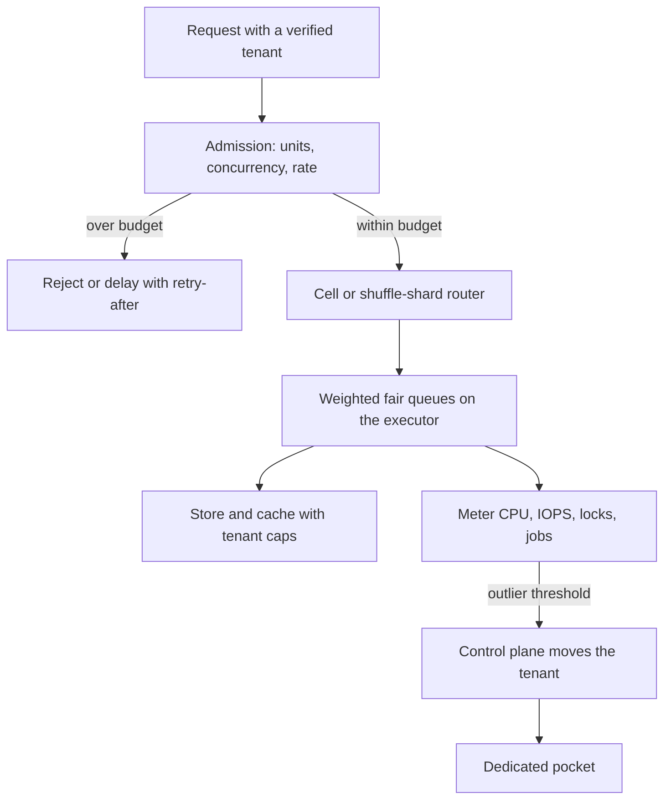

## Concept

### Isolation is a stack you name per resource

A tenant is the unit of customer fate: their data, their encryption context, their quota, their restore, and the neighbors they share a machine with. Multi-tenancy is how you pack those units onto shared infrastructure while telling the truth about the packing. At small scale the argument is a silo versus a pool. At large scale the argument is which layer is shared, which layer is dedicated, and which throttle fires first when one tenant gets large, pathological, or both.

Name isolation per resource, because the resources fail differently. Compute may be a cgroup, a process, a virtual machine, or a cell. CPU and memory need shares, quotas, and hard caps. Storage needs per-tenant tokens for IOPS and throughput. Network needs connection caps and, on a large fleet, shuffle sharding of the path. Data needs a decision you can draw: a tenant key on every row, a separate catalog, or a separate cluster. A column named tenant id, with nothing else, is a pool that still needs a noisy-neighbor story. A cluster per customer is a silo that still needs a control plane and a plan for capacity you cannot pack.

The control plane maps a tenant to a pocket: a cell, a shard, a dedicated database, a shared partition. The data plane enforces that map on every request and every job. Routing, quotas, and placement are product objects with owners, audits, and a rollback. A map that lives in a hand-edited file is a spreadsheet with an outage mode.

### Noisy-neighbor control is admission, fairness, and a blast-radius cut

A noisy neighbor is a tenant whose load, cardinality, or pathology consumes a shared resource until other tenants miss their objective. The scarce resource is often something other than CPU. It is a lock, a compaction queue, a connection pool, disk wait, an allocator, a hot partition, or a metadata node that sits on every request. Edge request rate can look calm while the fleet is on fire inside one of those.

Admission refuses or delays work before it occupies the scarce resource. Per-tenant rate limits, concurrency limits, and request-unit budgets, meaning reads, writes, search units, and export bytes, are admission. They belong at every entry: the public API, the worker that drains a queue, and the analytics job someone will describe as off the user path while it owns the disks. A limit that exists only at the edge leaves the worker and the report free to walk in the side door.

Scheduling shares the resource among work you already admitted. Weighted fair queues, per-tenant connection pools, and tenant-aware query slots keep one customer from occupying every worker. In a cache, cap entries and fill rate per tenant so one working set cannot evict everyone else's. Strict equality between a tiny tenant and a huge one is a product bug. Weighted fairness by plan, with a floor so a small tenant cannot be starved to zero, is the usual shape. The weights live with the plan.

Blast-radius cuts change the packing so one fire cannot reach every tenant. Shuffle sharding assigns each tenant a small slice of the worker pool, so two noisy tenants rarely share the same slice. Cells cap how many tenants share fate, including fate with a bad deploy. Dedicated pockets pull outliers off the shared pool. Isolation groups keep batch and interactive work off the same executor. You want the three layers together. Admission without fairness still lets the first arrival occupy the pool. Fairness without cells still lets one lock take the fleet. Cells without admission are smaller pools with the same fight.

### Objectives, outliers, and a rehearsed escape hatch

Shared pools hide pain in averages. A tail that looks fine while one tenant sits at seconds is a conversation with that customer, and the dashboard can stay green. Publish per-tenant objective burn for the tenants that can leave, sampled so cardinality stays bounded: the top noisy tenants, a histogram per cell, and a trace exemplar. Alert when one tenant dominates an inner resource, such as lock wait, queue depth, cache evictions, or compaction bytes, even when edge rate looks ordinary.

Outliers need an escape hatch that is a product workflow. When a tenant crosses a packing threshold, in rate, storage, key cardinality, or a contractual isolation clause, the control plane moves them to a dedicated cell or a larger shard. The move is rehearsed: copy by tenant id, shadow reads, cut the router, and keep the old pocket quarantined until rollback expires. Dual writes and copies based on a guess about which shard they occupy turn the escape hatch into a second incident. If the only response to a noisy neighbor is a conversation asking them to stop, you will eventually ask your largest customer to stop growing.

### You can isolate only what you meter

Meter request units, not only requests. A point read and a long export are different kinds of work, and a token bucket that treats them as peers will admit the export. Meter storage amplification: wide rows, high-churn indexes, and tenant-specific cardinality. Meter background work. Compaction, reindex, change capture, and training jobs are the classic noisy neighbor because they sit off the request path until they are the only thing the disks are doing. Put a tenant key on every queue message and every job so the meter and the throttle share an identifier.

Per-tenant keys, per-tenant backup holds, and per-tenant restore scopes are isolation too. They do not stop a hot query. They stop a key rotation or a restore from becoming a fleet event. Design them as control-plane objects that carry the same tenant id the data plane already trusts. Limits themselves are product config. Too tight and you page yourself for policy. Too loose and the neighbor returns. Ship limit changes with a dry-run that shows what would have been rejected, and keep a floor and a ceiling in the plan object.

## Trade-offs

| Approach | When it wins | Cost / risk |
| -------- | ------------ | ----------- |
| Shared pool with a row-level tenant id | Thousands of small tenants and one release train | A missed predicate is a leak; one outlier burns the pool |
| Soft quotas and best-effort throttles | Bursty, well-behaved tenants, early in the product | A pathological query still saturates a lock, disk, or cache |
| Hard isolation: cgroups, IOPS tokens, per-tenant pools | Predictable objectives and mixed interactive plus batch | Idle waste; limit tuning becomes a product surface |
| Shuffle sharding and cells | Large fleets and highly variable tenants | Control-plane complexity; partial outages are harder to explain |
| Dedicated silo or cell per outlier | Contractual isolation, residency, true whales | Capacity fragmentation and many copies of the operational tax |

Soft quotas are where most products start. A token bucket at the edge is kind to bursty customers and cheap to ship. It fails on resources the bucket does not see: a lock held by one statement, a cache key that piles every tenant onto one partition, a compaction storm from one high-churn table. The next control has to sit on that inner resource.

Hard isolation is the right default once a tenant can pay for the waste and the objective is a promise. You will get the numbers wrong. Treat them as versioned config with a dry-run, a floor, and a ceiling. An engineer typing a multiplier during an incident means the plan object is missing a field.

Cells beat one infinite pool even when each cell is still multi-tenant. Size the cell from failure math: the fraction of tenants, and of revenue, you can impair in one bad deploy or one noisy neighbor. Too small and the control plane dominates the cost. Too large and a single cell is still a headline. The dedicated pocket is for the outlier and the contract, and the move onto it is a workflow you have already run.

## Diagram

Admission happens before a request can occupy a scarce resource. Fairness shares what was admitted. The meter can move an outlier into a dedicated pocket without waiting for a heroics weekend.

## Failure modes

### Hidden shared resources

The edge is throttled. The connection pool, the migration lock, the search cluster, the certificate issuer, or the compaction scheduler is shared and unbounded. Detection: edge limits look quiet while the tail burns; one tenant id dominates lock wait, queue depth, or cache evictions; a background job name lines up with interactive objective burn.

Mitigation: inventory every shared resource on the request path and the async path. Stamp a tenant key on every message and every job. Apply admission at each scarce resource. Rank a noisy-tenant view by inner resource, rather than by requests per second. The first time you see that view, you will find a neighbor the edge metrics called healthy.

### Throttle cliffs and retry storms

Hard limits with no client contract cause retries, and the retries saturate the pool in a sharper shape than the original load. Detection: reject rate and success latency rise together; after a limit change, traffic becomes spikier; you cannot see the caller's retry budget.

Mitigation: return a retry-after hint and the remaining quota. Use a token bucket with a small burst. Shed load with a cheap rejection before you take a datastore connection. Publish the budget to the tenant SDK so backoff lives in product code. Coalesce retries. A limit that creates a synchronized retry wave is an amplifier with a configuration page.

### Fairness that starves or ignores the plan

Broken weights give a tiny tenant half the disks, or give the outlier everything because the default weight is one and nobody set it. Detection: small-tenant objective burn while utilization looks fine, or one tenant's utilization matches the cell's utilization for many minutes. The scheduler is fair relative to a number nobody owns.

Mitigation: default weights from the billing plan, with a floor and a ceiling checked in. Alert when a tenant's share of an inner resource diverges from its weight by a wide factor. The plan object is the source of the weight. A missing plan falls back to a safe default you have tested, so an incident does not depend on a human setting a flag by hand.

### The escape hatch harms both pockets

Moving an outlier duplicates load, misses a class of writes, or leaves the shared pool hot because the router still sends a fraction of traffic to the old cell. Detection: error budgets burn on both pockets; row counts or checksums diverge; the router split is not complete after the cutover you announced.

Mitigation: treat the tenant move as a rehearsed control-plane workflow. Shadow first. Freeze incompatible schema changes for the window. Copy by tenant id. Rollback is a router change back to the quarantined pocket. Keep metering on during the move so you can see whether the noise actually left. A migration that has only been described in a document is a dual-write incident with a project name.

## Real-world example

Salesforce's multi-tenant kernel is the large-SaaS reference for this stack. A shared application and a shared database fabric carry a mandatory tenant dimension, and governor limits are admission control with a product name. CPU time, query counts, heap, and callouts are request units. When a tenant exceeds them, that tenant's transaction fails. The fleet continues. That is noisy-neighbor control inside the runtime, applied to the work itself, on the resources the work actually consumes.

Limits are the shared-pool layer. The largest customers and the noisiest workloads land on more isolated pockets, and routing plus instance placement is a control-plane product of its own. Shopify's pod architecture makes a similar cut at a different layer. Merchants pack into pods so a noisy shop or a bad deploy impairs a bounded set, and large merchants can be moved toward stronger isolation. The public lesson is the combination: meter work in units that match cost, fail the noisy tenant first, and cap fate with a cell so a limit bug is a bounded outage.

The same idea shows up below the application. Per-guest accounting of bandwidth and disk on a virtualization host exists so one guest's burst cannot eat the machine. A tenant column prevents a class of leaks. The outage class needs admission, fairness, and a pocket you can move an outlier into on a weekday, with a rollback you have already practiced.

## What to remember

- Isolate per resource: CPU, locks, IOPS, cache, connections, and metadata are different fights with different throttles.
- Noisy-neighbor control is admission, weighted fairness, and a blast-radius cut; a single layer leaves a hole the next incident will find.
- Meter request units and background work per tenant, and give outliers a rehearsed move onto a dedicated pocket.
- Averages hide the customer who will leave; alert on per-tenant objective burn and on dominance of an inner resource.
