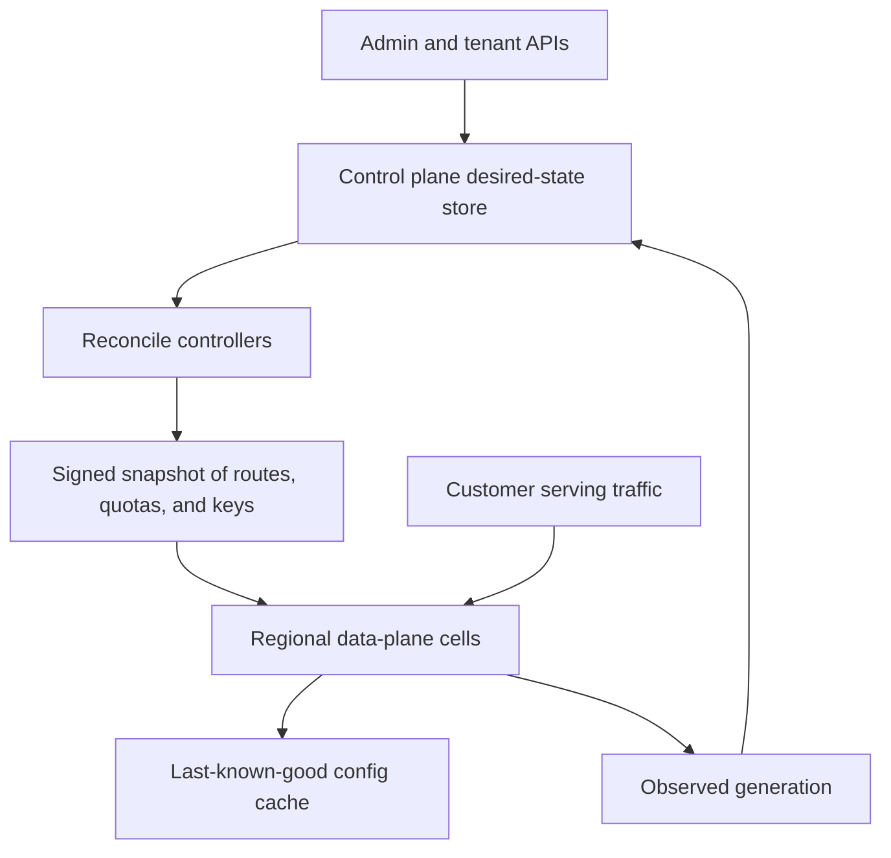

## Concept

### Two planes are two failure domains

In a SaaS platform the data plane is the path that serves customer work: the query, the packet, the object read, the message consume, the render. The control plane is the path that changes what the data plane should do: create a tenant, attach a key, resize a shard, rotate a certificate, publish a routing table, mutate a policy. Putting both in one service feels efficient until a provisioning bug, a migration, or a metadata lock takes serving with it. The split exists so those blast radii stay different on purpose.

I draw the line by which objective can slip while work already in flight continues. Creating an index can wait. Serving existing queries continues. Adding a user can wait. Authenticating an existing session keeps working when the user-admin API is down, unless you deliberately designed that dependency and accepted the outage shape. The control plane may be slower, more strongly consistent, and less available. The data plane may serve from a slightly stale snapshot. It keeps serving on that snapshot.

The contract is desired state. The control plane writes objects: this tenant should have this quota, this schema, this key reference, this cell. Each object has a generation. The data plane holds a snapshot and reports the generation it has observed. Reconcilers close the gap. If the data plane must call the control plane on every request to learn who the tenant is, you have one plane with two names.

### Blast radius and static stability

Static stability means serving continues at last-known-good capacity when control dependencies are impaired. A load balancer that must ask a controller for the target list on every request is coupled to control health. A load balancer that uses a cached target set, and whose forwarding path stays up when the controller is down, is statically stable. Cloud operators have used that phrase for years because the alternative is a control-plane brownout that becomes a regional serving event.

Apply the same rule to tenant routing tables, feature flags, quota documents, and signing keys. The data plane keeps a cache whose useful life is longer than a typical control-plane incident. Expiry is a safety decision, made per object class. A revoked key fails closed. Inability to reach the config service keeps serving on the last good snapshot for flags and ordinary quotas. Write that policy down per class. One fail-closed default turns a metadata outage into a full outage. One fail-open default keeps serving a key you already revoked.

Blast radius runs the other direction too. Recovering a data-plane incident should be possible while control writes are impaired. A control-plane bug should be unable to drop a cell, rekey every tenant, or push an empty routing table with the same permission as adding a user. Split those permissions. Destructive control actions are two-phase: an intent that names a counted blast radius, then an apply. The data plane rejects a snapshot that shrinks the world beyond a budget unless a named destructive workflow is in progress.

Cells and regions refine the cut. A regional data plane does not depend on a global control plane for the serving path. Global control can own tenant metadata and billing. A replicated snapshot, or a regional control cache, owns what that region needs in order to serve. If one region's controller is down, that region's existing tenants keep working. Other regions stay unaware. A new tenant may wait. An existing tenant continues.

### Desired state, distribution, and credentials

The control plane's product is a set of versioned objects: tenant, binding, quota, route, key reference. Clients that want to wait can poll a status object. The happy API writes desired state and returns an accepted response. An RPC that blocks until the index exists leaks into the data plane as a stall and couples provisioning latency to serving latency. Reads on the serving path use local state.

Config distribution is its own reliability problem. A watch is fresh and needs reconnect behavior, backoff, and a defined behavior when the watch dies. A pull on an interval is simple and needs a bound on staleness. A signed snapshot in object storage, fetched by the data plane, survives control-plane death. I use that as the default for high-stakes routing tables, with watches for freshness and the snapshot for disaster. Validate before apply: a minimum tenant count, a checksum against the previous generation, a canary on one cell, and the previous snapshots kept on disk.

Identity splits on the same line. Minting credentials and editing policy are control. Evaluating a request is data. Already-issued credentials keep working until they expire when minting is down. That sentence picks the lifetime: long enough to outlast a control incident you are willing to ride, short enough that revocation still means something. Revocation of a specific credential is a safety path and may fail closed. Inability to mint a new credential for a new session is a control-plane objective. It is a reason to delay new sessions. It is a reason to keep active sessions on the credentials they already hold.

### The control plane is a privileged multi-tenant system

The control plane often sees every tenant's metadata. It is a higher-value target than any single data-plane cell, and a bug there has a wider blast radius than a bug in one cell's query path. Treat it as a high-security service: a smaller API surface, stricter change management, a separate datastore, and no shared shell that can inspect any tenant across the fleet. Audit every mutation. Ship the data plane the minimum config it needs to serve.

Rate-limit control APIs on their own budget. A customer script that creates thousands of projects must not crowd out serving, and it must not crowd out other customers' control operations. Control-plane noisy neighbors show up as timeouts on create-user while traffic graphs look fine. Give control its own objective, its own error budget, and its own on-call expectations. Keep the planes visible on separate dashboards. A merged graph invites someone to restart the metadata store in order to fix serving.

## Trade-offs

| Approach | When it wins | Cost / risk |
| -------- | ------------ | ----------- |
| Single plane, one service | Early product, one region, low tenancy | Every deploy and every metadata lock hits serving and provisioning together |
| Split planes, data plane calls control on the hot path | Fast to build, always-fresh config | A control outage becomes a data outage; serving latency tracks metadata |
| Split planes, snapshot plus reconcile | Production SaaS, multi-region, a real serving objective | Stale-config windows; more moving parts; debugging is distributed |
| Global control, regional data planes | A tenant exists once, and data lives near users | New tenants wait on global control; routing has to stay correct |
| Regional control and data, federated catalog | Hard isolation, residency, cell autonomy | Duplicated control logic; tenant placement becomes a product |

Calling control on the hot path is the default accident. Tests pass because the control service is up in staging. The first metadata lock becomes a serving brownout. In review I want a data-plane request to read local cache, local disk, or a sidecar snapshot. A rare, budgeted miss may refresh. The steady state does not require a successful call to control.

Global control is the right home for billing identity and for the fact that a tenant exists. Keep it off the serving path. A brand-new tenant can wait for global control to assign a region. An existing tenant in a region keeps reading and writing while that global dependency is impaired. Federated regional control is the residency-friendly shape: the cell can serve without asking another geography for permission. The catalog that answers where a tenant lives has to be cached at the edge, in DNS, or in the token. If every request blocks on that catalog, you have placed a third dependency on the hot path.

## Diagram

Admins write desired state. Cells serve customers from a signed snapshot and report the generation they observed. Serving does not wait on a control call.

## Failure modes

### Control on the serving path

A cache miss, a flag evaluation, or a tenant lookup calls control on every request, or on enough requests that control latency becomes serving latency. Detection: serving tail latency tracks control-plane tail latency; a control deploy causes a serving brownout; circuit breakers on the control client open during traffic, during ordinary customer work.

Mitigation: precompute and ship snapshots. Fail open on last-known-good for flags and cosmetic quotas. Fail closed for safety: revoked keys, legal holds, disabled tenants. Load-test with the control plane stopped and require the data plane to keep serving the previous snapshot for the duration you claim in the objective.

### Empty or corrupt config push

A controller publishes an empty route table, or a snapshot that drops a large fraction of tenants, and the data plane applies it. Detection: sudden not-found responses for tenants that existed a minute ago; the generation jumps; serving errors track a control deploy.

Mitigation: validate before apply. Check a minimum tenant count, a checksum against the previous snapshot, and a canary cell before the fleet. The data plane rejects a snapshot that shrinks the tenant set beyond a budget unless a named destructive workflow is in progress. Keep the previous snapshots on disk so rollback is a pointer move. Two-phase apply beats a single push that is also the commit.

### Split-brain desired state

Two control regions accept conflicting mutations for the same tenant. Data planes in different cells serve different quotas or schemas. Support reads one admin view and the customer sees another. Detection: generation numbers are incomparable across cells; the same tenant id has two observed configs; tickets disagree with the console.

Mitigation: one writer per tenant object, or a consensus store for control state. Route mutations for a tenant to a single control primary. If you truly need multi-master control, reject concurrent generations on objects that need a single history. A last-write policy can be acceptable for a cosmetic flag. Placement, identity, and residency need one ordered history.

### Destructive control with no blast-radius limit

One API call can delete a cell, rotate every key, or disable a region. You discover the shape in a tabletop, or you discover it in an incident. Detection, before the incident: a review of control permissions shows destroy and create on the same role; there is no intent record; a dry-run of an empty route set would be accepted by the data plane.

Mitigation: separate permissions for destroy and for create. Intent records carry a counted blast radius and expire. Actions above a threshold need a second approver and a time-limited signed token. The data plane ignores a delete-all unless that token matches the snapshot. Practice the path. An untested break-glass procedure is a page in a wiki.

## Real-world example

Kubernetes is the public textbook for the split. The API server and its store are the control plane: desired state for workloads, services, and config. The node agent, the proxy, and the container runtime are the data plane: they watch, they reconcile, and they keep the last spec running when the API server is briefly gone. A node agent that needed a successful API call to keep an already-running container alive would take every node down with the control plane. The default is static stability as a product behavior.

Cloud load balancers draw the same line. The data plane continues with the last target set when the control plane that registers targets is impaired. Policy evaluation on the request path uses a cache. The APIs that mutate policy are a different service with a different objective. The design rule those systems publish is consistent: the data plane survives control-plane unavailability, and control APIs are shaped so they cannot accidentally empty the data plane.

SaaS systems that skip the split end up with one metadata database as the product. Every login, every read, and every handshake contends with migrations for new tenants. The repair is a control store for desired state, a distribution path for signed snapshots, and a data plane that serves on last-known-good. That is the difference between being unable to provision a tenant this hour and being unable to serve any tenant this hour.

## What to remember

- The data plane serves customer work; the control plane mutates desired state; keep control off the serving hot path.
- Static stability means serving continues on last-known-good config when control is impaired, with fail-closed reserved for safety.
- Ship signed snapshots, validate them before apply, and treat an empty or shrinking config as a dangerous operation with a counted blast radius.
- Give the control plane its own objective, permissions, audit, and quotas; it is a high-privilege multi-tenant system.
