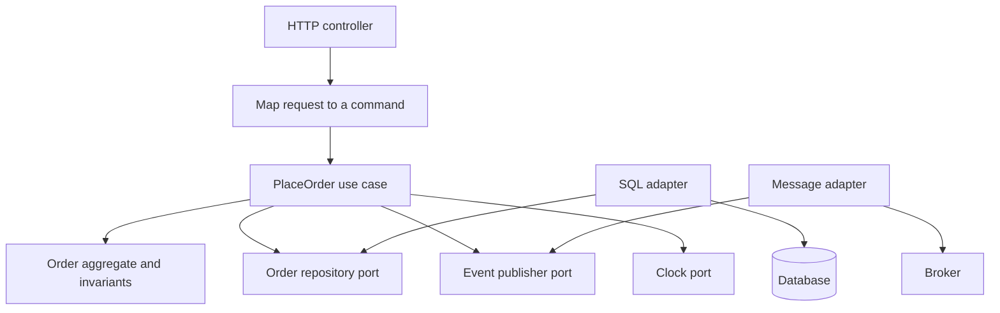

## Concept

### The dependency rule is the architecture

Clean architecture, onion architecture, hexagonal architecture, and ports and adapters are one constraint drawn three ways. Source dependencies point inward. The domain model does not import SQL, HTTP types, a cloud SDK, or a framework. Adapters at the edge translate the outside world into domain types and into interfaces the application owns. If a codebase remembers one rule, this is the rule. Folder names are decoration until the compiler enforces the direction.

I enforce it with the module graph. Inner modules export entities, value objects, and use-case interfaces. Outer modules implement those interfaces: a database adapter, a messaging adapter, an HTTP controller that calls a use case. Tests in the inner ring construct domain objects with no container and no network. When an inner module grows an import of a web framework or a vendor SDK, the diagram has already lost. The build should fail that import the same day, during the pull request, while the author is still in the change.

Pick one vocabulary per codebase and keep it. Onion language is a core of domain types, a ring of application services, a ring of interface adapters, and an outer ring of frameworks and drivers. Clean-architecture language is entities, use cases, interface adapters, and frameworks. Hexagonal language is an application at the center, ports as interfaces, and adapters as implementations. Mixing use case, service, and manager for the same layer turns the rule into a naming argument. The direction of dependencies is the part that survives a rewrite of the folders.

### Ports stay domain-shaped, and input and output stay in adapters

A port is an interface the application owns: load an order, charge a payment, read a clock, publish a domain event. Methods take and return domain types. An adapter is the implementation that speaks SQL, HTTP, or a vendor SDK. The composition root, a small main or a wiring module at the edge, connects the adapter. A domain class does not construct its own repository and does not know which process hosts it.

Two distortions show up in every large system. The port is shaped like the database: find by three columns, with a join baked into the method name. That is a query language wearing an interface. Shape the port like the domain operation: load the open orders for this customer. The second distortion is a session that leaks inward. Request-scoped persistence objects, mutable unit-of-work handles, and annotations that open transactions from inside an entity pull the framework into the core. Keep the unit of work at the use-case boundary. The application service starts it, calls domain methods, and the adapter commits. Domain objects enforce invariants. They stay unaware that a transaction exists.

Clocks, randomness, and the current time are ports. A billing cutoff you can test only by sleeping has coupled the rule to the wall clock. Feature flags that change a domain rule belong behind a port as an explicit policy input. Hidden globals make production and tests disagree about which rule ran, and the disagreement shows up as a bug you cannot reproduce on a laptop.

### A use case is one intent, and a company has many cores

A use case is one actor's one intent: place an order, refund a payment, rotate a tenant key. It loads aggregates, calls domain methods, persists, and records domain events. An order service with dozens of methods is a layered pile hiding in a hexagonal folder. Split by intent. If two intents share a pure calculation, that calculation belongs on the aggregate or in a domain function that still performs no input or output.

Entities and value objects hold rules that need no query: totals, state machines, invariants that are true of one aggregate. A rule that needs several reads is a use case. It gathers facts, then calls the entity. The temptation is the persistence session, where the rows are already loaded, so the entity method issues another query. That convenience inverts the dependency rule and makes the entity unusable in a unit test that has no database.

At scale you have many bounded contexts, each with its own inner ring. Integration is an adapter: a message, an API, an anti-corruption layer that translates another context's types into yours. A shared domain-kernel package that every context imports becomes a distributed monolith with a versioning crisis. Duplicate small types. Map at the edges. The dependency rule still holds, and the unit of the rule is the context.

### Large systems pressure the rings, and the rule still holds

Workflow engines, several stores, and saga orchestrators tempt people to put framework types in the core. Keep the core for rules. Let some application services exist only to sequence adapters: an outbox dispatcher, a saga step, a retry policy. Those orchestrators live in the application ring. Isolate vendor imports in a small module so the rest of the ring stays free of client types. When a vendor guarantee is the product, name a narrow port for that capability. State the vendor dependency in the decision record for that port. Keep the SDK inside the adapter that implements it.

Performance arguments usually mean a use case needs a query the aggregate should not know. Add a query port and a read model. Leave the write-side aggregate alone. In this setting, separate read models are the dependency rule applied to reads: reporting joins do not get to reshape the entity. A web framework will also offer a shortcut, controller straight to a repository, for a screen that is a table editor. That shortcut can live in an admin module the core is forbidden to import. The day the core follows the admin path, the onion is a folder convention. Controllers on the product path call use cases, including the use cases that are one line. The line is the seam a second transport, a worker or a queue, will need.

A modular monolith with an enforced graph, through language modules, separate projects, a package linter, or a build-system visibility rule, is how large systems keep the rule honest. Directories named domain, with no build failure, are a suggestion. The architecture is the graph the pipeline will refuse to break.

## Trade-offs

| Approach | When it wins | Cost / risk |
| -------- | ------------ | ----------- |
| Framework-first layers | Simple records, a small team, one database | Rules scatter into controllers; tests need the framework to boot |
| Strict onion, ports and adapters | A long-lived core, several adapters, real invariants | Boilerplate, over-abstracted ports, more hops while debugging |
| Modular monolith with enforced package rules | One deployable, many contexts, a compiler or linter on the graph | Boundary config becomes architecture and must be reviewed like code |
| One onion per bounded context | Services or modules with separate models | Mapping at every edge; pressure to invent a shared kernel |
| A deliberate shortcut for admin screens | Screens with no invariants, isolated from the core | The shortcut spreads until product paths have no use case either |

A strict onion around a table editor is ceremony. I allow a thin path, controller to repository, inside an admin module the core cannot import. The failure is product code copying that path because it was faster on a Thursday. Review the import. The intention in the pull-request description will not show up in the module graph.

One onion for the whole company collapses into a common package that imports everything and is imported by everything. Split by context. The mapping code at the boundary is cheaper than a shared kernel that cannot ship a change without a fleet-wide upgrade. Strict ports have a failure mode of their own: an interface per table with no domain language, which preserves the ceremony and loses the rule. If swapping the database would still require rewriting the use case, the port is wearing the vendor's types. Fix the types. Keep the adapter.

## Diagram

The use case sits in the middle and depends on ports. Adapters implement those ports and own the database and the broker. The arrows that matter point toward the aggregate.

## Failure modes

### The inner ring imports the framework

Domain types carry persistence annotations, web transfer objects, or a cloud SDK. Detection: a boundary test lists imports under the domain or core module; constructing an entity in a unit test requires the framework's container; the inner module's dependency list includes vendor packages.

Mitigation: fail the build on disallowed imports per module. Map at the adapter. If you use an object mapper, keep a persistence model that is separate from the entity and map explicitly. Annotating the aggregate is convenient, and it pins the domain to one library's lifecycle. Large systems that stay honest pay for the mapper. The mapper is boring. An import cycle that reaches the framework is the incident you are trying to avoid.

### God use cases and an anemic core

One application class grows every feature. Entities are structs with public fields and no behavior. Detection: very large files in the application module; domain types with no methods that enforce a rule; every story adds a method to the same service. Tests boot the world because the unit under test reaches the database.

Mitigation: one use-case type per command. Push invariants into the aggregate so a test can call them with plain values. If two use cases share a sequence of pure steps, extract a domain function that still does no input or output. Reject new methods on the oversized class in review. The file size is the signal. The missing invariant is the bug the file is hiding.

### Ports shaped like the vendor SDK

The application module imports producer records, request objects, or storage SDK types because the port signature used them. Detection: swapping the broker or the object store requires edits in use cases; the application module's dependency list includes the vendor. The port exists and changes nothing about the direction of the graph.

Mitigation: ports speak domain types. Adapters translate. When a vendor feature is the actual product, isolate it behind a small capability port with your own words, such as put-if-absent, and keep that port's implementation in the adapter module. State the vendor dependency in the decision record for that capability. Hiding the vendor's name while leaking the vendor's types helps nobody, and it makes the next migration a rewrite of the core.

### A unit of work that is really a dual write

A use case writes the database and publishes to a broker in one method, and the runbook calls that a transaction. Detection: incidents where the row exists and the event does not, or the event exists twice; operators republish by hand; consumers are written to tolerate gaps nobody can explain.

Mitigation: a transactional outbox, or a single writer. The adapter that stores the aggregate stores the outbox row in the same commit. A relay adapter publishes. The use case stays unaware of the broker client. The onion does not make a dual write safe. It gives you a place to put the pattern so the domain rule does not grow a retry loop of its own.

## Real-world example

Shopify's modular monolith is the dependency rule at a size where folder names would have lost. Package checks, and the component boundaries around them, make dependencies explicit. A billing component cannot casually reach into another team's models. That is the compiler story of the onion, applied to a large codebase that ships as one deployable. Domain logic stays with the component that owns the data. Other components integrate through published interfaces and messages. The interesting property is enforcement. A boundary the build can violate is a suggestion that dies on the first deadline.

Published layouts for application frameworks show the same rings in a smaller form: a domain project, an application project, an infrastructure project, and a web project, with references pointing inward. At product scale you multiply that graph per bounded context and add a composition root per deployable. A single domain project for the whole business recreates the shared kernel. Mobile guidance that puts the interface on use cases, and use cases on repositories, is the same arrow. Treat the framework as an adapter you replace in tests every day.

I copy the enforcement. A build that fails an illegal import will outlast a wiki page about layers. A shared kernel that every service bumps together will outlast the intention to keep the cores independent. The onion is the direction of the arrow, repeated per context, with input, output, and vendor types outside the head of that arrow.

## What to remember

- Dependencies point inward, and the module graph is the architecture; directory names are a hint until the build enforces them.
- Ports speak domain types; adapters own SQL, HTTP, clock implementations, and vendor SDKs.
- One use case is one intent, and a large system has one onion per bounded context.
- The rule does not make dual writes safe; put the outbox in the adapter and keep reporting queries on a read port.
