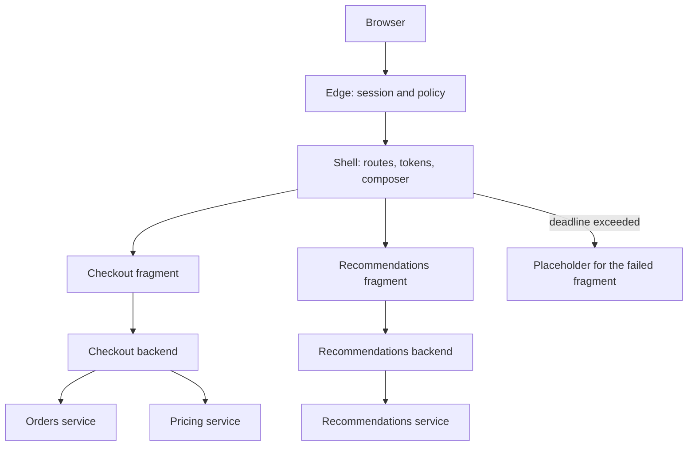

## Concept

### Composition is the architecture, and the shell is a platform

A micro-frontend is a slice of interface that a team can ship on its own calendar, owning the product surface that slice represents. A package that always lands in one bundle, on one pipeline, is a modular frontend. That can be the right system. It is a different contract. Independence is the property you are buying: two teams ship on different days, and the page still composes into one product.

Composition happens at one of three layers, and you should pick a default. Build-time composition assembles packages into one artifact. The experience can be fast and the dependency graph can be optimized. The release is coupled. Runtime composition in the browser has a shell load fragments, through module federation, import maps, or a loader you own. Teams ship independently. You pay for version skew, duplicate libraries, and a loading protocol. Edge or server composition has a shell or a CDN stitch markup from fragment endpoints. First paint can stay fast, personalization can stay on the server, and the browser hydrates islands. That is the shape a large retail composition system made public: a layout, fragment services, and timeouts so one slow fragment cannot hold the document.

The shell is a platform, and platforms should be boring. It owns top-level routing, the session, design tokens, the composition protocol, and the rule for what happens when a fragment is slow or dead. Product fragments can be structured however their team needs, as long as they honor the protocol: how to mount, how to receive user context, how to emit analytics, how to fail without blanking the page. A shell that changes every week forces every fragment to change with it, and you have rebuilt a monolith with extra repositories.

### Contracts cover session, design system, routes, and data

Independence dies on four shared concerns, so those concerns get explicit contracts.

The shell owns the session. Fragments receive a verified identity: a cookie the backend-for-frontend already understands, or a short-lived token minted for that fragment's audience. A fragment invents its own login only when it is a separate product with its own threat model. A global mutable user object on the page is a shared database in the browser. Cross-origin fragments need an audience on the token and a defined failure when the token is missing. The page degrades to a signed-out fragment. It does not grow a second login wall in the middle of checkout.

The design system is a versioned kit: tokens, a small set of components, a compatibility window of the current release and the previous one. A fragment that vendors a private copy of another kit will drift visually and add weight to the page. The kit has a changelog, a deprecation window, and a pipeline that tests fragments against it. A design file with no package is a picture of a contract. The package is the contract.

One URL space belongs to the shell. It owns top-level routes and hands a prefix to a fragment. Deep links survive independent deploys. A fragment version that does not understand a path renders a fragment-level missing page. It does not throw into the shell. Fragments do not invent colliding paths, and they do not read each other's client stores. Cross-fragment state moves through the URL, through a versioned event with a schema, or through a backend that already aggregated the data. A shared global store is how the organization builds a distributed monolith in the browser.

### A backend for one screen family belongs to the team that ships it

A backend for frontend shapes a screen model for one client family. Micro-frontends without that layer push aggregation into the browser. A checkout fragment on a phone then fans out to inventory, pricing, tax, and coupons over a weak network, and each call carries its own authorization story. That is a latency problem and an authorization problem wearing a component model.

The browser talks to the edge. The edge talks to a backend for frontend, or to a composer that talks to those backends. The backend talks to domain services. A fragment team that owns a product surface end to end owns its backend: seller tools, checkout, a claims workspace. A single backend for every fragment recreates a gateway monolith, with a resolver for each team's arguments. Split the backends. Share the edge: transport security, the web application firewall, bot rules, and the session. Share a screen field only when it is a real platform concern, such as the user header or a feature-flag snapshot.

Version the backend with the fragment. A mobile binary may pin a backend version for a long time. A web fragment can ship interface and backend together and still owes expand-and-contract to anything that did not ship together, including a cached client and a canary. Breaking the screen model is the same event as breaking the fragment protocol. Contract tests sit in the pipeline for each pair. Both sides deploying in the same hour, and calling that a compatibility strategy, works until you need to roll one of them back.

Multiple fragments on one page should not each call origin for the same user header. A page-level backend or the composer batches that. The fragment backend owns the domain aggregation that is unique to its surface. Common reads stay in one place so the device does not pay for them once per team.

### Independent deploy still has to look like one product

Marketing wants one brand. Teams want separate pipelines. You get both with a design-system platform, visual checks of the composed page, and a canary of the composition. A fragment that is perfect in isolation can still wreck the page. The thing you measure is the composed route: time to useful paint, input latency, script weight, and the error rate when one fragment is removed.

Performance budgets are part of the protocol. Cap the script a fragment may add. Lazy-load below the fold. Reject or defer a fragment that blows the budget, in the pipeline, before the regression reaches customers. Failure isolation is the rest of the protocol. Each fragment has an error boundary. The server-side composer has a deadline and a placeholder. A slow recommendations fragment does not hold checkout. Retry a fragment render inside a budget, and stop when the budget is spent.

## Trade-offs

| Approach | When it wins | Cost / risk |
| -------- | ------------ | ----------- |
| Modular monolith frontend | One team, or a product that must ship as one optimized bundle | Coupled releases; team growth fights the pipeline |
| Runtime composition in the browser | Several web teams on a compatible framework family | Duplicate dependencies, version skew, first-paint and indexing work |
| Edge or server fragment composition | Many teams, a first-paint objective, and indexable pages | The composer is a new critical path; fragment objectives must be real |
| Micro-frontends with a backend per team | Distinct client surfaces and real organizational scale | Many deployables, contract sprawl, heavier local setup |
| One graph gateway as the only backend | Homogeneous clients and a graph that is the product | A resolver that every team edits; cache and authorization concentrate in one tier |

Runtime composition is the default conference architecture. It wins when teams already share a framework generation and can keep a compatibility table honest. It loses when one team must stay on an old runtime and another needs a new one, unless you isolate runtimes at a high experience cost. Frames give strong isolation and a clumsy page. Use them for untrusted content or a genuinely foreign stack. Your own checkout should live in the composition protocol, with a design-system upgrade plan, so the page stays one product.

Server composition moves complexity to a platform team, which is the right trade once you have more than a handful of fragments and a page-level objective. The composer has to be statically stable: last-known-good fragment responses where the content allows it, per-fragment deadlines, and markup that still renders when any one fragment times out. Skipping the per-team backend produces a page that issues dozens of API calls from the device. Aggregation belongs on a server you operate, close to the domain services, with timeouts and a screen model the fragment can trust.

## Diagram

The shell composes the page and isolates a failed fragment. Each product fragment talks to its own backend, and that backend is the only tier that knows the domain services behind the screen.

## Failure modes

### Shared runtime coupling

One global framework instance, one global store, and one style reset that fragments override. A deploy from one team breaks the shell or another team. Detection: incidents line up with another team's release; keys collide on the page object; visual bugs show up as one control looking like another team's after a fragment publish.

Mitigation: isolate styles with a prefix, modules, or a shadow boundary. Limit the shared runtime to a documented compatibility table that the platform tests. Import the design system as a versioned dependency. Ban new globals except a single namespaced bus with a schema. If two fragments must share a framework singleton, that singleton is a platform release, scheduled and versioned, and an accidental import is a defect.

### The composer waits, and the page fails

The assembler blocks on a slow fragment and the whole document fails. Detection: the page objective burns while one fragment origin is unhealthy; traces show no per-fragment deadline; retries multiply load on the sick origin.

Mitigation: a deadline and a placeholder per fragment. The shell renders without any single fragment. Cache fragment output where personalization allows it. Spend retries from a budget. A recommendations outage should look like a missing rail. Practice this by failing a fragment in a game day and reading the composed page, not only the fragment's own dashboard.

### Fragment and backend drift

The interface reads a field the backend stopped sending, or the backend requires a field an old cached fragment does not send. Detection: client exceptions after a backend-only deploy; schema checks are absent; staging was green because both sides deployed together and production canaries did not cover the old client.

Mitigation: contract tests in the pipeline for each fragment and backend pair. Expand, then contract, on the screen model. Keep a compatibility window that matches how long old web assets and mobile binaries actually live. Independent deploy is a compatibility problem. Shipping two repositories in the same hour and calling it independent will work until the day you need to roll one of them back alone.

### Weight and duplicate work

Three copies of the same utility, three analytics clients, and unbounded hydration. The composed route gets slower every time a team is added. Detection: script weight tracks team count; core page metrics regress on the composed URL; the network panel shows the same user header fetched once per fragment.

Mitigation: an allow-list of shared libraries and versions, budget gates in the pipeline, and lazy loading for anything below the fold. Batch common header and flag data in the composer or a page-level backend. Measure the composed route in the same dashboard the fragment team watches. A fast isolated preview and a slow page means you instrumented the wrong artifact.

## Real-world example

Zalando's Project Mosaic is the public large-scale pattern for server-side composition. A layout service assembles markup from fragment services owned by different teams. The assembler includes fragments with timeouts. Teams deploy fragment services on their own cadence. The page is a tree of inclusions. Each fragment service can aggregate the backends that team owns and return the markup or data the composer needs. That is a backend for frontend sitting next to the fragment, so the browser never learns the company's entire service list.

Later public write-ups from other product companies describe the same split: a shell, vertical teams, and a composition protocol that includes failure. Large retail pages show that a customer-facing page can be many owned fragments with independent release. The failures that travel with the pattern are a shared framework nobody can upgrade, a design system with no versioned package, and a program that still ships the page on one pipeline while the repositories pretend otherwise.

When I adopt this, the first questions are organization and composition. If one team owns the page, I keep a modular frontend and spend the effort on a design system and a backend that shapes the screen. If many stream-aligned teams must ship interface on different days, and the page has a paint objective, I invest in a composer, per-fragment backends, contract tests, and a protocol that includes budgets and placeholders. That platform is the product. The fragments are the tenants of it.

## What to remember

- A micro-frontend is an independently deployable interface slice plus a composition protocol; one shared bundle is a modular frontend.
- The shell owns session, routing, design tokens, and failure isolation; fragments share a versioned kit and a single URL space.
- Pair each product fragment with a backend for that screen so the browser is not the aggregation tier on a weak network.
- Independent deploy needs contract tests, performance budgets, and placeholders, or you bought extra latency and kept the coupling.
