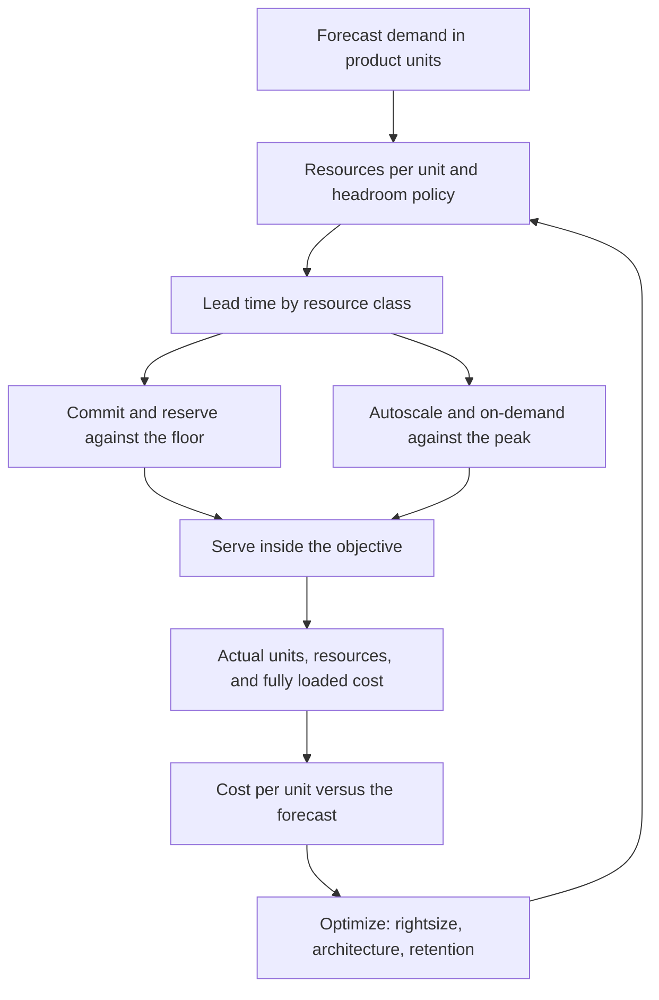

## Concept

### Unit economics is the planning primitive

Capacity planning without a unit is a feeling that last quarter was tight. A cost practice without a unit is a bill-shock channel. The unit is the thing you sell or the thing that scales with customers: a delivered video minute, a paid order, a monthly active tenant, a million events ingested, a search query, a seated workspace. Cost per unit, and resources per unit, are the models. Instance hours, gigabyte-months, and request counts are inputs. They are the lines you use to explain the model. They are the wrong sentence to take to a planning review by themselves.

I want two numbers that fit on one page. Technical: resources per unit at a named percentile of load, with the headroom policy written next to it. Financial: fully loaded cost per unit, including the lines people forget when they optimize the fleet. Observability, backups, address translation, cross-zone traffic, idle reserved capacity, and the platform team's share all belong on that page. A model that counts only application instances will celebrate a smaller fleet and grow the transfer line until finance finds it in a renewal.

Unit economics also decides which architecture is allowed to ship. A feature that adds a large fraction of cost per order, for a small conversion gain, is a product decision with a number attached. A cache that cuts database cost and adds a smaller application cost is an architecture decision you can defend in the same review. Without the unit, both conversations become taste, and taste loses to the loudest incident of the quarter.

### Demand, lead time, and headroom are a supply chain

Demand is a forecast of load: organic growth, launches, seasonality, failover traffic, and the worst customer doubling. Supply is the provisioned resource that can absorb that load inside the objective. Lead time is how long supply takes to appear. Stateless replicas can arrive in minutes when the image is warm and the bottleneck really is replica count. A new shard, a disk layout, or a connection-pool redesign is hours to weeks. Reserved capacity, hardware, a new region, or a database engine change is weeks to months. Plan each resource class on its own clock.

Autoscaling is the tactic for bottlenecks whose lead time is minutes and whose constraint is the thing you scale. It does not create write capacity on a single-primary database. It does not raise a vendor quota you discover at peak. It does not split a hot partition. For stateful systems, capacity is a project with a trigger written in advance: when weekly peak on the write primary crosses a named line for two weeks, start the split. Waiting for a page is incident response. The plan was supposed to start earlier, on a number you already agreed.

Headroom is the gap between provisioned supply and expected peak. Set it from failure math, then convert it into a utilization target. Lose one availability zone. Absorb a retry storm of a size you have actually seen. Absorb the largest tenant doubling. Take the larger of those, and refuse a utilization target that cannot survive it. A fleet that sits at the ceiling during an ordinary weekly peak has no zone-failure story and no launch story. A utilization slide can look efficient until the first real week.

Forecasts are ranges. Tie the low case to committed spend you can still use if you are wrong: reservations and savings plans sized to the floor. Tie the high case to elastic capacity. Review weekly during a launch and monthly otherwise. A meeting that only explains last month's invoice is accounting. A meeting that compares forecast units, actual units, and resources per unit is planning, and it is the meeting the architect should be in.

### Allocation, showback, and the shape of the bill

You can steer only the spend you can attribute. Tag or split accounts by product, environment, and the driver of the unit. Showback, putting the number in front of the team that causes it, changes behavior in most engineering organizations. Chargeback, actually moving money, is what you add when showback has been ignored for more than a couple of planning cycles. Unallocated spend is a design smell: a shared cluster with no tenant or product key, a central network path nobody owns, a log pipeline with no cardinality budget.

Classify lines so the action is obvious. Compute that scales with queries: rightsize, autoscale the right tier, turn off idle non-production, pick a family that matches the profile. Storage that scales with retention: lifecycle rules, compression, a colder tier for data nobody reads. Transfer that scales with chatty service graphs: keep traffic in the zone and in the region, and prefer a less chatty protocol on the hot path. Observability that scales with label cardinality: that is an architecture defect with a price, and the price belongs in the same review as the latency chart.

Reservations and savings plans are a bet on the floor of demand. Buying the peak locks you into a shape you may need to leave, and it removes the elastic buffer the failure math required. Preemptible capacity belongs on interruptible work, batch and delivery pipelines and some training, with a drain path. Putting preemptible capacity under the serving path, with no static floor, is a reliability incident narrated as a discount.

Architects belong in this loop because the expensive lines are usually design. A chatty mesh in a region where cross-zone bytes are pricey. An unbounded log field. A silo per tenant applied to tens of thousands of small customers. A hot key that forces vertical scale. Rightsizing instances after the fact cannot repair a protocol. The paved path should be the cheap path: default instance sizes, default retention, environments that expire, and a platform that makes the high-cardinality label harder to emit than the low-cardinality one.

### The loop sits next to the service objective

Inform means the unit sits on the same review as the service objective. Cost per order next to checkout latency. Cost per ingested million next to consumer lag. Optimize means the backlog may contain a change to the architecture, alongside a reservation. Operate means budgets alert on the rate of spend and on cost per unit. Absolute dollars rise when you grow. A rising unit cost, while the product mix is stable, is the signal that something in the design got more expensive per unit of value.

A control that expires non-production environments on a schedule will beat a quarterly cleanup campaign. Optimization that requires a hero ticket will not happen in the week of a launch. Put the expiry in the platform so the default is the cheap path.

Every savings proposal names the objective it still meets and the failure it still survives: a zone loss, a retry storm, the largest tenant. A cost program that only has a savings number will raid headroom. Pair the number with the failure math. A cut that spends the error budget is an outage purchased at a discount, and the invoice will not show the purchase until the incident review.

## Trade-offs

| Approach | When it wins | Cost / risk |
| -------- | ------------ | ----------- |
| Peak plus a guess | Tiny fleets, where human time dominates the bill | Chronic overpay, or chronic pages, and no model to learn from |
| Autoscale as the whole plan | Stateless tiers whose bottleneck really is replica count | Hides stateful cliffs, thrash, and vendor quotas until peak |
| Unit model plus a lead-time plan | Growing products with mixed stateful and stateless tiers | The model must be maintained; a bad unit produces confident wrong bets |
| Heavy committed discounts | A stable baseline and predictable growth | Locks the architecture into a region, family, or managed service |
| Showback with engineering guardrails | Many teams sharing one cloud bill | Tag games and political noise unless the unit is real and reviewed |

Autoscaling is a tactic for a specific bottleneck. If tail latency tracks a primary database, adding replicas adds cost and adds no capacity. If the cloud account has a hidden quota, the scaler fails at the moment you needed it. Put quotas, connection ceilings, and stateful cliffs on the same sheet as CPU. A capacity runbook named "add compute" is how you scale the wrong resource through three incidents in a row.

Commitments are correct on the floor. They become a drag when they freeze a design you should leave: a region, an instance family, a managed service whose unit cost no longer fits. Model the break-even and include the option to leave. A perfect allocation warehouse that no team reads is accounting theater. Put cost per unit on the operational review next to incidents. A healthy latency chart with a large jump in cost per unit is an architecture incident even when nobody paged.

## Diagram

Forecast the product unit, turn it into resources with an explicit headroom policy, then split supply by lead time. Actual cost per unit feeds the next model.

## Failure modes

### Scaling the resource that is not the bottleneck

Replica count rises, the bill rises, and latency stays where it was. Detection: replica count tracks request rate while tail latency tracks database CPU, lock wait, or a downstream rejection; cost per unit rises in the same weeks the team reports capacity work.

Mitigation: write a bottleneck hypothesis before you scale. Load tests hold the suspected cliff fixed so you can see whether the lever moves the objective. Name runbooks by resource: write operations, connections, partition count, quota. A generic add-compute step is a hint that the model has no bottleneck, and the next incident will scale the same wrong tier.

### Headroom raided for a savings target

Utilization targets creep up every quarter until the failure math no longer fits. The first zone impairment or the first launch misses the objective. Detection: peak utilization approaches the line you said you needed for a zone loss; the error budget burns on spikes that used to be boring; reserved coverage matches the peak.

Mitigation: freeze the headroom policy next to the objective. A savings proposal shows the new failure math in the same document as the dollars. Alert on peak utilization of the constrained resource, alongside spend. If the only way to hit the savings number is to delete the zone story, the number is the thing that has to change.

### Unowned and unbounded lines

Logs, traces, network translation, and cross-zone traffic dominate the bill, and no service team believes they own them. Detection: an unallocated category grows; a label's cardinality jumps after a release; a new service doubles transfer without a matching jump in product units.

Mitigation: budgets on platform signals, including span rate, log volume, and metric series. Default-deny high-cardinality labels on the paved path. Prefer in-zone placement for chatty calls. Assign an owner to every top line, including shared networking. An unowned line will grow, because every team can add a little and nobody sees their fraction until the renewal.

### Forecast theater

The spreadsheet is edited to match last month and ignored until a renewal. Detection: committed purchases do not match the floor you claim; elastic spend is most of a service you called stable; there is no forecast-versus-actual on units at the review cadence you wrote down.

Mitigation: one source of unit truth, from billing or product analytics, feeding both finance and the on-call review. Shorten the cadence during launches. If a model misses its declared band for two quarters, replace the unit or the driver. Adding sheets will not repair a unit that does not track cost, and a more precise spreadsheet of the wrong unit will be confidently wrong.

## Real-world example

Netflix has published the pieces of this discipline for years. The product unit is streams and viewing hours. Encoding ladders and the appliance program that places caches inside networks exist because those choices dominate cost per hour delivered. A codec that spends more compute to send fewer bits is a unit-economics decision, and it is an architecture decision in the same meeting. Placing supply close to viewers is a lead-time decision: you do not create cache capacity inside a partner network on the evening of a premiere, so that supply is planned early, and elastic cloud capacity covers the part of the system that can move in minutes. The architecture and the cost model are the same conversation.

Other consumer companies put cost per thousand impressions, or cost per query, beside latency, so caching and colder storage compete with instance rightsizing on equal terms. The inform, optimize, and operate loop is vocabulary for making the bill an engineering input. Pick the unit, fully load the cost, plan stateful capacity on its real lead time, buy commitments against the floor, and put cost per unit next to the objective. A quarterly savings target that consumes headroom, and never asks whether the protocol is chatty, buys an outage on a delay. The delay is the only thing that makes it look like a win in the quarter it was booked.

## What to remember

- Plan and price in product units; instance hours and gigabytes are inputs to that model, and the model is the sentence you review.
- Match the tactic to lead time, and set headroom from the failure you still intend to survive.
- Attribute spend, commit against the floor, and treat transfer and observability growth as architecture.
- Every savings idea names the objective and the failure story it still satisfies; a cut that spends the error budget is an outage on a delay.
