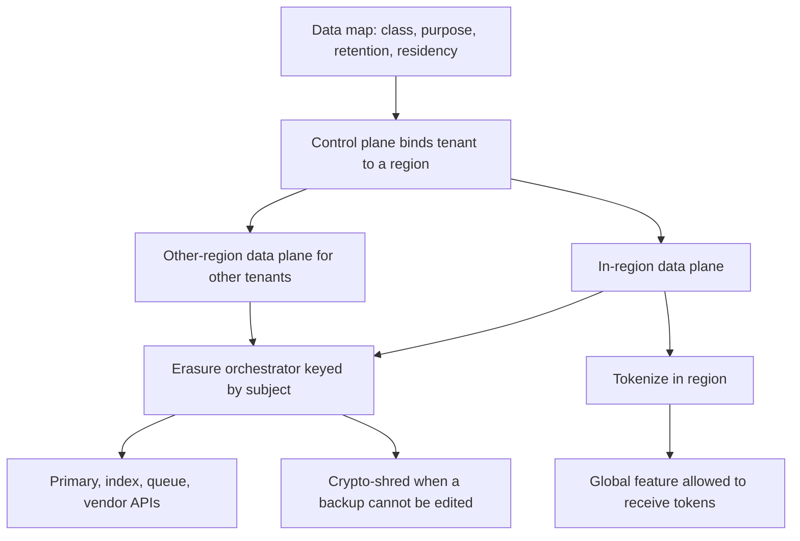

## Concept

### Residency, sovereignty, and localization are different constraints

Data residency is a placement rule: this class of data is stored and processed in a named geography. Data sovereignty is stricter: the data stays under a legal regime, which can constrain who administers it, who can compel access, and which subprocessors are allowed. Localization is a product concern, language and currency and formatting, that people bundle with residency because both sometimes use the same geography word. Mixing the three produces a regional interface over a global warehouse, or a sovereign stack for an image that was allowed to be global.

I start from a data map. For each category of personal data, record the purpose, the lawful basis, the retention clock, who the controller is, which processors touch it, whether it is a special category, and the residency rule that actually applies. The engineering consequences of a general data-protection regime are purpose limitation, minimization, integrity, and the rights of the person, including access and erasure. Residency often arrives as a contract, a sector rule, or a customer addendum on top of that. A primary database in one country, with the same rows streamed to an analytics lake in another, has placed one copy. The data has more copies than the primary.

Copies are the product of the architecture. Support tools, backups, logs, metrics, traces, crash dumps, email, object replicas, edge caches, delivery-pipeline fixtures, and the laptop that pulled a production dump are all stores. A residency story that names the primary and ignores the rest is a finding waiting for an audit. Enumerate the stores before you argue about which region dropdown to offer.

### Classification and purpose live in the schema and the pipeline

A policy document loses to the next column someone adds on a Friday. Put classification on the data: personal, sensitive, or operational; a purpose tag; a retention clock; a residency domain. Pipelines that move bytes carry the tags. A warehouse table with no lineage back to a purpose is how secondary use becomes accidental. Access follows purpose. A support tool that can open one customer mints a short-lived, audited grant for that customer and that ticket. A standing global read role is a different system, and it needs a justification you can show.

Minimization is a data-model feature. Keep raw identity out of every shard when a join would be convenient and a token would do. Use opaque identifiers, a vault for the direct identifiers, and join keys you can revoke. If a log line does not need the field, drop it at the edge. Treat free-text fields as suspect. People will paste an address into a notes column you classified as operational. Schema checks and outbound controls catch that class of leak. A written policy, with no check on the pipeline, will not.

Cross-border transfer is its own subsystem when personal data leaves the allowed geography. The architecture choices are concrete. Keep processing in region. Tokenize in region and export tokens for a global feature that can operate on tokens. Or export under a documented mechanism, with the access controls and subprocessors that match what counsel described. Encryption of a bucket is a confidentiality control. A distant admin plane that can query the regional rows is a transfer, even when the disk never moves. Design the admin path as part of the residency story, in the same review as the primary region.

### Erasure is a distributed workflow

The right to erasure, and the contractual deletes that enterprise customers add, is a workflow across every store that can hold a copy. A single delete against the user table is the first call. Search indexes, caches, queues, analytics, derived profiles, vendors, and backups are in scope. If you cannot list the stores, you cannot claim the delete is complete.

Build the workflow as a platform. A registry of personal-data stores is keyed by the person or by a party id you control. Each store implements an idempotent delete. An orchestrator issues the work, records acknowledgements, retries, and reaches a terminal state a human can audit. Derived data has a rule: recompute without the person, or delete the derivation. Vendors are in the registry with an API and a contract. An email to a vendor is a request. An acknowledgement is a recorded response from that API, with a time and a status you can show later.

Backups are the hard store, because you usually cannot edit one object inside a snapshot. Practical patterns are short retention for stores that hold personal data, a rare restore into isolation followed by delete and a new backup, or crypto-shredding. Crypto-shredding encrypts the personal data under a key per person or per tenant and destroys the key when the backup cannot be rewritten. It works when every copy is under that key, including logs and support exports. A single plaintext copy in a ticket system defeats the key destruction, and the registry has to know that store exists.

Tombstones and legal holds conflict with erasure, and the orchestrator has to know which one is in force. A hold freezes deletion and is visible to the people operating the workflow. When the hold lifts, deletion resumes from the same registry. A silent skip fails the person who asked for erasure and the matter that required the hold. Completion is the terminal state of the orchestrator, after the stores that are in scope have acknowledged, and after any hold has been accounted for.

### Residency is a control-plane binding

The control plane binds tenant to region, or to an allowed set of regions. The data plane in that region serves the tenant. The router sends the tenant there. It does not offer an admin override that copies the dataset for a demo or a support shortcut. New features default to in-region processing. A global feature, a central trainer or a global search index, is an explicit exception: the data class is allowed to leave, the feature runs in region, or it operates on tokens produced in region. A replica outside the bound geography is a transfer someone has to sign, with a subprocessor list that matches the path.

Admin access is part of residency. A global operator role that can query every region's database is a transfer and a sovereignty issue. Split admin planes by geography, or broker access through in-region break-glass with an audit and a ticket. Support staff see the minimum fields. Global telemetry gets a field allow-list. Feature-flag services evaluate a bit without requiring user content to travel to a vendor in another region.

Disaster recovery has a residency mode. Unless the contract names the failover geography, fail closed: a regional outage is the outcome you accepted, in preference to a silent transfer. Replication inside the allowed geography is normal engineering. Replication outside it needs counsel, a matching subprocessor list, and a test that a configuration typo cannot enable the path. The binding is a tested object. A router that guesses a default region when the binding is missing will eventually guess wrong for the tenant who paid for the constraint.

## Trade-offs

| Approach | When it wins | Cost / risk |
| -------- | ------------ | ----------- |
| One global store, with legal mechanisms only | Data that is allowed to be global, and a small processor list | Fails customer residency addenda; erasure and access sprawl across copies |
| In-region silos per geography | Strict residency and large customers who audit it | Many copies of the stack; features lag; routing bugs move data by accident |
| Tokenize in region, export tokens only | A global product that still holds strict personal data | Joins get harder; a reversible token becomes a new incident class |
| Per-tenant residency binding to a regional cell | Products with mixed customer rules | Control-plane complexity; some features exist only in some cells |
| Crypto-shred keys for erasure | Backups and lakes you cannot surgically edit | Any plaintext copy defeats it; key management becomes part of the product |

A global store plus a transfer mechanism can be lawful for some processing and still violate a contract that says processing stays inside one country. Architecture follows the strictest rule you have committed for that tenant. Publish the feature matrix. If a ranker exists only in one geography, tenants bound elsewhere wait until you run it in their cell or redesign it to train on local data. Shipping the feature by copying the rows is a transfer with a release note.

Tokenization is the pragmatic middle for products that are global in collaboration and regional in identity. It fails when personal data rides along in metadata, file names, and free text. Guard the outbound path with the same classification the schema carries. In-region cells are the honest answer when the contract is strict. Every cell needs the same erase path, backup story, and admin model, or the strict region becomes the one you cannot operate safely, and operators will route around it.

## Diagram

The data map becomes a binding. Each region serves its tenants. Erasure runs across every store, and tokens are the only payload a global feature is allowed to see.

## Failure modes

### Shadow copies

Personal data lands in logs, traces, analytics, support tickets, crash dumps, and delivery pipelines. The primary is in the right region. The copies are elsewhere, or they are invisible to erasure. Detection: outbound checks hit on a log sink; a subject-access export contains fields the registry did not list; a non-production environment is a restore of production.

Mitigation: a new store does not ship without a classification and a delete adapter registered with the orchestrator. Drop or tokenize at the log edge. Ban production dumps as a workflow, with a platform that offers synthetic fixtures instead. Run subject-access and erasure drills on a schedule so the registry is tested before a deadline tests it for you.

### Partial erasure

The person is gone from the user table and still present in search, a vendor list, or the next restore. Detection: the same person reappears after a request marked complete; a vendor keeps sending mail; a restore brings rows back with no tombstone to re-apply.

Mitigation: the orchestrator owns completion. Every store acknowledges, retries are bounded and visible, and vendors are APIs in the registry. Restore pipelines re-apply a tombstone log, or the backup was crypto-shredded and the key is already gone. The user-table response is one acknowledgement among many. Support can see the workflow state. They should be able to point at the store that has not finished.

### Transfer through the control and admin planes

Global admin, a global delivery pipeline, a global observability vendor, or a feature-flag service in another region sees payloads that were supposed to stay put. Detection: a subprocessor review, a packet path, or a debug session from the wrong geography. The primary disk never moved. The query did.

Mitigation: residency-aware admin and break-glass with an audit, in place of a standing global query role. In-region telemetry stacks, or a strict field allow-list on anything that leaves. Feature flags evaluate without shipping user content abroad. Pipeline fixtures use synthetic data. The control plane that binds a tenant to a region is itself audited, because a bad binding is a transfer with a configuration change as the vehicle.

### Residency routing and failover bugs

A tenant bound to one geography is served from another after a failover, a default, or a shard move. Detection: access logs show a region mismatch for the tenant binding; replication metrics show a destination outside the allowed set; answering a customer questionnaire requires a manual investigation.

Mitigation: the binding is a tested control-plane object, and the router fails closed when the binding and the cell disagree. Disaster-recovery plans name a residency mode alongside a recovery-time target. A failover geography is either named in the commitment or it is unavailable to that tenant. Game-day the typo: a configuration that would send the tenant to the wrong cell is rejected before it is pushed, in the same validation you use for an empty routing table.

## Real-world example

Microsoft's EU Data Boundary is a public residency program at cloud scale: a commitment to store and process defined customer data, for specified services, inside the EU, including telemetry and support paths that historically processed data elsewhere. The architectural lesson is the scope. The hard work is the copies and the admin plane. Pipelines, support tools, and directory paths had to change so the region flag on the primary database was not the whole story. A program that stops at the primary will fail the first questionnaire that asks where diagnostic data goes.

Cloud providers sell residency and sovereignty options as products: dedicated regions, operator access controls, and customer-held keys. Product companies offer in-region instances or geography-limited processing as a commercial tier. That tier is a control-plane binding, a data-plane cell, a subprocessor list that matches the cell, and an erase path that works inside it. If any one of those is missing, the tier is a brochure, and the first enterprise audit will read it that way.

Consumer account deletion shows the erasure half of the same problem at a different scale. A button that deletes one service and leaves a newsletter vendor, a search index, and a backup is a partial workflow. The systems that hold up treat deletion as a platform: a registry, idempotent deletes, acknowledgements, and a story for backups that cannot be edited in place. Inventory every copy, bind tenants to cells, tokenize what must travel, and fail closed on a geography the commitment forbids. The person who asked for erasure, and the customer who paid for a region, are both waiting on that inventory.

## What to remember

- Residency, sovereignty, and localization are different constraints; map classes and copies before you choose a region.
- Put purpose, classification, and retention on the schema and on every pipeline that moves the data.
- Erasure is an idempotent orchestrated workflow across stores, vendors, indexes, and backups; crypto-shred only when every copy is under the key.
- Bind tenants to regions in the control plane, keep admin and telemetry inside the bound, and fail closed on a geography the commitment forbids.
