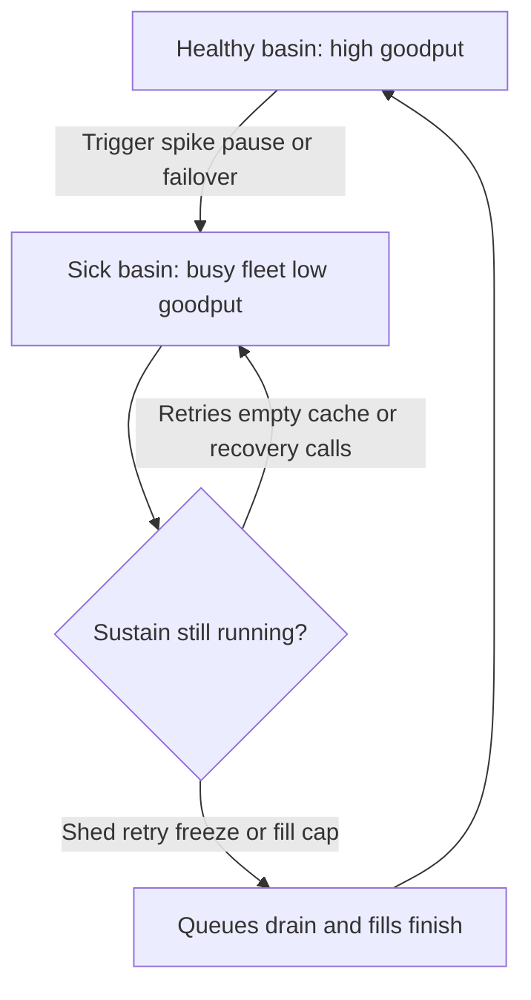

A service can sit in a bad operating point that does not heal when the spike that created it is gone. CPU stays high, sockets stay busy, and the request counter looks like demand. Useful completions do not come back. That stuck state is a metastable failure: a second equilibrium, locally stable, fed by the overhead of being slow. Extra replicas join the overhead. Waiting for arrivals to fall does not leave it, because arrivals may already be back to the rate the fleet used to serve.

## Concept

Ordinary overload is a queue that drains once offered load drops under the service rate. Metastability is a fold in that relationship. The same user arrival rate supports two outcomes. In one, almost every request finishes inside the deadline and the caches, pools, and membership protocols stay quiet. In the other, the fleet spends its cores on work that will be thrown away, and the quiet protocols are no longer quiet. You sized the first outcome. The incident is the second.

### Goodput collapse

Goodput is the rate of work a user would accept as done. Throughput, QPS, and CPU count attempts, including attempts that exist only because an earlier attempt failed or timed out. During a collapse those counters can all rise while goodput falls toward zero. The fleet is employed. The SLO is not.

The mechanism is residency. Latency up means more calls in flight. Each in-flight call holds a thread, a connection, a lock, or a buffer. Those holdings reduce the service rate for everyone else, which raises latency again. Clients time out and try again. The retry is both a new arrival and a repeat of a user who is still waiting. Offered load becomes user arrivals times how many times each user is attempted, plus the internal work the slowdown created: cache fills, health checks, reconnects, membership, schema loads. When that overhead is a large fraction of capacity, a new machine is hired into the overhead. Goodput per replica stays down, and the autoscaler, watching CPU or request rate, hires more.

I file a drop in goodput at flat or falling user arrivals as its own incident class. The first question is which loop is turning capacity into waste, not which box to add.

### Trigger and sustain are different objects

Every collapse I have sat in has a trigger and a sustaining loop, and they are rarely the same thing. The trigger is temporary. A launch, a failover, a garbage-collection pause, a cold cache after a restart, a blip that made one dependency look dead. If the system returns to the healthy point when the trigger ends, you had ordinary overload. The incidents that last for hours are the ones whose feedback remains after the trigger is over.

The sustain is that remaining feedback. I look for it in a short list.

- Retries from clients, meshes, and interior hops, replaying work the user has already abandoned.
- A cache that cannot hold a key, because fills time out and the next reader misses again.
- A queue of work that completes after the caller has timed out, so the server did the work and the client will send it again.
- Recovery protocols — election, catch-up, connection setup, shard-map rebuild — that are noise on a healthy day and the whole workload on a bad one.
- Runtime self-interference: collection, eviction, lock convoys, or thread-pool growth that gets worse as latency gets worse.

Put trigger and sustain on the timeline as two lines. Removing only the trigger leaves the loop. Adding replicas while the loop is on feeds it.

### Two attractors at one arrival rate

Walk a concrete service. Healthy, it completes about 25,000 useful reads per second. The lookaside cache hits on roughly 98 percent of keys. The database sees a thin miss stream and answers in a few milliseconds. A short restart of the cache tier drops the hit rate. Misses stampede the database. Database latency crosses the application timeout. The application retries. Fills themselves time out, so a key that was successfully loaded is already stale to the next reader, or never landed. User arrivals return to 25,000 per second. Goodput does not. Hit rate stays low. Retry multiplicity stays high.

Both states are locally stable. In the healthy one, a single miss fills and the next reader hits. In the sick one, a successful fill is a drop in a miss stream, and the next reader still misses. Traffic will not walk the system from the second state to the first. The path between them is a policy change: shed so fills can finish, freeze retries so the database sees one attempt per user, cap fills so the miss stream is bounded, or pull a shard aside, warm it, and put it back. User arrivals may already be normal. The work inside the building is not.

### Recovery changes the feedback

The recovery action has to break the sustain. More replicas help when the new replicas do user work. They deepen the outage when they join the retry or the membership storm. Longer timeouts help when the extra wait completes user work. They deepen the outage when they hold workers on calls whose callers have left. Retrying harder is how the sick state gets deeper.

The moves that change equilibrium are blunt on purpose. Shed until goodput rises. Freeze retries until queues drain. Let one cohort of nodes rejoin at a time. Cap cache fills. Serve a bounded stale value so the database is not on the critical path of every read. Restart a process only after the thing that would recreate the sick state has been stopped. A restart into a live retry storm is another trigger.

Instrument the class before you need the runbook. Goodput beside QPS. Retry rate as a fraction of user requests. Cache hit rate. Queue time against the client timeout. A counter for internal recovery calls. When those series move together, you are in the second equilibrium, and the dashboard that only shows CPU will send you to scale a fleet that is fully busy and producing nothing.

## Trade-offs

| Approach | When it wins | Cost / risk |
| -------- | ------------ | ----------- |
| Admission control aimed at goodput | The sick state is retry, queue, or cache-fill work | Some users get a fast failure while spare CPU looks idle |
| A retry budget of zero during recovery | The sustain is retry amplification | Brief blips become user-visible; interior hops must not invent their own retries |
| Fill caps and bounded stale reads | A lookaside cache that emptied under load | Stale data; a cap that is too tight never warms the cache |
| Overprovision past the known trigger | A cheap, known ceiling on user arrivals | Cost, and useless if the sustain grows with the cluster |
| Warm a shard away from the storm | The working set must be rebuilt before it can serve | A restart that leaves the sustain in place recreates the sick state |
| Waiting for load to fall | True overload with no sustaining loop | In a metastable failure the wait does not end |

Protecting goodput spends a little availability in the moment. That spend is the way out. A failure that returns in a millisecond and holds no worker is how you leave the bad attractor. A success that takes several seconds and is then retried is how you stay in it.

Static overprovision is an honest answer to triggers an autoscaler cannot hide, such as a full restart or a zone loss. It does not replace breaking the sustain. A cluster at twice steady-state load still collapses if every client retries many times into an empty cache. The shed, the retry freeze, and the fill cap need to be runtime controls with an owner and a chart. A change that requires a deploy will not ship while the system is sick.

## Diagram

The healthy basin and the sick basin share one arrival rate. The trigger is the shove. The sustain is the wall. Recovery is a door you open by changing policy.

## Failure modes

### Reading the collapse as a missing replica

**Detection.** User arrivals are at or below the pre-incident baseline. Replica count, CPU, and attempt rate are up. Success rate is poor. Goodput per replica is falling while the autoscaler is still adding pods.

**Mitigation.** Stop scaling as the first move. Split attempts into user requests, retries, and internal calls. If retries and internal calls dominate, shed, freeze retries, and cap fills. Add capacity only after a new replica would spend its time on user work.

### A cache that cannot refill

**Detection.** Hit rate falls and stays down. Database CPU and lock waits sit at the ceiling. Timeouts cluster on the fill path. Keys that were hot before the incident are still the miss stream.

**Mitigation.** Serve stale for a bounded window. Limit fills per key and across the fleet. Prefill the working set from a snapshot or from a replica that was kept out of the stampede. Disabling the cache leaves the database as the only equilibrium, and that equilibrium is the sick one.

### Recovery traffic becomes the workload

**Detection.** Membership, election, catch-up, or connection setup — a metric that is noise in steady state — is now most of the CPU, the packets, or the log volume. Nodes flap. Adding nodes makes the protocol hotter.

**Mitigation.** Gate joins so one cohort recovers at a time. Back off join attempts. Put recovery traffic on its own pool so user goodput can resume while the cluster reconstitutes.

### Work that finishes after the caller left

**Detection.** Traces show handlers completing after the client span has ended. Queue time plus service time exceeds the client timeout on a large fraction of requests. Client retries line up with those late completions.

**Mitigation.** Refuse at admission, before the queue, with a fast failure. Keep the queue short enough that the last admitted item can finish inside the deadline. Cancel server work when the deadline has already expired, so a late completion does not invite the next retry.

## Real-world example

The DynamoDB disruption in US-EAST-1 on 20 September 2015 is the public incident I still use when a team believes more capacity will unstick a collapse.

A small number of storage servers became unhealthy. That is a trigger the storage tier is built to absorb. The sustain lived on a different path. Servers rebuilding metadata about tables and partitions sent a burst of requests at an internal metadata service. On a normal day that path is quiet background work. Under the failure it was a flood. Customer clients saw errors and latency and retried, which kept the metadata service overloaded after the original storage servers were no longer the limit.

The metadata tier was busy. Almost none of that busyness was customer reads and writes completing. Extra capacity on the user-facing API would have left the storm in place. Restoration required isolating and recovering the metadata path so that ordinary customer work could finish again. When customer traffic later fell, part of the fall was applications giving up. Giving up is what clients do after enough errors. It is a poor recovery plan.

The review question I take from that day is which quiet paths can become loud: cache fills, membership, leader election, session setup, schema fetches, shard maps. Bound each of them. Give each a concurrency limit so it cannot consume the workers that still serve users. A dashboard of user QPS and CPU will send you to scale a fleet that is fully employed and delivering nothing a customer can use.

## What to remember

- A metastable failure is a second equilibrium: goodput stays collapsed after the trigger has ended.
- Name the sustain separately from the trigger. Recovery is the act of breaking the sustain.
- Capacity poured into retries, miss storms, or recovery calls feeds the sick state. A shed and a retry freeze are how you leave.
- Chart goodput, retry multiplicity, hit rate, and internal recovery traffic, or the outage will be filed as a missing machine.
